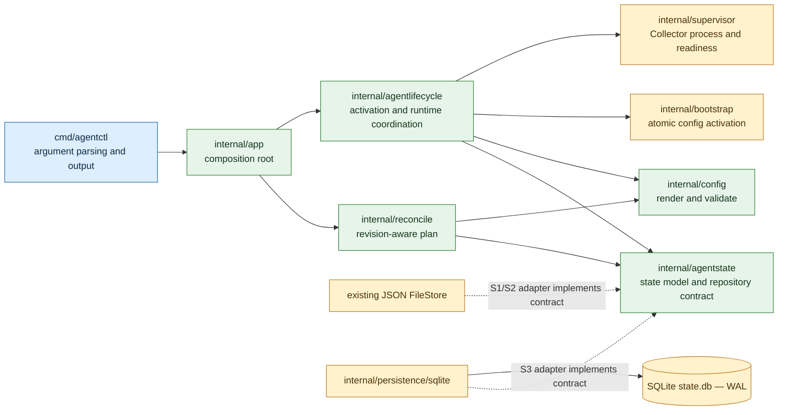

# M1 Implementation Design

Status: Draft for review
Scope: M1 only; design phase before implementation
Related ticket: [M1 Implementation Plan](m1-implementation-plan.md)
Target baseline: [Telemetry Agent Target Architecture v0.1.4](../../docs/architecture/target-architecture-v0.1.4.md)

## 1. Goal

Deliver the M1 capability through three runnable slices while preserving existing CLI behavior, Collector supervision, exporters, host telemetry, and safe dependency teardown. Establish only the seams needed for reconciliation and state recovery. Do not implement Core registration, broad discovery, or the full integration extension framework in M1.

## 2. Current code facts

- `cmd/agentctl/main.go` currently contains process startup, dependency wiring, command routing, bootstrap flow, Collector runtime flow, and status handling. It is 807 lines and exceeds the requested 450-line maximum for non-test source files.
- `cmd/agentctl/dependency_command.go` contains dependency command parsing and handlers. It is 557 lines and also exceeds the limit.
- `internal/agentstate` owns the state model and a JSON `FileStore`; writes use an OS lock and atomic file replacement. State includes desired, activated, and applied generations, managed dependencies, ownership, and pending teardown.
- `internal/agentlifecycle` currently coordinates config activation, Collector restart/readiness, generation updates, health reporting, and teardown sequencing. It directly depends on `agentstate.FileStore`.
- `internal/config` already merges config layers and validates/renders Collector YAML. `internal/bootstrap` installs/validates the pinned Collector; `internal/supervisor` owns child-process lifecycle and readiness.
- Current `go.mod` has no SQLite driver dependency.

These facts describe the migration starting point; they do not define the target package layout.

## 3. Proposed M1 design

Use incremental seams in the existing code and preserve its tested behavior as each slice lands. S1 separates CLI delivery from production composition and introduces only the repository/runtime interfaces required by S2. S2 adds a single reconciliation path over the existing persisted state. S3 swaps the persistence adapter to SQLite and adds recoverable activation records.

### Dependency direction



Arrows are compile-time dependencies. The composition root constructs concrete adapters. Reconciler and lifecycle code depend on consumer-owned interfaces, not concrete SQLite, CLI, filesystem, or process implementations. No runtime event bus is required for M1; a single reconcile request can be invoked directly and repeated safely.

### Suggested structure after M1

```text
cmd/agentctl/
  main.go                    # signal handling and exit code only
  command.go                 # root command parsing and dispatch
  bootstrap_command.go       # bootstrap CLI adapter
  collector_command.go       # run/stop lifecycle CLI adapter
  dependency_command.go      # dependency CLI adapter, split by operation
  status_command.go          # status and diagnostics CLI adapter

internal/app/
  agent.go                   # production composition and lifecycle entry
  dependencies.go            # concrete adapter wiring

internal/reconcile/
  controller.go              # one-shot idempotent reconcile operation
  plan.go                    # immutable plan and digest
  inputs.go                  # revisioned desired/applied snapshot types

internal/agentstate/
  state.go                   # state model and transition invariants
  repository.go              # repository contract consumed by lifecycle code
  store.go                   # existing JSON adapter during S1/S2
  ...                        # platform lock/path files retained as needed

internal/agentlifecycle/
  configuration.go           # activation request and state transition
  collector_configuration.go # compiler/validator adapter
  runtime.go                 # Collector run/readiness/apply loop
  teardown.go                # ownership-safe deferred cleanup

internal/persistence/sqlite/
  open.go                    # database setup, WAL and connection lifecycle
  migrate.go                 # schema migration and legacy JSON import
  state_repository.go        # SQLite implementation of state repository
  activation_repository.go   # activation journal and LKG metadata
```

Names and file allocation are proposed. Keep each non-test source file below 450 lines. Split only at cohesive responsibilities; do not create one-file wrappers or refactor unrelated files merely to reduce line counts. `main.go` should be far below the limit. The current 807-line entrypoint and 557-line dependency command are split by responsibility in S1, with command behavior unchanged.

## 4. Slice design

### S1 — Architecture Foundation & Boundaries

1. Extract CLI command adapters from the oversized entrypoint and dependency command file. Keep the CLI package and public command syntax stable.
2. Add `internal/app` as the production composition root. It wires the existing `bootstrap`, `agentlifecycle`, `agentstate`, `config`, `dependency`, `identity`, and `supervisor` implementations.
3. Add a narrow state repository interface around the currently used `Load`, `Save`, and atomic `Update` behavior. Keep `FileStore` as its initial implementation so this slice does not mix architectural extraction with a storage migration.
4. Keep `agentlifecycle` as the existing lifecycle implementation for now. Do not rename it or split every target context into packages before a runnable reconciler exists.
5. Add a package dependency check or equivalent static review ensuring there is no import cycle and no inward package imports `cmd/agentctl` or a future SQLite implementation.

**S1 acceptance evidence:** Existing CLI commands, bootstrap, Collector start/stop, and host metrics retain behavior; composition is outside CLI command logic; all changed non-test Go files are under 450 lines; package dependency graph is acyclic.

### S2 — Reconciliation & Configuration Activation

1. Add a one-shot `reconcile.Controller` that reads a consistent state snapshot and produces an immutable plan with source revision and deterministic digest.
2. Treat current dependency enablement and Collector receiver layers as the initial desired input. Do not add inventory or automatic discovery in M1.
3. Route configuration changes through reconciliation and the existing config renderer/validator and activation path.
4. Make repeated reconcile a no-op when the rendered configuration digest matches the active/applied digest; do not restart the Collector for unchanged configuration.
5. Check the plan's input revision immediately before activation. If state advanced, reject the stale plan and request a fresh reconcile.
6. Keep the active config untouched when rendering or validation fails. Preserve the current deferred teardown rule: host resources are removed only after the Collector is ready with the generation that no longer references them.

**S2 acceptance evidence:** Changed config is activated through reconciliation; identical config does not restart; stale plans do not overwrite newer intent; invalid config leaves the current active config intact; existing enable/disable/uninstall order is preserved.

### S3 — SQLite Persistence & Restart Recovery

1. Add one SQLite database at the platform state location with WAL enabled and schema migrations.
2. Implement the repository contract using short transactions. Keep the JSON file store available only as a legacy importer after cutover; do not run two stores as concurrent authorities.
3. Import existing JSON state transactionally and idempotently, preserving Collector context, generation counters, dependency enablement, ownership records, and pending teardowns. Preserve a backup of the source file through a successful upgrade.
4. Persist activation attempts, candidate digest/artifact reference, committed revision, failure outcome, and Last-Known-Good reference.
5. On restart, recover from the last committed revision. A failed/incomplete candidate must not be treated as applied; revalidate and activate the last committed configuration before reporting recovery complete.
6. Keep configuration artifacts on disk as immutable, digest-addressed files; store their digest/path and lifecycle metadata in SQLite. Promote the active configuration atomically only after validation. This avoids storing secrets or large YAML blobs in the database.

**S3 acceptance evidence:** Migration preserves ownership and pending teardown; migration can safely rerun after interruption; an Agent restart restores Collector config and host telemetry; a failed activation cannot replace or erase the committed Last-Known-Good artifact.

## 5. State transition and failure rules

```text
desired revision N
  → compile plan for N with digest D
  → validate candidate D
  → recheck N is still current
  → record activation attempt
  → atomically promote candidate and run Collector
  → verify policy-defined readiness
  → commit applied revision N and Last-Known-Good D
```

- If desired state changes before activation, reject the stale plan and reconcile again.
- If compile or validation fails, keep the current active artifact and record the failed candidate.
- If Collector startup/readiness fails, restore the prior committed artifact and report activation failure; do not mark the candidate applied.
- If the process crashes during activation, use the activation journal and committed artifact reference to recover deterministically on the next start.
- A successful Collector health endpoint is the existing minimum readiness signal for M1. Gateway receipt verification and health-triggered rollback remain out of M1 scope unless the accepted target decision is changed.
- No automatic retry loop should busy-spin on a failed revision. A later explicit state change or bounded retry policy can request another attempt.

## 6. SQLite driver decision — open

`go.mod` currently has no SQLite driver. The driver must support Windows and Linux service builds and fit the repository's release/cross-compilation model.

- **Pure-Go driver:** avoids a C toolchain and simplifies cross-compilation; adds a dependency whose performance and compatibility should be checked against the required workload.
- **CGO SQLite driver:** uses the system SQLite implementation and has established usage, but requires C toolchains/libraries in supported build and release environments.

No driver is selected in this draft. Choose one before S3 implementation and verify reproducible Windows/Linux builds, WAL behavior, migration behavior, and licensing.

## 7. Explicitly out of scope for M1

- Core registration, authentication, or desired-state synchronization.
- General discovery provider framework or automatic integration activation.
- Redis/PostgreSQL/MongoDB integration implementations.
- Full extension SDK, arbitrary plugin loading, or runtime Collector factory loading.
- Agent-owned telemetry spool or replacement of Collector retry/queue.
- Automatic health-triggered rollback. M1 recovery is based on activation records and last committed configuration, not health causality policy.
- Cross-process distributed reconciliation; one local activation writer is sufficient for M1, with stale revision checks protecting concurrent CLI updates.

## 8. Risks and review questions

| Risk / question | Design response or required decision |
|---|---|
| Current CLI functions and tests share `package main` | Split files first without changing package or behavior; move production wiring only where that makes the seam cleaner. Preserve test helpers or relocate tests with the moved code. |
| Current lifecycle requires concrete `FileStore` | Introduce the narrow repository interface before S2; avoid redesigning state transitions in S1. |
| JSON state migration loses teardown safety | Transactional, idempotent import; preserve ownership and pending teardown; validate before switching to SQLite. |
| File activation and DB commit are not one atomic operation | Use immutable artifacts and an activation journal; define recovery for each crash point and test it before claiming atomic recovery. |
| Windows/Linux SQLite build/runtime differences | Driver remains open until build pipeline, packaging, WAL, and service account behavior are verified. |
| 450-line cap encourages arbitrary fragmentation | Treat 450 as a hard ceiling, not a target. Files remain grouped by cohesive responsibility and module interface. |

## 9. Review checklist

- Does incremental migration match the requested solo-development pace and S1 → S2 → S3 ordering?
- Is using JSON only as a temporary S1/S2 adapter acceptable, with SQLite authoritative after S3 cutover?
- Is a digest-addressed configuration artifact plus SQLite activation journal acceptable for Last-Known-Good recovery?
- Which SQLite driver should S3 evaluate/select for Windows/Linux packaging?
- Are the 450-line maximum and the listed M1 non-goals captured correctly?
