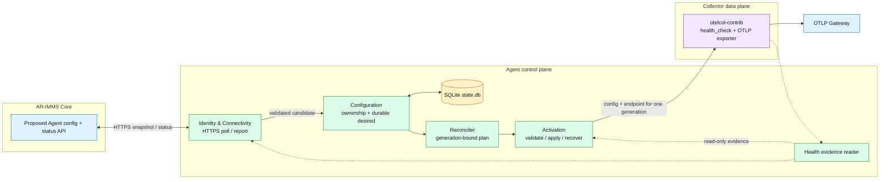
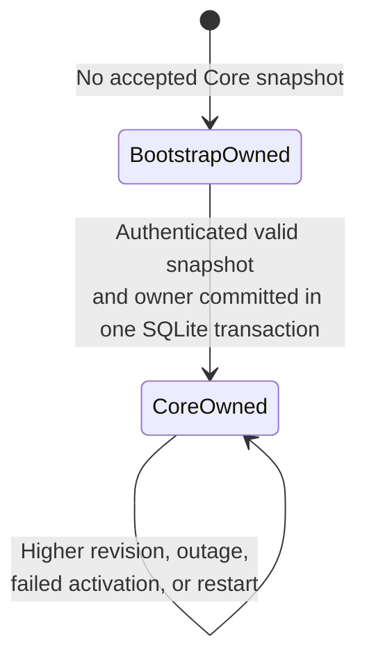

# M2 Core Gateway Endpoint Sync — Architecture and API Design

Status: **Architecture accepted with clarifications**, 28 October 2026. Proposed Core API details still require Core review. Design only; no Agent or Core API implementation is implied.

This slice synchronizes one Core-owned setting: the OTLP Gateway endpoint. It follows Target Architecture v0.1.4 and builds on the existing [local installation identity](../architecture/m2-local-installation-identity-design.md) and [configuration lifecycle](../architecture/desired-state-configuration-lifecycle.md). Labels below distinguish current code, approved policy, proposals, and open items.

## 1. Scope and decisions

| Classification | Decision or constraint |
|---|---|
| **Approved Decision** | Agent polls Core over HTTPS for a complete desired snapshot. Revisions increase monotonically per Agent; a Core rollback uses a new revision. SSE may wake a future poll but carries no configuration changes in M2. |
| **Approved Decision** | Bootstrap owns the Gateway endpoint until the first authenticated, valid snapshot and Core ownership are committed together in SQLite. Registration alone does not switch ownership. Core remains authoritative afterward, including during outages and failed activation. |
| **Approved Decision** | Desired, activated, and applied revisions remain distinct. M2 activation requires Collector readiness through a verified health endpoint; Gateway delivery is a separate health concern. |
| **Approved Decision** | Core must authorize the Agent credential against its installation/registration binding on every request. Installation ID alone grants no access; revoked bindings are rejected. |
| **Approved Decision** | Readiness for a new generation must come from its Collector child. A stale health listener or previous Collector process cannot satisfy it. |
| **Approved Decision** | `core_api_url` and `otlp_gateway_endpoint` are separate. Core does not manage dependency enablement, integrations, Gateway credentials, or local Collector paths in this slice. |
| **Verified Existing Behavior** | `agentstate.State` stores Bootstrap's `Collector.GatewayEndpoint` and local desired/activated/applied generations. The Collector config reads `${env:OTEL_GATEWAY_ENDPOINT}`; `supervisor.Run` supplies that environment value from options captured when runtime starts. `runtimeWatcher` does not currently reload the endpoint per launch. |
| **Verified Existing Behavior** | The base config enables `health_check` at `127.0.0.1:13133`. The supervisor requires HTTP 200 within a bounded startup window. Last-known-good recovery currently saves YAML, not the endpoint. |

**Goal:** A managed Agent can accept a newer Core Gateway endpoint, activate the matching Collector process, report the outcome, and retain a usable last-known-good endpoint/configuration pair across failures and restarts.

**Non-goals:** Registration and credential issuance, new integration/dependency management, incremental event replay, Gateway delivery verification, automatic rollback because of Gateway export failures, and a general configuration ownership framework. Real authenticated polling depends on the later registration/credential capability.

## 2. System architecture



Core publishes desired intent and acknowledges reports. The Agent owns local acceptance, reconciliation, activation, and runtime evidence. Collector owns collection/export; its Gateway connection is independent of Core API connectivity. `core_api_url` is locally provisioned and never sourced from the Gateway endpoint or Core's desired snapshot.

## 3. Component boundaries

| Context | **Proposed Design** responsibility and inward contract | Must not do |
|---|---|---|
| Lifecycle Host | Compose the poller, repository, status reporter, and existing runtime lifecycle; start/stop bounded workers. | Decide ownership, parse Core policy, or render a special Core pipeline. |
| Identity & Connectivity | Read installation ID and future registration credential through narrow ports; poll a snapshot; deliver a durable latest-status report. HTTP adapter implements a `SnapshotSource` and `StatusSink`. | Write Collector files or alter applied state. |
| Configuration | Validate the one-field snapshot; compare revisions; atomically store the accepted snapshot and owner transition, advancing the local target generation only if the effective runtime input changes; resolve effective endpoint. Repository owns SQLite transactions. | Call Core or infer health from transport errors. |
| Reconciliation | Read immutable desired/applied snapshots and produce one plan bound to the local generation and Core revision. A matching applied config/endpoint is a no-op. | Perform network or process I/O. |
| Activation / Runtime Control | Reuse the lifecycle lock and config validation/recovery path; bind a Collector launch to the exact config bytes **and endpoint** for its generation; require `health_check` readiness before committing applied state. | Treat Collector readiness as Gateway delivery evidence. |
| Health & Diagnostics | Publish Collector/readiness and sync evidence with revision correlation; expose a read-only snapshot to reporting. | Change desired state or command rollback. |
| Infrastructure | Extend the existing WAL database with context-owned repositories and a bounded status outbox; provide HTTPS/credential adapters. | Own configuration precedence or revision policy. |

The contracts above are logical seams, **not approved Go APIs or a package-per-box requirement**. Configuration owns the desired-state write port; connectivity depends on it. The runtime reads a generation-bound plan through a narrow port. Events may wake reconciliation, while SQLite remains authoritative.

## 4. Proposed Core API contract

**Status: Proposed Design.** The Core repository has no Agent configuration/status OpenAPI path or implementation. Its `api/baseline.yaml` establishes REST/JSON under `/api/v1`, a `{data, meta}` success envelope, and `application/problem+json` errors. The exact Agent module owner, routes, and credential scheme require Core review.

| Method and proposed path | Purpose | Successful response |
|---|---|---|
| `GET /api/v1/agent-installations/{installation_id}/desired-configuration` | Authenticated complete snapshot; optional `If-None-Match` with the last **accepted** revision. | `200` full snapshot plus `ETag`; `304` only when that accepted revision remains current. |
| `PUT /api/v1/agent-installations/{installation_id}/status` | Replace the latest observed status idempotently using `report_sequence`. | `200` with acknowledged sequence. |

Example `200` snapshot (the endpoint uses the current Collector exporter format, `host:port`, not a Core HTTPS URL):

```http
HTTP/1.1 200 OK
ETag: "42"
Content-Type: application/json

{"data":{"installation_id":"11111111-2222-4333-8444-555555555555","revision":42,"otlp_gateway_endpoint":"gateway.internal:4317"},"meta":{"request_id":"req_example"}}
```

Example latest-status report and acknowledgment:

```http
PUT /api/v1/agent-installations/11111111-2222-4333-8444-555555555555/status
Content-Type: application/json

{"report_sequence":17,"accepted_revision":42,"activated_revision":41,"applied_revision":41,"collector_state":"ready","health":"degraded","reason_code":"CONFIG_ACTIVATION_FAILED"}
```

```json
{"data":{"acknowledged_report_sequence":17},"meta":{"request_id":"req_example"}}
```

| Contract rule | **Proposed Design** behavior |
|---|---|
| Authentication | HTTPS plus an Agent credential authorized by Core against the path's installation/registration binding **on every request**. An installation ID alone is never proof of authorization; a revoked binding is rejected. Credential issuance and mechanism are **open**; human IAM tokens and unauthenticated fallback are not assumed. Until a valid binding/session exists, polling and reporting do not start and Bootstrap ownership remains. |
| Snapshot schema | One required positive integer revision and one required Gateway `host:port`; reject empty/malformed fields and unsupported configuration fields before persistence. Core must scope revisions to the installation ID and never reuse one revision for different content. |
| Revision comparison | `>` accepted after validation; `=` with identical content is a no-op; `=` with different content is a protocol conflict; `<` is stale and rejected. A Core rollback publishes old desired values at a **new higher** revision. A first or later higher revision whose effective endpoint already matches the applied configuration needs no restart; its Core revision is marked satisfied only while the matching Collector is verified ready. |
| Conditional GET | Send `If-None-Match` only for a durably accepted revision. `304` with no accepted snapshot is a protocol error. `304` does not change ownership or trigger activation. The body revision remains the authority; the ETag is a transfer optimization. |
| Status report | One coalesced, durable latest-status slot in SQLite retains the newest report until Core acknowledges its sequence. Repeating an identical sequence is idempotent; acknowledgment removes only that sequence, preserving a newer pending report. This is not an event stream, audit log, or general delivery system. |
| Error handling | `401/403`: surface binding/auth failure and stop authenticated calls until credentials recover; `404`: surface missing installation binding; `429`, `5xx`, timeout, or network failure: bounded backoff and retain local state/outbox. Use Core's Problem Details envelope for non-2xx responses; no error response changes desired state. |

Core must define the Agent OpenAPI source under its own `api/v1/` during implementation. The example routes and payloads above are review proposals, not existing contracts.

**Core revision to local generation mapping — Proposed Design:** Core revisions describe only the Core-owned Gateway endpoint. Local generations still describe complete Agent Collector configuration, including local dependency changes. Persist the association for accepted, activated, and applied Core revisions; never infer one from equality of generation numbers.

| Core state | Local association and advancement rule |
|---|---|
| Accepted revision `R` | Durable snapshot `R` records its endpoint and the current target local generation `G`. Increment local desired generation only when the **effective** endpoint changes; acceptance and Core ownership can advance while `G` stays unchanged. |
| Activated revision `R` | Attribute `R` to the generation whose promoted config **and endpoint** match the Core snapshot. Until promotion, retain the previous activated Core revision. A newer `R` with identical active inputs can reuse that local generation without a new Collector launch. |
| Applied revision `R` | Attribute `R` to the local generation of the live Collector that passed generation-bound readiness with the matching endpoint. An unchanged higher `R` can advance this mapping without restart only after checking that same child remains ready; otherwise it remains pending. |

For example, with a ready Collector at local `G5` using endpoint A, first Core `R10` = A maps accepted/activated/applied `R10` to `G5` without restart. `R11` = B creates desired `G6`; activated/applied stay at `R10@G5` until B is promoted and its child becomes ready. `R12` = B creates no new generation and may map to the already-ready `G6` without restart. If B is not ready, `R12` remains accepted while applied stays at the last ready revision. Local dependency generations may advance independently and do not make a Core Gateway revision applied.

Core revision numbers and local generation numbers are never compared to each other. An applied Core revision requires a matching endpoint on the ready, identified Collector child; an accepted Core revision does not imply activation or application. After a failed candidate, activated mapping returns to the prior good pair while accepted Core revision stays current.

## 5. Lifecycle



The presence of a committed Core snapshot is the Gateway ownership marker; no independent mutable switch is needed. `Collector.GatewayEndpoint` remains the Bootstrap seed, not the effective value after transition. Bootstrap reruns may update that seed but cannot replace the committed Core snapshot or active Core-owned endpoint.

```mermaid
sequenceDiagram
    participant C as Core
    participant P as Connectivity
    participant D as SQLite / Configuration
    participant R as Reconciler
    participant A as Activation
    participant O as Collector
    P->>C: HTTPS GET snapshot (Agent credential)
    C-->>P: 200 revision N, Gateway endpoint
    P->>D: Validate identity, schema, endpoint, revision
    D->>D: Atomic commit: snapshot + Core ownership + generation if runtime input changed
    D-->>R: Advisory reconcile wake-up
    R->>D: Read desired, activated, applied snapshots
    R->>A: Immutable plan (local generation, Core revision N)
    A->>A: Stage/validate config and endpoint; journal prior good pair
    A->>O: Start/restart with exact config + OTEL_GATEWAY_ENDPOINT
    O-->>A: This generation's child alive + health_check HTTP 200 within timeout
    A->>D: Commit applied generation, Core revision, endpoint + good pair
    D-->>P: Durable status report queued
    P->>C: PUT latest status
    C-->>P: Acknowledged report_sequence
```

```mermaid
sequenceDiagram
    participant C as Core
    participant P as Connectivity
    participant D as SQLite / Configuration
    participant A as Activation
    participant O as Collector
    alt Core outage or 304 unchanged
        P->>C: Poll
        Note over P,C: Poll times out or returns 304
        D-->>O: Continue good pair; reconcile any accepted pending desired state locally
    else Invalid, stale, or conflicting snapshot
        C-->>P: 200 candidate
        P-->>D: Reject before mutation; record diagnostic
        D-->>O: Continue current runtime
    else New candidate fails validation/readiness
        C-->>P: 200 revision N+1
        P->>D: Commit desired N+1; Core remains owner
        D->>A: Reconcile candidate N+1
        A->>O: Attempt generation-bound launch
        O-->>A: No readiness before timeout or process failure
        A->>D: Record failed revision; restore prior good config + endpoint
        D-->>P: Queue failure status (desired N+1, applied N)
    end
    Note over D,O: On Agent restart, recover pending journal first, then launch the durable good pair and resume polling.
```

**Activation boundary:** existing code promotes a YAML artifact and later starts the Collector. This slice must also snapshot the endpoint under the same lifecycle lock, reload it for each generation-bound launch, and include it in recovery. A changed effective endpoint advances the local desired generation even when YAML bytes are identical. Before a new launch, wait for the previous child to exit and reject an already-serving health listener; then require HTTP 200 from the configured `health_check` endpoint while the new child remains alive. The readiness result is bound to the launched generation, config bytes, and endpoint; recheck that binding before the applied commit. Successful readiness commits only that generation/revision pair; a newer desired revision cannot be marked applied by an older launch. A failed revision remains desired but is recorded as failed to prevent a busy loop. Core must send a new revision to request an intentional rollback; local recovery of the running pair does not transfer ownership back to Bootstrap.

## 6. Persistence and transaction boundaries

| Durable data in the existing `state.db` | **Proposed Design** minimum content |
|---|---|
| Existing `agent_state` | Preserve Collector context, dependency ownership, pending teardown, and desired/activated/applied local generations. Keep its Bootstrap Gateway endpoint as the seed. |
| Core Gateway snapshot | Singleton per installation: accepted Core revision, endpoint, content fingerprint, acceptance time, and target local generation. Migration creates the table **without an owner row**; only a committed, validated snapshot creates that row and Core ownership. Equal endpoint revisions can share a target generation. |
| Activation/recovery metadata | Activated and applied Core revision **with their associated local generations**; candidate local/Core revision and endpoint; prior good endpoint and config artifact identity; pending/failed outcome. Extend the existing activation journal and recovery path rather than creating another runtime controller. |
| Status outbox | One coalesced latest report payload and monotonically increasing local report sequence; retain until acknowledged. No credentials, authorization headers, general event queue, or event replay. |
| Connectivity settings | Locally provisioned `core_api_url` and a reference to a future protected Agent credential. Keep both outside Core-owned desired fields; do not put credential material in SQLite. |

**Short transactions:** (1) validate a fetched snapshot outside SQLite, then atomically compare revision, insert/update the Core snapshot, establish owner, and advance local desired generation only if the effective endpoint changes; (2) persist activation intent before filesystem/process I/O; (3) after readiness, commit the exact applied generation/revision/endpoint and good-pair metadata; (4) enqueue/ack status only by sequence. The existing OS lifecycle lock serializes config promotion, capture of the generation-bound launch pair, and paired recovery; SQLite transactions do not span network or process I/O. Keep the prior good artifact until the new applied-state commit is durable so an interrupted filesystem/SQLite transition can be recovered deterministically.

An additive migration must preserve M1 JSON payloads, local generations, dependency ownership, teardown state, and the M2 installation UUID. If persistence fails before the first snapshot commit, Bootstrap remains owner. If it fails after a candidate was accepted, startup uses the durable last-known-good pair and recovers any pending activation journal before retrying reconciliation.

## 7. Failures and invariants

| Case | Required behavior |
|---|---|
| Same accepted revision/content; unchanged endpoint | No new generation or restart. Re-send a pending status report if needed. A first or higher Core revision with an already applied endpoint advances the Core revision mapping, not the local generation, once the matching child is verified ready. |
| Revoked registration or credential/installation mismatch | Core rejects the request; Agent keeps its durable desired/last-good state and reports an authorization diagnostic locally. No identity-only access or insecure fallback. |
| Pre-existing listener or previous Collector replies 200 during a candidate launch | Refuse readiness for the candidate; do not advance its applied Core revision or local generation. |
| Lower revision or same revision/different content | Reject without changing desired, owner, or runtime; record a scoped contract diagnostic. |
| Invalid snapshot or SQLite commit failure on first sync | No ownership transition; Bootstrap endpoint and current Collector continue. |
| Core outage after transition | Keep last accepted Core desired and last-known-good active pair; retry boundedly. Never reapply Bootstrap defaults. |
| Candidate render/start/readiness failure | Restore prior good config **and endpoint**, keep Core desired revision, record failure and report desired versus applied revisions. No repeated tight-loop activation. |
| Crash between config promotion, Collector launch, and applied commit | Recover from the durable intent under the lifecycle lock. Do not mark a revision applied unless its exact config and endpoint passed readiness. |
| Core sends rollback | Accept only a higher revision; reconcile to the old endpoint value. Skip restart only if the already-running pair is verified to match and be ready. |
| Reporting fails | Collector and desired state are unaffected; retain the latest bounded report for retry. Never infer Gateway delivery health from Core status success. |

## 8. Acceptance criteria

1. On an unregistered or not-yet-synced Agent, Bootstrap endpoint remains effective and the Agent collects offline; registration alone does not switch ownership.
2. A first authenticated valid snapshot commits endpoint, revision, and ownership atomically; invalid content or persistence failure leaves Bootstrap active.
3. A higher revision changes the Gateway endpoint through validation, generation-bound Collector restart, verified `health_check` readiness, and applied-state commit. The Collector child receives the new environment value.
4. Equal unchanged, stale, and equal conflicting revisions have the behavior in section 7. A higher revision with the same effective endpoint advances Core revision mapping without a new local generation or restart only when the matching child remains ready. Core rollback requires a higher revision.
5. A failed candidate or restart during activation restores the last-known-good YAML/endpoint pair while retaining Core desired ownership and reporting the failed revision.
6. Core offline before and after Agent restart leaves telemetry collection running from durable local state; polling and status delivery resume after reconnect.
7. Existing dependency CLI changes and ownership/teardown records survive a Core snapshot, bootstrap rerun, rollback, and SQLite migration unchanged.
8. Core rejects a revoked registration and credentials bound to a different installation; Agent retains local operation without insecure fallback.
9. Native Windows/Linux tests and a pinned Collector smoke test verify that the `health_check` HTTP 200 follows startup of the **selected generation's child** with its config/endpoint; a stale listener or previous child never satisfies readiness. They do not claim Gateway delivery.

## 9. Unverified items and Core review

| **Unverified / Open Question** | Impact before implementation |
|---|---|
| Agent credential issuance, binding, revocation, and re-registration contract is not implemented or approved. | Core and Agent must approve a machine authentication contract before real polling/reporting. No unauthenticated mode is proposed. |
| Core Agent-management module/route ownership and the proposed GET/PUT schemas are not yet approved OpenAPI contracts. | Core review must settle paths, response/ack schemas, status retention semantics, and Problem Details codes before coding the HTTP adapter. |
| The current Collector exporter sets `tls.insecure: true`; the approved address/security policy for a Core-provided Gateway endpoint is undefined. | Decide allowed endpoint/network/TLS policy before accepting remote addresses in production. Gateway credentials remain deferred. |
| The Agent tests prove HTTP-200 polling with a fake server, and the pinned v0.160.0 extension documents 200/503 readiness behavior; no packaged-binary Windows/Linux smoke result was found. | Verify the exact pinned binary and config on both platforms before claiming the readiness gate is operationally proven. |

**Evidence:** Agent `internal/agentstate/{state,sqlite_store,activation}.go`, `internal/agentlifecycle/{configuration,runtime,rollback,activation_recovery}.go`, `internal/supervisor/{supervisor,readiness}.go`, `internal/bootstrap/config_recovery.go`, `configs/base/otel.yaml`, and their tests; Core `api/baseline.yaml`, `api/v1/*.yaml`, `AGENTS.md`; [pinned v0.160.0 health_check documentation](https://github.com/open-telemetry/opentelemetry-collector-contrib/blob/v0.160.0/extension/healthcheckextension/README.md). Core and Agent source were inspected on 28 October 2026.
