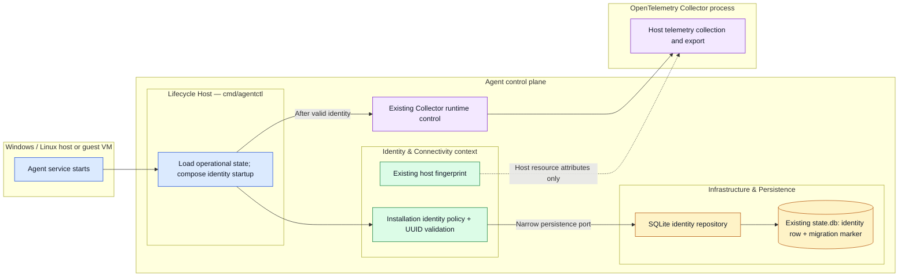
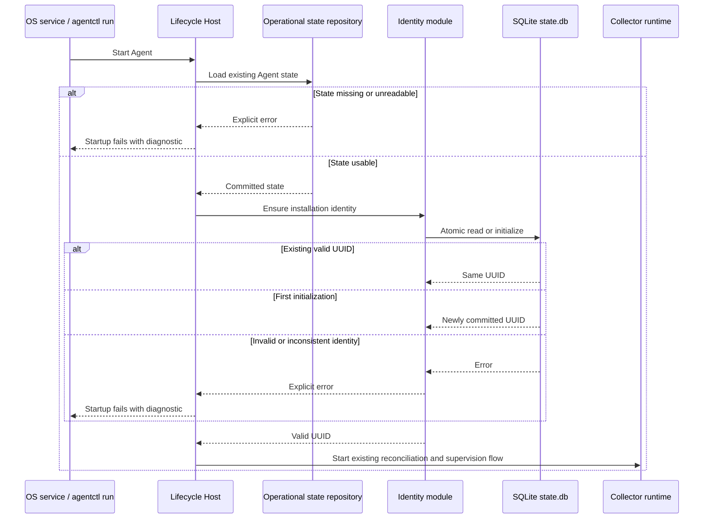
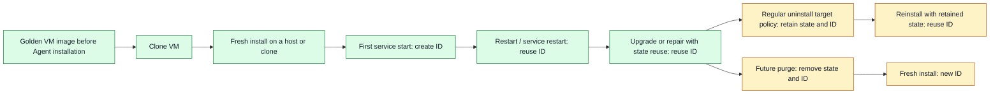

# M2 Local Installation Identity — Design

Status: Approved implementation design; UUID generation ownership clarified 28 October 2026.

This slice establishes a durable identity for one Telemetry Agent installation. It follows the accepted [Target Architecture v0.1.4](target-architecture-v0.1.4.md): Identity & Connectivity owns installation identity, operational state lives in one SQLite database, and the Lifecycle Host composes dependencies without owning identity policy. The [v0.1.4 roadmap](../roadmap/telemetry-agent-v0.1.4-milestones.md) places this work in M2.

## 1. Scope and approved policy

**Approved for this slice:**

- Generate a unique installation UUID on the first Agent startup when no identity has been initialized.
- Persist the UUID in the existing operational `state.db`. Preserve it through process and service restarts, upgrades, and repair installations that reuse that state.
- Keep the installation UUID separate from the host fingerprint. Host and guest VMs use the same Agent implementation and identity lifecycle.
- Fail explicitly if an initialized identity is invalid, missing, or unreadable. Never silently replace it.
- Prepare golden VM images before Agent installation. Install and start the Agent separately on each clone.
- Cover these behaviors with lifecycle tests on Windows and Linux paths.

**Approved policy for later lifecycle work:** Regular uninstall preserves persistent Agent state. A future `uninstall --purge` removes the identity and associated local state. Deleting local identity does not revoke a future Core registration. A new installation ID will represent a new installation to Core.

Registration, credentials, Core connectivity, clone detection, identity reset, offline image preparation, and changes to uninstall behavior are outside this implementation slice. The regular-uninstall policy above is **not met by current code**; section 8 records that gap.

## 2. Verified current implementation

| Concern | Verified current source | Design consequence |
|---|---|---|
| Host identity | `internal/identity/machine.go` hashes the OS machine ID to `HostID` for telemetry attributes. | Keep `HostID` unchanged; it does not identify an Agent installation. |
| Operational database | `internal/agentstate/sqlite_store.go` stores operational state in SQLite WAL. `sqlite_schema.go` defines `agent_state`, `activation_journal`, and schema version 1. | Add identity to this database without a second state file or Collector storage. |
| Packaged installation | `internal/agentinstallation/installer.go` persists Collector and ownership state, then installs and starts the OS service. | The first service start can initialize identity after usable state exists. |
| Runtime entrypoint | `cmd/agentctl/collector_command.go` composes the `run` path. `internal/agentlifecycle/runtime.go` loads state before supervising Collector. | Compose identity initialization before Collector runtime begins; keep it outside Collector supervision. |
| Installation removal | Linux and Windows removers delete the Agent-owned data directory last; it contains `state.db`. | Regular uninstall currently destroys identity. Meeting the approved retention policy needs a separate lifecycle change. |

These are source observations, not runtime proof. Existing SQLite and OS service behavior still require the platform checks in section 7.

## 3. Modules, structure, and dependency direction

| Module | Responsibility and interface | Depends on | Does not own |
|---|---|---|---|
| Identity policy | Validate an installation UUID; request its durable creation or retrieval through one narrow repository interface. Return the committed ID or an explicit error. | Persistence port; secure random UUID generation. | Host fingerprint calculation, Collector process control, Core registration. |
| SQLite identity adapter | Atomically initialize or read the singleton identity using the existing `state.db` transaction and WAL conventions. Distinguish uninitialized databases from damaged initialized state. | SQLite storage and migration metadata. | Identity rotation policy or Collector configuration. |
| Lifecycle Host | Load existing operational state, initialize/validate identity, then start the current runtime flow. | Identity module and existing runtime entrypoint. | UUID generation rules or SQL. |
| Installation/removal | Reuse the existing installation state path and ownership record. | Current install and OS removal adapters. | Identity creation or clone detection in this slice. |

This is a logical structure, not a requirement for one Go package per box. The likely code locations are `internal/identity` for the identity value and policy, `internal/agentstate` for its SQLite adapter and schema change, and `cmd/agentctl` for startup wiring. Exact Go declarations should stay small and follow the repository's existing composition conventions. No public telemetry or Core contract changes are proposed.

## 4. Durable state and initialization invariant

**Proposed storage:** a singleton `installation_identity` row in the existing SQLite database, separate from the serialized `agent_state` payload. Schema migration version 2 records that the table structure exists. Its transaction creates the table, seeds one uninitialized singleton row, and records version 2 atomically. The row separately records `initialized` and the canonical UUID; schema version and identity initialization are distinct states. This separation prevents routine desired-state updates or `RecordAgentInstallation` from overwriting identity.

The Identity module generates a UUID candidate through an injected cryptographic randomness source. The SQLite repository atomically initializes an uninitialized row and always returns the committed UUID. If two processes race, the loser reads and returns the winner's UUID. The adapter reuses SQLite's existing immediate transaction and busy-timeout behavior. The Agent must never derive or rotate this UUID from hostname, MAC address, VM UUID, host fingerprint, or binary version.

**UUID generation:** use UUIDv4 from cryptographically secure randomness supplied by the Lifecycle Host. No Core contract constrains identity format in this slice.

| Schema version 2 | Identity row state | Required behavior |
|---|---|---|
| Absent | No table | Apply version 2 by atomically creating the table, inserting its uninitialized singleton row, and recording the version. |
| Present | Uninitialized with null UUID | Identity supplies a candidate; repository stores it atomically and returns the committed UUID. |
| Present | Initialized with valid UUID | Return the existing committed UUID without changing runtime configuration. |
| Present | Missing row, invalid state, or malformed UUID | Return an explicit identity-state error; do not recreate or replace the identity. |
| Absent | Identity table already exists | Return an inconsistency error; do not infer initialization state. |
| Unreadable database or operational state | Any | Return the underlying error; do not create replacement state. |

The first startup path must verify that the existing operational state can be loaded before initializing identity. This prevents a bare `agentctl run` against a nonexistent or damaged `state.db` from creating an identity and then failing because Collector state is unavailable. For an older JSON installation, the existing import path completes before identity initialization.

## 5. Startup and lifecycle flows

Green nodes describe this slice or its supported provisioning flow. Amber nodes describe approved future uninstall/purge semantics; they are **not** current behavior and are **not** delivered by this slice.

## 6. Failure and compatibility rules

- Identity initialization is idempotent. Repeated starts and concurrent first starts return the same committed UUID.
- A UUID creation failure prevents Collector startup and reports the cause. It must not commit a partial marker or overwrite operational state.
- Missing or malformed initialized identity blocks startup. Recovery requires an explicit operator procedure in a later slice; silent replacement would split installation history.
- Initialization does not advance desired, activated, or applied configuration generations and does not restart Collector when the ID already exists.
- The host fingerprint and current OTel resource attributes remain as they are. This slice does not add the installation ID to telemetry attributes or local status responses.
- The database and schema must remain compatible with existing M1 state, including legacy JSON import. No second operational database or arbitrary plugin mechanism is introduced.
- Prepare a golden image before installing the Agent. Each clone receives its own ID during its own installation/start. Copying an initialized installation is unsupported in M2.

## 7. Acceptance and verification

| Scenario | Required observable result |
|---|---|
| Fresh installed Agent, first start | One UUID is committed before Collector runtime starts; existing host metrics still run. |
| Agent/service restart | Same UUID; no identity write that changes configuration generations. |
| Upgrade or repair using existing `state.db` | Same UUID and existing Collector/dependency ownership state. |
| Existing M1 SQLite or migrated JSON state | Identity is initialized once without losing current state or last-known-good configuration. |
| Two startup attempts against one database | One UUID wins and both successful attempts observe it. |
| Missing/malformed initialized row or unreadable SQLite | Startup fails with an explicit diagnostic; no new UUID is written. |
| Golden image cloned before Agent installation | Each clone's later installation/start has a distinct ID; behavior is identical for host and guest VM. |
| Windows/Linux runtime | Native platform checks confirm state path permissions and startup ordering. |

Verification should use focused identity and persistence tests, install/runtime tests with fake Collector control, and native Windows/Linux CI runs. An end-to-end Collector smoke check is needed before claiming that startup wiring preserves host telemetry. Compilation alone does not prove the runtime flow.

## 8. Known gap and deferred decision

The approved regular-uninstall policy conflicts with current `internal/agentinstallation` removers: both delete the Agent data directory containing `state.db`. Therefore the current CLI cannot yet preserve identity through regular uninstall/reinstall. Implementing `uninstall --purge`, changing removal ownership/teardown, and documenting recovery of retained state require a separate lifecycle design and acceptance tests. Until then, this slice can claim preservation across restart, service restart, upgrade, and repair with state reuse, but **not** across the current uninstall command.

There is no approved Core registration contract in this slice. The future Core binding must use the durable installation UUID, treat a new UUID as a new installation, and must not infer remote revocation from local deletion. Those rules do not require Core code now.

## 9. Implementation guardrails

- Preserve CLI behavior, Collector configuration, and existing reconciliation/activation contracts.
- Keep new exported Go identifiers documented and each non-test code file at or below 450 lines.
- Use one narrow identity persistence interface at the Identity/SQLite seam; do not create an integration SDK or generic identity framework.
- Keep UUID operations inside short SQLite transactions. Do not hold a transaction during Collector or OS service operations.
- Do not log secrets or raw OS machine IDs. The installation UUID is an identifier, not a credential.
