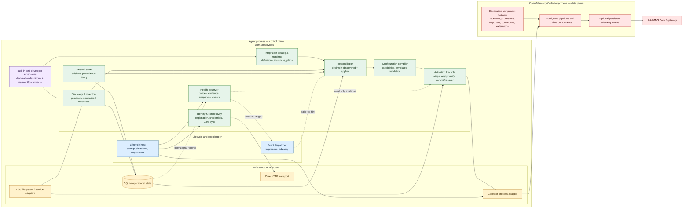

# Superseded: AR-IMMS Telemetry Agent Target Architecture

This earlier exploratory draft is superseded by the accepted [Target Architecture v0.1.4](target-architecture-v0.1.4.md). Use v0.1.4 as the authoritative target. This file is retained as historical design analysis; its repository gap analysis and migration notes have been reconciled into the accepted baseline.

## Status and scope

This is a target design, not a description of current behavior or an approved migration plan. It treats the supplied design brief as the product direction and examines the repository only in the later current-state section. Proposed names describe responsibility boundaries; they do not require one Go package per box.

## Design summary

Use a local reconciliation architecture with four durable state domains: desired configuration, discovered inventory, applied Collector revision, and health observations. A reconciliation controller reads immutable snapshots and produces a target plan; focused services compile and activate that plan. Extensions contribute discovery facts or integration intent through narrow contracts. They do not control the Collector process, mutate persistence directly, or depend on the central lifecycle.

Run the Agent and OpenTelemetry Collector as independently restartable processes. The Agent owns control-plane decisions and the Collector owns telemetry execution. The local Agent database is SQLite; Collector queues or persistent telemetry storage remain a separate concern.

## Target subsystem boundaries



The diagram shows dependency direction and ownership rather than mandated package structure. Infrastructure implements ports owned by domain services. The event dispatcher is in-process coordination only; durable state and revision checks remain authoritative.

## Responsibility and dependency matrix

| Boundary | Owns | Exposes | May depend on | Must not own |
|---|---|---|---|---|
| Lifecycle host | Process startup/shutdown, dependency construction, cancellation, process supervision | Start/stop hooks and subsystem health registration | Domain service interfaces, OS service adapter | Integration matching, policy decisions, configuration generation |
| Identity & connectivity | Installation identity, registration state, credential references, Core synchronization and outbound status | Identity snapshot, versioned desired-state sync, authenticated client | Persistence, secure credential adapter, Core HTTP port | Collector pipeline logic, local discovery implementation |
| Desired state | Baseline and synchronized revisions, precedence, validation policy, conflict metadata | Immutable desired snapshot and compare-and-swap update | Persistence, schema validation | Discovery side effects, runtime health decisions |
| Discovery & inventory | Provider scheduling, normalized resource inventory, source/provenance and freshness | Resource snapshots and provider capability contract | OS/API adapters, persistence | Integration-specific pipeline templates, Collector lifecycle |
| Integration catalog & matching | Definition registry, instance resolution, capability requirements, mapping rules | Candidate instances and desired component intents | Discovery snapshots, extension contracts | Collector process control, persistence internals |
| Reconciler | Diff desired intent, inventory, and applied snapshot; build idempotent plan | Revision-bound plan with operations and reasons | Read-only domain ports, compiler interface | Direct OS/process calls, health policy, mutable singleton orchestration |
| Configuration compiler | Resolve intents against packaged Collector capabilities; render deterministic config; validate | Candidate artifact, digest, diagnostics, capability report | OTel distribution metadata, templates, validator | Desired-state mutation, restart policy, extension discovery side effects |
| Activation lifecycle | Stage, serialize, activate, verify, commit, recover or policy-authorized rollback | Activation result and durable revision transition | Compiler, Collector runtime port, persistence | Defining desired state, deciding health meaning |
| Health observer | Collect probes/signals, evaluate health, preserve evidence and transitions | Read-only snapshot and `HealthChanged` event | Runtime probes, persistence/read model | Desired-state mutation, activation or rollback commands |
| Infrastructure & persistence | SQLite transactions/migrations, OS services, files, secure storage, network/process adapters | Narrow repository and adapter implementations | Platform libraries and standard interfaces | Domain policy or integration matching |
| Collector distribution/runtime | Built-in factory set and configured telemetry execution | Supported capability inventory, health endpoint, telemetry output | OTel component ecosystem | Agent desired-state or registration logic |
| Extension | Discovery, match/generate, preflight, diagnostics, optional collection contribution | One or more independently registered contracts | Public extension API and immutable context | Internal packages, database schema, lifecycle host internals |

Allowed dependency direction is domain service → owned interface; infrastructure → interface implementation; composition root → concrete implementations. Extension implementations are called through extension interfaces and receive snapshots, not repositories. Avoid domain-to-infrastructure imports, cross-domain concrete imports, and cycles. Domain events may wake consumers; consumers must re-read persisted state and reject stale revisions.

## Domain vocabulary and integration model

| Term | Meaning | Example |
|---|---|---|
| Integration Definition | Versioned metadata describing schema, discovery/match rules, requirements, mappings, and configuration contribution | `postgresql` definition requiring a supported SQL receiver and a reachable endpoint |
| Integration Instance | A resolved definition bound to one resource or scope with its own configuration and lifecycle | PostgreSQL endpoint `db-a` on host `node-17` |
| Collector Capability | A component/factory and its supported configuration schema in this Agent distribution | `postgresqlreceiver` compiled into the pinned distribution |
| Runtime Component | One configured receiver, processor, exporter, connector, or extension instantiated by the Collector | Receiver instance `postgresql/db-a` in a pipeline |

An integration definition is not a runtime component. Multiple integration instances may share a component or pipeline; some definitions may contribute no receiver at all, and some components may serve multiple instances. The compiler owns mapping integration intent to Collector configuration and checks that requested capabilities exist in the shipped distribution.

### Extension mechanisms

Declarative definitions should contain a stable ID and version, configuration schema, discovery selectors, match rules, capability requirements, resource/telemetry mappings, and constrained OTel configuration templates. Validate templates against the Agent's supported component catalog and reject unsupported fields before activation. Treat template expansion as data transformation, never arbitrary code execution.

Programmatic extensions implement only the capability they need. Public contracts should be versioned and context-based, with cancellation, bounded execution, structured diagnostics, and immutable input snapshots:

```go
type ResourceDiscoverer interface {
    Discover(context.Context, DiscoveryScope) (DiscoveryResult, error)
}

type IntegrationMatcher interface {
    Match(context.Context, ResourceSnapshot) ([]IntegrationCandidate, error)
}

type ConfigContributor interface {
    Contribute(context.Context, IntegrationInstance, CapabilityCatalog) (ComponentIntent, error)
}

type Preflight interface {
    Check(context.Context, IntegrationInstance) ([]Diagnostic, error)
}

type HealthProbe interface {
    Probe(context.Context, RuntimeSnapshot) (ProbeResult, error)
}
```

These signatures illustrate independent seams, not a final public API. An extension can implement discovery without implementing health or config contribution. Registry registration occurs at process composition; definitions and metadata may be loaded from trusted local files. Do not load arbitrary Go plugins or OTel factories dynamically. A custom receiver requires rebuilding and validating the Agent distribution against the Collector factory model. Custom collection outside Collector is an explicit exceptional capability that must document why native receivers, existing exporters, and configuration composition do not suffice.

## Reconciliation and activation lifecycle

### State model

Persist four distinct views:

- **Desired:** versioned user/Core intent, source and precedence metadata, and conflict policy.
- **Discovered:** observed resources with provider, identity, timestamp, and freshness/expiry.
- **Applied:** committed configuration revision, digest, capability set, and activation outcome.
- **Health:** timestamped evidence about process, components, and delivery; health may be retained as operational history but is never desired intent.

Each desired update uses a monotonically increasing revision plus expected-revision compare-and-swap. A discovery refresh writes a new inventory revision. Reconciliation reads consistent snapshots and records the input revisions in its plan. If inputs move before activation, it discards or recomputes the stale plan. Independent user/Core updates merge through explicit ownership/precedence rules; conflict is surfaced rather than silently overwriting a newer valid update.

### Lifecycle

```mermaid
sequenceDiagram
    participant Source as Local operator / Core sync
    participant DS as Desired state store
    participant D as Discovery providers
    participant R as Reconciler
    participant C as Compiler and validator
    participant A as Activation lifecycle
    participant DB as SQLite
    participant O as Collector runtime
    participant H as Health observer
    Source->>DS: Compare-and-swap desired revision
    DS->>DB: Commit desired revision and outbox event
    D->>DB: Commit discovered inventory revision
    DB-->>R: Wake-up hint; reconcile reads current snapshots
    R->>DB: Read desired, discovered, applied revisions
    R->>C: Compile idempotent revision-bound plan
    C->>C: Resolve capabilities, render, validate candidate
    C-->>A: Candidate artifact plus digest and diagnostics
    A->>DB: Acquire activation lease and verify input revisions
    A->>O: Validate/apply candidate using selected runtime operation
    O-->>A: Runtime acknowledgement / readiness
    H->>DB: Record health evidence independently
    A->>DB: Commit applied revision after activation verification
    A-->>R: Request next reconcile if desired revision advanced
```

1. A local or Core change commits a versioned desired snapshot. Core unavailability leaves the last accepted revision usable; synchronization resumes from a persisted cursor when connectivity returns.
2. Discovery providers independently update inventory. Provider failures preserve the last known observation with freshness metadata; expired resources follow explicit policy rather than disappearing on one transient error.
3. Reconciliation computes required integration instances and component intents from the latest snapshots. Plans carry source revisions and are safe to repeat.
4. The compiler resolves intents against the distribution capability catalog, produces deterministic Collector configuration, and runs structural plus Collector-native validation.
5. Activation obtains a single-writer lease, checks revisions are still current, stages an immutable artifact, applies it, and verifies runtime acknowledgement/readiness. It commits the applied digest/revision only after policy-defined verification.
6. On failure, retain previous applied configuration and record the failed candidate and reason. Recovery on restart inspects the journal and runtime artifact, then completes a provably safe transition or re-applies the last committed revision. Rollback is an activation policy based on evidence and explicit thresholds; a health event alone never triggers it.
7. If desired advanced during activation, commit the revision actually activated, then enqueue another reconciliation. Never mark a newer desired revision applied by inference.

SQLite transactions should cover each desired/discovered/applied transition and an outbox record for durable event delivery. Do not keep one database transaction open across process startup, network calls, or Collector readiness waits. Use leases/unique activation records to serialize writers; optimistic revision checks protect against stale plans. Define crash points and journal recovery before implementing concurrent Core and local updates.

### Health and partial failure

Health reports evidence at Agent, Collector, component, and delivery levels. A failed integration should be isolated to its component/configuration contribution when OTel pipeline dependencies permit; compiler validation should expose shared-resource or pipeline coupling before activation. Preserve unrelated pipelines when possible, but do not promise per-integration restart isolation where one Collector process/configuration reload is shared. Delivery backlog, exporter errors, Collector readiness, and source probe failures are separate signals. Policy can evaluate sustained evidence for rollback; transient signal loss does not directly mutate desired state.

## Collector compatibility and capability model

Ship a version-pinned Agent distribution with an explicit component inventory and factories. At startup or build time, derive/verify the capability catalog from that distribution. The configuration compiler rejects references absent from the catalog and validates the complete compiled configuration with the Collector's supported validation path. Only configured components are instantiated. Extension definitions can refer to capabilities; they cannot add factories at runtime. This keeps the Collector authoritative for receivers, processors, exporters, connectors, extensions, batching, retry, and telemetry protocol behavior.

## Persistence and local-first operation

Use one SQLite database for Agent operational state: installation metadata, desired revisions, discovered inventory, integration definitions/instances, applied revision journal, Core sync cursor, activation lock/lease, pending operations, ownership, and durable event outbox. Use schema migrations, transactional writes, integrity checks, bounded retention, and platform-appropriate file permissions. Secure secrets in OS credential storage where available; SQLite stores references and non-secret metadata, not private keys or bearer tokens.

Keep Collector telemetry queues/storage outside this database so Collector lifecycle and retention policy cannot corrupt Agent control state. The Agent starts from its last committed desired/applied state without Core. Local configuration and discovery continue; outbound sync/reporting retries with bounded backoff. Define queue limits and stale inventory policy explicitly.

## Trade-offs

| Choice | Benefit | Cost / risk | Recommendation |
|---|---|---|---|
| Reconcile snapshots and plans | Idempotence, restart recovery, understandable drift correction | More state/version modeling and operational diagnostics | Use for desired, inventory, and applied transitions |
| Narrow independent extension contracts | Extensions implement only needed capability; orchestration stays stable | Public API versioning and compatibility burden | Stabilize only contracts needed by first integrations |
| Declarative templates plus compiled distribution | Safe reuse of OTel components and predictable packaging | New receiver factories still require distribution rebuild; template language must be constrained | Default path; no dynamic loading |
| Single local SQLite database | Atomic state transitions and queryable operational history | Migration, locking, backup, and corruption recovery requirements | Use with short transactions and durable activation journal |
| One Collector process/config | Existing OTel runtime model and lower resource cost | Configuration changes can affect shared pipelines; limited fault isolation | Start with explicit blast-radius analysis; separate processes only if evidence justifies it |
| Health as evidence | Prevents observer from silently becoming policy owner | Requires explicit activation policy and evidence thresholds | Keep health read-only; policy consumes snapshots/events |

## Current implementation analysis (repository checked 2026-10-26)

This section records verified source/docs evidence and is separate from the target proposal.

| Concern | Current evidence | Gap or reusable capability |
|---|---|---|
| Process split and Collector control | `internal/supervisor` owns child process/readiness; `internal/agentlifecycle` coordinates configuration generations and restarts; `internal/bootstrap` handles Collector artifact installation | Strong basis for preserving separate processes and isolating runtime operations; composition remains in entrypoints and lifecycle wiring |
| Desired/applied lifecycle | `internal/agentstate.State` persists desired/activated/applied generations, dependencies, ownership, and pending teardown; JSON `FileStore` atomically replaces state under OS lock | Reusable revision/ownership safety concepts. State model is dependency-specific, JSON-backed, and lacks discovery inventory, Core revisions, an activation journal/outbox, and competing-writer merge semantics |
| Configuration | `internal/config` explicitly merges YAML layers, substitutes supplied values, validates and renders; lifecycle activates config and tracks generations | Reuse deterministic layering and validation seam. General integration intent, Collector capability catalog, compiler diagnostics, and stale-plan handling are absent |
| Dependencies/integrations | `internal/dependency` catalog and managed dependency implementations cover Windows Exporter, Node Exporter, and LibreHardwareMonitor; `agentctl` commands manage them | There is a catalog/adapter seam, but lifecycle and configuration contributions are closely tied to named host dependencies. No general declarative definition/instance model or independently composed extension contracts is evidenced |
| Identity/platform | `internal/identity` provides platform and machine identity; code includes Windows/Linux implementations | Reusable stable host identity foundation. Target installation identity, registration, credentials, VM/physical semantics, and Core connectivity require separate verification/design |
| Health | `internal/agenthealth` has observation/snapshot/reporting types; Collector readiness is supervised; dependency health checks exist in dependency packages | Health signals exist, but verify source-to-event persistence and ensure health remains read-only as activation policy grows |
| Persistence | `internal/agentstate` uses local JSON plus OS lock; `internal/agenthealth` describes runtime observations as transient | SQLite is a target change. No evidence in inspected paths of one operational database or durable inventory/event journal |
| Telemetry data path | `configs/base`, `configs/os`, and profile fragments configure OTel; `docs/architecture/metrics-spine.md` describes Agent OTLP to Gateway and Gateway Prometheus scraping | OTel-native split is already established. Host metrics are evidenced; broader application/VM/infrastructure coverage and persistent Collector queue need capability/runtime proof |
| Discovery/Core sync/spool | No general discovery package, Core synchronization subsystem, or Agent-owned bounded spool surfaced in the inspected `internal` paths | New capabilities; confirm via full repository search before detailed implementation sizing. Keep Collector retry/queue as default telemetry resilience path |

Current source establishes a useful base for lifecycle, configuration, identity, dependency ownership, and readiness. It does not establish the target’s general reconciliation or extension model. The target should therefore migrate concepts and behavior selectively, not rename existing managers into a target-shaped directory tree.

## Incremental migration proposal

Each phase preserves existing CLI workflows and telemetry output until an acceptance gate passes. This is a proposed sequence, not a commitment to exact package names.

| Phase | Scope | Main risks | Acceptance criteria |
|---|---|---|---|
| 0. Contract and inventory baseline | Record current config outputs, dependency behavior, ownership rules, platform assumptions, supported Collector components, and compatibility tests. Define desired/discovered/applied/health vocabulary. | Existing behavior may be incompletely documented; current config may encode implicit contracts | Golden config and lifecycle behavior captured for Windows/Linux; component catalog and open questions reviewed; no user-visible behavior changes |
| 1. Reconciler seam over current state | Introduce immutable input snapshots and revision-bound plans around existing dependency and lifecycle operations; preserve JSON store temporarily behind repository interfaces | Duplicating lifecycle logic or changing idempotency during extraction | Existing install/enable/disable/uninstall outcomes unchanged; repeated reconcile is a no-op; stale revision rejected; teardown ordering preserved |
| 2. Activation journal and restart recovery | Make staged/activated/applied transitions explicit, add candidate digest and recoverable activation journal, serialize activations | Crash windows and disagreement between disk config and runtime | Fault injection at each transition recovers committed config; invalid candidate leaves prior applied config; Windows/Linux service behavior verified |
| 3. SQLite operational store | Migrate state behind repository ports; transactional revisions/outbox; migrate existing JSON with backup and idempotent import | Schema migration, locking, permission and corruption handling | Upgrade preserves dependency ownership and generation state; rollback/backup documented; concurrent updates do not lose accepted changes |
| 4. Integration definition/instance model | Adapt current managed dependencies as built-in definitions; add schema and capability requirements, then declarative config contributions | Abstraction too broad; identifier churn breaks CLI/config | Existing dependencies map to definitions/instances; unsupported Collector capability fails before activation; existing config is semantically equivalent |
| 5. Discovery providers and inventory | Add one useful discovery source at a time; normalize provenance/freshness; feed reconciler | Flapping discovery removes valid telemetry; platform permission gaps | Provider failure retains last observation; expiry behavior is policy-tested; Linux/Windows source coverage is explicit |
| 6. Core synchronization and conflict semantics | Add registration/credential references, revision cursor, authenticated desired-state sync and local-first retry | Identity/credential lifecycle and competing local/Core writes | Core outage leaves last accepted state active; resume is idempotent; conflicts are surfaced/resolved by documented precedence; no secret in DB/logs |
| 7. Independent extension and health contracts | Publish the minimum versioned interfaces; adapt first-party providers; separate health events from activation policy | API compatibility and untrusted extension behavior | Extensions implement one capability independently; bounded failure does not stop unrelated providers; health cannot directly mutate desired/applied state |

Phases 1–4 establish the safe control loop before broad extensibility. Defer dynamic plugins, remote arbitrary configuration execution, multi-process Collector sharding, and fleet-scale coordination unless a tested need and explicit decision justify them.

## Assumptions, open questions, and proof points

| Question | Why it matters | Evidence required |
|---|---|---|
| What is installation identity across reinstall, disk clone, and VM image duplication? | Determines registration, history continuity, and duplicate-agent handling | Identity lifecycle proposal and Windows/Linux/VM PoC |
| Which party owns each desired field (Core, local operator, discovery, defaults)? | Prevents concurrent updates overwriting valid changes | Field-level ownership/precedence table and conflict examples |
| Is SQLite available and reliable on all supported install locations and service accounts? | Affects locking, permissions, backup, and recovery | Windows service and Linux systemd multi-process/crash tests |
| What activation operation is supported by the chosen Collector distribution: reload, restart, or replacement process? | Defines downtime, verification, and rollback behavior | Validate exact pinned Collector capabilities and test failed reload/start |
| What constitutes successful activation: health endpoint, pipeline-specific signal, export evidence, or combination? | Readiness alone may not establish delivery or component correctness | Scenario-based activation policy and telemetry-path PoC |
| How are desired updates merged under overlapping Core/local edits? | Needed for scenario 6 without losing valid changes | Concurrent update simulation with revision conflicts and field ownership |
| When should health evidence trigger rollback, and for which scope? | Avoids rollback on transient or unrelated failures | Threshold/window/hysteresis policy PoC; preserve unrelated pipelines |
| How is partial integration isolation represented when pipelines share processors/exporters? | Determines actual blast radius and runtime independence | Compile graph analysis and a failing-component experiment |
| Is an Agent-owned spool needed beyond Collector persistent queue/retry? | Avoid duplicating telemetry buffering and delivery semantics | Gateway outage duration, disk budget, delivery guarantees, duplicate behavior |
| What is trusted extension provenance and update policy? | Declarative templates and Go contracts still need supply-chain boundaries | Signing/trust model and schema/version compatibility tests |

## Source references

- `internal/agentstate/state.go`, `internal/agentstate/store.go`, `internal/agentstate/doc.go`
- `internal/agentlifecycle/configuration.go`, `internal/agentlifecycle/collector_configuration.go`, `internal/agentlifecycle/runtime.go`, `internal/agentlifecycle/doc.go`
- `internal/config/renderer.go`, `internal/config/merge.go`, `internal/config/validator.go`, `internal/config/doc.go`
- `internal/bootstrap/`, `internal/supervisor/`, `internal/identity/`, `internal/dependency/`, `internal/agenthealth/`
- `configs/base/otel.yaml`, `configs/os/`, `configs/profiles/`, `docs/architecture/desired-state-configuration-lifecycle.md`, `docs/architecture/metrics-spine.md`
