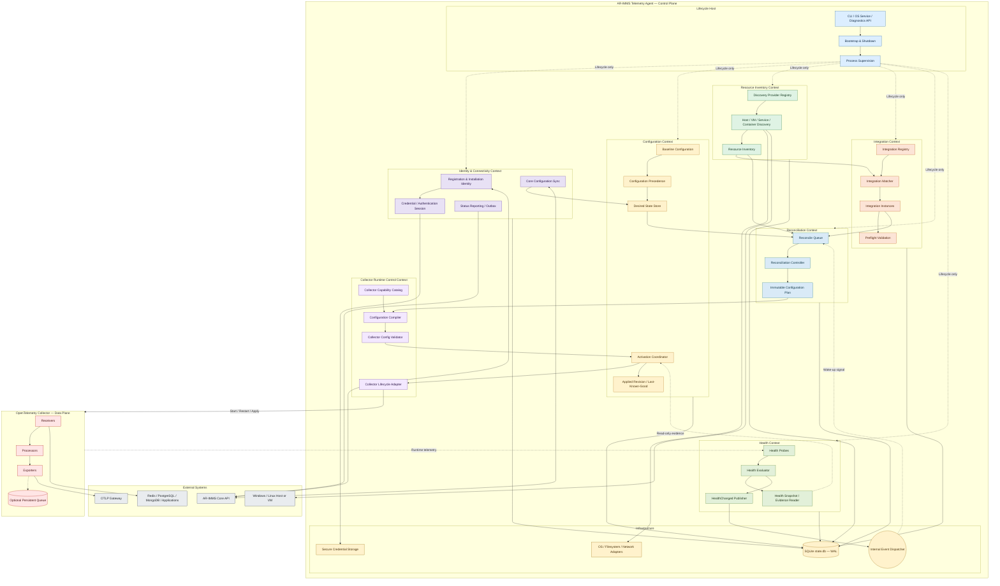

# AR-IMMS Telemetry Agent — Target Architecture v0.1.4

Architecture baseline | 26 October 2026 | Status: Target accepted; implementation details subject to validation

Purpose: Define the desired architecture independently of the current Go package layout. This baseline is design input for implementation, gap analysis, and incremental migration. Target decisions below are authoritative; implementation details remain subject to validation.

## Overall architecture



## 1. Decision register

| Decision | Status | Rationale / boundary |
|---|---|---|
| Unified Agent across host and VM | Confirmed | One Agent implementation per OS/architecture; unique installation identity per installation. |
| OTel Collector as telemetry engine | Confirmed | Reuse native receivers, processors, exporters and OTel runtime; avoid a second collection framework. |
| Control plane separate from Collector process | Target decision | Independently restartable processes; verify against packaging/runtime constraints. |
| Reconciliation-driven configuration | Target decision | Idempotent plans from desired, discovered and applied snapshots. |
| Health as independent observer | Confirmed direction | Health emits evidence/HealthChanged; it does not directly mutate desired state or decide rollback. |
| One SQLite operational database | Confirmed | Context-owned repositories on SQLite WAL; Collector persistent queue stored separately. |
| Built-in + developer integrations | Confirmed direction | Declarative definitions and narrow programmatic contracts; no arbitrary dynamic Go loading. |
| Activation policy details | Open | Verification gates, rollback criteria, reload strategy and local/Core precedence require testing. |

## 2. System boundaries

The installation contains an Agent control-plane process and a managed OpenTelemetry Collector data-plane process. The Agent owns intent and lifecycle decisions; the Collector owns collection and export. Core API and OTLP Gateway are external systems.

```text
External Systems
  ├── AR-IMMS Core API (registration, desired state, reporting)
  └── OS / Host / VM / containers / monitored applications

Agent Control Plane
  ├── Lifecycle Host
  ├── Identity & Connectivity
  ├── Configuration & Desired State
  ├── Resource Discovery & Inventory
  ├── Integration Catalog & Instances
  ├── Reconciliation Controller
  ├── Collector Runtime Control
  ├── Health & Diagnostics
  └── Shared Infrastructure (adapters, SQLite, events)
          │ Validated config artifact / runtime commands
          ▼
OpenTelemetry Collector Process
  ├── Receivers → Processors / Connectors → Exporters → OTLP Gateway
  └── Extensions / Self-telemetry / Optional persistent exporter queue
```

## 3. Bounded contexts and responsibilities

| Bounded context | Owns | Does not own |
|---|---|---|
| Lifecycle Host | Composition root, CLI/OS service startup, shutdown, cancellation, Collector process supervision and local diagnostics. | Integration matching, desired-state policy, configuration generation or health classification. |
| Identity & Connectivity | Installation identity, registration binding, secure credentials, authenticated Core synchronization, connectivity status and bounded outbound reports/outbox. | Collector pipeline internals or discovery implementation. |
| Configuration & Desired State | Embedded baseline, durable desired revisions, ownership/precedence, candidate/applied/last-known-good metadata, activation coordination and explicit rollback policy. | Resource discovery or Collector implementation details. |
| Resource Discovery & Inventory | Pluggable OS/process/container discovery; normalized observations, stable resource identity, evidence, provenance, freshness and expiry. | Integration activation or OTel config templates. |
| Integration Context | Built-in/developer definitions, registry, matching, configured instances, capability requirements, preflight and contribution intents. | Launching/restarting Collector or writing arbitrary database tables. |
| Reconciliation Context | Read consistent desired/discovered/applied snapshots; compute revision-bound idempotent plans; stale-plan detection and bounded retry scheduling. | Process operations, database mutation outside owned interfaces, health policy. |
| Collector Runtime Control | Distribution capability catalog, deterministic config compiler, OTel-native validation, process adapter, readiness/runtime observation. | Core policy, discovery or integration-specific business rules. |
| Health & Diagnostics | Probe registration, normalized signals, health levels, snapshots, timestamps/revision evidence, HealthChanged events and read-only evidence API. | Changes to desired state, direct rollback commands. |
| Infrastructure & Persistence | SQLite migrations/transactions, filesystem/OS/network adapters, secure credential store, Core HTTP, event dispatch, bounded operational outbox. | Domain decisions; direct cross-context table access. |
| OpenTelemetry Data Plane | Factories/instances of receivers, processors, connectors, exporters and extensions; signal processing, retry, queue and OTLP output. | Agent identity, registration, reconciliation and fleet policies. |

## 4. Dependency and communication rules

| From | Allowed dependency / contract | Forbidden shortcut |
|---|---|---|
| Lifecycle Host | Construct concrete adapters; invoke lifecycle interfaces | Per-integration case handling in bootstrap |
| Identity & Connectivity | Desired-state write port; outbox/report port | Direct Collector process calls |
| Discovery | Inventory repository; ResourceChanged advisory event | Direct instance activation |
| Integration | Read inventory/desired snapshots; emit component intent | Touch runtime config file or subprocess |
| Reconciler | Read-only snapshots; compiler plan contract | Ad hoc mutation of Collector / Core / DB tables |
| Compiler | Capability catalog, immutable intents, templates, native validator | Set desired state or decide restart policy |
| Activation | Collector lifecycle port; health evidence reader; revision repository | Treat HealthChanged as unconditional rollback |
| Health | Read-only runtime probes; publish scoped evidence | Write applied/desired revision |
| Infrastructure | Implements narrow ports owned by contexts | Own domain policy / import domain concrete implementations cyclically |
| Extensions | Public extension contracts + immutable inputs | Import Agent internals or mutate SQLite directly |

The event dispatcher is advisory: a consumer wakes and re-reads durable state. Every durable configuration transition must be recoverable after restart. A shared event bus must not become the source of truth.

## 5. State model and ownership

| State | Owner | Minimum contents / semantics |
|---|---|---|
| Desired | Configuration | Revision, source, ownership/precedence and requested integration configuration. |
| Discovered | Resource Inventory | Resource ID, provider, evidence, observedAt, freshness/expiry and inventory revision. |
| Integration Instance | Integration | Definition version, resource binding, configured options, desired enablement and diagnostics. |
| Applied | Configuration / Activation | Committed artifact digest, applied revision, active runtime identity and activation outcome. |
| Health | Health | Scope, severity, reason, observedAt, sequence, candidate/committed revision correlation. |
| Operational Outbox | Identity/Reporting | Bounded durable status/ack records for delivery after reconnect. |

## 6. Reconciliation and activation

```mermaid
flowchart LR
    A["Core/local change or discovery refresh"] --> B["Commit desired/inventory revision"] --> C["Advisory reconcile trigger"] --> D["Read desired + discovered + applied snapshots"] --> E["Resolve instances and component intents"] --> F["Compile deterministic full Collector config"] --> G["Verify factories + native validation"] --> H["Serialize candidate activation"] --> I["Apply/restart Collector"] --> J["Verify policy-defined runtime and telemetry signals"] --> K{"Outcome"}
    K -->|"Verified"| L["Commit applied revision"]
    K -->|"Failed"| M["Record failure / recover last-known-good"]
    L --> N["Reconcile again if inputs advanced"]
    M --> N
```



Reconciliation computes **what** should change; Activation controls **how** a candidate is applied. A failed revision must be recorded to avoid busy-loop retries. A newer desired revision must never be marked applied merely because an older candidate succeeded.

Concurrent integration updates are a required scenario, but exact coalescing, debounce, single-worker and compare-and-swap mechanisms are implementation options to validate. Health evidence can inform rollback but does not automatically justify it; a Gateway outage may be unrelated to a configuration candidate.

## 7. Integration architecture and developer extension model

General and built-in capability belongs to the Agent distribution. An integration is a versioned definition of how a technology is discovered, configured, mapped to Collector components and monitored. An integration definition is not itself an OTel receiver.

| Concept | Role | Example |
|---|---|---|
| Integration Definition | Schema, discovery selectors, required capabilities, telemetry mapping and config contributions | `redis` v1 |
| Integration Instance | Definition bound to one resource with its own desired settings | `redis@localhost:6379` |
| Collector Capability | Factory compiled into shipped Collector distribution | `redisreceiver` |
| Runtime Component | Configured component instance inside Collector | `redis/instance-a` |

| Extension mode | Developer work | Release impact |
|---|---|---|
| Declarative | Trusted manifest, config schema, discovery/matching rules, templates | May ship separately only if trusted definition loading exists and all factories are already present. |
| Programmatic | Implement only needed Go contracts: Discoverer, Matcher, ConfigContributor, Preflight, HealthProbe | Normally compile and register in Agent distribution; no dynamic Go plugins in v0.1.4. |
| New OTel component | Implement receiver/processor/exporter using OTel component/factory APIs | Rebuild pinned Collector distribution; verify Windows/Linux and restart behavior. |

```text
// Illustrative seams only — not approved stable APIs
ResourceDiscoverer.Discover(ctx, scope) → observations
IntegrationMatcher.Match(ctx, resourceSnapshot) → candidates
ConfigContributor.Contribute(ctx, instance, catalog) → componentIntents
Preflight.Check(ctx, instance) → diagnostics
HealthProbe.Probe(ctx, runtimeSnapshot) → healthEvidence
```

A developer should not need to modify Lifecycle Host, Reconciler, or Collector process control when adding an integration that uses existing capabilities. Not every integration needs every interface or one pipeline per instance. The compiler chooses a valid topology.

## 8. Persistence and local-first operation

Use one SQLite `state.db` in WAL mode, with context-owned repository interfaces and short transactions. Persist identity metadata, desired/discovered/applied revisions, integration instances, activation journal, sync cursor and bounded outbox. Secrets belong in protected credential storage; SQLite holds references where possible. OTel exporter persistent storage is separate.

Startup without Core must load the last committed local state and launch a known-good Collector configuration where credentials and prerequisites remain valid. Restoration must not assume readiness proves Gateway delivery.

## 9. Acceptance scenarios

| Scenario | Required observable outcome |
|---|---|
| First install on host/VM | Identity + baseline Collector; host metrics reach Gateway. |
| Redis discovered and enabled | Candidate → approved instance → validated receiver config → metrics output. |
| Integration config updated | Revision-aware apply and verification without reinstall. |
| Invalid database credentials | Scoped diagnostics; unrelated telemetry continues where Collector dependencies allow. |
| Core offline + restart | Restore committed local state and attempt bounded resync later. |
| Concurrent Redis/PostgreSQL changes | No accepted valid update silently lost; actual mechanism open. |
| Exporter delivery failure | HealthChanged with scoped evidence; rollback only if explicit policy attributes failure. |
| Custom receiver added | Factory included in distribution; config validates and receiver survives Collector restart. |

## 10. Shipping constraints and deferred complexity

v0.1.4 priority: preserve existing exporters and CLI behavior; support Windows/Linux and host/VM installation; deliver Core registration, host metrics, Redis/PostgreSQL/MongoDB integrations, application logs/metrics, safe configuration change, basic health and restart recovery.

Defer arbitrary dynamic Go plugins, generic marketplace, fully autonomous discovery activation, speculative plugin framework, multi-Collector sharding, distributed reconciliation, guaranteed zero-loss/hot-swap, and automatic rollback without tested causality policy.

## 11. Open decisions — do not invent answers

| Question | Required proof/decision |
|---|---|
| Core vs local precedence | Ownership matrix, revision conflict examples and approved sync contract. |
| Exact Collector distribution and component list | Factory inventory against pinned build and OS integration tests. |
| Activation verification and rollback | Policy for readiness, receipt/export evidence, timing and related failures. |
| Health severity and event scope | Level-specific probe results and candidate revision correlation. |
| Agent identity on cloned VM / reinstall | Identity lifecycle tests and registration policy. |
| Discovery activation policy | Explicit user/Core approval versus auto-enable; credential availability. |
| Process restart/upgrade mechanics | Fault injection across Windows service/systemd and candidate crash windows. |
| Declarative package loading security | Trusted path, schema/version checks, signature/trust decision if remotely delivered. |

## 12. Repository gap analysis (verified current source, 26 October 2026)

The target is established above without relying on current package layout. This section records source evidence separately; the evidence is not a constraint on target boundaries.

| Concern | Current evidence | Gap / reusable capability |
|---|---|---|
| Process split and Collector control | `internal/supervisor` owns child process/readiness; `internal/agentlifecycle` coordinates configuration generations and restarts; `internal/bootstrap` installs the pinned Collector artifact. | Reuse process separation and runtime seams. Core lifecycle supervision and new bounded contexts still need composition validation. |
| Desired/applied lifecycle | `internal/agentstate.State` persists desired/activated/applied generations, dependencies, ownership and pending teardown; JSON `FileStore` atomically replaces state under OS lock. | Reuse generation and ownership safety. Replace/bridge JSON with SQLite; add discovery, Core revisions, integration instances, journal/outbox and conflict semantics. |
| Configuration | `internal/config` merges YAML layers deterministically, substitutes values, validates and renders; lifecycle activates and tracks generations. | Reuse merge/validation. Add capability catalog, integration contributions, immutable plan, digest and stale-plan checks. |
| Dependencies/integrations | `internal/dependency` catalog and managed implementations cover Windows Exporter, Node Exporter and LibreHardwareMonitor; `agentctl` commands manage them. | Existing seams are named-dependency oriented. General definition/instance model and independently composed extension contracts are absent in inspected paths. |
| Identity/platform | `internal/identity` has machine and platform identity with Windows/Linux implementations. | Reuse host identity. Verify installation identity, registration, credentials and cloned VM/reinstall semantics. |
| Health | `internal/agenthealth` includes observation/snapshot/reporting types; Collector readiness and dependency health checks exist. | Verify scoped `HealthChanged` publication, durable evidence needs, and read-only behavior relative to activation. |
| Persistence | `internal/agentstate` uses local JSON and OS locking; runtime health observations are described as transient. | Migrate to one SQLite WAL operational database with short transactions, migrations, recovery and credential references. |
| Telemetry path | `configs/base`, `configs/os`, and profile fragments configure OTel; `docs/architecture/metrics-spine.md` describes Agent OTLP to Gateway and Gateway Prometheus scraping. | OTel split is established. Verify requested Redis/PostgreSQL/MongoDB/application coverage against pinned factories and platform builds. |
| Discovery/Core/outbox | No general discovery inventory, Core sync subsystem, or bounded operational outbox surfaced in inspected `internal` paths. | New bounded-context capabilities; confirm with full repo search and contract/API review before sizing. |
| Agent spool | No Agent-owned telemetry spool surfaced in inspected paths; Collector remains the default owner of telemetry retry/queue. | Verify delivery guarantees and disk budget before adding another queue. |

Existing lifecycle behavior is a migration asset, not the target architecture. Do not simply rename current managers or require a one-to-one mapping from these packages to contexts.

## 13. Incremental migration proposal

Each phase preserves current CLI behavior and telemetry output until its acceptance gate passes. The exact package seams should follow the target contracts, not current folder names.

| Phase | Scope | Risks | Acceptance criteria |
|---|---|---|---|
| 0. Contract baseline | Capture CLI/config outputs, ownership rules, platform assumptions, pinned Collector capability inventory, and current lifecycle behavior. Define state ownership and open precedence questions. | Implicit contracts and undocumented platform behavior. | Windows/Linux baselines; golden config and lifecycle scenarios; unresolved decisions recorded. |
| 1. Reconciliation seam | Introduce immutable desired/discovered/applied snapshots and revision-bound plans around existing dependency lifecycle; keep existing persistence behind a port temporarily. | Duplicate lifecycle logic or changed idempotency. | Repeated reconcile is a no-op; stale plan is rejected; install/disable/uninstall and deferred teardown remain equivalent. |
| 2. Activation journal/recovery | Add candidate digest and explicit staged/activated/applied journal; serialize activation and recover after restart. | Crash windows and divergence between file/runtime state. | Fault injection at transitions restores last committed config; invalid candidate leaves prior applied config. |
| 3. SQLite WAL migration | Introduce context-owned repositories, transactional revisions and durable outbox; migrate JSON state with backup/import. | Locking, schema migration, permissions, corruption. | Existing ownership/generation preserved; interrupted migration recoverable; concurrent updates never silently overwrite. |
| 4. Integration definitions | Adapt current managed dependencies as built-in definitions and instances; add capability requirements and declarative config contributions. | Over-generalized model or identifier churn. | Current dependencies map cleanly; unsupported capability rejected pre-activation; emitted config semantically equivalent. |
| 5. Discovery inventory | Add one provider at a time with stable identity, provenance and freshness; connect inventory to reconciliation. | Flapping or permission failure removes valid integrations. | Provider failure retains prior observation; expiry policy explicit; Windows/Linux coverage documented. |
| 6. Core connectivity and sync | Add registration, credential references, sync cursor, authenticated desired-state exchange, bounded reporting/outbox and conflict behavior. | Identity and local/Core ownership ambiguity. | Core outage preserves local operation; reconnect is idempotent; conflicts surfaced per approved policy; no secret in DB/logs. |
| 7. Integrations and health evidence | Deliver Redis/PostgreSQL/MongoDB vertical slices, then independent extension contracts and scoped health. | Shared pipeline blast radius; API compatibility; false rollback. | Each slice reaches Gateway; failure is scoped where feasible; health cannot directly mutate desired/applied state; rollback remains policy-gated. |

Before broad extension rollout, prove the smallest vertical slice: definition → desired instance → reconciliation plan → compiled OTel config → activation → Gateway output → scoped health. Defer dynamic plugins, multi-Collector sharding, arbitrary remote code/config execution and fleet-scale coordination absent a demonstrated requirement and explicit decision.

## 14. Proof points and implementation checks

- Verify installation identity across reinstall, disk clone, and VM image duplication on Windows/Linux.
- Verify SQLite WAL locking, service-account permissions, backup, corruption handling, and crash recovery in supported install locations.
- Verify the pinned Collector's component factories, config validation path, reload/restart behavior, readiness signals and process replacement on both OSes.
- Simulate overlapping local/Core integration updates; prove accepted changes are not lost under the chosen ownership and concurrency mechanism.
- Fail a component that shares processors/exporters with unrelated pipelines; document actual isolation limits.
- Distinguish Collector readiness, source health, export errors, and Gateway receipt. Test rollback evidence and thresholds independently.
- Compare Collector persistent queue behavior against expected outage duration, disk budget, duplicates, and delivery guarantees before considering an Agent spool.
- Define trust, path, schema/version rules, and signature decisions for declarative definitions before accepting remote distribution.

## 15. Guidance for AI coding agents

Treat v0.1.4 as the accepted target, not a package-renaming checklist. First identify the smallest vertical slice and inspect source for reusable behavior only after establishing the target contracts. Preserve working functionality and verify migration acceptance incrementally.

Label findings as **VERIFIED CURRENT**, **TARGET DECISION**, **PROPOSED**, or **OPEN**. Do not infer repository capabilities from diagrams. Avoid implementing every logical box as a separate package unless independent responsibility and testing justify it. Do not invent answers to the open decisions in section 11.

## 16. Reference boundaries

This is an approved target baseline supplied on 26 October 2026. External technical constraints must be checked against the pinned OpenTelemetry Collector source/build and relevant upstream documentation before implementation; this document does not claim those external versions have already been verified.

Repository evidence used for the separate gap analysis: `internal/agentstate/`, `internal/agentlifecycle/`, `internal/config/`, `internal/bootstrap/`, `internal/supervisor/`, `internal/identity/`, `internal/dependency/`, `internal/agenthealth/`, `configs/`, `docs/architecture/desired-state-configuration-lifecycle.md`, and `docs/architecture/metrics-spine.md`.
