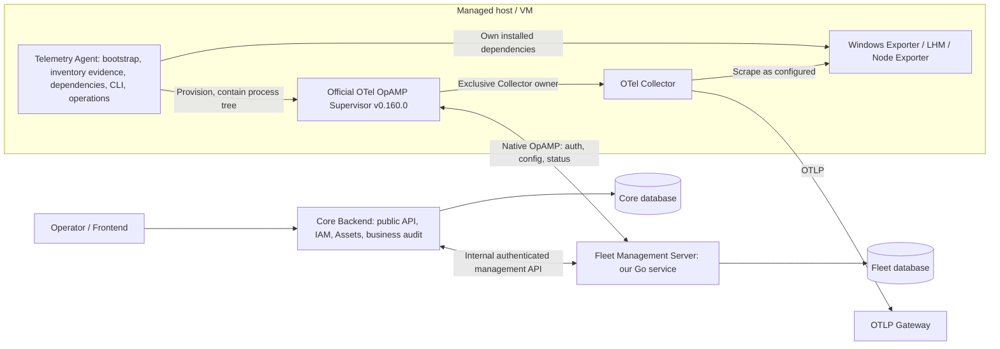

# ADR 0005 — Fleet Management authority and OTel-native execution

**Status:** Proposed for approval (architecture direction agreed in discussion; no code change authorized by this document alone)  
**Target:** AR-IMMS `v0.1.4a-next` architecture revision  
**Evidence baseline:** `AR-IMMS/telemetry-agent` PR #40, `c9597df6bb8d498e6661df151b99c35b8c1ea1f1` (2026-11-18).  
**Supersedes, where conflicting:** Core-centric Collector desired-policy authority in `docs/local/architecture/v0.1.4a-next/opamp-integration.md`, `context-boundaries.md`, `consolidation/02-context-ownership.md`, `consolidation/03-target-architecture.md`, and `architecture-overview.md`. These remain historical implementation references until contracts/code migrate.

## 1. Vocabulary — never conflate these components

| Name | Implementation | Deployed at | Role |
|---|---|---|---|
| **AR-IMMS Fleet Management Server** (`Fleet Manager`) | **Our Go product** built using `opamp-go`, with an application/domain/persistence layer | Central VPS | Fleet identity and approval records, desired Collector policy, config publication, observed outcomes, fleet audit; exposes internal management API and native OpAMP endpoint |
| **OpenTelemetry OpAMP Supervisor** (`Supervisor`) | **Upstream OpenTelemetry executable**, pinned `cmd/opampsupervisor/v0.160.0` | Managed host/VM | OpAMP client, Collector process/config application, fallback, automatic config rollback, supported reporting |
| **AR-IMMS Telemetry Agent** (`Agent`) | Our Go host service and `agentctl` | Managed host/VM | Bootstrap, persistent local installation identity, protected credentials, environment/topology evidence, Windows Exporter/LHM/Node Exporter dependency lifecycle, diagnostics, controlled operations |
| **OTel Collector** (`Collector`) | Pinned OTel distribution | Managed host/VM or defined deployment | Telemetry receivers/processors/exporters, Prometheus scrape and OTLP delivery |
| **AR-IMMS Core Backend** (`Core`) | NestJS | Central VPS | Public API, IAM/RBAC, physical asset/Node binding authority, incident/ticket/maintenance, business audit |

**Naming prohibition:** Do not call Fleet Manager “Supervisor,” and do not treat upstream `opamp-go` as a ready-made fleet-management application. `internal/opampserver` in the existing Agent repository is an **existing adapter**, not proof the new Fleet Manager product is implemented.

## 2. Decision and rationale

Adopt **B+ / OTel-native management**: Core remains the single **user-facing API entrypoint and business authorizer**, while Fleet Manager is the **authoritative owner of Collector fleet desired config and operational observations**. Supervisor is the **single Collector lifecycle/config execution owner** in native mode. Agent is **not** a second Collector lifecycle/config engine in that mode.

Prefer upstream Collector receivers/processors/extensions/Prometheus scraping over a proprietary telemetry execution framework. Fleet Manager still needs its own policy, persistence, revision/CAS, publication, audit and API implementations: OpAMP itself does not provide those applications.

**Deployment:** one VPS and one MongoDB deployment with separate logical databases and least-privilege database users is acceptable. No cross-database repository access. No mandatory distributed transaction: correlate commands and observations using operation/request IDs and idempotency keys. Transaction support depends on MongoDB deployment topology; standalone MongoDB does not provide multi-document transactions/change streams.

## 3. Ownership and non-overlap

| Capability | Authority | Execution / evidence | Decision |
|---|---|---|---|
| Human authentication and business action authorization | Core | Core API | KEEP Core |
| Site/Room/Rack/Node registry and permission to bind installation to Node | Core | Core/Fleet management contract | KEEP Core |
| Fleet installation registration/approval state, enrollment credential lifecycle | Fleet Manager **target** | Agent enrollment bootstrap; Core authorizes Node binding | MOVE by explicit versioned migration, **not implemented yet** |
| Desired Collector config / revisions / CAS / published config hashes | Fleet Manager | Fleet DB, OpAMP protocol adapter | MOVE |
| Active OpAMP connections and config/status translation | Fleet Manager | `opamp-go` transport | MOVE |
| Collector remote config merge, apply, restart and startup rollback | Supervisor | OTel Collector runtime | DELEGATE; one executor |
| Collector metrics, logs, traces; Prometheus receivers | Collector | OTLP pipeline | DELEGATE |
| OS service, Supervisor provisioning, protected local secrets | Agent | OS/service manager | KEEP |
| Windows Exporter, Libre Hardware Monitor, Node Exporter: install/configure/enable/disable/uninstall/ownership | Agent | Local CLI and OS adapters | **KEEP without ambiguity** |
| Host/VM/K8s evidence, topology source provenance | Agent + OTel metadata | Fleet observations → Core topology resolution | KEEP custom gap only |
| Docker inspection / opt-in restart | Agent Operations | NATS transport + local authorization safety | KEEP separate from OpAMP restart |
| Business audit / fleet execution audit | Core / Fleet Manager respectively | Correlated facts, not copied records | KEEP separate owners |
| Package/binary remote updates through Supervisor | None verified for pinned binary | Unsupported for this release | DEFER |

## 4. Guardrails and principles

1. **One Collector owner:** Supervisor runs the Collector in native mode. The legacy Agent runtime is an exclusive, persisted rollback mode; it must never run concurrently. Verify ownership across crash, upgrade and uninstall.
2. **One desired-config authority:** Fleet Manager stores desired configuration, revision/CAS, publication hash, observed status. Core may cache views but cannot authoritatively mutate the same records.
3. **Business request ≠ execution:** Core authorization and Fleet acceptance are not Collector apply success; `desired_revision`, `publication_revision`, `observed/applied_revision`, and actual effective configuration evidence stay distinct.
4. **Explicit config composition:** Agent owns secure local bootstrap identity/dependency inputs; Fleet Manager owns remotely managed Collector intent; Supervisor merges/applies. Define merge precedence and unique component IDs before extending targets. Avoid two competing receiver owners or duplicate scrapes.
5. **Fail safely, remain observable:** OpAMP disconnect does not imply Collector stop or success. Record `UNKNOWN` with provenance/freshness. Collector readiness does not prove OTLP delivery.
6. **No arbitrary remote code execution:** Supervisor Restart is Collector-only. Business Docker/service operations remain Agent allowlisted Operations, with audit/idempotency/opt-in.
7. **OTel-native first:** Prefer pinned supported receiver/processor/extension, Prometheus or OTLP. Custom Collector component must use official component interfaces/SDK and pass security/compatibility checks. Upstream “supported” is not the same as enabled/tested in our distribution.
8. **Immutable identity and least privilege:** `agent_id` is not a secret or an authorization proof. Credentials are protected and revocable; machine fingerprints are evidence only.
9. **Explicit non-duplication of ownership:** Agent OS dependency lifecycle remains separate from Supervisor Collector lifecycle. Disable/uninstall a dependency only after compatible config/reference and host teardown safety are satisfied.
10. **Honest evidence:** Tests with Mock Core are not production NestJS Core interoperability. Distinguish `PASS`, `NOT RUN`, `BLOCKED`, `UNKNOWN`.

## 5. Feature-flag migration and rollback

**Target:** exactly one persisted runtime mode per installation, such as `otel-native` or `legacy`; names are *proposed*, not existing CLI flags. The repository currently uses `--disable-opamp-supervisor` for explicit legacy selection—**reuse/bridge that contract rather than invent competing toggles**.

- Native mode: Supervisor alone manages the Collector; Fleet Manager alone owns new remote desired state. The Agent may provision/restart the *Supervisor process* in response to OS service/credential changes; that is **not** an independent Collector-control path.
- Legacy mode: preserved Agent local Collector path, guarded by the existing ownership selector.
- Switching: stop and verify old process tree, persist mode transition, start target owner, verify exactly one Collector and corresponding telemetry output; on failure mark transition outcome and follow explicit rollback path.
- Flags cannot reverse incompatible SQLite migrations, credentials, external API contracts, or database schema changes. Preserve old state during migration, version the new contracts, and do not pretend flagging provides transactional rollback.
- **Time-constrained release:** complete CLI and existing Windows/LHM/Node dependency commands; prioritize real OpAMP config + OTLP and bad-config recovery; defer full host/VM/K8s topology implementation and aggressive deletion of legacy source.

## 6. Data and audit contracts

**Proposed collections** (not yet implemented): Fleet `installations`, `enrollment_invitations`, `credentials` (metadata/references only), `desired_configs`, `config_publications`, `config_observations`, `operations`, `execution_audit`, `outbox`. Core owns asset binding, IAM and business-audit records. Neither service reads/writes the other's MongoDB collections directly.

For a user-triggered change: Core records the authorized user intent and `operation_id`; Fleet Manager atomically records accepted desired revision, execution audit, and outbox intent within its own DB transaction where supported, then returns `202 Accepted`. Supervisor status results subsequently update Fleet observations. Correlate both audit trails by `operation_id`, not by sharing database tables. Use idempotency keys for timeout/retry ambiguity.

## 7. Supersession / migration impact

This ADR intentionally changes the **authority**, not merely the Go package tree. Existing `v0.1.4a-next/architecture-overview.md`, `opamp-integration.md`, `context-boundaries.md`, `consolidation/02-context-ownership.md`, `consolidation/03-target-architecture.md`, and release tracker describe earlier **Core desired policy** and **Agent-local desired state** behavior. Those remain truthful history for shipped PR-07/09.5 code until the Fleet/Agent/Core contracts change. Do not silently mark them implemented or erase history.

Before production adoption: publish jointly reviewed versioned Fleet↔Core and Fleet↔Agent enrollment contracts to `docs/shared` (currently a submodule; do not modify automatically), plan existing Core-enrolled identity migration, and prove connected/reconnected Supervisor config delivery with production Core interoperability.

## 8. Open / unverified facts

- Production NestJS Core API interoperability is **NOT VERIFIED**.
- Exact OpAMP update trigger from Core for already-connected Supervisor and effective-config semantics require tests.
- Supervisor v0.160.0 `CustomMessage` general execution is **NOT VERIFIED** and must not be relied upon.
- Agent LKG vs Supervisor rollback consistency and old-to-new schema migration remain **NOT VERIFIED** end-to-end.
- New Fleet Manager database and API are **PROPOSED**, not already delivered by the current `internal/opampserver` adapter.

**Related:** `0006-agent-identity-and-environment-evidence.md`; `../architecture/v0.1.4a-next/fleet-management-flows.md`; existing `opamp-integration.md`, `cli-contract.md`, and `docs/local/verification/v0.1.4a-next/test-matrix.md`.
