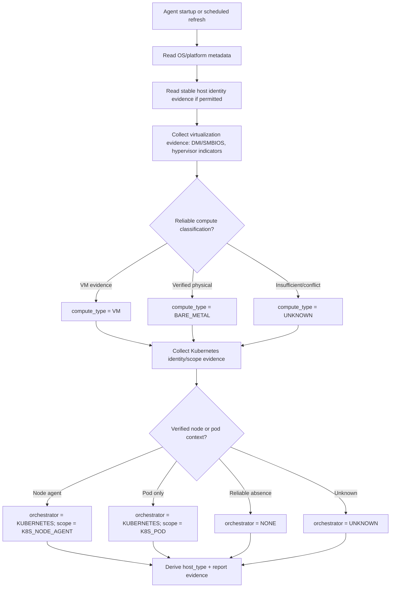
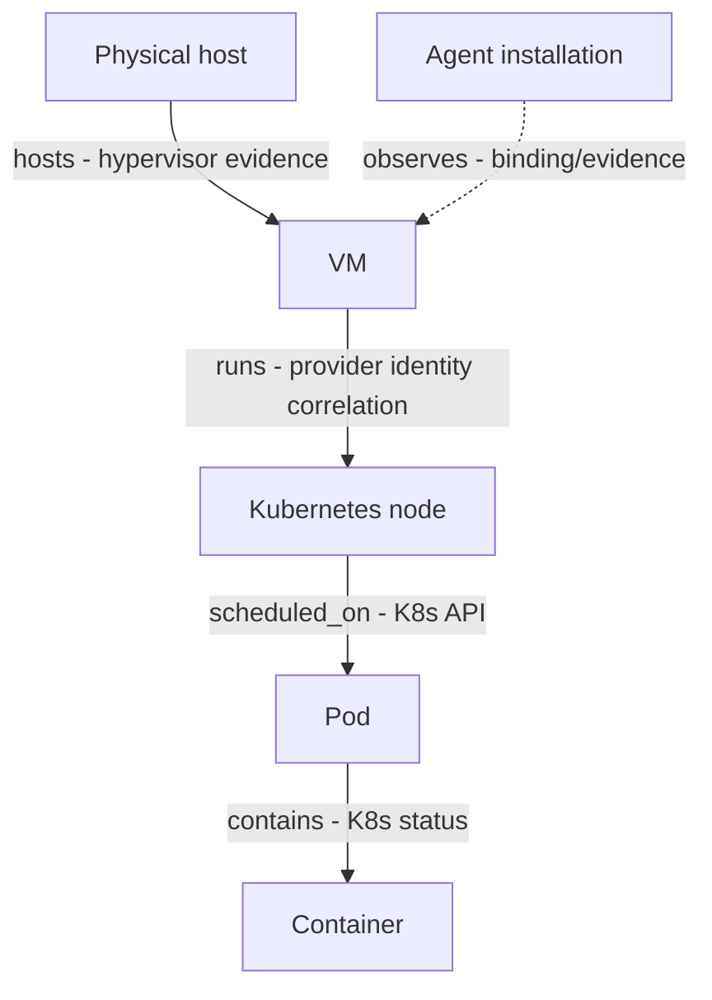

# ADR 0006 — Agent identity and evidence-based host environment detection

**Status:** Proposed for approval; target schema, not existing wire format  
**Depends on:** ADR 0005 Fleet Management authority  
**Evidence baseline:** `telemetry-agent` PR #40 at `c9597df` with existing durable installation identity/enrollment/OS credential stores.

## 1. Decision

Use **`agent_id` (installation UUID)** independent of **`host_id` (OS-derived host identity evidence)** and **environment classification**. Do not derive `agent_id` from hostname, MAC, machine ID or OpAMP session. For existing installations, **reuse the persisted installation UUID as `agent_id` where compatible**; do not silently generate a second authoritative installation ID. OpAMP `instance_uid` is a protocol identity subject to an explicit authenticated binding, not a credential.

A single enum `BARE_METAL | VM | KUBERNETES` is insufficient for topology: a Kubernetes worker can itself be a VM or bare metal. Provide the requested `host_type` as a **derived UI classification**, backed by independent dimensions `compute_type`, `orchestrator`, and `deployment_scope`. Include `UNKNOWN` in all incomplete classifications.

## 2. Identity schema (proposed, versioned contract)

| Field | Type | Meaning / source | Rule |
|---|---|---|---|
| `schema_version` | string | Identity report version | Required |
| `agent_id` | UUID | Durable Agent installation identity | Stable across restarts/upgrades |
| `host_id` | string? | Normalized OS-derived host identifier | May be unavailable; never authentication |
| `host_id_source` | enum/string | e.g. linux machine-id, Windows MachineGuid; exact access subject to permissions | Required when host ID supplied |
| `host_type` | `BARE_METAL \| VM \| KUBERNETES \| UNKNOWN` | Derived display/classification | Kubernetes overrides display only if verified node role |
| `compute_type` | `BARE_METAL \| VM \| UNKNOWN` | Physical/virtual execution type | Independent of orchestrator |
| `orchestrator` | `NONE \| KUBERNETES \| UNKNOWN` | Orchestration environment | `NONE` only with reliable negative evidence |
| `deployment_scope` | `HOST_SERVICE \| K8S_NODE_AGENT \| K8S_POD \| UNKNOWN` | What the Agent installation actually represents | Prevent Pod identity mistaken for Host identity |
| `hostname` | string? | OS hostname | Mutable display metadata |
| `os_type`, `os_version`, `architecture` | string | OS/platform observations | Include source/timestamp |
| `agent_version`, `collector_version`, `supervisor_version` | string? | Runtime/software evidence | Do not infer from desired pin if binary not inspected |
| `virtualization_vendor` | string? | KVM, Hyper-V, VMware, etc. | Optional, evidence-dependent |
| `k8s_cluster_uid`, `k8s_node_uid`, `k8s_node_name` | string? | Kubernetes API-backed identity | Optional, only with proven source |
| `observed_at` | timestamp | Observation time | Required |
| `classification_confidence` | `VERIFIED \| INFERRED \| UNKNOWN` | How strongly evidence supports classification | `INFERRED` must not be treated as verified binding |
| `evidence_sources` | structured array | Detector name/version, source, scope, observation time, outcome | No raw secrets |
| `attributes` | map | Allowlisted environment metadata | Size- and sensitivity-bounded |

**Privacy/security:** a raw stable fingerprint can be sensitive. Prefer normalized opaque or scoped identifier where possible. Do not store raw SMBIOS serials, machine-id files, MAC lists, tokens or service-account credentials indiscriminately in telemetry, logs or the fleet UI. Do not derive cryptographic authentication from `host_id`.

## 3. Detector behavior

### Sources and interpretation

| Platform | Useful evidence | Important caveat |
|---|---|---|
| Windows host/VM | MachineGuid, SMBIOS manufacturer/model, hypervisor provider indicators, OS info | SMBIOS can be spoofed/virtualized; MachineGuid can duplicate in cloned images |
| Linux host/VM | `/etc/machine-id` when host-scoped, DMI/sysfs, kernel and verified hypervisor evidence, `systemd-detect-virt` if present | Container-mounted machine-id can belong to container or parent; missing DMI does not prove bare metal |
| Kubernetes/k3s | Kubernetes API node UID/name and cluster scope, runtime service-account permissions, DaemonSet/Pod identity | Presence of `KUBERNETES_SERVICE_HOST` alone does **not** prove this Agent represents a Kubernetes node |
| VM → physical host | Hypervisor/cloud management API or trusted external inventory | Generally not derivable from a guest OS alone; preserve `UNKNOWN` |
| K8s node → VM | Kubernetes provider ID matched against cloud/hypervisor authoritative inventory | Hostname/IP coincidences are not sufficient |

`host_type` UI rule: `KUBERNETES` only when the installation is verified as a K8s **node agent**; otherwise use proven compute type (`VM` or `BARE_METAL`) or `UNKNOWN`. For agents inside a K8s Pod that are *not* node agents, `deployment_scope=K8S_POD` remains explicit and `host_type` should not pretend to be the physical host. The full dimensions are authoritative; `host_type` is presentation only.

## 4. Lifecycle, collision, and topology rules

| Situation | Required response |
|---|---|
| Restart / upgrade | Preserve `agent_id`; refresh metadata without rebinding silently |
| Hostname changes | Preserve IDs; update observed `hostname` and timestamp |
| VM clone with duplicate machine-id | Distinct `agent_id`; flag `host_id` collision, no automatic merge |
| Cloned persisted Agent state/credential | Treat duplicate active `agent_id`/credential use as an identity collision; quarantine/re-enroll under explicit policy |
| OS reinstall | Host ID may change; Fleet revalidates asset binding rather than inferring same host |
| Kubernetes Pod recreation | Pod UID changes; never use Pod UID as host or durable Agent installation ID |
| VM migration | Stable VM identity can persist; host placement edge changes only with external evidence |
| Missing/conflicting evidence | Report `UNKNOWN`, source list and reason; no guessed physical parent |

### Topology relationships

This diagram is illustrative, **not** a guaranteed tree. Kubernetes clusters span nodes and hosts; model typed, temporal relationships with source, confidence, observation time and expiration. Core's Asset/Topology bounded context remains authoritative for business placement; Fleet owns its collected identity observations.

## 5. Enrollment, auth, and migration

- **Agent local:** retains durable installation ID, credential reference, interrupted-enrollment recovery and protected OS secret store. A host fingerprint cannot authorize registration.
- **Core:** authenticates Admin/Operator and authorizes binding this Agent to a Node/Asset.
- **Fleet Manager target:** registers Agent installation, issues/manages OpAMP credential according to versioned workflow, records approval and authenticated UID binding.
- **Supervisor:** uses provisioned token/cert to establish OpAMP session; never trusts self-reported `host_id` as proof of Node ownership.
- Existing enrollment is Core-backed at current HEAD. Define a compatibility mapping/migration before moving credential issuance or registration authority; do not revoke or overwrite persisted credentials as a side-effect of schema rename.

## 6. Acceptance tests

1. Identity stable across restart, upgrade, hostname change; reinstall behavior explicitly tested.
2. Windows and Linux host/VM positive detection and incomplete/conflicting evidence returns `UNKNOWN`.
3. K8s/k3s host-agent vs arbitrary Pod correctly distinguished; no accidental `host.id` of container reused as physical host.
4. VM clone with same machine-id and different `agent_id` raises collision; copied Agent credentials trigger duplicate-session/identity defense.
5. Valid token + authorized Core Node binding is required; host fingerprint alone is insufficient.
6. Metadata size limits, safe redaction, no raw secrets in audit/log/OTLP.
7. Topology edges carry source/freshness; unknown VM parent remains unknown.

**Related:** ADR 0005; `../architecture/v0.1.4a-next/fleet-management-flows.md`.
