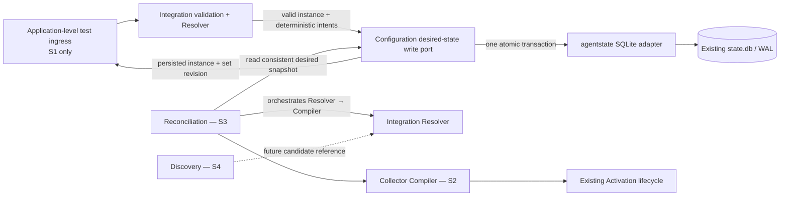
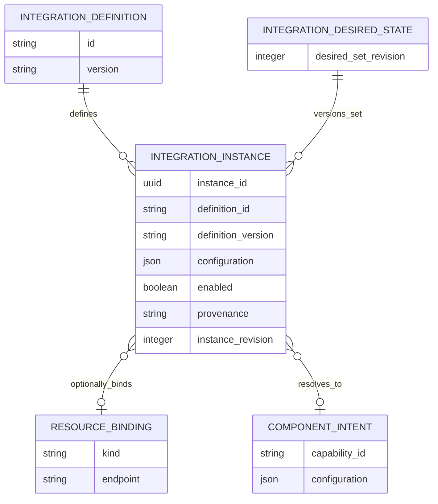

# S1 Integration Core Foundation — Technical Design

**Status:** Proposed for final developer review; not an implementation authorization.
**Scope:** Integration domain models, static Registry, Resolver/Contribution contracts, and SQLite persistence. S1 persists valid desired instances and resolves their deterministic intents in an application-level test ingress. It does not activate Collector configuration.

Labels: **Verified** = confirmed in current source; **Approved** = required by Target Architecture v0.1.4; **Proposed** = recommendation for review; **Open** = needs a decision or evidence.

## 1. Requirements and invariants

### Expected behavior

A caller requests monitoring a service, for example Redis at `192.168.1.10:6379`. S1 validates the desired instance, persists it, and can resolve it through its definition to immutable component intents. A future Reconciliation Controller will read desired state and orchestrate Resolver → Collector Compiler → existing Activation lifecycle.

### S1 includes

- **Proposed:** Definition/Instance domain values, definition and instance validation, a static built-in Registry, deterministic Resolver and contribution intent values/contracts.
- **Proposed:** A Configuration-owned desired-integration write/read port and `agentstate` SQLite adapter. Integration owns instance semantics; Configuration owns the desired-set change marker. The adapter updates both atomically.
- **Proposed:** An application-level test ingress composes validation, contribution generation and persistence to prove S1 end to end. No production CLI command is added; `agentctl integration` is deferred to S3 with the Redis reference integration.
- **Approved boundary:** S1 produces validated, persisted, resolvable intents only. S2 verifies Collector capabilities and compiles OTel configuration; S3 adds reconciliation, activation wiring and Redis; S4 adds Discovery.

### Invariants

1. Definitions are immutable, versioned Agent-distribution data. No runtime-loaded definitions or plugins.
2. Instance identity is stable. A definition version is pinned; there is no implicit upgrade or migration.
3. Per-instance revision advances only when that instance changes. The Configuration-owned desired-set revision advances exactly once in the same transaction for every effective create, update, enable, disable or delete. Unchanged operations advance neither revision.
4. A write uses an expected instance revision where one exists. Stale writes conflict; no last-write-wins overwrite.
5. Definition/config/resource validation and deterministic contribution generation finish before persistence. Any such failure leaves the existing row and both revisions unchanged.
6. Applied configuration generations and Integration instance revisions/desired-set revision are distinct. S1 does not modify existing M1/M2 `DesiredGeneration`, `ActivatedGeneration` or `AppliedGeneration`.
7. SQLite stores non-secret settings and opaque secret references only. No plaintext credentials.
8. Applying configuration does not prove Integration health. Integration Core does not control processes, activation, readiness or rollback.

### Non-goals

Production CLI; Collector capability availability checks or native validation; Collector Compiler; Reconciliation Controller; Redis/PostgreSQL implementation; Discovery; Core API, Core ownership or Core/local precedence; health events; Collector activation; dynamic plugins; generic schema framework.

## 2. Domain model

| Model | Proposed meaning and rules |
|---|---|
| `DefinitionID` / `DefinitionVersion` | Stable identifier and exact version of the definition/config contract. Instances refer to a registered ID/version pair. |
| `IntegrationDefinition` | Immutable Agent-shipped definition with configuration validator, required capability IDs, and deterministic contributor. It is not an OTel receiver or runtime component. |
| `IntegrationInstance` | Desired instance with stable UUID, definition ID/version, validated settings, `enabled`, optional resource binding, local provenance, and per-instance revision. |
| `ResourceBinding` | Optional explicit endpoint/reference, e.g. host and port, before Discovery exists. It is operator configuration, not a discovered identity. Credentials are separate references. |
| `ComponentIntent` | Immutable capability ID and validated, non-secret contribution values. No OTel YAML, final runtime naming, factory availability claim, or process instruction. |
| `Contribution` | Deterministic zero-or-more component intents. Disabled instances contribute none. Diagnostics are structured and secret-free. |
| `DesiredSetRevision` | Configuration-owned monotonic marker for the set of desired Integration Instances. It changes atomically with effective instance mutations and gives future Reconciliation a cheap change token. It is not an M1/M2 Collector config generation or an applied revision. |

Settings use a definition-validated JSON-compatible value with deterministic encoding and a reviewed size bound. S1 rejects plaintext secrets; whether it accepts references to existing CredentialStore entries is **Open**. S1 validates capability identifier syntax and declared requirements only. Installed factory availability belongs to S2.

## 3. Components, contracts and dependency direction



| Part | Owns | Must not own |
|---|---|---|
| Integration model, validator and Resolver | Definition/version compatibility, instance validity, deterministic contribution. | SQL, desired-set revisions, OTel YAML, Collector factory inventory, process control. |
| Static Registry | Lookup by definition ID/version; reject duplicate pairs. | Dynamic loading, persistence or Discovery. |
| Contributor | Convert a validated instance to deterministic intents; no I/O or side effects. | Capability availability, native config validation, activation, health policy. |
| Configuration desired-state contract | Desired source/provenance and set revision; exposes consistent snapshots and atomic mutations. | Integration-specific validation/contribution or Collector rendering. |
| SQLite adapter in `agentstate` | Schema migration, short transactions, compare-and-set semantics and durable serialization. | Domain decisions or cross-context direct table access. |
| Test ingress | Exercise validate → contribute → persist using ports and fakes/adapters. | Production command UX or runtime orchestration. |
| Future Reconciliation | Read desired snapshot; orchestrate Resolver and Compiler; hand candidate to existing lifecycle. | Integration-specific rules, SQL, or direct Collector process operations. |

**Ports:** The desired-instance repository/write port is declared by Configuration because it owns desired-state provenance and the set revision. This is a Configuration-context contract, separate from the existing `internal/config` Collector YAML renderer. Its values use Integration-owned domain types. `agentstate` implements the port and imports those types; Integration does not import Configuration, Persistence, Reconciliation, or Lifecycle. The test ingress is composition only. Future Core input may call the same Configuration write contract after its own contract is approved; no precedence is implied.

**Patterns:** Use a simple static Registry, narrow Repository port, and SQLite Adapter. A contributor Strategy is justified only to let definitions provide distinct contribution behavior; use a function field if that is enough. No generic plugin, factory framework, or `agentstate.Repository` reuse: that existing interface represents Agent lifecycle state, not Integration desired state.

## 4. S1 validation and failure semantics

The application path performs these pure operations before storage:

1. Validate instance identity, exact registered definition version, settings, optional endpoint/resource reference, enablement and secret-free content.
2. Resolve the definition and run its deterministic contributor. Invalid settings, unsupported definition version, or contributor-declared invalid configuration are permanent input errors.
3. Persist the prepared desired instance using expected-revision semantics. The transaction either updates the instance and desired-set marker together, or commits neither.

The contributor must be deterministic for the same definition version and instance input, total for validated input, and free of external I/O. A violation/error is classified as `ContributionError` and prevents persistence. Unknown definition/version is `DefinitionError`; invalid input is `ValidationError`; stale expected revision is `RevisionConflict`; SQLite/migration failure is `PersistenceError`. Storage errors are not converted to validation errors. On every failed update, the prior valid row and both revisions remain unchanged.

S1 does not check whether a capability factory exists in the shipped Collector or whether generated OTel configuration is valid. S2 owns those checks. Later Reconciliation reruns Resolver against the durable snapshot; it does not trust an earlier transient intent as applied state.

## 5. SQLite persistence and lifecycle

### Proposed schema

The current schema migration sequence ends at version 5; recheck immediately before implementation and use the next unused version. Both tables are part of the same migration transaction.

```sql
CREATE TABLE integration_instances (
  instance_id TEXT PRIMARY KEY,
  definition_id TEXT NOT NULL,
  definition_version TEXT NOT NULL,
  configuration_json BLOB NOT NULL,
  enabled INTEGER NOT NULL CHECK (enabled IN (0, 1)),
  resource_binding_json BLOB,
  provenance TEXT NOT NULL,
  revision INTEGER NOT NULL CHECK (revision > 0),
  created_at TEXT NOT NULL,
  updated_at TEXT NOT NULL
);

CREATE TABLE integration_desired_state (
  id INTEGER PRIMARY KEY CHECK (id = 1),
  desired_set_revision INTEGER NOT NULL CHECK (desired_set_revision >= 0),
  updated_at TEXT NOT NULL
);
```

Definitions, contributions, Collector applied revisions, and health are not persisted here. M1/M2 `agent_state` payload and activation journal remain untouched.

### Atomic mutation, revisions and concurrency

- **Verified:** `SQLiteStore` uses WAL, immediate transactions, a 5-second busy timeout, in-process mutation serialization, versioned migrations and short transactions.
- **Proposed:** Each create/update/enable/disable/delete runs in one immediate transaction. It reads/checks the current instance and expected revision, compares effective values, mutates the instance row, increments `integration_desired_state.desired_set_revision` once, and commits. Failure rolls back all changes.
- Create requires an unused UUID; duplicate IDs conflict. Update/enable/disable require the current expected instance revision; mismatch conflicts. Effective no-op succeeds without revision changes.
- Delete requires the current expected revision. If the row is absent, return unchanged/not-found without advancing the set revision; if the row exists but revision is stale, return conflict. A successful hard delete advances the desired-set marker; the next future snapshot sees the instance absent. IDs are never reused. No S1 tombstone or reconciler queue is needed.
- A snapshot reads the marker and complete instance set in one read transaction, so a future Reconciler cannot combine a new marker with an older set. Concurrent writers serialize through SQLite locking; expected revisions prevent stale callers from overwriting newer state.
- Restart reads the last committed desired set/revision. S1 does not activate it. Migration failure must leave existing M1/M2 state usable; no legacy state rewrite is required.

### Revision ownership

| Revision | Owner and meaning | S1 behavior |
|---|---|---|
| Instance revision | Integration instance concurrency/version. | Increment for effective change to that instance only. |
| Desired-set revision | Configuration’s integration desired-state change marker. | Increment atomically once for any effective instance create/update/enable/disable/delete. Future Reconciliation observes it. |
| `DesiredGeneration` / `ActivatedGeneration` / `AppliedGeneration` | Existing M1/M2 local Collector lifecycle generations. | Unchanged by S1. Future S3 maps a reconciled candidate to the existing activation lifecycle without treating these values as the desired-set revision. |
| Integration health | Health context evidence, independent of applied state. | Not represented or inferred in S1. |

## 6. Diagrams

### Component and dependency flow

See the component diagram in §3. It shows the Configuration-owned desired-state contract and the S3-only Reconciliation/Compiler/Activation path.

### S1 configure, validate, persist, resolve

```mermaid
sequenceDiagram
  participant Test as Application test ingress (S1)
  participant Int as Integration model / Registry / Resolver
  participant Port as Configuration desired-state port
  participant DB as SQLite adapter
  Test->>Int: Validate instance and generate deterministic contribution
  alt Invalid definition, config, or contribution
    Int-->>Test: Typed error; no write attempted
  else Prepared instance and intents
    Int-->>Test: Validated instance + immutable intents
    Test->>Port: Create/update with expected instance revision
    Port->>DB: Begin immediate transaction
    DB->>DB: Check row revision and effective change
    DB->>DB: Write instance and increment desired-set marker atomically
    DB-->>Port: Commit or conflict/error; rollback both on failure
    Port-->>Test: Persisted instance + desired-set revision
  end
```

### Domain/data relationships



Definitions and intents are in-memory S1 values. Desired-state row has one singleton marker; the ER relation denotes snapshot ownership, not a persisted foreign key. Intents, applied state and health are not SQLite rows.

## 7. Verification and acceptance criteria

| Layer | Measurable acceptance |
|---|---|
| Domain validation | Valid/invalid IDs, exact definition versions, settings, optional endpoints and secret exclusion covered. All deterministic validation/contribution failures occur before persistence. |
| Registry/Resolver | Duplicate ID/version rejected; unknown definition/version classified; same input produces equal intents; contributor errors are typed and leave persistence untouched; test contributor uses no Collector code. |
| Application ingress | Create/update test flow returns validated instance, immutable intents and committed set revision. Invalid update preserves previous value/revisions. No production CLI is required. |
| Repository contract | Create, update, enable, disable and delete semantics verified; stable IDs; per-instance and desired-set revisions change exactly once on effective mutation and never on no-op; stale CAS conflicts; repeated missing delete does not advance revision. |
| SQLite | One transaction couples instance mutation with set-marker increment; injected failure between writes rolls both back. Snapshot marker/rows are consistent; data survives reopen; concurrent writers do not lose changes; migration idempotent and preserves dependency, identity, enrollment and Gateway state. |
| Compatibility | Existing `agentctl` dependency commands, M1/M2 generations, enrollment and Collector lifecycle behavior remain unchanged. No activation, compiler, Redis or Discovery dependency in S1. |
| Engineering | New non-test Go files ≤450 LOC; package and exported GoDoc; focused tests, `gofmt`, `go vet ./...`, `go test ./...` on native runners as repo guidance requires. |

## 8. Open decisions and blockers

1. **Settings/secret representation — Open:** choose a serialized size bound and whether S1 supports opaque CredentialStore references. Plaintext credentials must remain excluded. If initial test definitions require no credentials, defer provisioning to S3.
2. **Definition version policy — Proposed:** exact-version match only for v0.1.4. Approve before implementation; no silent compatibility fallback.
3. **Endpoint normalization — Open:** decide whether endpoints are generic host/port fields or definition-validated URI values. Do not include credentials in endpoints.
4. **Delete caller semantics — Proposed:** repository treats absent row as unchanged/not found and does not increment revisions; decide whether the application maps that to successful idempotent delete UX in S3.
5. **Migration version — Open for implementation check:** current highest is 5; recheck HEAD and reserve next unused version.
6. **Core ownership — Open by target:** future Core source/provenance can be represented later, but local/Core precedence and remote contract remain undecided.

**S1 implementation blockers:** decisions 1–3 need resolution if the first registered/test definition depends on credentials or a specific endpoint contract. Otherwise the model, transaction, revision and Resolver contracts can be implemented with a non-secret test definition while those details stay open. No S1 blocker requires adding Core APIs, a production CLI, Reconciliation, Compiler, Discovery or Collector activation.

## References

- [Target Architecture v0.1.4](target-architecture-v0.1.4.md)
- [Architecture Gap Analysis](telemetry-agent-v0.1.4-gap-analysis.md)
- [Core-Independent Roadmap](../roadmap/telemetry-agent-v0.1.4-core-independent-work.md)
- [Integration Core Delivery Slices](../roadmap/telemetry-agent-v0.1.4-integration-core-slices.md)
- [Desired State and Collector Configuration Lifecycle](desired-state-configuration-lifecycle.md)
