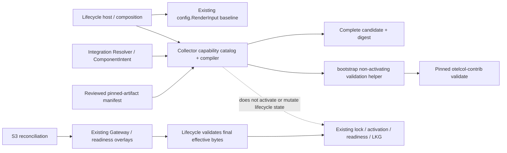
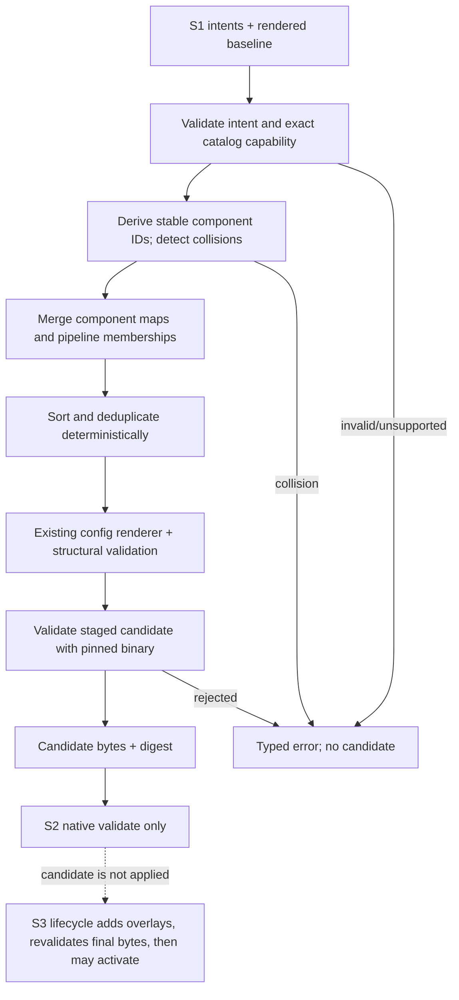

# S2 Collector Capability Catalog & Compiler — Technical Design

**Status:** Proposed for developer review; design only.
**Scope:** One S2 milestone: establish the exact shipped Collector capability inventory, compile S1 component intents with the existing Collector baseline into a complete candidate, and validate that candidate with the native binary. S2 does not decide when to apply it.

Labels: **Verified** = observed in repository source; **Approved** = target/S1 boundary; **Proposed** = design recommendation; **Open** = needs review or artifact evidence.

## 1. Requirements and invariants

**Inputs:** resolved S1 component intents; the existing ordered `config.RenderInput` baseline (base, OS and any existing profile/local layers plus explicit Gateway substitution); a capability catalog proven against the exact platform Collector artifact.

**Output:** deterministic complete telemetry YAML candidate and a digest bound to the exact candidate bytes, Collector version, platform and catalog version. S2 compiles and natively validates this candidate only. It does not write the active path, start/restart the Collector, add generation readiness or accept a candidate as applied.

**Invariants (Approved):** unknown/unavailable capabilities, malformed intent data, ambiguous pipeline mappings, ID collisions, or invalid native configuration fail closed. Host metrics, managed host-exporter receivers, OTLP endpoints and metrics/logs/traces pipelines remain intact. S2 validation does not prove activation or telemetry delivery. In S3/M2 lifecycle, readiness and Gateway overlays are applied as needed and the final effective bytes are natively validated before existing activation/recovery. S3 decides when to apply.

**Non-goals:** Reconciliation, activation or rollback implementation; Redis or any service-specific definition; CLI; Discovery; Core APIs/ownership policy; changing Collector version or artifacts; custom Collector components; runtime component discovery on agent startup.

## 2. Existing architecture assessment

| Area | Verified current implementation | S2 reuse / boundary |
|---|---|---|
| Collector pin and distribution | `internal/bootstrap/types.go` pins `0.160.0`; `SelectArtifact` pins separate Linux and Windows amd64 archive names, SHA-256 and sizes. No checked-in binary or verified component inventory exists in the repository. | Keep version and hashes as source of truth. Validate the actual downloaded archives/artifacts per OS; do not infer Contrib build contents from component source repositories. |
| Baseline | `configs/base/otel.yaml` defines OTLP receiver protocols, `health_check`, memory limiter, resource identity, batch, OTLP Gateway exporter and logs/metrics/traces pipelines. OS layers add hostmetrics and platform Prometheus receivers/pipeline membership. | Reuse ordered `config.RenderInput` and its deterministic recursive map merge; preserve all existing signals and settings. |
| Current dependency injection | `dependency.Catalog.CollectorReceivers` returns receiver names for enabled managed dependencies. `collectorConfigurationActivator` overlays `MetricsReceiverLayer`, currently replacing metrics receiver membership with `otlp`, `hostmetrics`, and managed receiver names. | Treat this existing path as the compatibility baseline. S2 must union existing configured pipeline membership with intent-derived members; it must not drop Windows Exporter/LibreHardwareMonitor/Node Exporter/OTLP or fork dependency ownership. |
| Rendering | `internal/config.Render` merges YAML layers and inline maps, performs structural validation, and serializes YAML. Lists are replacement values, not append-merged lists. | Reuse it for baseline rendering and final candidate rendering. S2 owns explicit, deterministic list union before final `Render`; never depend on accidental YAML list merge. |
| Native validation | `bootstrap.ActivateRenderedConfig` stages a file and invokes the pinned binary as `validate --config <staged path>` before replacing the active config. | Extract a bootstrap-owned non-activating staged validation helper and reuse it both here and from activation. It invokes the existing runner/validator only; it cannot rename or activate. Lifecycle still validates the final overlaid bytes immediately before activation. |
| Lifecycle and Gateway | `agentlifecycle` resolves effective Gateway ownership, readiness token, activation lock, applied generations and rollback/LKG around the existing activator. | Keep these outside the compiler. S3 supplies a validated candidate to existing lifecycle coordination; no new lifecycle is created in S2. |

## 3. Capability catalog and artifact proof

**Verified:** the two supported artifacts are `otelcol-contrib` v0.160.0, Linux amd64 and Windows amd64, with committed archive SHA-256 values in `internal/bootstrap/artifact.go`. This repository does not establish which exact receiver/processor/exporter/connector factories those binaries contain. “Contrib” is not evidence that every Contrib component is present.

**Proposed evidence process:** review and check in a small static capability manifest tied to Collector `0.160.0` and the exact Linux amd64 and Windows amd64 artifact hashes. In CI, download/obtain those exact artifacts, verify their hashes, extract and run each binary's `components` command; compare the observed component kinds/names and stability to the manifest, failing on mismatch. This proves platform availability without runtime inventory discovery. The Collector troubleshooting guide documents `otelcol components` and cautions that output format may change. Do not parse its output in Agent runtime. See [OpenTelemetry Collector troubleshooting: list available components](https://opentelemetry.io/docs/collector/troubleshooting/) and [Collector releases distribution description](https://github.com/open-telemetry/opentelemetry-collector-releases).

**Proposed catalog:** a small immutable in-process registry built from the reviewed static manifest. Each entry maps a public S1 capability ID to exact native component name/kind, platform availability, supported signals and explicit pipeline wiring rules. Only binary-probed entries appear as supported; platform differences are explicit. Redis or another receiver is unsupported until its exact factory is observed in the pinned artifact and its configuration validates. CI fails when either artifact disagrees with the manifest. Native `validate` remains final configuration authority.

**Proposed:** keep the small hand-reviewed manifest in source and publish raw per-platform inventories as CI artifacts for audit. Do not ship or parse raw inventories at runtime. Do not change the committed artifact version/checksums in S2.

## 4. Compiler behavior

1. Render the existing baseline through `internal/config.Render` with the same platform, ordered layers and effective Gateway substitution used today. Parse the resulting YAML document into a private mutable tree; never mutate caller-owned maps/intents.
2. For every intent, validate capability syntax, JSON object shape, non-secret config and catalog support for the target OS/architecture. Decode strictly; reject unknown fields only where the capability-specific component schema/native validation can authoritatively decide. Return typed errors preserving the capability and intent context without secret values.
3. Derive the native component instance ID as `<native-type>/i-<lowercase-hex-sha256(instance-id)>`. Hash the exact UTF-8 S1 instance ID bytes with full 64-character lowercase SHA-256 hex. This yields a stable, bounded, Collector-safe instance suffix without exposing arbitrary user IDs. Do not include endpoints, settings, secrets, map iteration, randomness or list position. Check collisions against both baseline and candidate IDs; any collision is an error, even if configs are equal. No component sharing is implicit.
4. Sort intents by capability ID, stable instance ID, then canonical config bytes. Insert component config under the catalog-selected section. The Capability Catalog owns explicit wiring rules for every component kind:

   | Kind | Required catalog mapping |
   |---|---|
   | Receiver | One or more signal pipelines that consume it. Attach only to those declared pipelines. |
   | Processor | Signal-specific pipeline and explicit ordered insertion point. No implicit append when ordering is semantically relevant. |
   | Exporter | Signal-specific pipeline destination and fan-out policy. Preserve existing Gateway exporters; reject ambiguous destination/ownership. |
   | Connector | Explicit signal-specific receiver/exporter roles and paired stable IDs. Reject partial or ambiguous connector wiring. |

   Missing, conflicting or unsupported mapping is a typed compilation error. Do not create arbitrary processors/exporters or mutate a baseline component implicitly.
5. Add IDs only to catalog-declared pipeline memberships. Preserve every existing receiver, processor and exporter and their meaningful ordering; deduplicate only when exact repeated membership has no semantic effect. Do not sort ordered processor chains. S2 must preserve logs/traces and the metrics host path; fail closed if safe composition is not defined.
6. Run final structural rendering/validation through the existing `config.Render` path after all additions. Compute SHA-256 over the exact returned candidate bytes and return those bytes plus the digest, Collector version, platform and manifest version. Candidate owns an immutable copy of the bytes; consumers must verify the digest before use. Any later overlay creates different bytes and therefore a new digest; S3 binds/validates the final overlaid candidate separately.
7. Invoke native Collector validation against a staged temporary candidate using a bootstrap-owned non-activating helper that reuses `validateCollector`, `CommandRunner`, staging and cleanup. Extract the shared validation-only work from `ActivateRenderedConfig`; keep file replacement in the existing activation method only. S2's helper must not know the active path, lifecycle lock, readiness token, LKG or state generations. Error includes platform, component ID and native validation context, but no secret-bearing config values.

The catalog, not Integration, decides Collector section, native name/kind, supported signal and pipeline wiring. Integration only declares stable capability IDs and intent config. The compiler does not check remote service health or claim telemetry delivery.

## 5. Contracts, package structure and dependencies

**Proposed files (new or modified):**

| File | Responsibility |
|---|---|
| `internal/collectorruntime/doc.go` (NEW) | Package boundary: Collector capability knowledge and candidate compilation; no process lifecycle ownership. |
| `internal/collectorruntime/capability.go` (NEW) | Capability ID/kind, signal and explicit wiring policy, platform support and immutable lookup from the reviewed manifest. |
| `internal/collectorruntime/compiler.go` (NEW) | Pure deterministic merge of baseline YAML plus S1 intents; collision and pipeline-membership rules; candidate and digest. |
| `internal/collectorruntime/errors.go` (NEW, if needed) | Small sentinels/types for unsupported capability, malformed intent, collision and compilation errors. Avoid error framework if wrapping sentinels suffices. |
| `internal/collectorruntime/*_test.go` (NEW) | Pure catalog/compiler contracts, exact artifact inventory checks and golden semantic preservation tests. |
| `internal/bootstrap/config_validation.go` (NEW or MODIFY) | Non-activating staged validation helper reusing existing runner and `validate --config` logic. It cannot replace the active file. |
| `internal/bootstrap/config_activation.go` (MODIFY) | Reuse validation-only helper, then preserve existing validate-final-bytes-before-atomic-replace behavior exactly. |
| `.github/workflows/ci.yml` (MODIFY) | Probe both pinned Collector artifacts and compare component inventories against the reviewed manifest; run native validation fixtures on the matching OS binary. |

**Contracts (Proposed):** compiler accepts a rendered baseline plus immutable S1 `ComponentIntent`s and target `PlatformInfo`; returns an immutable candidate byte copy with SHA-256 digest over those exact bytes, Collector version, platform and catalog version. Overlay changes produce new bytes and invalidate the original digest. Catalog lookup is exact by capability ID and platform. The validation-only boundary accepts candidate bytes, pinned binary path, environment and context and returns an error; it has no activation capability.

Dependency direction: `collectorruntime` depends on S1 Integration values, `internal/config`, and platform identity; it does not import `agentlifecycle`, SQLite, CLI, Core, or Collector process supervisor. `bootstrap` owns invoking the pinned CLI and supplies a non-activating validation-only helper. Existing activation owns final Gateway/readiness overlays, validation of those exact final bytes, file replacement, activation lock, readiness and recovery. The lifecycle host composes these contracts in S3. `internal/integration` remains unaware of `collectorruntime`.

## 6. Patterns and trade-offs

- **Registry:** justified for exact capability-to-native-component mapping and duplicate rejection. Keep it static; no dynamic plugins or runtime loading.
- **Adapter:** justified for the existing Collector CLI validator, so compiler tests stay pure and activation does not leak into S2. Reuse `CommandRunner`; do not create another process abstraction.
- **Pure compiler composition:** use explicit helper functions for stable IDs, map insertion and list union. No Strategy unless actual component kinds demonstrate materially different policies; a `ComponentKind` switch in catalog/compiler is simpler and bounded.
- **Manifest vs runtime discovery:** checked-in manifest makes runtime deterministic and works offline; CI probes detect artifact drift. Runtime `components` parsing is rejected because output may change and deployment should not dynamically redefine capabilities.

## 7. Failure, compatibility and recovery

| Failure | Result |
|---|---|
| Capability absent from manifest or unsupported on target OS | Reject candidate before native validation; do not alter active config. |
| Catalog lacks an unambiguous kind, signal or pipeline mapping | Reject the candidate; do not guess routing or alter existing pipelines. |
| Manifest disagrees with actual pinned artifact | CI/catalog verification fails; do not ship the capability as supported. |
| Malformed or secret-bearing intent config | Return `InvalidIntent`; never include raw config in error/log. |
| Stable ID collision with any existing or generated component | Return `ComponentIDConflict`, even if configurations are identical; sharing is never implicit. |
| Baseline parse/merge/reference error | Return contextual compile error; baseline and active config untouched. |
| S2 native `validate` rejection | Return `NativeValidationError`; no active file, activation journal, LKG or generations are touched. |
| S3 overlay/final native validation rejection | Existing lifecycle rejects final bytes before activation and preserves active/LKG and generation recovery semantics. |
| Existing host exporter/pipeline removed by merge | Compiler compatibility test fails; no candidate is accepted. |

S2 does not call activation, increment M1/M2 generations, write SQLite, add generation readiness, or update last-known-good artifacts. S3/M2 lifecycle adds effective Gateway/readiness overlays as required, validates those exact final bytes, then uses existing activation locking, readiness verification, applied-generation recording and LKG rollback. If overlays change bytes, the S2 digest no longer identifies the final artifact; lifecycle owns or recomputes its final digest. Neither validation stage proves telemetry delivery or Integration health.

## 8. Verification and acceptance

- **Catalog tests:** exact capability lookup; duplicate/malformed manifest entries rejected; Linux/Windows support matches inventory; version mismatch or missing probe fails CI.
- **Compiler unit tests:** stable IDs across repeated runs; deterministic bytes/digest independent of input ordering; duplicate list entries deduplicated; conflicting IDs rejected; malformed and unsupported intents fail before native invocation.
- **Preservation contract tests:** compile a baseline matching each current platform config and assert OTLP endpoints/protocols, health check, identity processors, memory limiter, batch, Gateway exporter, metrics/logs/traces pipelines, hostmetrics scrapers and current managed exporter receiver membership remain semantically intact after adding intents.
- **Native validation:** on Linux and Windows CI, validate generated baseline and representative test-contributor candidates with the exact pinned artifact selected by `SelectArtifact`. Native rejection must not modify an existing target file; use a temp destination and assert byte-for-byte preservation.
- **Lifecycle compatibility:** existing activation, readiness, M1/M2 generation, enrollment and recovery suites remain unchanged and pass. S2 test proves it returns bytes/digest and does not call activation or write Agent state.
- **Engineering:** non-test Go files <=450 LOC, package/exported GoDoc, `gofmt`, focused tests, `go vet ./...`, `go build -buildvcs=false ./...` and both platform CI jobs pass.

## 9. Open decisions, blockers and risks

1. **Artifact evidence (implementation blocker):** repository sources pin version and hashes but do not contain the binaries or verified component inventories. The S2 capability manifest must remain empty/unclaimed for any unprobed component until CI obtains and checks both exact artifacts. Redis availability is unverified and must not be assumed.
2. **Manifest representation (Open, small):** approve the checked-in manifest encoding and whether raw `components` output is retained as CI artifact. Proposed: compact reviewed manifest in source; raw platform output as CI artifact only.
3. **S1 intent key limitation (Open):** current intents have capability and configuration but no per-intent stable key. The proposed instance-based native ID works for one intent of a given capability per Integration Instance. If one instance emits the same capability multiple times, reject it as ambiguous until S1 contract is explicitly extended; do not use order/index-derived IDs.
4. **Wiring catalog review (Open):** each manifest entry needs reviewed signal-specific wiring, especially processor ordering, exporter fan-out, and connector dual roles. Missing or ambiguous rules block that capability, not the whole compiler.
5. **Native validator extraction (implementation task):** refactor only enough bootstrap-owned validation code to expose staged validation without activation; keep the final lifecycle validation of overlaid bytes. Do not pass the active target path to the S2-only validator.

**Stable ID recommendation:** `<native-type>/i-<lowercase-full-hex-sha256(UTF-8 integration-instance-id)>`; deterministic, bounded and independent of secret/configuration values. Every collision rejects, including equal configs. This recommendation is explicit enough for final design review; any change requires updating compatibility tests before implementation.

The architecture is ready for final developer review. Actual platform artifact probing remains a concrete S2 implementation prerequisite, not an unverified claim in this design. No Redis, reconciliation, production CLI, Core, Discovery or lifecycle rewrite is needed.

## References

- [Target Architecture v0.1.4](target-architecture-v0.1.4.md)
- [S1 Integration Core Technical Design](integration-core-s1-design.md)
- [Integration Core Delivery Slices](../roadmap/telemetry-agent-v0.1.4-integration-core-slices.md)
- [OpenTelemetry Collector component inventory command](https://opentelemetry.io/docs/collector/troubleshooting/)
- [OpenTelemetry Collector release distributions](https://github.com/open-telemetry/opentelemetry-collector-releases)
