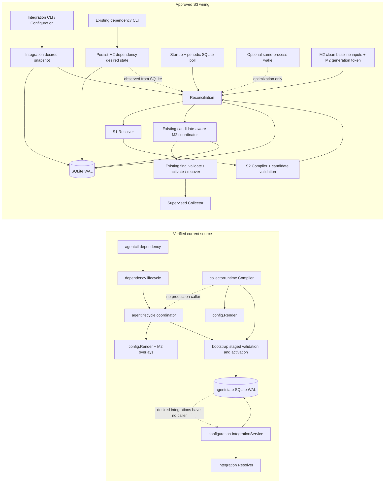
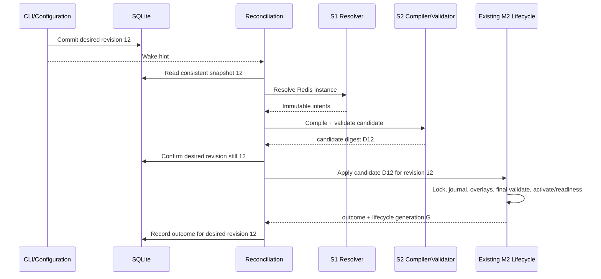
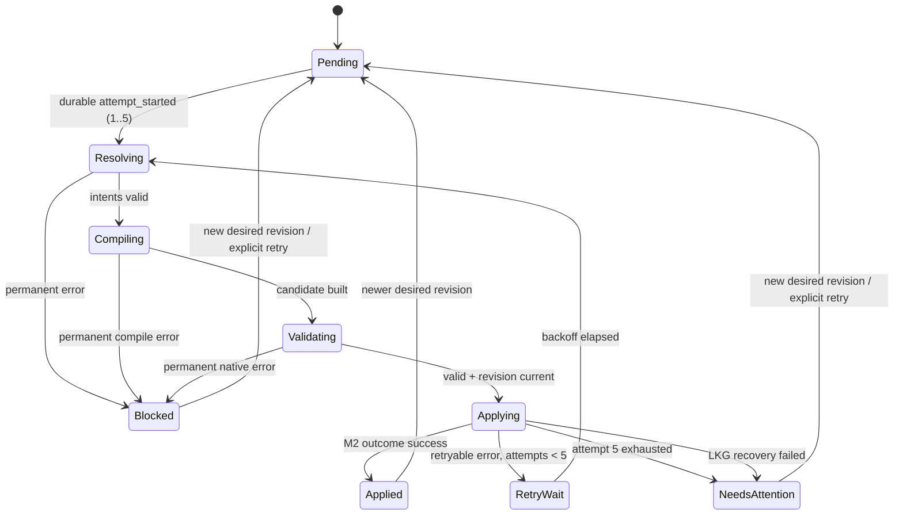

# S3 Reconciliation & Collector Capability Verification — Technical Design

**Status:** Proposed for developer review; design only.
**Scope:** Connect S1 desired Integration state and S2 candidate compilation to the existing lifecycle. OD-06 defines general Collector Capability Verification; Redis is the first reference integration.
**Labels:** **Verified** = present in inspected source; **Approved** = supplied decisions; **Proposed** = design recommendation; **Open** = unresolved evidence or implementation detail.

## 1. Goal, invariants and non-goals

**Approved behavior:** configure Redis → persist desired state → wake reconciliation → resolve S1 intents → compile/validate an S2 candidate → apply through the existing M2 lifecycle → observe health and delivery independently.

**Approved assembly rule:** S2 Compiler is the single owner that assembles the complete telemetry candidate from a clean baseline and the complete current enabled Integration set. M2 supplies baseline inputs and owns lifecycle-only overlays, final validation, activation and recovery. A prior generated candidate is never a later compile baseline.

SQLite desired instances/revision are authoritative; events are hints. Reconcile at startup and periodically. One reconciliation execution is in flight. Check revision-bound plans before lifecycle admission. If desired state changes after activation starts, let that lifecycle operation complete or recover, record it against the submitted revision, then process the newest snapshot. Never label an older applied revision as the current target. Retry at most five total attempts per revision/failure target; permanent failures block, retryable failures use bounded exponential backoff, exhaustion becomes `Needs Attention`, and explicit retry or a new desired revision is required to resume. Existing lifecycle owns locking, overlays, validation, readiness, journaling and LKG recovery.

**Non-goals:** Discovery (S4), Core APIs/sync/precedence, Redis server management, integration-specific branches in orchestration, a second activation/rollback mechanism, building or dynamically loading third-party plugins in S3, and inferring health or delivery from configuration application.

## 2. Bounded responsibilities

| Context                        | Owns                                                                                                                                                                                         | Must not own / dependency direction                                                                                  |
| ------------------------------ | -------------------------------------------------------------------------------------------------------------------------------------------------------------------------------------------- | -------------------------------------------------------------------------------------------------------------------- |
| Discovery & Inventory (S4)     | Observe resources and propose candidates with evidence/provenance.                                                                                                                           | No desired-state mutation or Collector control absent an approved action; not part of S3.                            |
| Integration Core (S1)          | Validate instances, exact-version definitions, deterministic contributions and immutable intents.                                                                                            | No SQLite, Collector concepts, orchestration, activation or health.                                                  |
| Configuration                  | Desired instances, provenance, per-instance and desired-set revisions; validate/resolve before persistence.                                                                                  | No retry state, applied state or lifecycle operations.                                                               |
| Reconciliation (S3)            | Read consistent Integration and M2 desired inputs; resolve the complete enabled set through S1; coordinate S2 compilation/validation and candidate admission for every configuration-changing trigger; track convergence. | No Discovery, Integration-specific branching, YAML assembly, Collector process control, activation, rollback or duplicate lifecycle journal. |
| Collector Runtime Control (S2) | Sole owner of complete telemetry candidate assembly from clean `config.RenderInput` baseline plus all enabled intents; artifact-bound catalog, deterministic wiring and staged candidate validation. | No desired ownership, scheduling, process supervision or activation; not responsible for building custom components. |
| Existing M2 Lifecycle          | Supply clean baseline inputs including existing host and managed-dependency configuration; admit revision-bound candidate; apply readiness/Gateway lifecycle values; final validation, activation, readiness, journal and LKG recovery. | No desired Integration ownership, resolver/compiler, retry policy or per-Integration health. Under S3, legacy managed-dependency commands must route through shared reconciliation rather than call an independent candidate-less activator. |
| Health & Diagnostics           | Read operational evidence and expose safe status/history/inspection. Reconciliation outcome persistence is implemented behind its own narrow repository in the shared SQLite infrastructure. | No desired mutation, activation or health inference from `Applied`.                                                  |
| `agentstate` persistence       | SQLite WAL adapters/migrations for state owned by Configuration, lifecycle and reconciliation.                                                                                               | No business policy; each context retains its own repository contract and state ownership.                            |

**Verified current seams:** [`configuration.IntegrationService.Put`](../../../internal/configuration/integration.go#L37) resolves before persistence; the SQLite adapter exposes consistent desired snapshots in [`sqlite_integration.go`](../../../internal/agentstate/sqlite_integration.go#L145). [`collectorruntime.Candidate`](../../../internal/collectorruntime/compiler.go#L17) carries immutable bytes/digest/platform/catalog metadata. S2 currently accepts `config.RenderInput` and enabled resolved instances, then calls [`config.Render`](../../../internal/collectorruntime/compiler.go#L47) itself. M2's [`collectorConfigurationActivator`](../../../internal/agentlifecycle/collector_configuration.go#L47) independently builds input from ordered layers plus a metrics receiver overlay (`otlp`, `hostmetrics`, enabled managed dependencies) and readiness overlay; it resolves effective Gateway environment and calls [`bootstrap.ActivateRenderedConfig`](../../../internal/bootstrap/config_activation.go#L19). [`configurationCoordinator.Apply`](../../../internal/agentlifecycle/configuration.go#L42) owns locking, pending activation, generation state and recovery but does not accept a candidate. The source-compatible baseline seam is therefore the existing `config.RenderInput`, populated by M2 with current managed receiver membership and accompanied by the M2 `DesiredGeneration` it represents. S2 renders that input exactly once and assembles integrations; candidate-aware M2 applies lifecycle-only overlays without re-rendering the layer baseline. Proposed G-07 change: dependency commands retain mutation and ownership behavior but route their post-mutation action through shared reconciliation; the current candidate-less apply call is no longer used for S3-managed changes. No general internal event bus API or production integration caller was found; `agentctl` has no integration command group.

## 3. Current and target dependency/call flow



Current dependency fact: `collectorruntime` imports `config`, `integration`, `identity` and `bootstrap`; `agentlifecycle` imports `agentstate`, `dependency`, `config` and `bootstrap`; `dependency` imports `agentstate` and `config`. No Reconciliation package or runtime call edge connects S1/S2 to M2 today. Target direction: Reconciliation depends on Configuration's snapshot contract, S1 resolver, S2 compiler and narrow baseline/candidate lifecycle ports. M2 may depend on the S2 candidate value, but S1, S2 and M2 do not import Reconciliation. The composition root wires the ports. Discovery remains outside this flow pending an approved action policy.

## 4. OD-05: candidate-aware contract with existing lifecycle

**Verified M2 semantics/call graph:** [`State.EnableDependency`/`DisableDependency`/`RequestUninstall`](../../../internal/agentstate/state.go#L114) advance `DesiredGeneration` when dependency state changes; accepted Core Gateway changes advance it in [`sqlite_core_gateway.go`](../../../internal/agentstate/sqlite_core_gateway.go#L74). `configurationCoordinator.Apply` holds the process mutex and OS lifecycle lock, prepares recovery, commits `PendingActivation`, invokes the state-driven activator, then persists `ActivatedGeneration`. The activator renders baseline/configuration, adds Gateway/readiness inputs and calls `bootstrap.ActivateRenderedConfig`. The runtime watcher launches the activated generation, verifies readiness, commits launch config/LKG, then persists `AppliedGeneration`. On readiness failure, rollback restores LKG and resets `ActivatedGeneration` to prior `AppliedGeneration`; `DesiredGeneration` remains monotonic. Startup recovery distinguishes pending generations above `ActivatedGeneration` (promotion may be incomplete) from activated-but-unapplied generations (restore prior active/LKG and roll back state). The current [`activation_journal`](../../../internal/agentstate/sqlite_schema.go#L24) is keyed only by lifecycle generation and [`recordActivationTransition`](../../../internal/agentstate/sqlite_schema.go#L159) upserts activated/rolled-back outcome. **G-08 finding:** this generation covers persisted M2 state transitions, including dependency and Gateway state, but does not cover edits to the ordered file-backed config layers, their contents/order, platform substitutions or other render inputs. Those files are read by [`config.Render`](../../../internal/config/renderer.go#L40); no corresponding layer-content revision is persisted. S3 must add baseline fingerprint validation. S3 extends the existing lifecycle path; Reconciliation must not invoke `ActivateRenderedConfig` directly.

**Proposed smallest extension (not existing APIs):** retain the same `configurationCoordinator`, locks, recovery hooks and journal. Add a candidate-bearing request path beside the M1/M2 state-driven entry point. S3 obtains a `CleanBaselineSnapshot` through a narrow M2 baseline port; it contains the existing `config.RenderInput`, the `agent_state.DesiredGeneration` from which its dependency membership was built, and a deterministic `baseline_fingerprint`. The input includes the current ordered file layers and one M2-owned inline receiver layer containing `otlp`, `hostmetrics` and enabled managed-dependency receivers; it excludes readiness-only overlays. The fingerprint covers ordered layer names/paths/content, platform and relevant render values, canonical inline M2 receiver membership, and the M2 desired generation. S2 calls `config.Render` once and assembles the complete candidate from that baseline and every enabled resolved integration. It never uses the previously activated/generated candidate as input.

The M2 admission method receives the candidate identity, expected Integration `desired_set_revision`, expected M2 `DesiredGeneration`, and `baseline_fingerprint`. Under the existing OS lifecycle lock, M2 re-reads the current clean baseline inputs and recomputes the fingerprint before opening the admission transaction. A changed fingerprint is rejected as `StaleBaseline` before lifecycle admission. The immediate SQLite transaction then verifies the Integration desired revision and M2 generation, selects the existing lifecycle generation, and persists `PendingActivation` plus desired/candidate/baseline identity. The generation comparison catches concurrent dependency/Gateway state changes; the fingerprint catches layer-content, layer-order, platform/value or other render-input changes not represented by that generation. No file reads, compilation or Collector work occurs inside the SQLite transaction. For a new effective candidate, advance existing `DesiredGeneration` once; retries for the same failed target reuse that reserved generation rather than creating one generation per attempt. A newer effective target advances the existing generation. Attempts remain attempt-history rows, not generations. This successful commit is **admission**. A mismatch returns a typed stale-plan outcome; no pending intent or generation advance is committed.

```text
CandidateApplyRequest {
  desiredSetRevision, expectedBaselineGeneration, baselineFingerprint,
  candidate (bytes + digest + platform/catalog/version)
}
ActivationOutcome {
  submittedDesiredSetRevision, lifecycleGeneration, candidateDigest,
  stage, result, recoveryResult, errorCode
}
CleanBaselineSnapshot {
  renderInput: existing config.RenderInput plus current M2-managed receivers,
  desiredGeneration: existing M2 generation represented by that input,
  baselineFingerprint: deterministic fingerprint of all clean baseline inputs
}
```

`CleanBaselineSnapshot` and `CandidateApplyRequest` are proposed S3 contracts, not current exported APIs. Keep them narrow: the baseline carries render inputs, the existing generation token and a content fingerprint; the apply request carries the immutable S2 candidate and all three stale-plan checks. These are values/ports at the Reconciliation seam, not a new plugin or configuration framework.

The coordinator acquires its process mutex and OS lifecycle lock before admission. It refreshes and compares the baseline fingerprint before the SQLite adapter uses existing `sqliteUpdateMutex`, `BEGIN IMMEDIATE` and busy timeout to verify `integration_desired_state.desired_set_revision` and expected baseline `agent_state.DesiredGeneration`; it then commits the existing `DesiredGeneration` reservation plus `PendingActivation` and mapping together. The transaction closes before work proceeds. **No SQLite transaction is held during file reads, compilation, overlay rendering, native validation, file promotion, Collector readiness, or recovery.** The OS lifecycle lock remains held through those operations as today. All Agent-managed layer writers must use this same lifecycle lock. Manual edits that bypass it are detected on the next fingerprint check, though a write racing the admission check remains an Open filesystem-coordination risk. Configuration writes use SQLite only and never acquire the lifecycle lock, so revision 13 may commit while revision 12 activates; this is an allowed post-admission change.

Lock order is fixed: process activation mutex → OS lifecycle lock → short SQLite admission transaction. Configuration mutations take only their SQLite transaction and release it before publishing a wake signal. No code waits for the lifecycle lock while retaining a SQLite transaction. This avoids lock inversion and keeps the SQLite writer lock out of long Collector operations.

After admission, the activator copies the S2 candidate bytes and applies lifecycle-owned final overlays only: generation-bound readiness and effective Gateway runtime/validation values using existing Gateway ownership. It must not call `config.Render` on file layers again or replace complete candidate pipeline lists. It computes the final effective digest, then validates those exact effective bytes before promotion. Validation failure writes a terminal failed-validation mapping and clears Pending Activation atomically; Activated/Applied stay at prior values and the reserved DesiredGeneration remains available for retry. On validation success, promotion proceeds and M2 persists ActivatedGeneration using existing semantics. Runtime readiness success must call a candidate-aware terminal SQLite method that, in one transaction, verifies pending generation/mapping, calls `MarkGenerationApplied`, writes the current journal mapping/outcome=`applied` with desired revision/candidate/effective/baseline digests, and clears Pending Activation. Thus AppliedGeneration cannot commit without matching M2 evidence. Existing state/journal methods remain sole generation/recovery owners. S2 digest is pre-overlay; effective digest is distinct.

If desired revision differs during admission, return typed `StaleDesiredRevision` without activation or generation advance. Crash before admission commit leaves state unchanged. Crash after admission but before promotion leaves Pending Activation and recovery path; startup restores prior config and atomically clears intent/records interrupted failure while AppliedGeneration stays prior. Crash after promotion/ActivatedGeneration but before readiness leaves Pending Activation; startup restores prior config/LKG, resets ActivatedGeneration to AppliedGeneration and records recovered failure in the same state/journal transaction. Readiness success commits AppliedGeneration and successful mapping together. Crash after that terminal commit but before Reconciliation records its result is repaired idempotently from authoritative M2 journal evidence. If desired revision advances after admission, lifecycle completes or recovers the admitted generation; Reconciliation records it for the submitted revision and rereads latest desired. Revision 12 evidence cannot satisfy revision 13. M2 owns the mapping between desired revision and existing lifecycle generation.

```mermaid

sequenceDiagram
  participant R as Reconciliation
  participant L as Existing M2 coordinator
  participant DB as SQLite WAL
  participant B as Clean baseline provider
  participant S2 as S2 Compiler
  participant C as Collector lifecycle

  R->>DB: Read desired snapshot revision 12
  R->>B: Read clean baseline inputs
  B->>DB: Read M2 state and dependency membership
  B-->>R: RenderInput + baseline DesiredGeneration 36
  R->>S2: Compile full enabled set against clean baseline
  S2-->>R: Candidate C12 + digest
  R->>L: C12, expected desired revision 12, baseline generation 36
  L->>DB: BEGIN IMMEDIATE
  L->>DB: Verify desired revision 12 + baseline generation 36

  alt Latest revision is 13 before admission
    DB-->>L: Revision mismatch
    L->>DB: ROLLBACK
    L-->>R: Stale plan, no generation or intent
    R->>R: Re-read snapshot and baseline; recompile latest

  else Revision remains 12
    L->>DB: Write existing generation 37 and PendingActivation
    L->>DB: COMMIT
    DB-->>L: Admitted atomically

    Note over L,DB: No SQLite transaction remains open

    opt Desired revision changes to 13 after admission
      R->>DB: Commit desired revision 13
    end

    L->>C: Lifecycle overlays, final validation, promotion/readiness/recovery
    C-->>L: Outcome for generation 37
    L-->>R: Outcome bound to revision 12 and generation 37
    R->>DB: Read latest desired revision 13
    R->>R: Reconcile revision 13 next
  end
```

**Outcome/error semantics (Proposed):** structured outcome distinguishes `admission`, `final_validation`, `activation`, `readiness`, `state_commit`, and `recovery`; includes typed error code, whether admission committed, lifecycle generation if reserved, both digests when computed, and whether LKG recovery succeeded/failed. Recovery failure is surfaced as critical/needs attention and is never hidden by retry. Reconciliation maps typed stage/code to Approved retry classes; it never performs rollback. Preserve current error wrapping for legacy callers; do not leak raw configuration/secrets into diagnostics.

## 5. Single assembly owner and extension scenarios

**Approved:** S2 is the only telemetry configuration assembler. M2 provides configuration inputs for a clean baseline; it does not merge Integration components. M2's candidate path performs only lifecycle-owned final overlays and applies the result through the existing activation coordinator. Under S3, managed-dependency changes also use this candidate path through shared reconciliation; the legacy state-driven path remains only for bootstrap/compatibility callers outside S3-managed configuration changes.

**Proposed minimal contracts (names illustrative):**

```go
// Reconciliation-owned port; implemented by an M2 adapter.
type BaselineProvider interface {
    CleanBaseline(context.Context) (CleanBaselineSnapshot, error)
}

type CleanBaselineSnapshot struct {
    Input config.RenderInput
    M2DesiredGeneration uint64
}

// Reconciliation-owned port; implemented by the existing M2 coordinator adapter.
type CandidateApplier interface {
    ApplyCandidate(context.Context, CandidateApplyRequest) (ActivationOutcome, error)
}
```

The baseline provider reads current `agentstate.State`, derives managed receivers through the existing `dependency.Catalog.CollectorReceivers`, and returns the same ordered layers and `config.MetricsReceiverLayer` shape used by `collectorConfigurationActivator` today. It excludes the generation-specific readiness overlay. The existing `config.RenderInput` remains the compiler input; no new YAML model or renderer is introduced. `M2DesiredGeneration` catches persisted dependency/Gateway changes; `baseline_fingerprint` catches file-backed layer and render-input changes that do not advance it. Candidate admission compares both with current inputs along with the desired Integration revision so concurrent M2 or layer changes cannot silently replace newer configuration. These ports belong to the S3 application boundary; `agentlifecycle` implements them structurally and does not import Reconciliation.

The candidate-aware activation path receives one immutable `collectorruntime.Candidate`, copies its bytes, overlays readiness using the existing config helper, supplies the existing effective Gateway value through the established runtime/validation environment, computes final effective identity, and calls the existing bootstrap final-validation-and-promotion path. It does **not** re-read or re-render the baseline. S2 appends only catalog-declared component IDs to declared pipeline memberships; it does not replace whole pipeline maps or processor ordering. IDs colliding with baseline or another contribution fail closed; there is no implicit sharing or removal by mutating an earlier candidate. Existing `ApplyDesiredConfiguration` command compatibility is retained as a façade to the shared reconciliation path after S3 owns runtime configuration; its candidate-less renderer is not used for managed dependency mutations. Both paths ultimately use the same coordinator, locks, generation records, activation journal and recovery.

### Current vs target assembly sequence

**G-07 — Unified configuration assembly (Proposed):** keep existing `agentctl dependency` commands, desired-state mutations, ownership checks and synchronous success/error behavior. Change their post-mutation action to invoke the same generic `ReconcileOnce` path used by Integration changes; they must no longer call the state-driven `ApplyDesiredConfiguration` renderer once S3 owns runtime configuration. Managed dependency state remains in `agentstate`; the Integration desired set remains in Configuration. Reconciliation reads both, requests a clean baseline including all currently enabled managed receivers, resolves every enabled Integration, and asks S2 to assemble once. The existing M2 coordinator remains the only activation path. When CLI and Agent service are separate processes, the CLI one-shot may accelerate its own operation, while the service's periodic SQLite poll independently detects and converges the committed state. Neither process signals the other through a new IPC mechanism. The existing candidate-less activation API may remain for bootstrap/legacy compatibility, but no S3-managed configuration mutation may use it.

```mermaid
sequenceDiagram
  participant IC as Integration CLI
  participant DC as Existing dependency CLI
  participant RC as Shared Reconciliation
  participant B as M2 baseline adapter
  participant DB as SQLite / agentstate
  participant S1 as Resolver
  participant S2 as Compiler
  participant M2 as M2 candidate coordinator
  participant C as Bootstrap / Collector

  IC->>DB: Commit Integration desired set R22
  DC->>DB: Commit managed dependency desired-state change
  IC->>RC: Run once / optional local wake
  DC->>RC: Run same reconciliation once
  Note over RC,DB: Agent service also polls SQLite periodically; this guarantees cross-process detection
  RC->>DB: Read consistent Integration snapshot and M2 state
  RC->>B: Request clean baseline
  B->>DB: Read M2 dependency state + DesiredGeneration G36
  B-->>RC: config.RenderInput (layers + host/managed receivers), G36
  RC->>S1: Resolve every enabled instance from R22
  S1-->>RC: Immutable component intents
  RC->>S2: Compile baseline + full enabled intent set
  S2->>S2: config.Render once; deterministic component/pipeline merge
  S2-->>RC: Complete candidate C22 + candidate digest
  RC->>S2: Validate staged candidate with pinned artifact
  S2-->>RC: Candidate accepted / typed validation error
  RC->>M2: Candidate, R22, expected baseline G36
  M2->>DB: Atomic stale checks + PendingActivation admission
  Note over M2,DB: Commit, then close SQLite transaction before Collector work
  M2->>M2: Readiness overlay + current Gateway runtime values
  M2->>C: Validate final effective config; promote under existing lock
  C-->>M2: Activation/readiness/recovery evidence
  M2->>DB: Existing generation/journal terminal commit
  M2-->>RC: Outcome bound to R22 and lifecycle generation
```

### Scenario A — Plug PostgreSQL

**Input (illustrative, capability availability must pass OD-06):** register a static `postgresql@1.0.0` definition and a contributor that validates endpoint settings and returns an intent with a stable PostgreSQL metrics capability ID. The verified artifact/platform catalog maps that ID to a native receiver and metrics pipeline. The desired instance is enabled in the current snapshot.

**Output:** S1 resolves the definition; S2 adds the catalog-selected receiver and pipeline membership to the clean baseline and validates the candidate. Reconciliation submits that candidate with desired revision and baseline generation. M2 uses the generic candidate path. For this integration addition, only the definition/contributor registration and verified catalog entry change; the Reconciliation algorithm and M2 activation logic do not gain PostgreSQL branches. S3's one-time generic runtime wiring remains required before any Integration can activate.

### Scenario B — Plug a custom Cooling Receiver

**Input:** a separately built and verified Collector distribution, its exact artifact identity per platform, a contributor intent, and an OD-06 catalog entry whose receiver/pipeline mapping has artifact inventory and representative native-validation evidence.

**Output:** S2 accepts the capability only for the verified distribution/platform and compiles its intent into the same complete candidate path. No S3-specific build or dynamic loading is introduced. **Verified current limitation:** `collectorruntime.StaticCatalog` and `ValidateCandidate` call the official `bootstrap.SelectArtifact` and compare against the official pinned version/hash. **Proposed scope rule:** keep OD-06 artifact evidence and catalog semantics distribution-neutral; alternate-distribution selection/verification may be deferred as a separate capability. Do not hard-code the upstream distribution name into S1, S3, or Integration contracts. Until the Agent can select and launch that verified alternate artifact, this scenario is design-compatible but not operationally supported.

### Scenario C — Unplug Redis while PostgreSQL remains active

The example below illustrates the transformation only; Redis/PostgreSQL are emitted only after each exact target artifact/platform capability passes OD-06. The clean baseline `B36` is the current base + laptop + Linux layers with M2's host/managed receivers. At desired revision `R21`, S2 produced the historical output `C21` with Redis and PostgreSQL enabled. A disable changes Redis to `enabled=false`, atomically advancing desired-set revision to `R22`; the new consistent snapshot contains both instances. Resolver returns no intents for disabled Redis and a PostgreSQL intent for the enabled instance. S2 compiles `R22` from `B36` (or a fresh baseline snapshot), never from historical candidate `C21`.

```yaml
# Historical candidate C21 before Redis is disabled (structural example only).
# C21 is shown to explain the removal; it is NEVER the next compile baseline.
extensions:
  health_check:
    endpoint: 127.0.0.1:13133
receivers:
  otlp:
    protocols:
      grpc: { endpoint: 127.0.0.1:4317 }
      http: { endpoint: 127.0.0.1:4318 }
  hostmetrics:
    collection_interval: 15s
    scrapers: { cpu: {}, memory: {}, disk: {}, filesystem: {}, network: {}, paging: {}, load: {}, system: {} }
  prometheus/node_exporter:
    config:
      scrape_configs:
        - job_name: node_exporter
          scrape_interval: 15s
          static_configs: [{ targets: [127.0.0.1:9100] }]
  postgresql/i-<sha256-postgres-instance>:
    endpoint: 192.168.1.20:5432 # illustrative; native settings require verified definition
  redis/i-<sha256-redis-instance>:
    endpoint: 192.168.1.10:6379 # illustrative prior C21; native settings require verified definition
processors:
  memory_limiter:
    check_interval: 5s
    limit_mib: 256
    spike_limit_mib: 64
  resource/agent_identity:
    attributes:
      - { key: host.name, value: '${value:host.name}', action: upsert }
      - { key: host.id, value: '${value:host.id}', action: upsert }
      - { key: service.name, value: ar-imms-node-agent, action: insert }
  resource/laptop:
    attributes:
      - { key: asset.type, value: laptop, action: upsert }
      - { key: deployment.environment, value: homelab, action: upsert }
  batch: { timeout: 5s }
exporters:
  otlp/gateway:
    endpoint: '${env:OTEL_GATEWAY_ENDPOINT}'
    tls: { insecure: true }
service:
  extensions: [health_check]
  pipelines:
    metrics:
      receivers: [otlp, hostmetrics, prometheus/node_exporter,
                  postgresql/i-<sha256-postgres-instance>, redis/i-<sha256-redis-instance>]
      processors: [memory_limiter, resource/agent_identity, resource/laptop, batch]
      exporters: [otlp/gateway]
    logs:
      receivers: [otlp]
      processors: [memory_limiter, resource/agent_identity, resource/laptop, batch]
      exporters: [otlp/gateway]
    traces:
      receivers: [otlp]
      processors: [memory_limiter, resource/agent_identity, resource/laptop, batch]
      exporters: [otlp/gateway]
```

The component settings above are structural examples, not OD-06 or native-validation evidence. The exact extension result is determined by the verified per-capability configuration schema.

After disabling Redis, the complete S2 output `C22` is:

```yaml
extensions:
  health_check:
    endpoint: 127.0.0.1:13133
receivers:
  otlp:
    protocols:
      grpc: { endpoint: 127.0.0.1:4317 }
      http: { endpoint: 127.0.0.1:4318 }
  hostmetrics:
    collection_interval: 15s
    scrapers: { cpu: {}, memory: {}, disk: {}, filesystem: {}, network: {}, paging: {}, load: {}, system: {} }
  prometheus/node_exporter:
    config:
      scrape_configs:
        - job_name: node_exporter
          scrape_interval: 15s
          static_configs: [{ targets: [127.0.0.1:9100] }]
  postgresql/i-<sha256-postgres-instance>:
    endpoint: 192.168.1.20:5432 # illustrative; native settings require verified definition
processors:
  memory_limiter:
    check_interval: 5s
    limit_mib: 256
    spike_limit_mib: 64
  resource/agent_identity:
    attributes:
      - { key: host.name, value: '${value:host.name}', action: upsert }
      - { key: host.id, value: '${value:host.id}', action: upsert }
      - { key: service.name, value: ar-imms-node-agent, action: insert }
  resource/laptop:
    attributes:
      - { key: asset.type, value: laptop, action: upsert }
      - { key: deployment.environment, value: homelab, action: upsert }
  batch: { timeout: 5s }
exporters:
  otlp/gateway:
    endpoint: '${env:OTEL_GATEWAY_ENDPOINT}'
    tls: { insecure: true }
service:
  extensions: [health_check]
  pipelines:
    metrics:
      receivers: [otlp, hostmetrics, prometheus/node_exporter, postgresql/i-<sha256-postgres-instance>]
      processors: [memory_limiter, resource/agent_identity, resource/laptop, batch]
      exporters: [otlp/gateway]
    logs:
      receivers: [otlp]
      processors: [memory_limiter, resource/agent_identity, resource/laptop, batch]
      exporters: [otlp/gateway]
    traces:
      receivers: [otlp]
      processors: [memory_limiter, resource/agent_identity, resource/laptop, batch]
      exporters: [otlp/gateway]
```

The complete post-disable `C22` has the same baseline receiver, processor, exporter and logs/traces sections; S2 omits only the Redis receiver component and its metrics receiver membership. It retains PostgreSQL, hostmetrics, Node Exporter, the ordered shared processors, `otlp/gateway`, logs/traces pipelines and the Gateway environment reference. S2 returns a new candidate digest over exact `C22` bytes. M2 then overlays its fresh readiness token and effective Gateway runtime/validation value, validates the final effective configuration and uses existing activation/recovery. The final digest differs from `C21`; M2 records the new lifecycle generation against desired revision `R22`. If S2 sees a component ID collision or an unsupported capability, it rejects the candidate rather than sharing or overwriting a component.

```mermaid
sequenceDiagram
  participant CLI as Configuration writer
  participant DB as SQLite desired state
  participant RC as Reconciliation
  participant S1 as Resolver
  participant S2 as Compiler
  participant M2 as Existing lifecycle

  CLI->>DB: Disable redis-primary; commit desired revision R22
  RC->>DB: Read consistent snapshot R22 (Redis disabled, PostgreSQL enabled)
  RC->>S1: Resolve enabled instances only
  S1-->>RC: PostgreSQL intent; no Redis intent
  RC->>S2: Clean baseline + complete enabled intent set
  S2->>S2: Rebuild C22; remove Redis component/membership by omission
  S2-->>RC: Candidate C22 + digest; host and PostgreSQL retained
  RC->>M2: Submit R22-bound candidate
  M2->>M2: Admission, lifecycle overlays, final validation, activation/readiness
  M2-->>RC: Outcome + lifecycle generation
  RC->>DB: Persist reconciliation outcome for R22
```

## 6. State, attempts and controller algorithm

Configuration alone mutates desired instances and desired-set revision. Reconciliation owns its durable retry target and bounded attempt history through its repository. M2 lifecycle generations, pending activation, activation journal and LKG remain M2-owned. Store safe codes/metadata, never raw settings or full Collector diagnostics. Prune old completed rows by agreed count/age, preserving active target and pending recovery evidence. Writes are short SQLite transactions; never hold a DB transaction across compilation, process execution or activation.

**OD-05B — durable desired-to-applied mapping (Approved):** the current target mapping is stored with M2 activation records, not as a second Reconciliation generation/journal. Extend `PendingActivation` with `DesiredSetRevision`, `CandidateDigest`, `BaselineFingerprint`, and later `EffectiveConfigDigest`; its existing `Generation` remains the M1/M2 lifecycle generation. Extend the existing `activation_journal` row for that generation with current mapping fields and typed terminal outcome/stage/recovery result. This remains a single current terminal mapping per lifecycle generation; it adds no generation counter or parallel lifecycle journal. Legacy rows keep mapping fields null. M2 writes admission mapping with Pending Activation atomically; it writes final digest/outcome at validation failure/recovery or successful readiness terminal commit. Reconciliation attempts may reference these identifiers but are not authoritative for activation state.

**G-09 — Retry and journal semantics (Proposed):** the M2 `DesiredGeneration` identifies an effective desired configuration target, not an attempt. If the exact `(desired_set_revision, baseline_fingerprint, candidate_digest)` is already terminally applied, return the authoritative existing M2 outcome idempotently: no new generation, activation or attempt charge. An explicit retry of a target already applied is also a no-op; forced reactivation is outside this contract. If the exact target failed before application and OD-02 allows another attempt, reuse its reserved `DesiredGeneration` after the previous `PendingActivation` is cleared/recovered; do not allocate one lifecycle generation per retry. A changed Integration revision, clean baseline fingerprint or candidate digest is a new effective target and reserves the next existing `DesiredGeneration`.

`activation_journal` is currently keyed by generation and upserts one row; keep it as the authoritative **current terminal mapping** for that generation. Preserve per-attempt history in the already-approved Reconciliation attempt repository, not by creating another lifecycle journal. Before retrying, close the prior Reconciliation attempt with M2's terminal outcome/recovery evidence. If the process crashes between M2's terminal commit and that attempt close, startup reconciles the still-started attempt from the matching M2 journal/Pending Activation evidence before scheduling another retry. Thus a journal upsert on a reused generation cannot erase the durable S3 attempt history; `AppliedGeneration` remains the authority for whether a generation actually applied. Failed validation or successful LKG rollback leaves Applied unchanged; rollback resets Activated to the previous Applied value while Desired remains the reserved target generation. A successful retry marks that same target generation Activated and Applied. Restarts resume the existing attempt budget and repair any incomplete outcome mapping before advancing it.

| Identifier                         | Owner / meaning                                                                  | Must not be substituted for           |
| ---------------------------------- | -------------------------------------------------------------------------------- | ------------------------------------- |
| Integration `desired_set_revision` | Configuration; desired instance-set version submitted.                           | M1/M2 generation or applied proof.    |
| S2 `candidate_digest`              | Compiler; digest of pre-overlay candidate bytes.                                 | Final effective configuration digest. |
| Clean baseline fingerprint          | Baseline provider; ordered layer content and all relevant clean render inputs.    | M2 lifecycle generation.               |
| M2 lifecycle generation            | Existing lifecycle; generation admitted/applied/recovered.                       | Desired-set revision.                 |
| Final effective digest             | Existing lifecycle; exact overlay-applied bytes validated/promoted.              | S2 candidate digest.                  |
| Activation outcome                 | Existing lifecycle journal; admitted generation success/failure/recovery result. | Redis health or telemetry receipt.    |

**Transaction/crash semantics:** admission commits Integration desired-revision check + existing M2 generation reservation + Pending Activation/mapping atomically after the clean baseline fingerprint check. If the SQLite transaction rolls back, there is no admitted mapping. After commit, M2 recovery owns the pending record across restart. Promotion commits `ActivatedGeneration` using existing M2 semantics; it is not `Applied`. Only successful readiness terminal commit writes `AppliedGeneration` together with desired revision/candidate/baseline/effective digests and outcome. Crash after this M2 commit but before Reconciliation closes its attempt is repaired idempotently from authoritative M2 journal evidence before another attempt starts. On activation failure with successful LKG recovery, M2 current journal mapping records failed generation/recovery outcome while `AppliedGeneration` remains prior; Reconciliation history keeps the immutable attempt record. If revision 13 supersedes admitted revision 12/generation 37, revision 12's mapping remains historical; never rewrite it as revision 13. Restart reads latest Configuration snapshot plus M2 journal; matching success may prove revision 12 was applied, but not that 12 remains current when SQLite says 13.

| Boundary                  | Desired revision vs lifecycle generation                                    | Durable operation                                                                                                                                                             | Crash behavior                                                                                                                                                                           |
| ------------------------- | --------------------------------------------------------------------------- | ----------------------------------------------------------------------------------------------------------------------------------------------------------------------------- | ---------------------------------------------------------------------------------------------------------------------------------------------------------------------------------------- |
| Before admission          | expected 12 vs latest 13; baseline digest B36 must still match                | Under lifecycle lock, compare fresh baseline fingerprint; then one M2 `BEGIN IMMEDIATE` checks desired and M2 revisions, updates existing `DesiredGeneration` if target is new, and persists Pending Activation/mapping. | Fingerprint/revision mismatch: no admission; report stale and re-read. After commit: admitted generation and intent both exist. |
| During activation         | submitted revision 12 maps to existing generation 37; desired may now be 13 | No SQLite transaction. Existing OS lifecycle lock spans overlays, final validation, promotion, readiness/recovery.                                                            | M2 startup recovery uses Pending Activation/recovery artifact; reconcile latest SQLite revision after recovery.                                                                          |
| Terminal success          | desired 12, generation 37; not interchangeable                              | One M2 SQLite transaction validates pending mapping, commits `AppliedGeneration=37`, journal mapping/digests/outcome=`applied`, and clears Pending Activation.                | Before commit: recovery sees pending and restores/retries per existing policy. After commit: journal is authoritative; reconcile can repair its own missing attempt result idempotently. |
| Terminal failure/rollback | desired 12, generation 37; Applied remains previous generation              | One M2 state/journal transaction records current typed failure/recovery and clears or rolls back pending state; Reconciliation closes the immutable attempt row. Never writes Applied=37. | Before terminal commit, Pending Activation drives recovery. After commit, S3 history retains attempt evidence; retry may reuse G37 only after repair/closure. No false Applied. |

**Cross-process trigger (Verified/Approved):** `agentctl` and the service may be separate processes. The inspected local status HTTP endpoint is read-only; service-manager commands do not publish desired-state events. Periodic SQLite polling by the Agent service is the **guaranteed cross-process detection mechanism**; startup reconciliation covers changes committed while the service was stopped. An in-process coalescing wake is only a same-process latency optimization and is never required for correctness. No broker, file watcher or new IPC framework is introduced. Existing CLI commands may invoke the same one-shot reconciliation directly to preserve synchronous behavior; a service in another process still independently detects the commit by polling.

Startup first lets existing activation-journal recovery run, then reconciles consistent Integration and M2 desired state. CLI writes commit before an optional same-process wake. Periodic service polling queries SQLite every tick; this detects writes from CLI processes even when wake signals cannot cross processes. Resolve all enabled instances, compile and validate against the clean baseline, recheck the desired revision/baseline, then submit to M2. Persist attempt outcome and immediately loop if latest inputs differ. On crash, startup consults M2 journal first, closes/reconstructs any interrupted attempt without resetting the persisted budget, and targets latest desired state.



## 7. Retry and Redis reference behavior

**Approved OD-01–04:** startup + internal wake hint + periodic SQLite polling; maximum five total attempts per target; permanent/transient/activation-related classification; bounded exponential backoff; exhausted `Needs Attention`; durable attempt budget/blocked state; single-flight execution; stale-plan rejection before activation and completion/recovery if activation has begun; structured durable diagnostics with bounded retention/redaction; status/history/inspect/explicit retry via local CLI. **Proposed target key:** `(desired_set_revision, baseline_fingerprint, candidate_digest, platform, catalog/artifact identity)`. Explicit retry of a failed target starts an audited attempt under that target's existing retry budget; a new desired revision or effective baseline/candidate target gets a fresh budget. An exact target already durably applied is an idempotent no-op, including operator retry; it does not reactivate or advance generation. Do not charge more than five attempts. Preserve the previously proposed charge point at durable `attempt_started` before resolver work; a process crash after this point consumes that attempt. Retry timing and retryable stage/code mapping require implementation tests, not ad-hoc string matching.

**Redis input (Proposed):** desired revision `12`; instance `redis-primary`; endpoint `192.168.1.10:6379`; enabled; provenance `local`; no credentials in settings. Resolver emits Redis receiver intent only if the exact platform capability is registered. Expected illustrative data (digest/generation values are examples, not observed runtime IDs):

```text
candidate: C12, digest: sha256:8f2a…e91c, platform: windows/amd64
final effective config after M2 overlays: F12, digest: sha256:4c77…0b12
activation outcome: desired_revision=12, lifecycle_generation=37,
  result=applied, readiness=ready, recovery=not_needed
M2 activation_journal: generation=37, desired_revision=12,
  candidate_digest=8f2a…e91c, effective_digest=4c77…0b12, outcome=applied
reconciliation: state=Applied, attempt=1/5
```

Redis receiver availability: **Verified, limited** — the inspected Windows `otelcol-contrib v0.160.0` binary inventory listed `redis`, but the S2 capability manifest does not declare it. **Open OD-06 evidence:** checksum-bound artifact identity, platform-specific inventory and representative native validation remain pending for Windows and Linux; Redis must not be enabled on a platform until that platform passes the verification contract in §8. This Windows observation is not proof of Linux support.

### Representative flows

1. **Success:** revision 12 resolves endpoint above; S2 creates deterministic C12; M2 receives C12, acquires its existing lock, records activation intent, adds Gateway/readiness overlays, computes F12, validates F12, activates and verifies readiness, then acknowledges existing lifecycle generation 37. Reconciliation stores success for revision 12. `Applied` means configuration applied; it does not establish Redis health or Gateway receipt.
2. **Activation failure and retry:** revision 12 candidate C12 reaches M2; readiness fails at generation attempt; M2 performs its existing LKG recovery and returns `stage=readiness`, `recovery=succeeded`, typed error. Reconciliation stores attempt `1/5`, error code and next retry time; bounded backoff retries the same revision. Fifth retryable failure transitions to `Needs Attention`; no second rollback is invoked. If recovery failed, record that explicitly and stop automatic retry pending operator handling.
3. **Change during activation and restart:** revision 12 is atomically admitted as generation 37 with candidate digest C12; activation begins under M2 lock; operator commits revision 13 while it runs. If the Agent crashes, M2's pending activation/recovery artifact and journal recover generation 37 on restart. M2 writes/retains mapping `(desired=12, candidate=C12, generation=37, effective=F12, outcome=applied|recovered)`; Reconciliation reads latest Configuration revision 13, treats revision 12 as historical, compiles C13 and submits it. Status target remains 13; generation 37 cannot acknowledge revision 13.



### Three independent outcome facts

| Fact                      | Evidence/owner                                                                                                                           | Example                                         |
| ------------------------- | ---------------------------------------------------------------------------------------------------------------------------------------- | ----------------------------------------------- |
| **Configuration Applied** | M2 lifecycle outcome, final digest and lifecycle generation.                                                                             | F12 activated as generation 37.                 |
| **Integration Healthy**   | Health/diagnostics evidence for Redis receiver/source, if available; not inferred by reconciliation from `Applied` or process readiness. | Redis scrape succeeds / receiver reports error. |
| **Telemetry Delivered**   | End-to-end Gateway receipt or equivalent independent evidence.                                                                           | Redis metrics observed at Gateway.              |

S3 can establish applied configuration and persist available diagnostics; it cannot claim health or delivery without corresponding evidence.

## 8. OD-06 — Collector Capability Verification

**Approved architectural decision:** OD-06 is a **general, artifact-bound capability verification contract** for Collector-backed integrations, not a Redis-specific feature. Redis is its first reference case. S1 integration definitions/contributors express required **component intents**; S2 maps those intents to a platform-specific, verified capability catalog. Reconciliation consumes compiler results and remains independent of component provenance and integration-specific branching.

### Capability vs integration extension

| Extension pattern                                                  | How telemetry reaches Collector                                                                                                             | OD-06 evidence boundary                                                                                                                                                                                                             |
| ------------------------------------------------------------------ | ------------------------------------------------------------------------------------------------------------------------------------------- | ----------------------------------------------------------------------------------------------------------------------------------------------------------------------------------------------------------------------------------- |
| Configuration-only integration (e.g., Redis receiver)              | Existing component in the pinned `otelcol-contrib` binary.                                                                                  | Prove artifact identity, component inventory and a representative configuration using that exact binary.                                                                                                                            |
| Custom Collector component (e.g., future cooling receiver)         | Component is compiled and registered in a **custom Collector distribution** (for example, built using the OpenTelemetry Collector Builder). | Verify the custom distribution itself, using its own exact artifact identity/platform/catalog and native component/config checks. Merely adding Go source to Agent does **not** make the component loadable by the child Collector. |
| External telemetry adapter/exporter (e.g., future power simulator) | Standalone process emits OTLP into a supported Collector receiver.                                                                          | Verify the **Collector-side** receiver/pipeline capability under OD-06. Build, compatibility and functional tests of the external adapter are separate; do not misclassify it as a Collector component.                             |
| Composite integration                                              | Multiple supported receivers/processors/connectors/exporters in one candidate.                                                              | Every required component and supported combination must pass S2 capability and candidate validation; a single listed receiver is not proof of the complete pipeline.                                                                |

An **Integration Definition** is not equivalent to a dynamically loaded executable plugin. S3 continues using S1 static definitions and pluggable contributors, and S2's static artifact-bound catalog. Runtime plugin installation, marketplace, arbitrary binary downloads and hot-loading are outside S3. The architecture permits future upstream components, custom Collector distributions and external adapters without requiring a new Reconciliation path.

### Verification contract and ownership

1. **Artifact identity (build/CI):** Pin the distribution/version and exact per-platform binary artifact/checksum. Verify the same artifact the Agent will distribute and launch; do not silently switch artifacts or assume upstream and custom distributions have identical inventories.
2. **Component inventory (build/CI):** Inspect the pinned binary for every required Collector component and role (receiver, processor, exporter or connector). Inventory alone is necessary but **not sufficient** for the complete integration configuration.
3. **Representative native validation (build/CI):** Validate a minimal configuration using the exact verified binary for each supported OS/architecture and relevant capability/pipeline wiring. Capture reproducible evidence tied to artifact identity. Platform failures remain unsupported rather than being inferred from another platform's success.
4. **S2 catalog gate (compile time):** Register only verified capabilities for the exact distribution/platform. S1 intents resolve against this catalog; unsupported requirements fail closed with typed diagnostics **before activation**. For new local configuration requests, reject unsupported definitions/capabilities before desired-state persistence when they can be determined at that boundary. Persisted legacy state becoming unsupported must produce a blocked reconciliation outcome rather than an unsafe activation.
5. **Candidate and final effective validation (runtime):** S2 performs staged validation of the compiled candidate; M2 overlays Gateway/readiness and validates the **final effective bytes** prior to promotion. These checks complement, not replace, build/CI artifact evidence. Runtime validation is not a claim of source health or delivered telemetry.

**Ownership:** S1 defines requirements and produces intents; S2 owns the capability manifest, compiler gating and staged candidate validation; build/CI owns artifact-bound verification evidence; M2 owns final effective validation and activation; Reconciliation coordinates convergence and reports typed unsupported outcomes. This is one verification contract, **not** a separate plugin-management subsystem.

### OD-06 reference case: Redis

The initial target distribution remains pinned `otelcol-contrib v0.160.0`. A Windows binary inventory previously listed `redis`, but this alone does not authorize catalog support. For **each** target platform, verify the shipped artifact checksum, confirm the `redis` receiver in its component inventory, and natively validate an isolated Redis metrics-pipeline fixture using that exact artifact. Only then add Redis to the corresponding S2 platform capability catalog and enable the Redis reference integration. A running Redis server and verified Gateway delivery belong to S3 E2E/health evidence, **not** to capability proof.

| Verification result                  | S2 / Integration behavior                                                                                                 |
| ------------------------------------ | ------------------------------------------------------------------------------------------------------------------------- |
| Verified Windows **and** Linux       | Declare Redis support on both verified target platforms.                                                                  |
| Verified on one platform only        | Declare support only on that verified platform, if S2 supports platform-scoped registration; other platforms fail closed. |
| Missing, failed, or unknown evidence | Do not declare the unverified capability or accept an unsupported activation.                                             |
| Future custom distribution           | Re-run the same contract against the exact new distribution/artifacts; never inherit upstream evidence automatically.     |

**Status:** **Approved** contract; **Open** Redis artifact verification. Exact pinned artifacts, checksums, CI inventories, representative native validation and per-platform manifest updates require implementation/evidence. No custom Collector build is required for the S3 Redis baseline.

## 9. CLI, failures and verification

Thin local CLI proposal: `integration configure redis --id … --endpoint …`, `list`, `enable|disable|delete … --expected-revision N`, `status`, `history [--limit N]`, `inspect <id>`, `retry [--revision N]`. Configuration service returns instance and desired-set revisions; CLI delegates and formats safe bounded output.

| Failure                                                                               | Decision                                                                                                                                             |
| ------------------------------------------------------------------------------------- | ---------------------------------------------------------------------------------------------------------------------------------------------------- |
| Invalid settings/unknown definition/unverified capability on target artifact/platform | Reject before desired persistence when determinable; no activation. Permanent/blocked if encountered from persisted legacy or now-unsupported state. |
| Native candidate/final validation failure                                             | Record exact stage/code; no M2 promotion for final-validation failure; unchanged revision is permanent unless typed evidence says otherwise.         |
| Activation/readiness failure                                                          | M2 performs its established recovery; reconciliation records outcome and retries only per typed mapping and five-attempt budget.                     |
| Redis offline after activation                                                        | Report source/collection evidence separately; do not roll back whole Collector by default.                                                           |
| Stale before M2 admission                                                             | Discard candidate, no activation; immediately read latest snapshot.                                                                                  |
| Stale clean baseline                                                                  | Compare fingerprint under lifecycle lock before admission; discard/recompile with latest layer inputs.                                               |
| Desired changes after activation intent                                               | Finish/recover the admitted operation; record old revision outcome; reconcile latest revision.                                                       |
| Event loss/restart/Collector crash                                                    | Startup + periodic snapshot and existing supervisor/journal recovery; SQLite remains truth.                                                          |
| SQLite failure                                                                        | Do not begin external activation unless durable attempt/admission state is committed; surface unknown commit outcomes and recover on next snapshot.  |

Acceptance tests: repository snapshot/CAS/migration compatibility; baseline-provider contract proves the input contains current ordered file layers and all enabled M2 managed receivers and returns matching `DesiredGeneration` and fingerprint; baseline file/order/value mutation after snapshot causes `StaleBaseline` before admission; layer writers serialize through the existing lifecycle lock; compile contract proves `config.Render` is invoked once for a clean baseline and never receives a previous generated candidate; a multi-instance snapshot compiles every enabled contribution and omits disabled/deleted contributions; receiver merge preserves all base, host, managed-dependency, processor, exporter, logs and traces pipeline members/order; stale Integration revision, M2 generation or baseline fingerprint rejects before Pending Activation/generation change; component ID collisions and unsupported processor/connector mappings fail closed; final lifecycle overlay changes do not mutate original candidate bytes/digest; candidate-aware M2 uses same activation lock, journal, generations, final validation, readiness and LKG recovery; dependency CLI mutation routes through the same S2 full-set compilation, preserves synchronous outcome semantics, and never uses candidate-less rendering after S3 activation; changing managed receiver membership while Redis/PostgreSQL are active preserves all Integrations; exact applied target returns no-op with no new generation; failed retry reuses reserved generation while each Reconciliation attempt remains durably distinct; crash between M2 terminal commit and attempt close repairs the same attempt from M2 journal before a retry; permanent failures block, transient failures stop at five total attempts, explicit retry respects the target budget, and new revision/fingerprint/candidate gets a fresh target; race before admission (stale return, no Pending Activation/generation change); race after admission (activation completes/recovery then latest target reconciles); admission fault injection proves generation/Pending Activation atomicity; crashes after admission/promotion exercise existing recovery; terminal tests prove `AppliedGeneration` and mapping/outcome commit atomically and failures never advance Applied; revision 12→13 restart proves old generation cannot satisfy the latest target; periodic service SQLite polling detects separate-process CLI commits without IPC, with in-process wake tested only as optional optimization; secret-safe bounded CLI history; OD-06 artifact-bound verification per declared platform; Redis E2E only where support is verified; offline Redis does not trigger global rollback; existing S1/S2/M1/M2, enrollment, host exporter, readiness, locking and LKG suites pass unchanged.

## 10. Gap resolution, remaining risks and acceptance

| Gap | Status | Resolution / remaining condition |
|---|---|---|
| **G-01 — Missing Integration Runtime Wiring** | **Resolved by design; not yet implemented** | Generic full-snapshot flow is specified through Configuration, S1, S2 and candidate-aware M2. New integrations add definition/contributor registration and verified capability only; Reconciliation/M2 do not branch by integration. |
| **G-02 — Configuration Assembly Ownership** | **Resolved by design; not yet implemented** | S2 assembles once from a clean `config.RenderInput` and the complete enabled set. M2 supplies current baseline inputs and generation token, then applies lifecycle-only final overlays. Prior candidates are forbidden as baseline. |
| **G-03 — Official Artifact Coupling** | **Deferred; generic OD-06 retained** | OD-06 remains artifact-bound and distribution-neutral. The current Agent selects/verifies the official pinned artifact only. Alternate distribution selection/build/launch support is deferred; do not encode an official-name assumption in S1/S3 contracts. |
| **G-04 — Limited Component Kinds** | **Deferred by decision** | Processor/connector intents remain fail-closed. S3 does not broaden S2 wiring. |
| **G-05 — Legacy Dependency Coupling** | **Deferred by decision** | Preserve the `dependency` → `agentstate` ownership contract and managed exporter path. Do not migrate managed exporters to Integration Core in S3. |
| **G-06 — Collector Runtime → Bootstrap** | **Accepted for pinned Collector** | Keep reuse of existing bootstrap staging/native-validation behavior. No alternate-distribution abstraction is added solely for hypothetical support. |
| **G-07 — Unified Configuration Assembly** | **Resolved by design; not yet implemented** | Existing dependency commands persist M2 desired state then invoke the same generic reconciliation path. S2 compiles all enabled Integrations plus the full clean host/dependency baseline. The candidate-less M2 renderer cannot run for S3-managed mutations. |
| **G-08 — Baseline Freshness** | **Resolved by design; one coordination risk remains** | `DesiredGeneration` catches persisted dependency/Gateway changes but not file-layer content/order or all render values. Add a deterministic baseline fingerprint, compare it under the lifecycle lock before admission, and keep the M2 generation CAS. External edits bypassing that lock remain a documented race. |
| **G-09 — Generation Reuse & Journal Consistency** | **Resolved by design; not yet implemented** | Reuse the reserved M2 generation for retries of the same failed target; no-op if that exact target is applied. `activation_journal` remains one authoritative current mapping per generation; immutable attempt history stays in Reconciliation's existing attempt repository, repaired from M2 evidence after crashes before another retry. |

**Required acceptance gate before implementation planning:** demonstrate one full assembly path for Integration and managed-dependency mutations; prove S2 rebuilds a complete candidate from fresh baseline inputs plus all enabled intents; prove stale generation/fingerprint candidates reject before admission; prove retries reuse target generation without losing durable attempt history; prove candidate-aware lifecycle overlays/activates without changing managed-dependency CLI behavior; run unplug regression showing only Redis component/membership disappears while PostgreSQL, host monitoring, shared processors/exporters, logs/traces and Gateway settings remain. S3 continues to require OD-05 atomic admission/durable mapping, OD-01–OD-04 behavior, and unchanged M1/M2 recovery.

## 11. Open risks and approval items

1. **Approved OD-05A/05B implementation constraint:** add candidate admission and revision mapping to the existing coordinator/activation journal only. Do not treat the proposed method/fields as current APIs, add a second generation counter, or hold a SQLite transaction through activation.
2. **Open error mapping:** define typed lifecycle errors/stages eligible for retry. Never classify by fragile message strings; recovery failure stops automatic retries.
3. **Open health evidence:** current readiness is not Redis health or Gateway delivery. Select acceptable evidence before exposing those statuses.
4. **Open history policy:** confirm age/count retention and safe diagnostic fields; retain lifecycle recovery evidence.
5. **Open baseline writer coordination:** verify that all Agent-managed changes to file-backed configuration layers acquire the lifecycle lock. The current bundled layers are read from files and their content is not represented by `DesiredGeneration`; arbitrary external writers that bypass the lock can race the final fingerprint check.
6. **OD-06 (generalized; contract approved, evidence open):** Confirm exact per-platform `otelcol-contrib v0.160.0` artifacts/checksums, inventory and native Redis fixture validation, then register only proven Redis capabilities in S2. Future custom Collector distributions follow the same artifact-bound contract; do not build them in S3.

**Readiness:** the design resolves G-01/G-02 and G-07–G-09 at the contract level, preserves OD-01–OD-06 and routes managed-dependency changes through the same complete assembly policy. It is ready for implementation planning with one explicit filesystem coordination risk: Agent-managed baseline layer writers must share the lifecycle lock, and external edits outside that lock cannot be made atomic with SQLite admission. Redis remains gated by unchanged OD-06 artifact evidence and S2 manifest registration. Alternate Collector selection/build/launch, Discovery and remote ownership policy remain outside this milestone.

## References

- [Target Architecture v0.1.4](target-architecture-v0.1.4.md)
- [S1 Integration Core Technical Design](integration-core-s1-design.md)
- [S2 Collector Compiler Technical Design](s2-collector-capability-compiler-design.md)
- [Integration Core Delivery Slices](../roadmap/telemetry-agent-v0.1.4-integration-core-slices.md)
