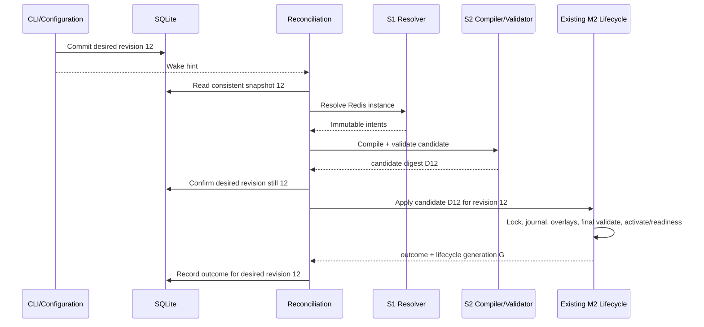
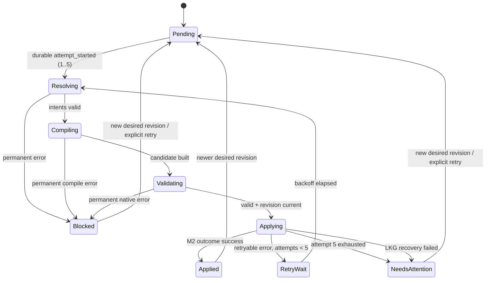

# S3 Reconciliation & Redis Integration — Technical Design

**Status:** Proposed for developer review; design only.
**Scope:** Connect S1 desired Integration state and S2 candidate compilation to the existing lifecycle, with Redis as the reference integration.
**Labels:** **Verified** = present in inspected source; **Approved** = supplied decisions; **Proposed** = design recommendation; **Open** = unresolved evidence or implementation detail.

## 1. Goal, invariants and non-goals

**Approved behavior:** configure Redis → persist desired state → wake reconciliation → resolve S1 intents → compile/validate an S2 candidate → apply through the existing M2 lifecycle → observe health and delivery independently.

SQLite desired instances/revision are authoritative; events are hints. Reconcile at startup and periodically. One reconciliation execution is in flight. Check revision-bound plans before lifecycle admission. If desired state changes after activation starts, let that lifecycle operation complete or recover, record it against the submitted revision, then process the newest snapshot. Never label an older applied revision as the current target. Retry at most five total attempts per revision/failure target; permanent failures block, retryable failures use bounded exponential backoff, exhaustion becomes `Needs Attention`, and explicit retry or a new desired revision is required to resume. Existing lifecycle owns locking, overlays, validation, readiness, journaling and LKG recovery.

**Non-goals:** Discovery (S4), Core APIs/sync/precedence, Redis server management, integration-specific branches in orchestration, a second activation/rollback mechanism, and inferring health or delivery from configuration application.

## 2. Bounded responsibilities

| Context | Owns | Must not own / dependency direction |
|---|---|---|
| Discovery & Inventory (S4) | Observe resources and propose candidates with evidence/provenance. | No desired-state mutation or Collector control absent an approved action; not part of S3. |
| Integration Core (S1) | Validate instances, exact-version definitions, deterministic contributions and immutable intents. | No SQLite, Collector concepts, orchestration, activation or health. |
| Configuration | Desired instances, provenance, per-instance and desired-set revisions; validate/resolve before persistence. | No retry state, applied state or lifecycle operations. |
| Reconciliation (S3) | Compare desired/applied observations, form revision-bound plans, coordinate Resolver → Compiler → lifecycle request, classify outcomes and track convergence. | No Discovery, Redis-specific logic, YAML, Collector process, activation, rollback or duplicate lifecycle journal. |
| Collector Runtime Control (S2) | Capability catalog, deterministic complete configuration candidate and staged native validation. | No desired ownership, scheduling, process supervision or activation. |
| Existing M2 Lifecycle | Admit candidate under existing lock; final Gateway/readiness overlays and validation; journal, activation, readiness and LKG recovery; existing generation acknowledgment. | No desired integration ownership, resolver/compiler, retry policy or per-integration health. |
| Health & Diagnostics | Read operational evidence and expose safe status/history/inspection. Reconciliation outcome persistence is implemented behind its own narrow repository in the shared SQLite infrastructure. | No desired mutation, activation or health inference from `Applied`. |
| `agentstate` persistence | SQLite WAL adapters/migrations for state owned by Configuration, lifecycle and reconciliation. | No business policy; each context retains its own repository contract and state ownership. |

**Verified current seams:** `configuration.IntegrationService` resolves before repository `Put`; SQLite exposes consistent desired snapshots. `collectorruntime.Candidate` carries immutable bytes/digest/platform/catalog metadata. `configurationCoordinator.Apply` currently loads M1/M2 state, locks, prepares activation recovery, invokes an `agentstate.State` activator, and records existing generations. `collectorConfigurationActivator` currently renders from layers and dependency state, adds Gateway/readiness inputs, and calls `bootstrap.ActivateRenderedConfig`. Thus it does **not** yet accept an S2 candidate. No general internal event bus API was found in inspected source; the local wake channel + periodic trigger remains the smallest proposal. `agentctl` has no integration command group.

## 3. Dependency and call flow

```mermaid
flowchart LR
  CLI[agentctl integration] --> CFG[Configuration application]
  CFG --> DB[(SQLite WAL)]
  CFG -. commit notification .-> WAKE[Coalescing wake signal]
  TIMER[Startup + periodic trigger] --> CTRL[Reconciliation controller]
  WAKE --> CTRL
  CTRL --> CFG
  CTRL --> CORE[Integration Resolver]
  CORE --> S2[Collector Runtime Control: compile + candidate validation]
  S2 --> ADMIT[Candidate-aware lifecycle request]
  ADMIT --> M2[Existing M2 coordinator + activator]
  M2 --> DB
  M2 --> COL[Existing supervised Collector]
  CTRL --> RP[Reconciliation outcome repository]
  RP --> DB
  CLI --> HD[Health & Diagnostics read services]
  HD --> DB
  S4[Discovery & Inventory (future S4)] -. proposes only .-> REVIEW[Approved action/policy]
  REVIEW -. authorized desired mutation .-> CFG
```

Dependency direction: CLI → Configuration/read services; Reconciliation → Configuration read port, Integration Resolver, S2 Compiler, lifecycle request port and reconciliation repository; `agentstate` implements persistence ports; M2 remains the only activation implementation. Discovery (S4) is outside this flow until an explicit action policy exists. No package cycle or integration-specific branch in the controller.

## 4. OD-05: candidate-aware contract with existing lifecycle

**Verified M2 semantics/call graph:** `DesiredGeneration` advances when existing M2 desired configuration changes. `configurationCoordinator.Apply` holds the process mutex and OS lifecycle lock, prepares recovery, commits `PendingActivation`, invokes the state-driven activator, then persists `ActivatedGeneration`. The activator renders baseline/configuration, adds Gateway/readiness inputs and calls `bootstrap.ActivateRenderedConfig`. The runtime watcher launches the activated generation, verifies readiness, commits launch config/LKG, then persists `AppliedGeneration`. On readiness failure, rollback restores LKG and resets `ActivatedGeneration` to prior `AppliedGeneration`; `DesiredGeneration` remains monotonic. Startup recovery distinguishes pending generations above `ActivatedGeneration` (promotion may be incomplete) from activated-but-unapplied generations (restore prior active/LKG and roll back state). `activation_journal` currently records activated/rolled-back transitions only; it has no candidate mapping or validation-failure outcome. S3 extends this path; Reconciliation must not invoke `ActivateRenderedConfig` directly.

**Proposed smallest extension (not existing APIs):** retain the same `configurationCoordinator`, locks, recovery hooks and journal. Add a candidate-bearing request path beside the M1/M2 state-driven entry point. The SQLite-backed M2 admission method receives candidate identity plus expected integration desired-set revision. In one immediate transaction it verifies the revision, reads `agent_state`, selects the existing configuration generation, and persists `PendingActivation` plus desired/candidate identity. For a new effective candidate, advance existing `DesiredGeneration` once; retrying the same desired revision/candidate reuses that reserved generation rather than creating one per attempt. A newer desired revision/candidate advances the existing generation. Attempts remain attempt-history rows, not generations. This successful commit is **admission**. A mismatch returns typed `StaleDesiredRevision`; no pending intent or generation advance is committed.

```text
CandidateApplyRequest {
  desiredSetRevision, candidate (bytes + digest + platform/catalog/version)
}
ActivationOutcome {
  submittedDesiredSetRevision, lifecycleGeneration, candidateDigest,
  stage, result, recoveryResult, errorCode
}
```

The coordinator acquires its process mutex and OS lifecycle lock before admission. The SQLite adapter uses existing `sqliteUpdateMutex`, `BEGIN IMMEDIATE` and busy timeout, verifies `integration_desired_state.desired_set_revision`, loads/mutates `agent_state`, and commits `DesiredGeneration` (when the effective candidate is new) plus `PendingActivation` together. The transaction closes before work proceeds. **No SQLite transaction is held during overlay rendering, native validation, file promotion, Collector readiness, or recovery.** The OS lifecycle lock remains held through those operations as today. Configuration writes use SQLite only and never acquire the lifecycle lock, so revision 13 may commit while revision 12 activates; this is an allowed post-admission change.

Lock order is fixed: process activation mutex → OS lifecycle lock → short SQLite admission transaction. Configuration mutations take only their SQLite transaction and release it before publishing a wake signal. No code waits for the lifecycle lock while retaining a SQLite transaction. This avoids lock inversion and keeps the SQLite writer lock out of long Collector operations.

After admission, the activator applies lifecycle-owned final overlays (Gateway/readiness and required existing lifecycle values) to a copy of candidate bytes, computes the final effective digest, then validates those exact bytes before promotion. Validation failure writes a terminal failed-validation mapping and clears Pending Activation atomically; Activated/Applied stay at prior values and the reserved DesiredGeneration remains available for retry. On validation success, promotion proceeds and M2 persists ActivatedGeneration using existing semantics. Runtime readiness success must call a candidate-aware terminal SQLite method that, in one transaction, verifies pending generation/mapping, calls `MarkGenerationApplied`, writes journal outcome `applied` with desired revision/candidate/effective digests, and clears Pending Activation. Thus AppliedGeneration cannot commit without matching M2 evidence. Existing state/journal methods remain sole generation/recovery owners. S2 digest is pre-overlay; effective digest is distinct.

If desired revision differs during admission, return typed `StaleDesiredRevision` without activation or generation advance. Crash before admission commit leaves state unchanged. Crash after admission but before promotion leaves Pending Activation and recovery path; startup restores prior config and atomically clears intent/records interrupted failure while AppliedGeneration stays prior. Crash after promotion/ActivatedGeneration but before readiness leaves Pending Activation; startup restores prior config/LKG, resets ActivatedGeneration to AppliedGeneration and records recovered failure in the same state/journal transaction. Readiness success commits AppliedGeneration and successful mapping together. Crash after that terminal commit but before Reconciliation records its result is repaired idempotently from authoritative M2 journal evidence. If desired revision advances after admission, lifecycle completes or recovers the admitted generation; Reconciliation records it for the submitted revision and rereads latest desired. Revision 12 evidence cannot satisfy revision 13. M2 owns the mapping between desired revision and existing lifecycle generation.

```mermaid
sequenceDiagram
  participant R as Reconciliation
  participant L as Existing M2 coordinator
  participant DB as SQLite WAL
  participant C as Collector lifecycle
  R->>L: candidate C12, expected desired revision 12
  L->>DB: BEGIN IMMEDIATE; read desired revision
  alt latest revision is 13 (before admission)
    DB-->>L: mismatch; ROLLBACK
    L-->>R: StaleDesiredRevision; no generation/intent
    R->>R: compile latest revision 13
  else revision remains 12
    L->>DB: write existing generation 37 + PendingActivation(C12, r12); COMMIT
    DB-->>L: admitted atomically (transaction ends)
    Note over L,DB: No SQLite transaction remains open
    opt desired revision changes to 13 after admission
      R->>DB: commit desired revision 13
    end
    L->>C: overlays, final validate, promote, readiness/recovery
    C-->>L: outcome for generation 37
    L-->>R: outcome bound to revision 12 / generation 37
    R->>DB: read latest desired revision 13; reconcile it next
  end
```

**Outcome/error semantics (Proposed):** structured outcome distinguishes `admission`, `final_validation`, `activation`, `readiness`, `state_commit`, and `recovery`; includes typed error code, whether admission committed, lifecycle generation if reserved, both digests when computed, and whether LKG recovery succeeded/failed. Recovery failure is surfaced as critical/needs attention and is never hidden by retry. Reconciliation maps typed stage/code to Approved retry classes; it never performs rollback. Preserve current error wrapping for legacy callers; do not leak raw configuration/secrets into diagnostics.

## 5. State, attempts and controller algorithm

Configuration alone mutates desired instances and desired-set revision. Reconciliation owns its durable retry target and bounded attempt history through its repository. M2 lifecycle generations, pending activation, activation journal and LKG remain M2-owned. Store safe codes/metadata, never raw settings or full Collector diagnostics. Prune old completed rows by agreed count/age, preserving active target and pending recovery evidence. Writes are short SQLite transactions; never hold a DB transaction across compilation, process execution or activation.

**OD-05B — durable desired-to-applied mapping (Approved):** the mapping is stored with M2 activation records, not as a second Reconciliation generation/journal. Extend `PendingActivation` with `DesiredSetRevision`, `CandidateDigest`, and later `EffectiveConfigDigest`; its existing `Generation` remains the M1/M2 lifecycle generation. Extend the existing `activation_journal` row for that generation with the mapping fields and typed terminal outcome/stage/recovery result. This focused migration extends the current generation-keyed journal (`outcome`, `updated_at`); it adds no generation counter or parallel activation history. Legacy rows keep mapping fields null. M2 writes admission mapping with Pending Activation atomically; it writes final digest/outcome at validation failure/recovery or successful readiness terminal commit. Reconciliation attempts may reference these identifiers but are not authoritative for activation state.

| Identifier | Owner / meaning | Must not be substituted for |
|---|---|---|
| Integration `desired_set_revision` | Configuration; desired instance-set version submitted. | M1/M2 generation or applied proof. |
| S2 `candidate_digest` | Compiler; digest of pre-overlay candidate bytes. | Final effective configuration digest. |
| M2 lifecycle generation | Existing lifecycle; generation admitted/applied/recovered. | Desired-set revision. |
| Final effective digest | Existing lifecycle; exact overlay-applied bytes validated/promoted. | S2 candidate digest. |
| Activation outcome | Existing lifecycle journal; admitted generation success/failure/recovery result. | Redis health or telemetry receipt. |

**Transaction/crash semantics:** admission commits desired-revision check + existing generation reservation + Pending Activation/mapping atomically. If it rolls back, there is no admitted mapping. After commit, M2 recovery owns the pending record across restart. Promotion commits `ActivatedGeneration` using existing M2 semantics; it is not `Applied`. Only successful readiness terminal commit writes `AppliedGeneration` together with desired revision/candidate/effective digests and outcome. Crash after this M2 commit but before Reconciliation outcome persistence is repaired from authoritative M2 journal evidence; Reconciliation may complete its attempt record idempotently. On activation failure with successful LKG recovery, journal records failed generation/recovery outcome while `AppliedGeneration` remains prior. If revision 13 supersedes admitted revision 12/generation 37, revision 12's mapping remains historical; never rewrite it as revision 13. Restart reads latest Configuration snapshot plus M2 journal; matching success may prove revision 12 was applied, but not that 12 remains current when SQLite says 13.

| Boundary | Desired revision vs lifecycle generation | Durable operation | Crash behavior |
|---|---|---|---|
| Before admission | expected 12 vs latest 13; no generation reserved | One M2 `BEGIN IMMEDIATE` checks desired revision, updates existing `DesiredGeneration` if candidate is new, and persists Pending Activation/mapping. Mismatch rolls back all. | Before commit: no admission; report stale, re-read. After commit: admitted generation and intent both exist. |
| During activation | submitted revision 12 maps to existing generation 37; desired may now be 13 | No SQLite transaction. Existing OS lifecycle lock spans overlays, final validation, promotion, readiness/recovery. | M2 startup recovery uses Pending Activation/recovery artifact; reconcile latest SQLite revision after recovery. |
| Terminal success | desired 12, generation 37; not interchangeable | One M2 SQLite transaction validates pending mapping, commits `AppliedGeneration=37`, journal mapping/digests/outcome=`applied`, and clears Pending Activation. | Before commit: recovery sees pending and restores/retries per existing policy. After commit: journal is authoritative; reconcile can repair its own missing attempt result idempotently. |
| Terminal failure/rollback | desired 12, generation 37; Applied remains previous generation | One M2 state/journal transaction records typed failure/recovery and clears or rolls back pending state; never writes Applied=37. | Before terminal commit, Pending Activation drives recovery. After commit, durable failure mapping drives retry/attention; no false Applied. |

**Cross-process trigger (Verified/Proposed):** `agentctl` and the service may be separate processes. The inspected local status HTTP endpoint is read-only; service-manager commands control lifecycle but do not publish a desired-state change event. No suitable writable IPC/event channel was found. Therefore an in-process coalescing wake is only a same-process optimization. The service's periodic reconciliation must query SQLite directly on every tick (proposed bounded interval, e.g. 15–30 seconds), compare desired-set revision with the M2 mapping/applied target, and reconcile any committed difference. Startup reconciliation covers offline periods. No broker, file watcher, or new IPC framework is introduced. CLI success means desired state committed; it does not promise immediate service activation.

Startup first lets existing activation-journal recovery run, then reconciles a consistent SQLite `DesiredSnapshot`. CLI writes commit desired state before signaling a coalescing wake mechanism. Periodic trigger also reads SQLite, so missed events are harmless. Resolve all enabled instances, compile and validate, recheck desired revision, then submit candidate to M2. Persist outcome and immediately loop if latest desired revision differs. On crash, startup consults M2 journal first, records/reconstructs interrupted reconciliation attempt without resetting the persisted budget, and targets latest desired state.



## 6. Retry and Redis reference behavior

**Approved OD-01–04:** startup + internal wake hint + periodic reconciliation; maximum five total attempts per desired revision/failure target; permanent/transient/activation-related classification; bounded exponential backoff; exhausted `Needs Attention`; durable attempt budget/blocked state; single-flight execution; stale-plan rejection before activation and completion/recovery if activation has begun; structured durable diagnostics with bounded retention/redaction; status/history/inspect/explicit retry via local CLI. Explicit retry starts an audited retry target for the same desired revision; a new desired revision gets a fresh budget. Do not charge more than five attempts. Preserve the previously proposed charge point at durable `attempt_started` before resolver work; a process crash after this point consumes that attempt. Retry timing and retryable stage/code mapping require implementation tests, not ad-hoc string matching.

**Redis input (Proposed):** desired revision `12`; instance `redis-primary`; endpoint `192.168.1.10:6379`; enabled; provenance `local`; no credentials in settings. Resolver emits Redis receiver intent only if the exact platform capability is registered. Expected illustrative data (digest/generation values are examples, not observed runtime IDs):

```text
candidate: C12, digest: sha256:8f2a…e91c, platform: windows/amd64
final effective config after M2 overlays: F12, digest: sha256:4c77…0b12
activation outcome: desired_revision=12, lifecycle_generation=37,
  result=applied, readiness=ready, recovery=not_needed
M2 activation_journal: generation=37, desired_revision=12,
  candidate_digest=8f2a…e91c, effective_digest=4c77…0b12, outcome=applied
reconciliation: state=Applied, attempt=1/5
```

Redis receiver availability: **Verified, limited** — the available Windows v0.160.0 binary inventory listed `redis`; S2 manifest does not declare it. **Open / unchanged OD-06:** exact checksum-bound Linux and Windows artifacts must pass CI inventory checks and representative native validation before Redis is enabled. Do not change that verification requirement or infer cross-platform support.

### Representative flows

1. **Success:** revision 12 resolves endpoint above; S2 creates deterministic C12; M2 receives C12, acquires its existing lock, records activation intent, adds Gateway/readiness overlays, computes F12, validates F12, activates and verifies readiness, then acknowledges existing lifecycle generation 37. Reconciliation stores success for revision 12. `Applied` means configuration applied; it does not establish Redis health or Gateway receipt.
2. **Activation failure and retry:** revision 12 candidate C12 reaches M2; readiness fails at generation attempt; M2 performs its existing LKG recovery and returns `stage=readiness`, `recovery=succeeded`, typed error. Reconciliation stores attempt `1/5`, error code and next retry time; bounded backoff retries the same revision. Fifth retryable failure transitions to `Needs Attention`; no second rollback is invoked. If recovery failed, record that explicitly and stop automatic retry pending operator handling.
3. **Change during activation and restart:** revision 12 is atomically admitted as generation 37 with candidate digest C12; activation begins under M2 lock; operator commits revision 13 while it runs. If the Agent crashes, M2's pending activation/recovery artifact and journal recover generation 37 on restart. M2 writes/retains mapping `(desired=12, candidate=C12, generation=37, effective=F12, outcome=applied|recovered)`; Reconciliation reads latest Configuration revision 13, treats revision 12 as historical, compiles C13 and submits it. Status target remains 13; generation 37 cannot acknowledge revision 13.



### Three independent outcome facts

| Fact | Evidence/owner | Example |
|---|---|---|
| **Configuration Applied** | M2 lifecycle outcome, final digest and lifecycle generation. | F12 activated as generation 37. |
| **Integration Healthy** | Health/diagnostics evidence for Redis receiver/source, if available; not inferred by reconciliation from `Applied` or process readiness. | Redis scrape succeeds / receiver reports error. |
| **Telemetry Delivered** | End-to-end Gateway receipt or equivalent independent evidence. | Redis metrics observed at Gateway. |

S3 can establish applied configuration and persist available diagnostics; it cannot claim health or delivery without corresponding evidence.

## 7. CLI, failures and verification

Thin local CLI proposal: `integration configure redis --id … --endpoint …`, `list`, `enable|disable|delete … --expected-revision N`, `status`, `history [--limit N]`, `inspect <id>`, `retry [--revision N]`. Configuration service returns instance and desired-set revisions; CLI delegates and formats safe bounded output.

| Failure | Decision |
|---|---|
| Invalid settings/unknown definition/capability absent on platform | Reject before desired persistence; no activation. Permanent if encountered from persisted legacy/corrupt state. |
| Native candidate/final validation failure | Record exact stage/code; no M2 promotion for final-validation failure; unchanged revision is permanent unless typed evidence says otherwise. |
| Activation/readiness failure | M2 performs its established recovery; reconciliation records outcome and retries only per typed mapping and five-attempt budget. |
| Redis offline after activation | Report source/collection evidence separately; do not roll back whole Collector by default. |
| Stale before M2 admission | Discard candidate, no activation; immediately read latest snapshot. |
| Desired changes after activation intent | Finish/recover the admitted operation; record old revision outcome; reconcile latest revision. |
| Event loss/restart/Collector crash | Startup + periodic snapshot and existing supervisor/journal recovery; SQLite remains truth. |
| SQLite failure | Do not begin external activation unless durable attempt/admission state is committed; surface unknown commit outcomes and recover on next snapshot. |

Acceptance tests: repository snapshot/CAS/migration compatibility; race where revision changes before atomic admission (stale return, no Pending Activation/generation advance); race after admission (activation proceeds, then latest revision reconciles); fault injection around admission commit proves generation/Pending Activation all-or-nothing; crash after admission and during promotion exercises existing recovery for generation 37; terminal tests prove `AppliedGeneration` and applied mapping/outcome commit atomically, and every failed validation/activation/LKG recovery retains prior AppliedGeneration; crashes immediately before terminal commit recover from Pending Activation, while crashes immediately after it reconstruct the exact result from M2 journal without false/stale Applied acknowledgment; revision 12→13 restart test proves generation 37 cannot satisfy revision 13; same-process wake is best-effort and separate-process CLI commit is discovered by periodic SQLite polling/startup; deterministic controller, single-flight, retry budget/backoff/five-attempt/operator retry; secret-safe bounded CLI history; both-platform artifact-gated Redis native validation; Windows/Linux Redis → Gateway E2E; offline Redis does not trigger global rollback; existing S1/S2/M1/M2, enrollment, host exporter, readiness, locking and LKG suites pass unchanged.

## 8. Open risks and approval items

1. **Approved OD-05A/05B implementation constraint:** add candidate admission and revision mapping to the existing coordinator/activation journal only. Do not treat the proposed method/fields as current APIs, add a second generation counter, or hold a SQLite transaction through activation.
2. **Open error mapping:** define typed lifecycle errors/stages eligible for retry. Never classify by fragile message strings; recovery failure stops automatic retries.
3. **Open health evidence:** current readiness is not Redis health or Gateway delivery. Select acceptable evidence before exposing those statuses.
4. **Open history policy:** confirm age/count retention and safe diagnostic fields; retain lifecycle recovery evidence.
5. **Open CLI retry behavior:** explicit retry starts a new audited attempt target and does not mutate desired state; confirm whether it also requests a fresh lifecycle application when the same candidate is already applied.
6. **OD-06 (unchanged):** Windows inventory observation exists, but exact archive-bound two-platform validation is pending CI. Redis stays unavailable until that evidence and manifest update pass.

**Readiness:** boundaries and OD-01–05 support a cohesive S3 implementation. Candidate-aware M2 seam and error mapping need developer review before coding; Redis remains gated by unchanged OD-06 evidence. Discovery and remote ownership policy remain outside this milestone.

## References

- [Target Architecture v0.1.4](target-architecture-v0.1.4.md)
- [S1 Integration Core Technical Design](integration-core-s1-design.md)
- [S2 Collector Compiler Technical Design](s2-collector-capability-compiler-design.md)
- [Integration Core Delivery Slices](../roadmap/telemetry-agent-v0.1.4-integration-core-slices.md)
