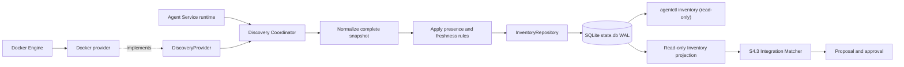

# S4 Resource Discovery & Inventory

**Status:** Provider-neutral inventory, opt-in Docker provider, S4.3 matcher core, S4.4 proposal/approval workflow and Agent Service refresh are implemented in the current branch. Verified evidence includes live Docker discovery and proposal approval, Windows Agent Service convergence for Redis, and Redis metric delivery to an isolated OTLP sink. Linux runtime end-to-end Redis delivery remains open. This status describes the current branch, not deployment.

## Responsibility and boundaries

- `internal/discovery` owns provider-neutral contracts, complete-snapshot normalization, material presence transitions, a serialized coordinator and inventory ports. It does not match Integrations, mutate desired state, compile Collector configuration or activate processes.
- `internal/discovery/docker` adapts the Moby Docker Engine client to the provider contract. It accepts only an explicitly configured local Unix socket or Windows named pipe and only copies an allowlisted set of Docker labels.
- `internal/agentstate` owns SQLite WAL persistence. Schema migration 10 adds inventory metadata, resource observations and provider status without rewriting earlier state.
- `cmd/agentctl` composes the provider and coordinator with the existing Agent runtime after M2 runtime recovery, and provides read-only inventory commands.



## Provider and resource identity

A resource key is the tuple `provider / provider-instance / provider-resource-id`. Docker uses provider `docker`, a non-reversible short SHA-256 identifier derived from the configured local endpoint, and the full Docker container ID. Container names, addresses and ports are evidence only; they do not establish identity.

A provider result must be complete. The coordinator replaces the persisted snapshot for that provider instance only after normalization succeeds. Incomplete results, duplicate conflicts, malformed values and provider errors do not establish absence. Exact duplicate observations collapse; conflicting duplicate identities reject the snapshot.

## Presence, freshness and revision

- A successful snapshot marks observed resources present and clears missing evidence.
- Two successful complete snapshots omitting a resource mark it missing. Rows are retained; discovery never deletes inventory.
- Provider failure records a safe error code and preserves resource observations and presence.
- Freshness is computed from `LastSeenAt`; evidence older than two minutes is stale. Staleness does not imply disappearance.
- The material inventory revision advances for membership, presence, lifecycle, metadata or endpoint changes. Poll timestamps alone do not advance it.
- SQLite commits resource replacement, status and revision atomically. Snapshot reads fetch revision, rows and provider status in one read transaction.

## Persistence and compatibility

Migration 10 adds:

- `inventory_meta`: singleton material revision.
- `inventory_resources`: provider-scoped resources keyed by provider, instance and resource ID.
- `discovery_provider_status`: last attempt/success, resource count and safe error code.

The migration is additive. Tests migrate a populated schema-v9 database and verify that M1/M2 state, Installation Identity, Enrollment records and S1 Integration desired state remain intact.

## Runtime configuration and operations

Docker discovery is disabled unless the Agent Service process has `AR_IMMS_DOCKER_DISCOVERY_ENDPOINT` set. Supported local endpoints are:

- Linux: `unix:///var/run/docker.sock` (or another absolute local Unix socket).
- Windows: `npipe:////./pipe/docker_engine` (local named pipe only).

The service performs an initial snapshot and polls every 30 seconds. Each Docker request is bounded by a five-second provider timeout. Provider failure is isolated from Collector supervision and S3 reconciliation. Shutdown cancels the provider loop and waits for it to finish.

Docker socket or named-pipe access is highly privileged: a process with Docker API access can generally control containers with host-level impact. Grant the Agent service account access only when discovery is required. Unset the endpoint and restart the Agent Service to disable discovery. Existing host monitoring and managed dependencies remain owned by their current lifecycle.

Read persisted inventory without contacting Docker:

```text
agentctl inventory list [--state-path <path>]
agentctl inventory inspect [--state-path <path>] <provider>/<instance>/<resource-id>
agentctl inventory status [--state-path <path>]
```

The commands are read-only. List and inspect show normalized evidence; status reports provider attempt/success and safe error codes. A missing provider row means no discovery endpoint has yet been configured or run.

## Extension boundary

Future providers implement `discovery.DiscoveryProvider` and return complete provider-neutral snapshots. They are composed at the Agent runtime. S4.3 matching consumes inventory through an Integration-owned projection; Discovery does not import Integration or perform matching. The read-only S4.3 CLI composition and S4.4 proposal lifecycle/approval are present. Live verification confirms Docker discovery, proposal creation, explicit approval, Agent Service convergence and Redis telemetry delivery on Windows. PostgreSQL and Mongo fixtures were verified through discovery/matching into `needs_input` proposals only; they are not production monitoring definitions and were not activated. Linux runtime delivery and Docker event streaming remain unverified/out of scope. Discovery does not automatically approve or write desired state; Core synchronization is not included.
