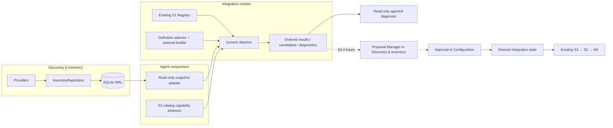

# S4.3 — Integration Matching & Configuration Resolution

**Status:** Accepted architecture; S4.3 matching, persisted-inventory projection, capability assessment and read-only CLI diagnostics are implemented in the current checkout. The opt-in Windows Docker test verifies the live Docker → SQLite → `agentctl integration match` candidate path and unchanged desired/M1/M2 state before proceeding to S4.4 approval. The separate Windows approval → Agent Service reconciliation → Collector → isolated OTLP sink flow also passed. Template-authorized desired-state materialization is now implemented in the current worktree, but its live Docker-to-Collector telemetry path has not been run. PostgreSQL/Mongo fixtures produce matching results that the S4.4 test path converts to `needs_input` proposals; they are not production integrations. Linux runtime telemetry delivery remains unverified.\
**Scope:** Deterministic discovery-time matching, validated configuration candidates and read-only diagnostics.\
**Related:** [Target Architecture v0.1.4](target-architecture-v0.1.4.md), [S4 Resource Discovery & Inventory](s4-resource-discovery-inventory.md), [ADR-0002](../adr/0002-generic-integration-matching.md), [implementation plan](../plans/s4.3-implementation-plan.md).

**Evidence labels:** **Verified Current** describes inspected source in the current checkout, including working-tree code; **Approved** records accepted S4.3 decisions; **Proposed** describes behavior not yet wired end to end; **Open** identifies a remaining implementation detail. This status does not claim all changes are committed, deployed, or verified on every platform.

## 1. Context, objectives and scope

S4.1/S4.2 provide provider-neutral observations, persisted inventory, resource presence/freshness and an opt-in Docker provider. They do not identify which Integration should monitor a resource. S4.3 fills that gap: read one consistent inventory snapshot, match it against registered definitions, resolve safe configuration candidates, and explain the result. The separate S4.4 proposal/approval boundary consumes these results; S4.4 code is present in the current working tree, but it is outside S4.3 scope and acceptance.

**Approved outcome:** one unchanged inventory snapshot, definition set, platform capability evidence and evaluation timestamp produce the same ordered results, evidence, fingerprints and candidate digests. Freshness is evaluated relative to the supplied timestamp. Matching has no persistent side effects.

**Included:** generic hybrid matching, minimal optional S1 Definition/Registry extension, Redis matching as the first proof, bounded Docker image evidence, endpoint resolution, capability assessment, read-only diagnostics and a real Docker-to-candidate E2E test.

**Excluded:** proposal persistence, approval, Desired Integration writes, discovery providers beyond the existing Docker provider, S3 invocation, Collector activation, Docker event streaming, PostgreSQL/MongoDB production definitions, device/SNMP integrations and Core synchronization. Redis telemetry collection does not begin in S4.3.

## 2. Verified source baseline

| Concern | Verified Current | S4.3 consequence |
|---|---|---|
| Discovery | `internal/discovery` owns complete provider snapshots, normalized resources and freshness. `ResourceKind` currently allows container, process, service and VM; unknown kinds fail validation. Inventory snapshots are read consistently through SQLite. | The Integration-owned read-only projection and production Inventory-to-Matcher adapter exist. **AD-06:** defer generic `device` kind until a device provider needs it. |
| Docker | `internal/discovery/docker/provider.go` maps bounded `container.Summary.Image` into reference/repository and optional tag/digest attributes; `ImageID` is not treated as a registry digest. `mapEndpoints` distinguishes container, exposed and host-published evidence. | Image evidence is implemented as additive resource JSON. Preserve exact repository semantics; never copy environment variables or arbitrary labels. |
| Inventory persistence | `internal/agentstate/sqlite_inventory.go:21` returns revision, resources and provider status from one SQLite read transaction. Resource records are JSON payloads. | Extend JSON compatibly; no SQL migration unless source-level evidence requires one. Include old payload compatibility tests. |
| S1 / matcher core | `internal/integration.Registry` performs exact ID/version lookup and stable `MatchableDefinitions()` enumeration. `IntegrationDefinition` has optional matching metadata; `Matcher.Match` builds validated immutable candidates and separate match/resolution/capability results. `Resolver.Resolve` remains for desired instances and returns Collector intents. | Core matching and Registry extension exist. Keep discovery-time candidate resolution separate from activation-time S1 intent resolution. |
| Redis | `internal/integration/redis/definition.go` validates one `endpoint` setting and creates `otel.receiver.redis.metrics` intent. | Reuse the definition's existing validation for candidate settings. Do not create Redis logic in generic orchestration. |
| S2 | `collectorruntime.Catalog.Manifest()` returns a sorted defensive manifest; `ArtifactVersion()` and `ManifestVersion()` expose selected evidence. The static manifest is tied to pinned artifacts. | Matcher accepts a narrow capability-assessor contract. Production composition must source it from the selected catalog; Integration does not import Collector Runtime or duplicate native validation. |
| Composition | `cmd/agentctl/integration_matching.go` reads one persisted SQLite inventory snapshot, projects it into the Integration-owned contract, wires the selected static S2 catalog as the read-only capability assessor, and exposes `agentctl integration match`. Redis registration is independent of runtime capability assessment. Fixture-based SQLite/CLI tests cover read-only behavior. | The opt-in Windows Docker test invokes the live read-only match command before S4.4 approval and verifies desired/M1/M2 state is unchanged. The same workflow separately verifies Windows S4.4 activation and telemetry delivery. Linux runtime telemetry delivery remains open. S3/M2 are reused without Integration-specific branches. |

The existing inventory global revision advances for material inventory changes; there is no resource-specific revision. `LastSeenAt` changes with observations and therefore must not enter stable candidate identity. A resource fingerprint supplies that narrower stale-evidence check.

## 3. Ownership and component architecture

| Owner | Responsibility | Does not own |
|---|---|---|
| Discovery & Inventory | Provider observations, normalized evidence, identity, presence/freshness and consistent snapshots. The separate S4.4 Proposal Manager is present in the current working tree and belongs here. | Which Integration is desirable, approval, desired-state mutation or Collector control. |
| Integration (S1/S4.3) | Existing definitions/registry, generic matching orchestration, definition-owned selectors/builders, candidate validation and match diagnostics. | SQLite, Docker APIs, Collector lifecycle, Desired State, proposal persistence. |
| Composition (`cmd/agentctl`) | Read inventory snapshot, map it to the Integration projection, provide platform capability assessment, expose read-only diagnostic command. | Matching policy and persistent ownership. |
| Configuration | The separate S4.4 approval operation is present in the current working tree; Configuration owns approval policy and existing Desired Integration state/CAS. | Discovery policy, candidate matching or Collector activation. |
| S3/S2/M2 | Existing approved desired-state reconciliation, compilation, lifecycle admission, activation and recovery. | Discovery-time matching and proposal approval. |



**Dependency rule:** `internal/discovery` does not import `internal/integration`, and Integration does not import Discovery, SQLite, CLI or Collector Runtime. Integration owns the compact matching projection; composition performs the mapping. Match input and output are values, not a second persistence or registry framework.

## 4. Current matcher contracts

The following summarizes the **current matcher contracts** in `internal/integration/matching.go` and `matching_engine.go`, alongside optional `IntegrationDefinition.Matching` and the Registry extension. These contracts, the SQLite inventory projection, capability assessment and read-only `agentctl integration match` composition are implemented in the current checkout (`cmd/agentctl/integration_matching.go` and its command dispatch). The Go sketch below is explanatory; it is not a second API or a claim that the sample comments are copy-paste implementation code.

```go
type MatchingDefinition struct {
    Selector             *MatchSelector // exactly one of Selector or Match
    Match                DefinitionMatcher
    BuildCandidate       CandidateBuilder
    RequiredCapabilities []string
}

type MatchSelector struct {
    ResourceKinds     []string
    LifecycleStates   []string
    ExactAttributes   map[string]string
}

type DefinitionMatcher func(MatchResource) (bool, []MatchEvidence, error)
type CandidateBuilder func(MatchResource) (CandidateBuild, error)

type CandidateBuild struct {
    Settings      map[string]any
    Evidence      []MatchEvidence
    RequiredInputs []RequiredInput
}

type MatchSnapshot struct {
    InventoryRevision uint64
    AsOf              time.Time // one captured evaluation time for freshness decisions
    StaleAfter        time.Duration
    Resources         []MatchResource
}

type MatchResource struct {
    Provider, ProviderInstance, ResourceID string
    Kind, LifecycleState, Presence         string
    Attributes                             map[string]string
    Endpoints                              []MatchEndpoint
    LastSeenAt                             time.Time
}

type MatchEndpoint struct { Address, Protocol, Scope, Provenance string; Port uint16 }
type ResourceIdentity struct { Provider, ProviderInstance, ResourceID string }
type MatchEvidence struct { Code, Source, Value string }
type RequiredInput struct { Name, Reason string }
type MatchStatus string
type ResolutionStatus string
type CapabilityStatus string

const (
    MatchMatched MatchStatus = "matched"
    MatchNoMatch MatchStatus = "no_match"
    MatchAmbiguous MatchStatus = "ambiguous"
    MatchStale MatchStatus = "stale"
    ResolutionReady ResolutionStatus = "ready"
    ResolutionNeedsInput ResolutionStatus = "needs_input"
    ResolutionInvalid ResolutionStatus = "invalid"
    CapabilitySupported CapabilityStatus = "supported"
    CapabilityUnsupported CapabilityStatus = "unsupported"
    CapabilityUnverified CapabilityStatus = "unverified"
    CapabilityNotAssessed CapabilityStatus = "not_assessed"
)

type CapabilityAssessment struct {
    Status CapabilityStatus
    Platform, ArtifactVersion, ManifestVersion string
    Required, Unsupported []string
}
type CapabilityAssessor interface {
    Assess([]string) (CapabilityAssessment, error)
}

type Candidate struct {
    configuration []byte // private canonical JSON; accessors return copies
    digest        string
}
func (Candidate) Configuration() json.RawMessage // returns a defensive copy
func (Candidate) Digest() string
type MatchResult struct {
    Resource ResourceIdentity
    DefinitionID, DefinitionVersion string
    MatchStatus MatchStatus
    ResolutionStatus ResolutionStatus
    CapabilityStatus CapabilityStatus
    ResourceFingerprint string
    Evidence []MatchEvidence
    RequiredInputs []RequiredInput
    Capability CapabilityAssessment
    Candidate *Candidate
    Diagnostics []MatchDiagnostic
}
type MatchDiagnostic struct { Code, DefinitionID string }
type MatchReport struct {
    InventoryRevision uint64
    EvaluatedAt time.Time
    Results []MatchResult
    Diagnostics []MatchDiagnostic
}
```

Add `Matching *MatchingDefinition` as optional metadata on the existing `IntegrationDefinition`; definitions without it continue to support manual configuration. The existing Registry should expose matchable definitions in stable ID/version order and reject a second matchable version for the same Integration ID. It must retain other exact versions for existing desired instances; it must not select “latest” implicitly.

Keep result status axes small and independent:

| Axis | Values |
|---|---|
| `match_status` | `matched`, `no_match`, `ambiguous`, `stale` |
| `resolution_status` | `ready`, `needs_input`, `invalid` |
| `capability_status` | `supported`, `unsupported`, `unverified`, `not_assessed` |

`Selector` and `Match` are mutually exclusive. A selector uses exact resource-kind, lifecycle-state and attribute equality; a `DefinitionMatcher` is pure and returns explicit evidence rather than a confidence score. `BuildCandidate` is optional when a match still needs operator input. The matcher invokes the existing definition validator on complete candidate settings before creating `Candidate`; it canonicalizes and copies JSON into private bytes and exposes only copy-returning accessors. `MatchEvidence` records a stable evidence code and sanitized value/source. `RequiredInput` identifies a missing user-provided value without embedding a secret. Capability results identify the selected platform and artifact/manifest evidence; an assessor failure becomes `unverified` with a safe diagnostic, never assumed support. Diagnostics use stable `MatchDiagnostic` codes and definition IDs, not arbitrary labels or credential-like content. A candidate with unsupported or unverified capability may remain visible as evidence; S4.4 must treat it as non-actionable unless policy explicitly permits it.

### Identity and digest rules

- **Resource identity:** existing provider / provider-instance / provider-resource ID tuple.
- **Match identity:** resource identity + Integration ID + exact definition version.
- **Resource fingerprint:** SHA-256 over provider-scoped identity, kind, presence, lifecycle eligibility, bounded normalized attributes and sorted endpoint evidence. Exclude `LastSeenAt`, poll timestamps, provider attempt status, global inventory revision and unrelated resources.
- **Candidate digest:** SHA-256 over canonical validated secret-free settings plus resource identity and exact definition ID/version (and required capability IDs if they affect the settings contract). Keep capability manifest/artifact evidence separately so a catalog change is not hidden by an unchanged settings digest.
- **Inventory revision:** record the global revision for audit and repeatable snapshot provenance, but do not include it in the resource fingerprint or candidate digest.

The same relevant resource evidence, definition version, candidate settings, capability evidence and `AsOf` timestamp must yield the same status, fingerprint, digest, evidence ordering and result ordering. Freshness can change as `AsOf` advances even when the fingerprint remains stable. A later approval must re-read and re-match; a digest alone never authorizes stale evidence.

## 5. Matching algorithm and endpoint policy

1. Read one consistent `InventorySnapshot` through the existing SQLite repository.
2. Map it to the Integration-owned `MatchSnapshot`; defensively copy and sort resources by provider-scoped key.
3. Mark missing, stale or ineligible resources non-actionable. Freshness uses the inventory policy (`LastSeenAt`/two-minute threshold); a provider failure does not refresh evidence.
4. Enumerate sorted matchable definitions from the existing S1 Registry.
5. Evaluate exact declarative selectors; invoke a definition-owned pure matcher only where selector rules cannot express the required evidence.
6. Resolve candidate settings with the matching definition's builder. Reuse `Validate` on those settings; do not construct/persist an `IntegrationInstance` merely to call `Resolver.Resolve`.
7. Canonicalize, validate secret absence, compute resource fingerprint and candidate digest.
8. Assess required capability IDs through a composition-supplied read-only port backed by S2's verified catalog and selected platform artifact.
9. Aggregate ambiguity without choosing an arbitrary match; return all relevant evidence and stable diagnostics.
10. Sort results and return without writes, provider calls, network probes, Desired State access or Collector operations.

**Endpoint resolution (AD-04):** inventory records evidence, not general reachability. For initial Redis support, only an explicit host-published loopback address such as `127.0.0.1:6380` or `[::1]:6380` may be selected automatically when the Agent uses the same local host network context and there is one unambiguous TCP endpoint consistent with the definition. The opt-in Windows live test verifies this for its explicitly configured local Docker named pipe and checks that the read-only match is non-mutating. This evidence does not establish reachability for other providers, remote Docker endpoints, or Linux runtime delivery; those contexts must fail closed to `needs_input` until independently verified. The pure matcher itself does not prove reachability. Wildcard binds (`0.0.0.0`, `::`), container-private addresses, exposed ports without a usable host address, remote addresses and multiple plausible endpoints return `needs_input`. No port probing or environment/label credential extraction is allowed.

## 6. Inventory image evidence and normalization

**Approved:** add an allowlisted Docker image reference and normalized repository to inventory; optional tag or digest only when directly available and correctly identified. Keep total key/value lengths within existing normalization bounds. Do not map Docker `ImageID` as a registry digest.

**Verified current normalization:** retain the bounded image reference from Docker's list response `Summary.Image`; parse it with the pinned image-reference parser. Store normalized repository, optional tag, and optional registry digest as separate attributes. Preserve registry and namespace. Parse failure retains only the bounded reference and does not guess a repository. `ImageID` is not treated as a registry digest. Definition selectors compare exact normalized repositories. Never match display name, substring, arbitrary OCI title, Compose service name, or inferred tag alone. Explicit operator labels could be strong evidence, but the current provider has no AR-IMMS matching-label allowlist; do not trust labels until a specific bounded label contract is added and reviewed.

The resource JSON extension is additive: absent image fields in existing SQLite payloads decode as empty. Matching reports insufficient evidence rather than guessing. No SQL migration was needed; current provider and inventory tests cover absent/new image evidence compatibility. A populated historical database on the real Agent service remains part of the broader platform verification, not a new schema migration.

## 7. Redis E2E data flow

Example Docker observation (representative; bounded image evidence is implemented):

```json
{
  "provider": "docker",
  "provider_instance": "local-engine",
  "complete": true,
  "resources": [{
    "provider_resource_id": "8d2f...",
    "kind": "container",
    "lifecycle_state": "running",
    "attributes": {
      "container.image.reference": "redis:7.4",
      "container.image.repository": "docker.io/library/redis",
      "container.image.tag": "7.4"
    },
    "endpoints": [{"address":"127.0.0.1","port":6380,"protocol":"tcp","scope":"host","provenance":"published_port"}]
  }]
}
```

SQLite commits the provider snapshot atomically. The read adapter returns an inventory revision and the resource identity `docker/local-engine/8d2f...`; it preserves `host/published_port` evidence. The Redis v1.0.0 matching definition uses exact repository and TCP evidence, builds `{"endpoint":"127.0.0.1:6380"}`, and validates that map with the existing Redis validator. The generic matcher returns:

The intended read-only projection into the Integration-owned contract is represented as:

```json
{
  "inventory_revision": 42,
  "as_of": "2026-11-09T09:00:00Z",
  "stale_after": "2m",
  "resources": [{
    "provider": "docker",
    "provider_instance": "local-engine",
    "resource_id": "8d2f...",
    "kind": "container",
    "lifecycle_state": "running",
    "presence": "present",
    "attributes": {
      "container.image.reference": "redis:7.4",
      "container.image.repository": "docker.io/library/redis",
      "container.image.tag": "7.4"
    },
    "endpoints": [{"address":"127.0.0.1","port":6380,"protocol":"tcp","scope":"host","provenance":"published_port"}],
    "last_seen_at": "2026-11-09T08:59:45Z"
  }]
}
```

The matching-enabled Definition metadata is conceptually:

```json
{
  "definition": {"id":"redis","version":"1.0.0"},
  "selector": {
    "resource_kinds": ["container"],
    "lifecycle_states": ["running"],
    "exact_attributes": {"container.image.repository":"docker.io/library/redis"}
  },
  "required_capabilities": ["otel.receiver.redis.metrics"]
}
```

These are explanatory wire-shaped examples, not JSON serialization APIs for Go structs; the current Go contracts use exported fields and composition must define any CLI JSON DTO explicitly.

```json
{
  "inventory_revision": 42,
  "evaluated_at": "2026-11-09T09:00:00Z",
  "resource_fingerprint": "sha256:<stable-resource-evidence>",
  "definition": {"id":"redis","version":"1.0.0"},
  "match_status":"matched",
  "resolution_status":"ready",
  "capability":{"status":"supported","required":["otel.receiver.redis.metrics"],"platform":"windows/amd64","artifact_version":"0.160.0","manifest_version":"<reviewed-manifest>"},
  "evidence":[{"code":"image_repository_exact","source":"container.image.repository","value":"docker.io/library/redis"},{"code":"endpoint_selected","source":"host/published_port/tcp","value":"127.0.0.1:6380"}],
  "candidate":{"configuration":{"endpoint":"127.0.0.1:6380"},"digest":"sha256:<canonical-candidate-digest>"}
}
```

Digests above are placeholders, not measured hashes. If the only endpoint is container-private, exposed-only, wildcard-bound (`0.0.0.0:6380`) or ambiguous, return `resolution_status=needs_input`, list `reachable_endpoint`, and omit the actionable candidate. S4.3 does not persist this result or start Redis collection.

## 8. Heterogeneous resources

| Example | Definition-owned evidence | Generic engine behavior |
|---|---|---|
| PostgreSQL container | Exact PostgreSQL repository, TCP port evidence, PostgreSQL-specific setting builder. | Same exact selector and builder contract; no generic code change. No production PostgreSQL definition in S4.3. |
| MongoDB host service/process | Future provider supplies normalized exact service/process identity and explicit endpoint evidence. | Resource kind and normalized fields are inputs; matcher does not import Docker. |
| PDU/cooling device | Future provider and schema supply device kind, manufacturer/model, protocol and reliable identifier such as sysObjectID. | **AD-06:** device kind/provider are deferred. Future inventory extension should register evidence without adding a technology branch to the matcher. Capability may still be unsupported. |

Provider-specific normalization belongs to each Discovery adapter. Definition-specific recognition and candidate settings belong to the Integration definition. Neither changes generic orchestration, S3, S2 compiler logic or M2 lifecycle.

## 9. Failure and duplicate behavior

| Condition | Result / actionability |
|---|---|
| Resource missing, stale or provider poll failed | Keep inventory diagnostics; report stale/non-actionable or no fresh match. Never disable a configured Integration. |
| Image absent, malformed or unknown | No image match or `needs_input`; no name/sub-string fallback. |
| Several Definitions match one resource | `ambiguous`, return evidence for each, no candidate marked actionable. |
| Multiple providers observe similar resources | Preserve provider-scoped identities; do not merge without a future stable logical identity contract. |
| Same ID has two matchable versions | Reject Registry construction; retain other non-matchable exact versions for desired instances. |
| Missing or ambiguous endpoint | `needs_input`; list required input and omit candidate. |
| Unsupported/unverified capability | Keep identification visible; capability status is separate; not actionable for S4.4 approval by default. |
| Credential required | `needs_input`; never infer from Docker environment or labels. Existing S1 secret rejection remains in force. |
| Existing manual desired Integration | Do not query/suppress in Matcher. S4.4 Proposal Manager/Configuration checks for duplicate or existing desired state. |
| Resource recreation or endpoint/definition change | New resource identity or fingerprint/digest; old approved desired state is untouched. S4.4 detects stale approval by re-reading/re-matching. |
| Repeated unchanged evaluation | Identical sorted report/fingerprint/digest; no revisions or database changes. |

## 10. Acceptance criteria

**Current checkout status:** Criteria 1–6 have implementation and focused tests in `internal/discovery`, `internal/integration`, `internal/integration/redis` and `cmd/agentctl`. The opt-in Windows Docker workflow verifies criterion 7 by running the actual `agentctl integration match` command from fresh Docker-backed SQLite inventory before approval and asserting desired/M1/M2 state is unchanged; it then continues through a separate S4.4 approval and telemetry-delivery flow. PostgreSQL/Mongo fixtures exercise matching only. Linux runtime telemetry delivery is not verified.

S4.3 is acceptable when:

1. Docker image evidence is bounded, allowlisted, persisted in JSON and backward-compatible with existing inventory rows.
2. The existing Registry deterministically enumerates matchable definitions and rejects duplicate active match versions while preserving exact instance-version resolution.
3. Redis can be matched through exact repository evidence without a Redis branch in generic engine code; its candidate settings pass existing validation.
4. Identical inputs produce byte-stable candidate settings, digest and result ordering; changes to relevant endpoint/image/lifecycle/definition evidence change the appropriate fingerprint or candidate digest.
5. Ambiguity, stale inventory, missing inputs and unsupported/unverified capability are explicit and non-actionable.
6. No credentials/secrets enter inventory-derived candidate settings or diagnostics.
7. A live Docker Redis fixture flows through the actual provider, SQLite snapshot and `agentctl integration match` to candidate or `needs_input`; Desired State, S3 and M2 state remain unchanged. The candidate is actionable only when the local Docker/Agent network-context invariant is established.
8. Windows/Linux unit/build verification passes; live Docker E2E is run only where Docker and permissions exist and is reported separately.

## 11. Implementation risks

- Docker image alias normalization can collapse distinct registries; keep aliases explicit and test private-registry cases.
- Host-published loopback reachability assumes the Agent shares the Docker host network namespace; return `needs_input` if composition cannot establish that context.
- **Verified for current Windows runtime:** the live Docker workflow used the Agent host's local named pipe, then the approved Redis endpoint was compiled and delivered metrics to the isolated OTLP sink. The generic matching package still must not infer network reachability from endpoint syntax alone. Other providers/platforms retain their own context-verification requirement.
- Capability evidence must identify the selected pinned platform artifact; do not report `supported` from a capability name alone.
- A global inventory revision is too broad for candidate freshness; use a per-resource fingerprint and re-match in S4.4.
- S4.4 proposal persistence and explicit Configuration approval provide a separate downstream operation; they do not make matching evidence a health, reachability or activation guarantee.

## 12. Accepted-decision coverage

| Decision | Coverage |
|---|---|
| AD-01 Hybrid matching | Selector and optional pure Definition function (§4–5). |
| AD-02 Reuse S1 | Optional metadata on the existing Definition/Registry; reuse validation; keep `Resolver.Resolve` for approved instances (§2, §4). |
| AD-03 Image evidence | Bounded Docker reference/repository/tag/digest fields and exact normalization (§6). |
| AD-04 Endpoint resolution | Unique explicit loopback host-published endpoint only (§5, §9). |
| AD-05 Matchable version | One matchable version per Integration ID, preserve other exact versions (§4). |
| AD-06 Device kind | Deferred; no device implementation in S4.3 (§2, §8). |
| AD-07 Capability compatibility | Independent capability status through composition-owned read-only assessor (§3–5). |
| AD-08 Fingerprint and digest | Stable resource fingerprint and canonical candidate digest, excluding volatile/global values (§4). |
| AD-09 Duplicate protection | Matcher stays read-only; S4.4 owns duplicate detection and proposal lifecycle (§3, §9). |
| AD-10 S4.3 boundary | Matching, candidate resolution, diagnostics and live read-only E2E only (§1, §10). |

## 13. Datadog references

Datadog Autodiscovery is an architectural reference for separate observation/configuration sources, explicit service identifiers, template resolution and diagnostics. Its config-provider/listener/metascheduler and check-runner lifecycle are not AR-IMMS contracts and are not copied here: [Autodiscovery package](https://pkg.go.dev/github.com/DataDog/datadog-agent/comp/core/autodiscovery), [Basic Autodiscovery](https://docs.datadoghq.com/getting_started/containers/autodiscovery/), [Docker Autodiscovery](https://docs.datadoghq.com/containers/docker/).

## 14. Local Integration Configuration Templates

**Verified Current (worktree):** The existing `Matcher` has a template-aware evaluation path. Configuration owns local Template persistence and an atomic materialization projection; SQLite CAS binds projection to inventory writer, Template-set, and Integration desired-set revisions. The Agent Service invokes projection only after a complete successful Discovery cycle. The projection uses the existing S3 → S2 → M2 path; CLI Template mutations do not run reconciliation.

An enabled local Template is explicit authorization to materialize its configured Integration for matching resources. This is not per-resource approval. All enabled Templates are evaluated as a set; ambiguous or conflicting results fail closed. Stable generated IDs include local owner, Template ID, provider-scoped resource identity, and Integration ID, while Template revision changes update the existing generated instance. Repeated unchanged projections are no-ops. Provider failure skips projection; two complete misses suspend only the affected generated instance; a later observation can re-enable the same ID. Manual instances remain outside Template ownership.

`agentctl integration template` provides local create, update, list, inspect, enable, disable, and logical-delete operations. Delete creates a permanent tombstone. Core ownership is reserved in the domain model but local Template writes reject it; no Core synchronization or precedence policy is implemented.

**Verification limit:** Runtime tests cover materialization, no-op revisions, provider failure, confirmed absence and reappearance against isolated SQLite. An opt-in live Docker Template test verifies desired-instance creation and proposal suppression. It does not activate Collector or prove telemetry delivery. That full Windows/Linux path remains open pending a run with the exact pinned Collector binary and isolated OTLP sink.
