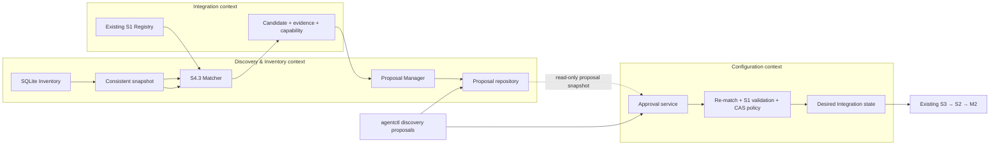
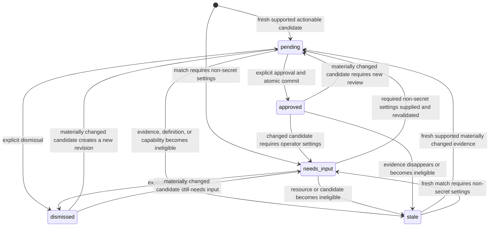

# S4.4 — Monitoring Proposal Lifecycle & Operator Approval

**Status:** Accepted design, implemented in the current feature branch and verified on the Windows workflow described in [S4.3/S4.4 verification evidence](../verification/s4.3-s4.4-verification.md). Not yet represented by a published/CI-verified commit.
**Scope:** Durable proposal evaluation/review and explicit atomic approval into desired Integration state.
**Related:** [Target Architecture v0.1.4](target-architecture-v0.1.4.md), [S4 Inventory](s4-resource-discovery-inventory.md), [S4.3 design](s4.3-integration-matching.md), [ADR-0002](../adr/0002-generic-integration-matching.md).

**Evidence labels:** **Verified Current** describes the current implementation and tests; **Approved** records the accepted S4.3/S4.4 decisions; **Proposed** records this design's implementation choices; **Open** marks remaining limitations. This document is a design description and does not imply every operational edge case has been E2E verified.

## 1. Goal and boundaries

S4.4 converts fresh, actionable S4.3 match results that lack an applicable enabled Template into durable operator-reviewable proposals. An explicit approval revalidates the latest evidence and atomically records approval with the desired Integration mutation. An enabled local Integration Configuration Template is a separate explicit authorization for automatic materialization; it does not create a per-resource approval proposal. S3 remains the only desired-to-applied convergence owner; M2 remains the only activation/readiness/LKG owner.



The proposal manager owns proposal identity, refresh/deduplication, lifecycle metadata and read/dismiss operations. Integration owns matching and candidate construction. Configuration owns final approval validation, desired-state mutation and expected-revision policy. `agentstate` provides SQLite adapters and the narrow cross-table transaction required for approval. No Matcher/Proposal Manager path invokes S3 or M2.

## 2. Existing contracts and required compatibility change

**Verified Current:** SQLite migration 6 stores each `IntegrationInstance` JSON payload plus an instance revision; `integration_desired_state` owns the set revision. `IntegrationService.Put` resolves an instance before repository persistence. `IntegrationInstance` currently has no resource binding or provenance fields.

**Approved S1 design gap:** the accepted S1 model includes optional provider-neutral resource binding and local provenance. Add these as optional JSON fields to `IntegrationInstance`, with omitted/empty legacy fields interpreted as local/unbound. This is additive to existing payloads and needs no Integration SQL migration. Discovery binding values are plain provider/instance/resource strings; Integration must not import Discovery types. The existing Resolver validates the binding shape and ignores it when producing component intents.

Proposed fields:

```go
type DesiredSource string // "local" or "discovery"

type ResourceBinding struct {
    Provider, ProviderInstance, ResourceID string
}

// optional fields on IntegrationInstance
Source  DesiredSource
Binding *ResourceBinding
```

Existing local CLI and tests normalize an empty source to `local`. Approval sets source `discovery` and binds the exact provider-scoped inventory identity. Core provenance/precedence remains unresolved; S4.4 does not add remote ownership.

## 3. Proposal identity, revisions and states

### Identity

**Proposed stable proposal identity:** hash of `(provider, provider_instance, provider_resource_id, integration_id)`. Definition version is deliberately excluded: a version or candidate change revises the same logical resource/integration proposal rather than creating a second proposal. Provider identities are never merged.

Track separately: proposal ID, proposal revision, definition ID/version, resource identity, resource fingerprint, candidate digest, capability artifact evidence, current status, required input names, safe evidence/diagnostics, observed global inventory material revision, last approved candidate digest, approved Integration instance ID/revision and timestamps.

### Lifecycle

Use five states; no additional `BLOCKED` state is needed:

| State | Meaning |
|---|---|
| `pending` | Complete, fresh candidate and required capability are supported; explicit approval can proceed. |
| `needs_input` | A definition can match but requires non-secret operator settings before approval. Candidate contains no secret material. |
| `dismissed` | Operator declined this exact proposal revision. Identical repeated evaluation stays dismissed. |
| `approved` | Proposal revision and desired Integration mutation committed atomically. It does not imply S3 applied, Collector ready or telemetry delivered. |
| `stale` | Resource evidence expired/disappeared, match is ambiguous, or candidate/capability evidence cannot currently be approved. |

Unsupported/unverified capabilities are surfaced as non-actionable match diagnostics and are not created as approval-ready proposals. If an existing proposal loses capability support or becomes stale, mark it stale. A later supported, fresh, materially changed result creates a new proposal revision in `pending`/`needs_input`. This keeps capability blocking out of an extra lifecycle state.



State changes caused by polling are deterministic from the latest complete inventory and match result. Provider failure alone does not cause `stale`; it preserves existing evidence and status, while freshness policy may independently make approval non-actionable.

### Refresh and deduplication

- New resource/definition pair inserts revision 1.
- Identical fingerprint, definition version, candidate digest, capability evidence, required-input list and status are a no-op; do not change proposal revision or timestamp.
- Material candidate/version/evidence change increments proposal revision. Current non-dismissed, non-approved proposal becomes `pending` or `needs_input`; an old approval request fails proposal-revision CAS.
- Identical dismissed candidate remains dismissed across repeated polls and recovery. A materially changed candidate gets a new revision requiring review.
- Resource recreation has a new provider resource identity and therefore a new proposal. The old proposal becomes stale after successful complete inventory snapshots establish missing state; it is retained for inspection.
- Provider failure never means resource deletion. Prior inventory remains; approval still checks current freshness and provider evidence.
- Disappearance never disables/deletes an already approved desired Integration. A proposal can become stale while retaining its last approved instance reference.
- Two matching Definitions produce ambiguity diagnostics and no actionable proposal.
- Proposal deduplication uses stable proposal ID. Approval additionally checks desired state and the resource binding; those checks are not delegated to Matcher.

## 4. Persistence and bounded-context contracts

**Verified Current:** migration 11 adds the separate inventory write/CAS revision; migration 12 adds durable proposal persistence. Compatibility tests cover upgrade from populated prior-schema state and preservation of enrollment, identity, dependencies and lifecycle/candidate evidence. Do not change existing M1/M2 or S1 migration semantics.

**Proposed migration 12:** create `integration_proposals` with deterministic `proposal_id` primary key, identity columns with a unique `(provider, provider_instance, resource_id, integration_id)` constraint, current `revision`, current `status`, bounded JSON payload, optional last-approved mapping and timestamps. Payload holds safe evidence, required input names, candidate settings/digest and capability evidence. Do not store credentials or arbitrary Docker metadata. No event/history table is needed for the PoC; current revision and last approval evidence are sufficient. Add a bounded payload size and SQLite constraint validation.

The Discovery-owned proposal repository supports consistent list/inspect, insert-or-refresh with expected revision, dismiss with expected proposal revision, and read-only approval snapshot. It does not approve desired state.

Configuration owns an `ApprovalService` with consumer-owned ports:

- `CandidateVerifier`: read latest inventory, rerun S4.3 matching for the proposal resource/definition, apply allowed non-secret input, validate via the exact S1 definition, recompute fingerprint/digest and capability status.
- `ApprovalRepository`: expose proposal and desired snapshots; commit one validated approval outcome atomically with desired state.

`agentstate` implements the final approval repository adapter against the existing SQLite database. The Configuration use case, not the proposal repository, decides approval eligibility and constructs a desired `IntegrationInstance`.

## 5. Approval sequence and atomicity

```mermaid
sequenceDiagram
  actor Operator
  participant CLI as agentctl proposals
  participant C as Configuration ApprovalService
  participant M as S4.3 Matcher / CandidateVerifier
  participant DB as SQLite state.db WAL
  participant S3 as Existing S3 Controller

  Operator->>CLI: approve proposal P at revision R; expected desired revision D
  CLI->>C: explicit ApprovalRequest(P,R,D,non-secret inputs)
  C->>DB: read proposal + desired snapshot + inventory snapshot
  DB-->>C: P/R, desired D, inventory write/material revisions
  C->>M: re-match latest resource and rebuild candidate
  M-->>C: exact definition, fingerprint, digest, inputs, capability evidence
  C->>C: freshness, settings validation, capability + duplicate checks
  C->>DB: short BEGIN IMMEDIATE approval transaction
  DB->>DB: CAS P/R, inventory write revision, desired set revision D
  DB->>DB: persist desired instance + increment desired revision + mark P approved
  DB-->>C: committed instance revision + new desired revision
  C-->>CLI: approval committed; S3 convergence pending
  S3->>DB: periodic desired-state snapshot
```

No SQLite transaction spans inventory reads, matching, Docker calls, capability assessment or native Collector validation. Those operations occur first. The adapter then opens one short write transaction and rechecks:

1. Proposal ID/current revision/status/candidate digest still equal the verified proposal.
2. Inventory write/CAS revision still equals the snapshot used for revalidation; material revision/fingerprint are recorded and checked as well. Any writer commit between snapshot and approval causes a stale conflict and the operator retries against fresh evidence.
3. Desired-set revision equals the caller's expected revision.
4. The target resource binding does not already map to another desired instance and no equivalent definition/settings instance would duplicate a manual configuration.
5. For an already approved identical proposal revision, return the persisted outcome idempotently without another desired-set increment.

Within that same transaction, insert/update the desired Integration instance, increment the existing desired-set revision once, and mark the exact proposal revision approved with instance ID/revision and candidate digest. Rollback leaves all three untouched. SQLite `BEGIN IMMEDIATE` and existing WAL/busy-timeout conventions serialize concurrent approvals; CAS yields one winner. No separate desired generation or approval journal is added.

The deterministic Integration instance ID for proposal-managed state is derived from the stable proposal ID and validated against existing S1 identity constraints. Re-approval of a changed candidate updates that same bound instance with its expected instance revision; it does not create another instance. Manual instances keep their existing IDs. Configuration Applied/Collector readiness/telemetry delivery remain S3/M2/runtime evidence, never proposal state.

## 6. Runtime and CLI

The Agent Service remains the only reconciliation owner. Extend the existing Discovery polling cycle so one cycle performs: provider snapshot commit (when enabled) → consistent inventory read → S4.3 match → proposal refresh. This reuses the existing polling interval and creates no second scheduler or event bus. Provider failures isolate discovery diagnostics and preserve resources; proposal evaluation errors are safe diagnostics and do not stop Collector supervision. Evaluate persisted inventory once at startup even when discovery provider polling is disabled, so old proposals can age to stale.

Read-only or proposal-local operations follow current `agentctl` parsing conventions:

```text
agentctl discovery proposals list [--state-path <path>]
agentctl discovery proposals inspect --id <proposal-id> [--state-path <path>]
agentctl discovery proposals dismiss --id <proposal-id> --revision N [--state-path <path>]
agentctl discovery proposals approve --id <proposal-id> --revision N --expected-desired-revision N [--input name=value] [--state-path <path>]
```

List/inspect are read-only and never call Docker. Dismiss changes only proposal state. Approve is an explicit Configuration operation. Output includes proposal revision, resource/definition identity, evidence, capability, required inputs, expected desired revision and a clear `approval committed; Agent Service convergence pending` result. No CLI command runs one-shot S3 reconciliation.

## 7. Sensitive settings and security limitation

Never accept or log plaintext credentials in flags, JSON settings, proposal evidence, SQLite proposal JSON or diagnostics. S1 rejects secret-bearing Integration settings and S2 intents. `credentialstore.Store` currently protects enrollment credentials outside SQLite, but no Integration secret-reference contract or Collector runtime secret expansion path exists. **Open implementation limitation:** authenticated Integration settings cannot be approved for activation until a separately reviewed reference/expansion contract connects CredentialStore to the Collector securely. S4.4 accepts non-secret inputs only; credential-requiring candidates remain `needs_input` and are not approvable. Do not imply a stored reference would be consumed by S2/M2.

Endpoint evidence is never treated as health. Only S4.3's safe loopback policy can construct the initial Redis candidate. Capability support requires current pinned artifact evidence. Manual approval remains mandatory for candidates without an enabled matching Template; Template enablement authorizes generated desired state but does not prove Collector readiness, service health or telemetry delivery. No endpoint probe or Core/local source-precedence policy exists.

## 11. Template-authorized automatic materialization

**Verified Current (worktree):** `IntegrationTemplate` is local-only through the current CLI and Configuration service. After a complete successful provider cycle, the existing Matcher evaluates the enabled Template set. The Configuration materializer atomically projects valid generated instances through SQLite; applicable auto-managed pairs are omitted from manual proposal refresh to avoid duplicate authorization paths. Conflicts and unsupported candidates remain non-actionable diagnostics. Provider errors do not trigger projection, and the existing inventory policy requires two complete misses before generated instances are suspended.

This path does not approve or mutate local templates into Core-owned records, bypass S3, or invoke M2 from CLI. Template deletion is a retained tombstone; disabling is reversible. Full live Docker → generated desired instance → Collector activation → isolated OTLP sink evidence is tracked separately in the Template autodiscovery verification report.

## 8. Failure and recovery behavior

| Failure | Durable behavior |
|---|---|
| Candidate/resource/definition changed before approval | CAS or verifier returns stale conflict; no write; proposal refresh records a new revision if actionable. |
| Inventory writer commits between revalidation and transaction | Inventory write revision mismatch; rollback all writes; retry after reading current inventory. |
| Desired Integration changed concurrently | Desired-set revision conflict; no approval or instance mutation. |
| Duplicate manual/bound desired Integration | Typed duplicate outcome; do not mark approved or create a second instance. |
| Validation or capability failure | No approval transaction; explicit `needs_input`/`stale` diagnostics; no desired write. |
| SQLite failure midway | Transaction rollback prevents partial desired/proposal outcome. |
| Process exits before transaction | No approval write. |
| Process exits after commit | Proposal and desired instance are both committed; repeated command returns the stored approval idempotently; S3 picks up desired state on startup/poll. |
| S3 activation/readiness failure after approval | Proposal remains approved and desired state remains durable; separate S3/M2 diagnostics and LKG recovery report runtime outcome. |
| Resource disappears after approval | Proposal may be stale, but approved desired Integration is not auto-disabled/deleted. |

## 9. Acceptance tests

- Proposal stable identity excludes version; new resource identity gets a new proposal; material candidate/version changes increment revision once; repeated identical refresh and dismissed candidate do not churn.
- SQLite migration from populated schema-v10 preserves M1/M2, enrollment, identity, Integration desired state and inventory.
- Concurrent refreshes of the same proposal yield one deterministic current revision.
- Approving same proposal twice is idempotent; two concurrent approvals create one desired instance and increment desired-set revision once.
- Stale proposal revision, stale inventory write revision/material fingerprint, stale desired revision, changed endpoint, definition version and unavailable capability reject without partial writes.
- Injected failure between desired-instance write and proposal outcome demonstrates transaction rollback.
- Restart preserves proposals and approvals; process-stop before/after commit demonstrates all-or-nothing recovery.
- Existing equivalent manual desired Integration is not duplicated; proposal-managed ResourceBinding remains stable through approved updates.
- Discovery provider failure preserves inventory and does not create false stale/missing transitions; complete misses/freshness make approval non-actionable.
- CLI list/inspect does not contact Docker or write desired state; dismiss does not change desired or M2 generation; approval does not run S3.
- Full Redis Agent Service/Collector/OTLP sink E2E proves distinct approval, desired revision, applied generation/readiness and telemetry delivery.
- PostgreSQL/MongoDB Docker fixtures prove test-only independent matcher/proposal behavior; no production support is claimed without verified Collector capability and real telemetry.

## 10. Risks and implementation blockers

- Current S1 runtime omits accepted optional resource binding/provenance. Add backward-compatible fields before proposal approval; do not invent Core ownership.
- Current inventory CAS conflates material revision with writer concurrency. Add a separate write token before approval; keep the material revision stable for deterministic matching.
- CredentialStore is enrollment-only; no Integration secret flow exists. Credentialed approvals are deliberately blocked pending an approved secure reference and Collector expansion contract.
- Local Docker API access is privileged. E2E uses explicitly named disposable containers and isolated SQLite; cleanup may touch only those fixtures.
- Docker Desktop/Windows execution is environment-dependent; Linux native behavior must be independently tested in CI or a supported Linux runner, not inferred from cross-build.
