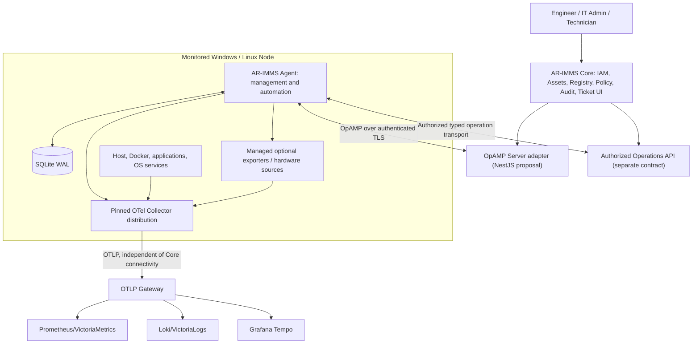
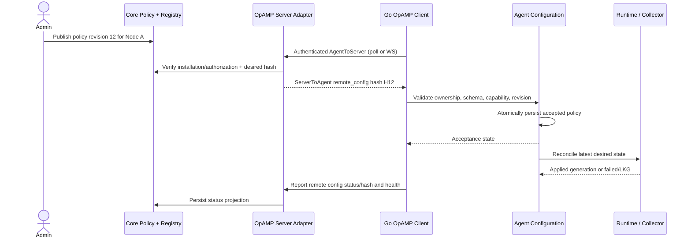

# AR-IMMS Telemetry Agent — Target Architecture vNext

> **Status:** PROPOSED / Architecture review baseline — not an implementation-complete specification<br>
> **Version:** 0.2-draft · **Date:** 2026-11-12 · **Audience:** Architecture owner, Go/TypeScript engineers, Coding Agents, QA<br>
> **Scope:** Telemetry Agent on native Windows/Linux; AR-IMMS Core management integration; OpenTelemetry Collector; local diagnostics and narrowly authorized infrastructure operations.<br>
> **Evidence baseline:** Phase-1 read-only source audit at commit `477e831d39525b2aa08ea1a6ea2a5be82ed91d12` (2026-11-11), uploaded source tree, previous Redis/Template verification reports and architecture discussions. Working-tree cleanliness was **not established** by the audit because the docs submodule was inaccessible. Verify all assumptions against current HEAD before implementation.

## 0. Document conventions

- **EXISTING:** Implemented in the audited repository or previously documented in verification evidence; does not imply all platforms are live-E2E verified.
- **PROPOSED:** Target behavior/design to be implemented after review.
- **OPTIONAL / DEFERRED:** Not required for baseline; needs a separate decision.
- **OPEN:** Requires explicit architecture or policy decision.
- **MUST / MUST NOT / SHOULD:** Intended engineering constraints for implementation after this proposal is approved.
- **PASS / FAIL / NOT RUN / BLOCKED:** QA evidence status; never infer PASS from code compilation alone.

This document covers intended product behavior, architecture boundaries, flows, developer experience, safety rules, migration and realistic test scenarios. It cannot enumerate literally every hardware/OS/network failure; test classes cover the important families and regression risks. This is a **target design**, not proof all features are available today.

---

## 1. Executive summary

### 1.1 Product thesis

**AR-IMMS Telemetry Agent is an OpenTelemetry-first, vendor-neutral management and automation layer:** install once; enroll in Core; enrich infrastructure observations through lightweight discovery listeners; provision supported monitoring capabilities without per-service prompts; converge automatically as resources change; expose actionable diagnostics; enable tightly controlled basic operations; survive network/Collector failures. Engineers should not need to maintain raw Collector YAML for routine integrations.

Its competitive value is **deployment and operations experience**, not rebuilding Datadog's check ecosystem or reimplementing telemetry receivers. The Collector owns telemetry execution; AR-IMMS owns installation, identity, asset-aware inventory, monitoring policy, intent-to-runtime convergence, health projections and Core integration.

### 1.2 Six foundational product requirements + operations

| ID | Product requirement | Observable success |
|---|---|---|
| PR-01 | One-install on native Linux and Windows | Agent + verified Collector + OS service installed; baseline metrics; restart-safe |
| PR-02 | Core registration | Stable installation identity, secure enrollment, correct Node binding, revocation enforcement |
| PR-03 | Automatic infrastructure discovery | Inventory indicates found/changed/missing resources; supported preconfigured capabilities converge automatically without per-service approval prompts |
| PR-04 | Developer-friendly extensibility | Generic Prometheus `/metrics` monitoring via profile alone; new Collector components via standard OTel extension path |
| PR-05 | Remote configuration | Core targets Agent via OpAMP; Agent validates/persists/reconciles; Core sees actual outcome |
| PR-06 | Operational reliability and transparency | LKG recovery, offline continuity, explicit diagnostics and evidence of delivery limits |
| PR-07 | Controlled local operations | Read-only inspect/logs/refresh first; scoped container/service restart second; no arbitrary shell or SSH |

### 1.3 Non-goals

- Reimplement receivers, telemetry processing/export, custom Python runtime, OpenTelemetry Collector plugin loader or a proprietary metrics pipeline.
- Promise universal zero-config monitoring, guaranteed telemetry delivery, zero transient scrape overlap or automatic secret discovery.
- Build full OpAMP protocol support, Agent binary remote upgrade, interactive SSH, unrestricted remote shell, Kubernetes mutation, autonomous AI remediation or a new message broker in baseline.
- Replace all working discovery/materialization code merely because Docker Observer/Receiver Creator exist upstream.
- Redesign Core IAM, Zammad ticket source of truth, Grafana alerting or AR field workflows in this iteration.

### 1.4 Existing behavior that MUST be preserved

Enrollment identity/credential storage; Gateway snapshot support; SQLite WAL and CAS; Docker inventory identity, historical/missing semantics; manual proposal/approval; local Template CRUD and ownership; deterministic Redis materialization; reconciliation/no-op convergence; Collector compilation/native validation, generation-bound activation/readiness and LKG; managed Windows Exporter, Node Exporter and LibreHardwareMonitor dependencies; existing CLI commands; host telemetry; pinned Collector 0.160.0 as baseline pending explicit upgrade. Prior Windows live Redis/Compose tests form regression reference, not blanket proof for vNext or Linux.

---

## 2. Architecture principles and decisions

1. **OTel-first.** Prefer supported Collector receivers/processors/exporters/connectors/extensions and standard OTLP/Prometheus instrumentation.
2. **One active owner.** For each monitored resource/pipeline, exactly one mechanism instantiates receivers: Agent compiler **or** Collector Receiver Creator. Do not enable both for the same targets.
3. **Core manages its published configuration scope, Agent manages effective local state, Collector executes; Core/local precedence remains OPEN.** Core never requires per-container manual endpoint management.
4. **Durable truth, ephemeral notifications.** SQLite owns local truth. Internal typed events accelerate reactions but cannot substitute for restart reconciliation.
5. **Safe-by-default discovery.** No per-service discovery approval workflow in the vNext target. Only pre-authorized capability/configuration policies may activate receivers; observation alone never grants credentials, endpoint access or dependency installation.
6. **Capability honesty.** UI/CLI must distinguish Discovered → Eligible → Desired → Applied → Observably Healthy → Delivery Evidence. Missing evidence is UNKNOWN, not SUCCESS.
7. **Least privilege and scoped authority.** Credentials, Docker socket and OS-service permissions are security boundaries, not merely configuration options.
8. **Single-install convenience ≠ silent package installation.** Optional hardware/third-party dependencies require compatibility checks, consent and ownership tracking.
9. **Behavior-preserving refactor first.** Separate package moves from new functionality, persistence migrations and Collector execution changes.
10. **No custom remote arbitrary execution.** Infra operations are typed/allowlisted; OpAMP Restart must never be interpreted as Docker restart.

### 2.1 Proposed ADR index

| ADR | Decision | Status |
|---|---|---|
| ADR-VN-01 | Six functional contexts + `app`, `platform`, and separate `operations` capability | PROPOSED |
| ADR-VN-02 | SQLite WAL remains single local database with context-owned repositories | PROPOSED |
| ADR-VN-03 | Typed, bounded in-process event dispatcher; periodic recovery retained | PROPOSED |
| ADR-VN-04 | OpenTelemetry Collector owns telemetry, not Agent | ACCEPTED principle |
| ADR-VN-05 | Generic Monitoring Profiles first; specialized native Go definitions only if required | PROPOSED |
| ADR-VN-06 | OpAMP transport of versioned AR-IMMS config; authority/merge policies remain OPEN | PARTIALLY ACCEPTED |
| ADR-VN-07 | Keep AR-IMMS Collector supervisor; do **not** run OpAMP Supervisor simultaneously | PROPOSED |
| ADR-VN-08 | OTel-native Observer + Receiver Creator is preferred for supported endpoint lifecycles; migration requires parity spike, with exactly one owner | ACCEPTED DIRECTION / VALIDATION PENDING |
| ADR-VN-09 | Operations API separate from OpAMP and monitoring configurations | PROPOSED |
| ADR-VN-10 | Existing Windows exporter/LHM/Node exporter as managed baseline/optional dependencies | PROPOSED |

---

## 3. System context and deployment



**Two independent network planes:**

- **Management plane:** enrollment, OpAMP config/status, authorized diagnostics/operations. The Agent initiates outbound connections; no inbound SSH requirement.
- **Telemetry plane:** Collector receivers/processors/exporters to gateway/backends. Core outage must not stop a correctly configured Collector. The management and telemetry endpoint can have different reachability/failure states.

**Deployment:** 1–3 monitored laptops/PCs for the PoC, including native Windows and Ubuntu agents; Docker Engine / Docker Desktop as relevant; separate Core/Gateway optional on VPS. Do not claim a Linux-native validation when the Agent runs inside a Docker Desktop Linux container.

---

## 4. Bounded contexts and contracts

> Contexts are logical ownership boundaries, not microservices. Within the Go repository use flat packages unless internal layering is justified by complexity. `operations` is a separate, opt-in capability; its existence must not give the general Agent unlimited machine permissions.

### 4.1 Identity & Connectivity

**Owns:** `InstallationIdentity`, installation ID, enrollment attempt, Core enrollment binding, credential reference, connection state, OpAMP session identity mapping; secure storage adapters. **Does not own:** monitoring policies or Collector configuration.

**Inputs:** enrollment token, approved Core origin, local identity, protected credential, network events. **Outputs:** authenticated Core/OpAMP transport, enrollment result, connectivity facts; no monitoring side effects.

**Features:** initial enrollment; resume lost-response attempt; credential protection; reconnect/backoff; revocation handling; TLS verification; Core identity mapping; OpAMP client lifecycle. **Status:** enrollment EXISTING; general OpAMP PROPOSED.

**Invariants:** identity stable across Agent/OS restarts; Node binding not silently reassigned; no fallback to an unauthenticated endpoint; `instance_uid` is not itself proof of authorization; credential material never appears in logs/events/CLI.

**Edge cases:** token expiry/reuse, concurrent enroll, response lost after server commit, Core 401/410/429/503, TLS mismatch, clock skew, machine clone, duplicated installation ID, credential store unavailable, network flap, proxy outage, revoked session while offline.

### 4.2 Configuration & Policy

**Owns:** `MonitoringProfile`, local/Core authority, profile revisions, accepted remote policy, desired Integration instances, Template ownership/provenance, effective desired-set revision, materialization/approval transaction semantics, configuration reconciliation use case. **Does not own:** Collector process or physical resource identity.

**Features:** built-in OS baseline, local profile CRUD, Core-managed profile snapshots, manual instances, authorization/precedence, CAS, conflict/rejection, deterministic materialization, no-op detection, desired-to-applied convergence through `ApplyCandidate` runtime port.

**Rules:** remote config is a versioned policy/profile blob rather than arbitrary complete Collector YAML; local/Core authority must be explicit; policies cannot modify another owner's instances; reject invalid whole snapshots atomically; retain last accepted configuration on remote failure; apply status only after runtime evidence; don't re-activate unchanged fingerprint.

**Edge cases:** out-of-order revisions/hash disagreement, duplicate snapshot, conflicting local override, unsupported capability, invalid endpoint binding, secret in profile, partial snapshot, locally deleted Core-owned instance, import of old SQLite schema, concurrent CLI/Core edits.

### 4.3 Resource Inventory

**vNext extension:** a minimal `DiscoveryProvider`/Listener abstraction delivers scoped complete snapshots (and optional change wakeups) into a normalized metadata registry. Providers do not scrape metrics, create receivers, or interpret OTel config. Built-in Docker provider is first; future OS process, K8s, networking/SNMP, cooling/power adapters reuse the observation contract. Registry correlates source-native identities, records provenance and timestamps, and must not merge by IP/port alone. Docker Desktop VM/network-namespace boundaries must be tested explicitly.

**Owns:** `ResourceIdentity`, host/VM/container observation, provider state, presence/missing history, endpoint observations, complete-snapshot semantics, timestamps/revisions. **Does not own:** receiver runtime, user approval decision or Collector pipeline.

**Features:** Docker discovery EXISTING; stable container IDs, labels/images/ports, source provenance; host inventory; future VM/OS service providers subject to verification. Docker Observer may be reused for endpoint discovery **only if** historical asset-aware inventory is preserved.

**Rules:** provider timeout/partial snapshot must not increment missing counter; complete successful snapshots can advance missing state according to documented policy; old identity retained in history after recreate; provider privileges are opt-in.

**Edge cases:** two Compose projects same service name, container name reuse, port collision/remap, paused/health-unhealthy, restarted same ID, recreated new ID, Docker daemon unavailable, malformed metadata, untrusted labels, multi-homed endpoints, VM clone, resource deleted during scan.

### 4.4 Monitoring Capabilities

> **Compatibility note:** Existing manual proposal/approval flows are legacy behavior preserved during structural refactoring. vNext runtime DX does not prompt for every newly discovered service. Security authorization for privileged integrations and operations remains mandatory; deprecating existing CLI/storage requires an explicit migration.


**Owns:** supported capability catalog, profile-to-Collector mapping strategy, capability resolution/evidence, compatibility requirements, explainable eligibility decisions and explanatory reasons. **Does not own:** desired instance persistence (Configuration), inventory history or telemetry scraping.

**Capability tiers:**

- **Tier A / Built-in:** hostmetrics, built-in Redis and OS baseline profiles.
- **Tier B / Generic:** Prometheus scrape profile for eligible `/metrics`; OTLP ingestion for already instrumented applications; other existing Collector receivers as validated profiles.
- **Tier C / Specialized:** Go definition for validated non-generic settings or contribution logic; receiver must actually be present in pinned Collector.
- **Tier D / New capability:** external exporter or custom OTel component/distribution via OCB, with explicit version/capability validation.

**Features:** catalog `list/inspect`, explain unsupported/blockers, matching evidence, automatic supported capability selection (no per-service prompts), generic profile schema validation, pinned manifest introspection. Built-in Redis Go Definition EXISTING; generic config-only profiles PROPOSED.

**Rules:** don't require Go rebuild solely to instantiate an already supported generic receiver; no arbitrary YAML injection; do not infer platform availability from upstream docs; no automatic deployment of new binaries from untrusted profiles.

**Edge cases:** two profiles match same resource, multiple endpoints, duplicate stream/resource attributes, unsupported receiver version, invalid user metrics URL, SSRF/internal privileged targets, auth-required endpoint, receiver config accepted but scrape fails, profile version migration.

### 4.5 Runtime & Installation

**Owns:** one-install workflow, pinned artifacts/checksums, OS service installation/uninstallation, managed exporter dependencies, Collector config compiler/native validator, process supervisor, candidate/generation journal, atomic activation, readiness, rollback/LKG. **Does not own:** monitoring policy or application service remediation.

**Features:** native systemd/Windows SCM startup; baseline configs; Collector install and repair; OS-specific managed dependencies; deterministic complete config assembly; process health; activation lock; LKG. **Status:** substantially EXISTING; native live Linux/SCM gates need fresh verification.

**Rules:** compiled config composed from approved intents and pinned components; validation before activation; no direct writes of raw user YAML into active config; stable generation on no-op; failures preserve/restore LKG; don't remove resources not owned by Agent; Agent supervisor is sole process owner (no concurrent OpAMP Supervisor).

**Edge cases:** checksum mismatch, binary incompatible with OS/arch, partial install, disk full, permission denial, service already exists, Collector crash loop, startup timeout, invalid config, failed atomic rename, reboot mid-activation, stale lifecycle lock, failed rollback, uninstall with shared dependency, Windows AV/firewall, Linux SELinux/AppArmor/systemd restrictions.

### 4.6 Health & Reporting

**Owns:** diagnostic snapshots, health evidence projections, Core/OpAMP status reports and truthful status semantics. **Does not own:** Collector scrape execution or the health of a service merely inferred from readiness.

**Statuses:** `DISCOVERED`, `ELIGIBLE`, `DESIRED`, `APPLIED`, `SCRAPE_EVIDENCE`, `EXPORT_EVIDENCE` are separate dimensions, not one oversimplified state enum. Core transport can map to OpAMP `RemoteConfigStatus` (`APPLYING/APPLIED/FAILED`) while AR-IMMS keeps its own more detailed lifecycle status.

**Evidence hierarchy:** process alive < Collector ready < config applied < receiver activity evidence < exporter sent evidence < gateway/backend confirmation. If signal unavailable, report UNKNOWN.

**Features:** local status/diagnostic endpoints, failure explanations, sanitized diagnostic bundle; reported OpAMP `ComponentHealth`, effective config/hash/status as supported, optional own telemetry. Avoid logging secret-bearing config or including private credentials in EffectiveConfig.

**Edge cases:** no traffic vs scrape failure, temporary missing target, receiver internal metrics aggregated across instances, exporter retry/queue overflow, gateway unreachable, backend rejecting writes, stale status packet, clock skew, excessive diagnostic output.

### 4.7 Remote Operations (independent capability)

**Owns:** `OperationRequest`, `OperationId`, target and authorization facts, durable operation lifecycle/outcome, adapter-specific execution and sanitized evidence. **Does not own:** general shell, SSH session, OpAMP commands, Collector pipeline.

**P0 read-only:** `container.inspect`, bounded `container.logs`, `service.status`, `discovery.refresh`, `monitoring.reconcile`, diagnostic snapshot. **P1 opt-in mutation:** `container.restart`, allowlisted `service.restart` (separate approval/security gate). **Deferred:** SSH, arbitrary command/script, K8s mutations, full remote terminal, automatic AI execution.

**Important security:** Docker socket can imply host-level control; Core RBAC does not confine a highly privileged local adapter. Use explicit local opt-in, least privilege where feasible, strict action/target allowlists, authenticated scoped requests, expiry, replay defense, audit and rate/concurrency limits. If an acceptable privilege boundary cannot be demonstrated for a given host, keep remote mutation disabled.

**Operation result lifecycle:** `REQUESTED → AUTHORIZED → RUNNING → SUCCEEDED / FAILED / UNKNOWN` with TTL, target-binding and idempotency. `SUCCEEDED` means API operation completed, **not** service recovered. Operation execution result and post-operation recovery verification are distinct.

**Edge cases:** stale container ID, target name reused, duplicate operation ID, worker crash mid-restart, lost response, command timed out after side effect, Core unreachable, revoked authorization, concurrent restart requests, logs containing secrets, service restart taking down Agent's own dependencies.

### 4.8 Cross-cutting: Application Host, Platform and Events

- `internal/app`: composition root, dependency wiring, startup/shutdown and scheduling; does not own business entity state.
- `internal/platform/sqlite`: DB opening, WAL/busy timeout, transaction and migration primitives; **no domain entities**. Each context owns SQL repositories; one physical SQLite database remains.
- `internal/platform/events`: bounded typed in-process dispatcher, stable handler registration, cancellation/shutdown, delivery failure metrics.
- `cmd/agentctl`: thin CLI parse/format/presentation/exit-codes. Business workflows live in application services.
- **Cross-context calls:** explicit read contracts/ports for synchronous decisions; typed facts for async wakeups; don't make every request event-driven.

---

## 5. OpenTelemetry division of labor

**Accepted design direction (2026-11-12):** retain native Collector receivers/processors/exporters, prefer OTel observers and `receiver_creator` for dynamic endpoint lifecycle, and build only a small Agent discovery metadata/enrichment layer plus capability/configuration provisioning. `receiver_creator` can only instantiate receiver types already compiled into the chosen Collector. Unknown protocols require a standard external exporter or a separately built OTel component/distribution, never a proprietary receiver engine. The observer and Agent metadata registry do not automatically exchange observations; use native OTel observation plus an independent scoped Agent provider initially, and optimize any bridge only after measurement.


| Requirement | Agent / Core responsibility | Collector / OTel responsibility |
|---|---|---|
| Host metrics | Choose baseline, OS/dependency ownership | `hostmetrics`, Prometheus scraping, platform-capable receivers |
| Redis/Postgres/Mongo | Resource discovery, approved profiles, credentials policy | Native receivers where present; actual protocol scrape |
| Custom app `/metrics` | Generic Prometheus profile, target matching, authorization | Prometheus receiver, scrape scheduling |
| App OTLP metrics/logs/traces | Endpoint policy, identity mapping and documentation | OTLP receiver, processors/exporters |
| Log/trace processing | Decide policy and source identity requirements | Receivers, processors, connectors, exporters |
| Failure queue/retry | Report diagnostics and select bounded config | Collector exporter queue/retry; no unproven zero-loss guarantee |
| Dynamic Docker monitoring | Inventory/identity/history; choose single receiver owner | Docker Observer/Receiver Creator **only after E2E equivalence** |
| Runtime health | Interpret reliable evidence | Internal telemetry and extension endpoints |
| Remote management | Core policy, OpAMP client/server, authority | OpAMP protocol concepts; Collector execution remains separate |

**Distribution strategy:** keep pinned `otelcol-contrib` for initial compatibility unless evidence justifies a trimmed custom distribution. OCB-built custom distributions must ship verified capability manifest, checksums, OS/arch targets and E2E; no dynamic loading of Go modules. Receiver Creator may instantiate multiple matching receivers: evaluate duplicate suppression and resource identity before adoption.

---

## 6. Configuration design and ownership

**Config authority status: OPEN.** We have deliberately not settled Core-vs-local ownership, merge/deletion precedence, or per-profile approval policies. No implementation may infer last-write-wins. In the interim, use one explicitly targeted Core-owned test namespace and preserve existing local behavior; final policy needs its own ADR before production migration. No per-new-service approval prompt is part of the target DX.


### 6.1 Configuration layers (logical)

1. **Immutable baseline:** versioned Collector mandatory pipelines, resource attributes, health/internal telemetry and Gateway/exporter constraints.
2. **OS built-in monitoring:** Windows or Linux host profile, default OTel components, optional managed exporters.
3. **Trusted built-in workload profiles:** e.g., Redis with opt-in auto-monitoring policy.
4. **Local engineer profiles/manual instances:** locally authorized settings.
5. **Core-managed policy:** received via OpAMP, targeted to the Agent and bound by explicit ownership.
6. **Runtime-discovered values:** endpoints/resource IDs resolved from current inventory; cannot override trust decisions.

**Provisional requirements, not an approved merge policy:** Do not implement a generic last-write-wins merge. Track stable ID, provenance and revision. The exact `BUILTIN`/`LOCAL`/`CORE` ownership, namespace replacement/deletion, and baseline override precedence remain OPEN pending a dedicated ADR; until then keep a strictly isolated Core-managed test namespace without altering existing local behavior.

### 6.2 Built-in host monitoring and managed dependencies

| Platform | Baseline | Optional / existing managed dependency | Expected |
|---|---|---|---|
| Linux | OTel `hostmetrics` | `node_exporter` where additional metrics are needed | Baseline works without Node Exporter; no duplicate metrics by default |
| Windows | OTel `hostmetrics`, appropriate OS config | `windows_exporter` built-in managed dependency | Discover existing install, ownership-aware install/repair; scrape via Collector |
| Windows hardware | Host baseline continues | LibreHardwareMonitor (LHM) + LHM exporter | Explicit opt-in; supported sensors only; graceful degradation |

Keep existing installer/configure/inspect/enable/disable/uninstall capabilities and artifact ownership rules. The **LHM application and LHM exporter** must be verified as separate components/dependencies if that is how the audited source implements them; don't invent an integrated exporter. Hardware sensor support may be unavailable or incomplete by model/permissions, and does not determine Agent readiness.

**Exporters are data sources, not a reason to implement custom collection inside the Agent.** Collector Prometheus receiver scrapes eligible local exporters. Apply firewall/loopback binding and credentials as applicable; avoid exposing metrics interfaces to the public internet.

### 6.3 Developer-facing monitoring profile (illustrative; schema NOT finalized)

```yaml
schema_version: 1
id: python-api-metrics
capability: prometheus-scrape
owner: local
selector:
  resource_kind: container
  labels:
    com.example.monitor: "true"
settings:
  interval: 15s
  metrics_path: /metrics
binding:
  endpoint: discovered.http.metrics
```

A safe profile references **approved symbolic endpoint bindings**, not arbitrary commands or unvalidated YAML fragments. Profile validation checks capability availability, selector/binding schema, address restrictions, interval limits, secret refs, ownership and duplicate receiver collisions. A profile must be inspectable/exportable and explainable before activation.

### 6.4 Reconciliation invariants

`Inventory/Policy change → Desired state computed → CAS persist → wakeup event → Reconciliation reads latest SQLite → compile full candidate → native Collector validation → runtime activation → readiness terminal evidence → applied generation journal/status`.

- No-op desired fingerprint: no Collector restart/new generation.
- Multiple changes: coalesce where safe; never apply stale revision after newer committed state.
- Candidate invalid: reject without replacing active config.
- Activation fails: try bounded LKG recovery and report both attempted candidate failure and recovery outcome.
- Collector ready does not establish telemetry delivery.
- Existing 15-second polling fallback remains until deliberate replacement; advisory events reduce latency, not guarantee delivery.

---

## 7. OpAMP architecture and contract

### 7.1 Protocol boundary

**DECIDED DIRECTION:** Go Agent embeds an **OpAMP client**; NestJS Core exposes an **OpAMP server adapter**, initially over authenticated HTTPS plain-HTTP polling, with WebSocket as optional later capability. OpAMP's wire messages are Protobuf, not JSON REST. Generated protocol types and transport framing must match the pinned protocol version; do not invent field names from prose examples.

- Agent initiates HTTPS or WSS outbound.
- Core IAM/Agent Registry remains the source for installation authorization and target Node binding.
- OpAMP `instance_uid` is protocol identity, mapped to—not equated with—AR-IMMS Installation ID; never treated as a bearer credential.
- Server supports only negotiated protocol capabilities; no requirement to expose package upgrades, arbitrary commands, certificate bootstrap or WebSocket in MVP.
- Agent sends relevant agent description, capabilities, config/effective status and health via OpAMP when supported; do not over-claim that every detailed AR-IMMS operation state fits native OpAMP fields.
- Remote policy is an **AR-IMMS-owned versioned document** delivered in OpAMP `config_map` with declared content type/hash. Agent validates it before translating to existing desired state; Core must NOT push arbitrary active Collector YAML.
- `RemoteConfigStatus` represents protocol-level apply states; any separately needed `RECEIVED/ACCEPTED/APPLIED/DELIVERED` is an AR-IMMS lifecycle projection, not a fabricated OpAMP enum.
- The OpAMP restart command (if supported later) pertains to the managed Agent's lifecycle. It is not a Docker/OS-service restart API.

### 7.2 Core logical modules

| Module | Owns | Does not own |
|---|---|---|
| Agent Registry (existing) | Installation↔Node binding, credential/revocation | Collector config |
| Monitoring Policy (new) | Published profile snapshots, scope, revisions and audit | Container endpoint discovery |
| OpAMP Transport Adapter (new) | Protobuf protocol, HTTP/WS session, auth integration, per-installation delivery | Business policy validation by itself |
| Config Status Projection (new) | Config hash/accepted/applied/error facts, recency | Telemetry backend truth |
| Operations Authorization (separate new) | Specific user/target/action approvals and audit | OpAMP command misuse |

Core must authenticate *each relevant request/connection*, authorize the installation against its binding, enforce size/rate limits and redact secrets. A fleet-wide profile change must not leak configurations to other installations.

### 7.3 OpAMP Core → Agent flow



**Remote-config commit decision (proposed):** a syntactically valid remote policy can be persisted as *accepted*, but it is not marked *applied* until Collector readiness/journal confirms it. If the effective configuration cannot be applied, preserve LKG and surface failure. Core policy revision and local Collector generation are distinct monotonic concepts.

### 7.4 OpAMP connectivity edge cases

| Case | Expected behavior |
|---|---|
| Same hash delivered repeatedly | No-op; do not generate new Collector activation |
| Old/unsigned/unauthorized config | Reject; preserve accepted state |
| Unsupported capability | Reject or explicitly degraded according to documented atomic policy; no silent partial success |
| Network/Core outage | Collector keeps running with LKG; local discovery still works under local policy |
| Core revokes Agent | Reject subsequent management connectivity; offline mutation authorization fails closed; policy for already-running monitoring must be explicitly decided |
| Two Agents share spoofed UID | Authenticated installation binding prevents cross-target leakage; investigate collision |
| Status report lost or reordered | Next status poll restores current state; newer status not overwritten by stale hashes |
| Core restarts with new session | Client reconnects and reports local effective status; avoid unnecessary reapply |
| Split local/Core edits | Ownership guard refuses conflicting writes; no last-write-wins |
| Clock drift/TLS certificate expiry | Clear error, bounded retry; do not disable TLS verification |
| Agent binary lacks requested receiver | Capability failure, no partial unsafe apply |
| OpAMP transport error mid-message | No partially accepted configuration; retry/resynchronize |

### 7.5 Implementation decision gate

The TypeScript OpAMP server is **a proposal**, not a claim of an existing production-ready NestJS library. Before implementation: (1) pin protocol revision and generated Protobuf schema, (2) prove compatibility with official Go OpAMP client test fixture, (3) test HTTP exchange, auth, config hash/status and reconnect, (4) compare effort/security against a dedicated Go OpAMP service. NestJS remains preferred only if the protocol adapter is auditable and testable. **Do not simultaneously deploy upstream OpAMP Supervisor with AR-IMMS supervisor.**

---

## 8. Internal Event Dispatcher

### 8.1 Purpose

Keep contexts loosely coupled and reduce reaction time after committed changes, without compromising SQLite authority. This dispatcher is **in-process and best-effort**, not an operations queue or durable event source.

### 8.2 Initial event taxonomy

| Event | Publisher after successful commit | Subscriber action |
|---|---|---|
| `InventorySnapshotCommitted` | Inventory | Re-read inventory, refresh monitoring proposals and materialization |
| `MonitoringPolicyChanged` | Configuration | Recompute policy-driven instances |
| `DesiredConfigurationChanged` | Configuration | Wake reconciliation controller |
| `CollectorGenerationApplied` | Runtime | Recompute health/status projection |
| `CollectorGenerationFailed` | Runtime | Recompute diagnostics and status |
| `OperationFinished` | Operations (later) | Refresh diagnostics/evidence; not mutation scheduling |

Use event payloads with stable IDs/revisions only. No secrets, full configs, mutable graph objects or arbitrary runtime commands.

### 8.3 Semantics

- Register handlers deterministically before runtime starts; bounded queues per design; no synchronous reentrant handler calls.
- Publish **after commit**; never while holding SQLite transaction or lifecycle lock.
- Handler re-reads current authoritative SQLite revision, is idempotent and tolerates duplicate/out-of-order event.
- Full queue returns observable failure; cannot roll back an already committed transaction.
- Shutdown stops admission, drains within deadline, then cancels remaining work and reports incomplete processing.
- Crash between DB commit and enqueue is acceptable because startup/periodic reconciliation repairs missed work.
- Do not add durable outbox unless a later requirement needs guaranteed prompt event processing.

### 8.4 Event failure tests

Queue full; handler panic/error; publish after shutdown; publish during cancellation; dropped notification after DB commit; duplicate event; stale revision; handler publishes another event; shutdown timeout; restart with pending desired revision. Every case must eventually converge via SQLite when startup/periodic reconciliation runs.

---

## 9. Operations design (no SSH)

### 9.1 Baseline API intents

| Action | Scope | Phase | Mutation? |
|---|---|---|---|
| `container.inspect` | Exact Docker ID and installation | P0 | No |
| `container.logs` | Exact ID; tail/window/size bounds | P0 | No |
| `service.status` | Allowlisted OS service | P0 | No |
| `discovery.refresh` | Agent provider scope | P0 | No resource mutation; local workload only |
| `monitoring.reconcile` | Current desired configuration | P0 | May restart Collector; privileged operation |
| `container.restart` | Exact ID; optional precondition generation | P1 | Yes |
| `service.restart` | Allowlisted Windows/Linux service | P1 | Yes |

`monitoring.reconcile` is **not automatically harmless**; it can trigger Collector activation and must use a scoped authorization policy. Read-only commands are generally lower risk, but container logs can expose secrets and Docker API access remains privileged.

### 9.2 Request lifecycle

`Core authenticates human → checks IAM + Node/resource/action entitlement + approval → issues short-lived target-bound intent → Agent verifies origin, freshness, unique ID, local opt-in, allowlist, current resource identity → durable operation record → executes bounded adapter → durable outcome → Core audit and separate recovery verification`.

**Transport OPEN:** Separate operations channel/API, possibly Agent-initiated polling over authenticated HTTPS; do not treat OpAMP `command` as an arbitrary operations bus. Choose delivery after security review, without exposing inbound unauthenticated executor port.

### 9.3 Mandatory safety

- Default remote operations **disabled**; no arbitrary commands/shell.
- Core request must bind Agent installation, Node ID, exact resource ID, action, parameters, issuer, authorization/approval, issued/expiry, unique operation ID and bounded TTL.
- Local Agent validates trusted Core origin and local policy; deny if offline authentication/authorization cannot be established for a *new mutating* request.
- Idempotency: persist operation before attempt; duplicates return existing status. **Never auto-retry uncertain mutating effects.**
- `UNKNOWN` when side effect might have occurred but outcome cannot be established; inspect target before any retry decision.
- Timeouts, bounded concurrency, bounded output and secret redaction; audit with no raw credentials.
- Recheck resource identity immediately before mutation; stale target rejected even if display name matches.
- Operation success is separate from restored service health.
- AI may suggest, not authorize or execute operations autonomously.

---

## 10. End-to-end business flows

### F1 — Install, bootstrap, enroll and initial monitoring

1. Engineer registers Node in Core, assigns place/QR according to AR-IMMS Flow 01/02.
2. Installs Agent on a native Windows/Linux host; installer checks privilege, OS/arch, disk, existing installations and signed/checksummed artifacts.
3. Agent sets stable installation identity, SQLite WAL, OS service and pinned Collector.
4. Engineer supplies one-time enrollment token (or enrolls later if offline local mode is permitted).
5. Core validates Node eligibility, binds installation and issues durable credential; Agent stores secret in protected store.
6. OS built-in monitoring applies; optional Windows Exporter/LHM/Node Exporter selected with explicit ownership.
7. Collector starts; Agent reports applied/readiness and Gateway telemetry evidence.

**Failure:** invalid token cannot enroll; failed optional LHM does not take down host telemetry; install interruption recoverable; existing external exporter not removed on uninstall.

### F2 — Discover, classify and monitor

1. Authorized provider reads Docker/host inventory.
2. Persist complete successful observation and resource history; emit `InventorySnapshotCommitted`.
3. Monitoring resolves an already authorized capability/profile from normalized metadata; unsupported/ambiguous targets remain explainable but do not trigger per-service approval prompts.
4. Configuration provisioner updates stable OTel rules/templates only when the capability set changes. For normal endpoint instance churn, OTel Observer/Receiver Creator handles runtime receiver lifecycle.
5. Reconciliation compiles/validates candidate and activates Collector.
6. Diagnostics show discovered/eligible/desired/applied/evidence separately.

**Failure:** missing auth/endpoint/receiver means blocked, not falsely monitored; provider timeout must not mark resources missing.

### F3 — Add/remove/recreate infrastructure

- Add container → listener metadata is correlated; if matching preconfigured OTel rule/capability exists, Observer/Receiver Creator starts monitoring automatically; no per-container prompt.
- Restart same container ID/endpoint → avoid spurious desired/gen updates.
- Recreate with new ID/port → Agent preserves old/new resource identity and history; OTel Observer/Receiver Creator converges runtime receivers. No forced config rebuild solely for instance churn; validate eventual no-ghost and duplicate behavior.
- Remove container → OTel observer removes dynamic receiver after endpoint disappears; Agent inventory only marks historical absence after a complete successful observation according to its snapshot policy.
- Docker provider down → don't treat as empty snapshot.

**Important historical evidence:** previous Windows Compose E2E **observed transient old+new Redis receivers** before successful-missing convergence; target is **eventual correct single active ownership** after policy threshold, not instantaneous zero overlap.

### F4 — Developer adds monitoring capability

- A Python/Grafana-like app already exposes Prometheus `/metrics`.
- Developer writes a generic profile file, validates/inspects it, applies locally or publishes from Core; Agent uses existing Prometheus receiver to scrape.
- No Go change and no rebuild **if that receiver is in the installed distribution**.
- For a specialized supported receiver, use an approved profile with credential refs and typed validation.
- If unsupported protocol, use external exporter or new OTel Collector component built by OCB; Agent reads manifest/capabilities, not arbitrary plugins.

### F5 — Core remote configuration using OpAMP

Publish targeted policy → authenticated protocol exchange → validate/accept Core-owned snapshot → persist → merge only by ownership and baseline constraints → reconcile → report protocol apply status and detailed AR-IMMS status. Core offline must not stop telemetry. Invalid Core policy must not overwrite LKG.

### F6 — Read-only diagnostics and scoped operations

Incident/Node page → inspect exact target → fetch bounded logs/OS status → optionally request authorized `container.restart` → persist outcome → compare before/after telemetry and alerts → attach evidence to Core ticket. No SSH. Container name alone never authorizes action.

### F7 — Recover and upgrade

Collector crash → supervised restart with last applied config, bounded crash-loop handling; candidate activation failure → journaled LKG rollback; Agent reboot → restart OS service, reload identity and SQLite, restart discovery/reconciliation; version upgrade → checksum verification, preserved tables/credentials/CLI semantics; uninstall → only owned dependencies.

---

## 11. Developer Experience (DX)

### 11.1 Three personas

- **Operator:** installs/enrolls, checks status, enables built-in monitoring, investigates issues; never edits raw Collector YAML for baseline.
- **Application developer:** provides `/metrics`/OTLP and a small profile; gets validation, `explain`, sample fixtures and actionable errors.
- **Platform engineer:** creates specialized capability/Collector distribution and runs reproducible cross-platform compatibility tests.

### 11.2 CLI UX contract (proposed names unless implemented)

```text
agentctl install
agentctl enroll --token <token>
agentctl status --output json
agentctl inventory list
agentctl monitoring catalog list
agentctl monitoring profile validate --file app.yaml
agentctl monitoring profile apply --file app.yaml
agentctl monitoring explain --resource <id>
agentctl diagnostics collect --resource <id>
agentctl operations container inspect --id <container-id>
agentctl operations container logs --id <container-id> --tail 100
agentctl operations discovery refresh
```

Do **not** rename existing commands silently. Existing `agentctl integration template ...`, catalog and proposal commands stay supported; any new UX should be additive or have a documented deprecation/alias map. Command examples are **desired UX**, not claims of executable CLI today.

### 11.3 Diagnostics explain contract

Every instance should explain: resource identity/provenance; discovered endpoint; matching rule and profile owner; capability manifest match; missing credentials/permissions; desired-set revision; generated receiver ID; Collector generation applied; last validation/activation result; last observable receiver/exporter evidence; limitations/unknowns. Redact private metadata and secrets.

Example user-facing states:

```text
Resource: redis-container@docker-id-123
Discovery: PRESENT (Docker provider revision 21)
Policy: redis-default, Core-owned rev 12
Eligibility: YES
Desired: ENABLED
Collector: APPLIED generation 36
Scrape evidence: OBSERVED (with timestamp)
Gateway delivery: UNKNOWN (no backend acknowledgement)
```

### 11.4 One-install user journey

- Defaults should work for host telemetry without a developer editing YAML.
- Windows Exporter remains built-in dependency support; LHM/LHM Exporter are opt-in, sensor support dependent; Linux uses hostmetrics even without Node Exporter.
- One explicit command to inspect status and one to explain failed integration.
- Keep samples in repo for Redis, Python Prometheus metrics, basic PostgreSQL auth and managed exporters; ensure sample files are executable by CI where possible.

---

## 12. Suggested Go source map and strict architectural rules

> Final import/package paths require audit of current HEAD. This is a logical target, not a mechanical move plan.

```text
cmd/agentctl/                         # thin CLI entrypoint and presenters
internal/
  app/                                # composition, startup/shutdown, schedulers
  identityconnectivity/               # installation identity, enrollment, Core/OpAMP client
    coreapi/                           # authenticated transport adapter
    credentialstore/                   # protected secret storage
  configuration/                      # profiles, authority, templates, desired state, reconciliation
  inventory/                          # resources, observations, providers, historical state
    docker/                           # Docker provider adapter
  monitoring/                         # capability catalog, matching, proposals, explain
    redis/                            # existing specialized Redis definition
    prometheus/                       # generic profile capability (proposed)
  runtimeinstallation/                # install/dependencies/Collector compiler/supervisor/LKG
    collector/
    dependencies/
    platform/                          # OS-specific adapters, only when justified
  health/                             # local diagnostics, evidence and reporting projections
  operations/                         # opt-in typed diagnostics/operations; not shell
  platform/
    sqlite/                           # DB primitives only
    events/                           # bounded typed dispatcher
configs/                              # baseline/OS/profile samples, not generated user state
docs/                                 # architecture, ADRs, runbooks, test matrix
```

**Mandatory rules:** one owning context per entity; domains do not import OS/SQLite/HTTP/Collector SDK; context adapters own repositories; consumer-owned small ports; no cross-context SQL mutations; application host not business logic; CLI not orchestration; no `common` god package; no dependency cycles; per-file production Go ≤450 lines; exported types/functions documented meaningfully; mutations/persistence/locking/security semantics documented; no fictional GoDoc; architecture dependency checks enforced in CI; Windows/Linux build and tests maintained.

### 12.1 Migration sequence (do not big-bang)

| Slice | Change | Gate |
|---|---|---|
| A | Context docs/architecture import checks | No behavioral change, CI architecture checks |
| B | Extract SQLite primitives; keep old repository facades | Schema, migration, CAS and interprocess lock equivalence |
| C | Add event dispatcher and 1–2 post-commit wakeups | Queue/recovery/shutdown/race tests |
| D | Extract composition from `cmd/agentctl` to `app` | CLI output, run/restart, focused E2E |
| E | Move context-specific repositories from `agentstate` | No table/data contract changes; reopen/migration fixtures |
| F | Invert reconciliation → runtime apply port, move use cases | Generation/LKG/no-op/E2E equivalence |
| G | Generic Profiles & OTel delegation spike | Python `/metrics`, no rebuild, Redis regression |
| H | OpAMP Core/Agent feature | Auth/protocol/status/reconnect/Linux+Windows live E2E |
| I | Operations feature | Authorize/inspect/logs first; safe restart separate PR |

Behavior changes must not be hidden in package-move commits. Keep reviewable PRs with rollback paths, baseline commit, verification record and explicit NOT RUN/BLOCKED entries.

---

## 13. Real Windows/Linux test infrastructure

### 13.1 Minimum physical topology

| Node | OS / role | Required software |
|---|---|---|
| W1 | Windows 11 Pro x86-64, native Agent as SCM service | Agent + pinned Collector; Docker Desktop with Linux containers; Windows Exporter; optional LHM + exporter |
| L1 | Ubuntu 24.04 LTS x86-64, native Agent as systemd service | Agent + pinned Collector; native Docker Engine/Compose; optional Node Exporter |
| C1 | Separate VPS/host or isolated test infrastructure | Core backend/Agent Registry, OpAMP adapter, OTLP Gateway, metrics/log/trace backends or isolated OTLP sink |

**Network validation:** record actual W1/L1 address and reachability. On Windows Docker Desktop, container-to-host-published port accessibility differs from native Linux; do not assume `127.0.0.1` has the same meaning inside containers. Both Agents MUST be native host processes for OS-service E2E, not Agent-in-container approximations.

### 13.2 Workload fixtures

- **Redis:** `redis:7-alpine`, one to three instances; publish distinct host ports as required by Agent binding policy; produce traffic periodically.
- **PostgreSQL:** `postgres:17` with test credentials from `.env` or secret store, never committed; include missing/wrong credential cases.
- **Python API:** Python app exposing `/metrics` with deterministic counter/gauge and request generator, optional OTLP traces. Ship a Dockerfile and tests; do not assume it exists.
- **Optional MongoDB:** if receiver profile supported and independently verified; test auth/connection.
- **Host:** CPU/memory/disk load generation within safe limits; Windows exporter; LHM hardware sensor fixture only where supported.
- **Test sink:** isolated OTLP collector/receiver that records sample attributes, endpoint/port and timestamps. Grafana dashboard alone is insufficient evidence of correct data attribution.

### 13.3 Example Compose scaffold (needs `./api` implementation and `.env`)

```yaml
name: arimms-qa
services:
  redis:
    image: redis:7-alpine
    ports: ["16379:6379"]
  postgres:
    image: postgres:17
    environment:
      POSTGRES_USER: qa
      POSTGRES_PASSWORD: ${POSTGRES_TEST_PASSWORD:?set_in_env}
      POSTGRES_DB: qa
    ports: ["15432:5432"]
  api:
    build: ./api
    ports: ["18080:8000"]
```

**Commands (run in a disposable testbed):**

```bash
docker compose up -d
docker compose ps
docker compose up -d --force-recreate redis
docker compose down
```

PowerShell uses the same Docker CLI, but Linux systemd (`systemctl`) vs Windows SCM (`Get-Service`, `Restart-Service` under authorization) requires separate platform-specific test scripts. All destructive operations run only on named test resources. Tests must record Docker container ID before/after and Collector applied generation.

### 13.4 Evidence rules

Each test stores: ID, OS/build, actual Collector binary checksum/version/capability manifest, commit, config revision, exact setup commands, start/end timestamps, resource IDs, event/reconciliation observations, OTLP sink samples, expected/actual, PASS/FAIL/BLOCKED/NOT RUN and cleanup. Use log/trace scrubbing. Collect generated config securely without leaking credentials.

---

## 14. Comprehensive acceptance matrix

**Platform legend:** `B`=both native Linux and Windows; `L`=Linux; `W`=Windows; `C`=Core contract; `S`=security/failure injection; `O`=optional environment. `P0` core baseline, `P1` managed operations, `P2` specialized extension. Test steps must be implemented as runnable fixtures and validated against actual installed versions, not mocked source-only tests.

### 14.1 Install, identity, OS lifecycle

| ID | Priority / Platform | Scenario / action | Expected result |
|---|---|---|---|
| T-001 | P0/B | Fresh install on clean host | Agent and checksum-verified Collector installed; OS service healthy |
| T-002 | P0/B | Restart host | Stable identity, startup state recovered, telemetry resumes |
| T-003 | P0/B | Install interrupted mid-artifact download | Retry/cleanup without corrupt installation or orphaned service |
| T-004 | P0/B | Mismatched/bad Collector checksum | Install blocked; no unverified binary executed |
| T-005 | P0/B | Reinstall or upgrade preserving state | SQLite/credential/enrollment continuity; public CLI compatible |
| T-006 | P0/B | Clean uninstall | Remove Agent-owned files/services only; external deps preserved |
| T-007 | P0/C | Valid enrollment token and pre-created Node | Exact Node binding, credential stored securely |
| T-008 | P0/C | Expired/reused token | Rejected, no duplicate binding |
| T-009 | P0/C | Enrollment response lost after Core commit | Safe resume with same attempt, no double registration |
| T-010 | P1/C | Revoked credential / invalid TLS | Management denied; no insecure fallback |
| T-011 | P1/B | Core offline during install/enrollment | Clearly local/offline state; no false registered status |
| T-012 | P1/B | Clone machine / duplicate installation ID | Collision detected or binding safely resolved; no cross-node status |
| T-013 | P1/W | Windows SCM start/stop/recovery | No duplicate processes; correct service ownership |
| T-014 | P1/L | systemd start/stop/recovery | Correct restart policy, permissions, logs and unit lifecycle |

### 14.2 Host baseline and managed dependencies

| ID | Priority / Platform | Scenario | Expected result |
|---|---|---|---|
| T-015 | P0/B | Hostmetrics with no optional exporter | Host CPU/memory/disk evidence arrives through OTLP |
| T-016 | P0/W | Windows Exporter managed install | Verified install/config/health; Collector scrape; clear ownership |
| T-017 | P1/W | Windows Exporter preinstalled outside Agent | Not overwritten/removed without explicit adoption |
| T-018 | P1/W | LHM + LHM Exporter opt-in on supported hardware | Available sensors exported; no made-up readings |
| T-019 | P1/W | No sensors / LHM unsupported / permission issue | Gracefully degraded optional dependency; hostmetrics still work |
| T-020 | P1/W | LHM exporter crash or scrape firewall blocked | Clear failure evidence; bounded restart; other pipelines unaffected |
| T-021 | P1/L | Node Exporter absent/disabled | Hostmetrics still valid; no unnecessary failure |
| T-022 | P1/B | Overlapping hostmetrics/exporter metric sources | Intentional no-duplicate policy or documented distinct metric identities |
| T-023 | P1/B | Dependency crash, repair, uninstall | Only owned dependency touched; recovery doesn't compromise Collector |

### 14.3 Discovery, inventory and lifecycle

| ID | Priority / Platform | Scenario | Expected result |
|---|---|---|---|
| T-024 | P0/B | Start a Redis container | Discovered with correct stable ID and endpoints |
| T-025 | P0/B | Three Redis containers/distinct ports | Three correctly attributed instances, no accidental merge |
| T-026 | P0/B | Compose restart, same Docker ID | No spurious desired revision/applied generation if endpoint unchanged |
| T-027 | P0/B | Compose force recreate with new ID | New resource; old historical; old generated receiver eventually disabled |
| T-028 | P0/B | Two Compose projects with same service name | Resource identities and receiver IDs remain distinct |
| T-029 | P0/B | Docker daemon timeout/unavailable | No missing-state advancement from failed/incomplete snapshot |
| T-030 | P0/B | First successful missing snapshot | Old instance still handled per documented missing threshold |
| T-031 | P0/B | Second successful missing snapshot | Old generated receiver removed after convergence; history retained |
| T-032 | P1/B | Port reassigned / IP changed | Endpoint update, no stale long-lived scrape target |
| T-033 | P1/B | Container recreated while scan/materialization runs | CAS/retry consistent, no unauthorized duplicate activation |
| T-034 | P1/B | Paused/healthy/unhealthy container | Report actual observed state; don't assume protocol health from Docker status |
| T-035 | P1/B | Ambiguous labels/multiple profile matches | Deterministic conflict or explicit multi-profile policy; no accidental double scrape |
| T-036 | P1/B | Discovery disabled/no Docker permissions | Host monitoring works; discovery failure explained |

### 14.4 Monitoring profiles, Collector and telemetry

| ID | Priority / Platform | Scenario | Expected result |
|---|---|---|---|
| T-037 | P0/B | Redis trusted profile enabled | Redis receiver emits identifiable real Redis metrics to sink |
| T-038 | P0/B | Redis profile disabled/deleted | Only owned generated instances removed; manual instances preserved |
| T-039 | P0/B | Python app `/metrics` generic profile | Prometheus scrape works without Go source modification/rebuild |
| T-040 | P0/B | App changes endpoint/restarts | Profile rebinds and metrics continue after documented convergence |
| T-041 | P0/B | Same desired config repeated | No new applied generation or unnecessary Collector restart |
| T-042 | P0/B | Invalid receiver config/unsupported capability | Native validation rejects, LKG remains active |
| T-043 | P0/B | Collector crashes mid-run | Supervisor recovers one process with valid applied config |
| T-044 | P0/B | Crash during candidate activation | Journal recovers/rolls back and records terminal outcome |
| T-045 | P0/B | Collector config/readiness activation failure | Bounded rollback; accurate FAILED plus recovery result |
| T-046 | P1/B | Redis password missing/wrong | Discovered/desired distinguishable from healthy scrape; no credential leak |
| T-047 | P1/B | PostgreSQL with authorized credentials and supported profile | Actual PostgreSQL receiver evidence; otherwise mark NOT IMPLEMENTED/BLOCKED |
| T-048 | P1/B | OTLP-instrumented Python emits spans/metrics | Application telemetry reaches appropriate backends with correct service identity |
| T-049 | P1/B | Prometheus scrape duplicate or metric-name collision | Single owner or explicit conflict, no silent double collection |
| T-050 | P1/B | Gateway unreachable 10–15 min | Local collection/runtime continues; exporter errors/queue limits visible; no zero-loss promise |
| T-051 | P1/B | Gateway restored | Export resumes; report whether queue/data actually survived |
| T-052 | P1/B | Backend rejects due to bad auth/quota | Distinguish backend rejection from Collector readiness |
| T-053 | P1/B | OTLP sink confirms host/container attributes | Correct Agent/Node/container identity; no cross-node attribution |
| T-054 | P2/B | Custom OCB distribution with new component | Capability manifest/checksum verified; integration tested on each supported OS |

### 14.5 Core remote configuration / OpAMP

| ID | Priority / Platform | Scenario | Expected result |
|---|---|---|---|
| T-055 | P1/C+B | Agent OpAMP auth/session established | Installation mapped correctly; no UID spoof authorization |
| T-056 | P1/C+B | Core updates Redis interval 10s→30s on Node A | Node A accepts/applies; Node B unaffected; status hash matches |
| T-057 | P1/C+B | Duplicate same remote config hash | No-op; stable Collector generation |
| T-058 | P1/C+B | Old/invalid/malformed/unsupported profile | Rejected, status failed, active LKG retained |
| T-059 | P1/C+B | Core disconnect for 15 min | Local monitoring continues; reconnect and resync safely |
| T-060 | P1/C+B | Agent restart with accepted Core snapshot | State survives; status resynchronizes; no spurious apply |
| T-061 | P1/C+B | Core-owned vs local-owned profile conflict | Fail closed in owned namespace; local data not silently deleted |
| T-062 | P1/C+B | Credential revoked while Agent running | New management updates denied; offline mutation policy enforced |
| T-063 | P1/C+B | Status packet duplicated/out-of-order | Core displays latest valid status/hash, not stale success |
| T-064 | P1/C+B | Large/malicious config payload | Size limits, schema validation, no shell or raw Collector YAML execution |
| T-065 | P1/C+B | Protocol interoperability Go client ↔ TS server | Real Protobuf message exchange and status semantics verified |
| T-066 | P1/C+B | TLS cert expiration/proxy failure/clock skew | Explicit failure; bounded backoff; no insecure bypass |

### 14.6 Internal events, SQLite and concurrency

| ID | Priority / Platform | Scenario | Expected result |
|---|---|---|---|
| T-067 | P0/B | Post-commit event wakes materializer | Faster reaction while SQLite revision remains authoritative |
| T-068 | P0/B | Queue full/dropped event | Observable warning; periodic poll eventually converges |
| T-069 | P0/B | Crash between SQLite commit and event enqueue | Startup reconciliation restores intended state |
| T-070 | P0/B | Duplicate/late event and overlapping CLI edits | CAS prevents stale mutation; no duplicate receiver |
| T-071 | P0/B | Handler panic or shutdown with queued work | Isolated/reportable; graceful bounded shutdown and restart recovery |
| T-072 | P0/B | Two Agent/CLI processes mutate SQLite concurrently | Lock/CAS preserves integrity; consistent error handling |
| T-073 | P0/B | Legacy database reopen after upgrade | Schema/data compatibility; no loss of identity or applied journal |
| T-074 | P1/B | Disk full or corrupt SQLite during write | Explicit failure, no fake commit or silent replacement of valid runtime |

### 14.7 Diagnostics and controlled operations

| ID | Priority / Platform | Scenario | Expected result |
|---|---|---|---|
| T-075 | P1/B | Inspect running exact-ID container | Bounded, accurate metadata without mutation |
| T-076 | P1/B | Bounded tail logs containing credential-looking strings | Redaction/access policy, byte/time bounds, no secret leak |
| T-077 | P1/B | Refresh discovery | New snapshot/diagnostics; no implied resource mutation |
| T-078 | P1/B | Force reconcile when no desired change | No-op generation; permission gate if it may activate Collector |
| T-079 | P1/B | Authorized exact-ID container restart (opt-in) | Exactly one attempted restart; durable result and audit |
| T-080 | P1/B | Same operation ID replayed | Return existing operation result, do not execute twice |
| T-081 | P1/B | Container recreated before operation | Reject stale target despite same name/port |
| T-082 | P1/B | Timeout/lost response during restart | UNKNOWN if outcome uncertain; do not blindly repeat mutation |
| T-083 | P1/B | Core offline/revoked/expired operation request | Reject new mutating operation; no cached authorization fallback |
| T-084 | P1/W | Allowlisted SCM service status/restart | Only approved service; constrained privileges and evidence |
| T-085 | P1/L | Allowlisted systemd service status/restart | Only approved unit; constrained privileges and evidence |
| T-086 | P1/B | Docker API inaccessible or privileged socket denied | Action failed safely; no privilege escalation fallback |
| T-087 | P1/B | Container restart succeeds but service health stays bad | Operation SUCCEEDED, recovery verification FAILED/UNKNOWN |
| T-088 | P1/B | Two simultaneous restarts on same target | Per-resource concurrency policy avoids destructive race |

### 14.8 Security, resilience, packaging, observability

| ID | Priority / Platform | Scenario | Expected result |
|---|---|---|---|
| T-089 | P0/B | Secrets in config, status, event and diagnostic outputs | Redaction; no credential values logged or leaked |
| T-090 | P0/B | Invalid server TLS certificate | Reject, never `insecure_skip_verify` fallback |
| T-091 | P0/B | Non-owned exporter present during uninstall | Non-owned exporter retained and not reconfigured |
| T-092 | P1/B | Symlink/path traversal in config or install directory | Safe path canonicalization; no escape from owned installation area |
| T-093 | P1/B | Malicious metrics endpoint/SSRF target | Deny unsupported private/metadata endpoints unless explicitly authorized in policy |
| T-094 | P1/B | Resource pressure CPU/memory/disk during polling | Bounded retries/queues; no unbounded goroutine or memory growth |
| T-095 | P1/B | Core and Gateway independently unavailable | Distinct health signals; local LKG; no false connectivity conflation |
| T-096 | P1/B | Gateway receives duplicate metrics after recreate | Explicit transient overlap evidence and eventual convergence; owner checks |
| T-097 | P1/B | Agent upgrade/Collector version mismatch | Manifest incompatibility blocked; rollback path documented |
| T-098 | P1/B | Repeated install/uninstall/upgrade cycle | Idempotent service ownership; no leaked processes/files/sockets |
| T-099 | P2/O | Optional hardware metrics missing/changed sensor names | No false default values; configured compatibility and clear UNKNOWN state |
| T-100 | P2/O | OTel Observer/Receiver Creator controlled spike | Compare real E2E with Agent-owned path; no simultaneous receiver owners |

### 14.9 Failure-injection coverage principles

- **Process:** kill Collector; kill Agent; restart OS service; reboot mid-journal; slow startup; crash loop.
- **Network:** DNS failure, TLS failure, Core outage, Gateway outage, firewall deny, intermittent packet loss, proxy misconfiguration.
- **Persistence:** SQLite locked/busy, disk full, corrupted data, stale CAS, migration failure, orphaned journal, duplicate process.
- **Discovery:** Docker daemon down, incomplete snapshot, stale container ID, re-used labels/names, missing endpoints, concurrent Compose recreate.
- **Configuration:** malformed schema, unsupported capabilities, stale hash/revision, conflicting owner, invalid receiver, large payload, secret exposure.
- **Security:** unauthorized installation, revoked credentials, forged UID, replayed operation, stale target, excessive Docker privilege, audit omission.
- **Telemetry:** receiver scrape failed, exporter retries, dropped data, duplicate series, missing resource attributes, Collector ready but no backend data.

---

## 15. Release gates and acceptance

| Gate | Requirement | Evidence |
|---|---|---|
| G0 — Baseline regression | Existing CLI/SQLite/enrollment/Redis/Collector LKG semantics intact | Old tests + DB fixtures + current-head diff review |
| G1 — Native one-install | Real Windows SCM + Linux systemd installation/reboot/uninstall | Host logs, service state, process IDs |
| G2 — Real telemetry | Host, Redis and Python `/metrics` to isolated sink | OTLP samples, exact identities and timestamps |
| G3 — Adaptivity | Compose add/recreate/remove, provider failure | Inventory revisions, old/new receiver IDs, eventual cleanup |
| G4 — DX extensibility | Config-only generic profile no Go rebuild | Profile fixture, unchanged binaries/checksums, real sink metrics |
| G5 — Reliability | LKG, crash recovery, event loss fallback | Journal, runtime generations and observed telemetry |
| G6 — Core management | Authenticated OpAMP config/status/reconnect | Protocol interoperability trace + status evidence |
| G7 — Controlled operations | Read-only operations; scoped restart only when authorized | Durable ledger, audit, replay/stale/timeout tests |
| G8 — Maintainability | Context ownership, import checks, GoDoc, cross-platform CI | Dependency graph, architecture checks, reviewable PRs |

**Implementation order:** G0/G8 architecture foundation → G1/G2/G3/G4 (local product maturity) → G6 (OpAMP/Core) → G7 (operations). Some tests (T-047/T-054/T-099/T-100) may be deferred with explicit scope/evidence; never mark skipped as PASS. Production-scope remote mutations cannot launch without their own authorization and security gate.

### 15.1 Definition of Done per feature

- Product use case and measurable behavior identified.
- Context owner, persistence model, input/output contract, trust boundary defined.
- Explicit negative/edge tests, Windows/Linux build, race where concurrency matters.
- Real E2E for behavior interacting with Collector/Docker/SCM/systemd/OpAMP.
- No unexpected CLI or SQLite contract changes; docs/runbook updated.
- PASS/FAIL/NOT RUN/BLOCKED stated with collected evidence and limitations.
- Independent review for privilege, secrets, config authority and lifecycle rollback.

---

## 16. Open architecture questions (must resolve before feature implementation)

1. **No per-service prompts [DECIDED]:** Supported safe preconfigured capabilities auto-converge. Existing proposal/approval persistence remains backward-compatible during migration; decide separately how to deprecate legacy CLI/UI and enforce permissions for protected endpoints and secret-backed integrations.
2. **Profile ownership:** How does a locally installed Agent transition to Core-managed authority, and can a Core-managed namespace be relinquished? Define disable/delete precedence.
3. **Prometheus generic bindings:** Exact symbolic endpoint resolver, address restrictions, selector grammar, duplicate prevention and secret references.
4. **OTel delegation [DECIDED DIRECTION]:** Prefer Docker/Host observers and Receiver Creator for supported runtime endpoint lifecycles, without Agent duplicating receiver execution. Validate pinned distribution, Linux/Windows reachability, identity parity and existing Redis E2E before switching active owner.
5. **OpAMP server placement [DECIDED]:** NestJS adapter in Core, initially authenticated plain HTTP polling. Protocol conformance, capability negotiation, security, and potential later WebSocket support still require validation.
6. **OpAMP config unit:** Snapshot vs delta, revision/hash canonicalization, 1-profile vs whole namespace atomicity, and status projection mapping.
7. **Offline policy after revocation:** Continue locally running monitoring vs disable Core-controlled sensitive configs after trusted revocation evidence. No speculative choice without security review.
8. **Gateway reachability/commit:** Applied generation requires readiness, not OTLP delivery. Decide how to surface delivery problem without rolling back healthy Collector needlessly.
9. **Host exporter overlap:** Which overlapping metrics are retained and how are names/resource attributes governed? Validate each OS profile.
10. **LHM packaging:** Exact LHM and exporter binaries/services, supported sensors, license and safe optional install/repair/uninstall ownership.
11. **Operations transport and privilege:** Agent-poll vs other outbound channel; can Docker and OS restart operations be executed within enforceable least privilege? If not, disable mutations.
12. **Health precision:** Which per-integration scrape evidence is actually available with pinned Collector? UNKNOWN if only aggregated metrics exist.
13. **SQLite cross-context transaction:** Preserve atomic approval+desired state while splitting repository ownership; avoid event-based pseudo-transaction.
14. **Version/support policy:** When to move from Collector v0.160.0; pin protocol and distribution versions with compatibility matrix.

---

## 17. Source-grounded architecture findings and migration cautions

Phase-1 audit reported:

- `cmd/agentctl` contains command adapters **and** production composition/runtime orchestration (37 production Go files).
- `agentstate` acts as a multi-context SQLite adapter (35 production files).
- `reconciliation` imports concrete `agentlifecycle`, motivating an `ApplyCandidate` port inversion.
- Existing Go production import graph had no import cycle; none of the inspected production Go files exceeded 450 lines.
- Current Docker provider is opt-in; unsuccessful provider snapshots do **not** establish missing resources.
- Redis/Template materialization uses deterministic IDs, CAS and an active receiver owner. No simultaneous Receiver Creator config is present in the audited source.
- Agent currently uses periodic ~15-second SQLite reconciliation fallback; refactor must preserve eventual convergence before introducing advisory events.
- Old acceptance evidence is platform/scope-specific; Linux-native live and Windows SCM live tests must be re-run on the actual vNext artifact.

**Critical separation:** Phase-1 audit validates architectural coupling/ownership proposals only; it did not run builds, vet, race or live tests. Never treat the diagram as evidence a proposed feature already works.

---

## 18. Developer implementation instructions / AI Coding Policy summary

1. Read architecture, Product, existing ADRs, enrollment contract, migration plan and relevant source/tests before editing.
2. Start with current HEAD, record `git status` including submodules; do not edit another person's uncommitted work.
3. Identify an actual user behavior and acceptance test for any new abstraction.
4. Refactor one context seam per PR; separate pure moves from feature changes and persistence migration.
5. Preserve legacy CLI, SQLite and public contracts or include explicit migration tests and upgrade path.
6. Add typed dispatcher early **without removing recovery polling**. Document queue capacity, publish failure and shutdown.
7. Use standard OTel components instead of new telemetry execution logic; document why a bespoke adapter is unavoidable.
8. Do not add broad generic frameworks, runtime scripting, custom plugin loader, message broker, direct SQL cross-context writes, or a second Collector supervisor.
9. Domain entities and public Go APIs get meaningful GoDoc; focus on invariants, pre/postconditions, side effects, concurrency/transactions, authorization and failure semantics; no boilerplate per-line comments.
10. Enforce import restrictions, file-size limits, cross-platform build and critical race/concurrency checks mechanically in CI.
11. Verify real E2E with actual pinned Collector binary and isolated sink; show evidence rather than test names alone.
12. Final PR report: scoped diff summary, preserved invariants, changed behavior (if any), tests PASS/FAIL/NOT RUN/BLOCKED, known risks, rollback path, documentation update.

---

## 19. References and technical verification sources

**AR-IMMS internal evidence:**

- `docs/local/architecture/target-architecture-v0.1.4.md`
- `docs/local/architecture/desired-state-configuration-lifecycle.md`
- `docs/local/architecture/s3-reconciliation-redis-design.md`
- `docs/local/architecture/s4-resource-discovery-inventory.md`
- `docs/local/verification/s4.3-s4.4-verification.md`
- `docs/local/verification/template-autodiscovery-verification.md` (audit cites it; verify location in current branch)
- Phase-1 Architecture Audit, revision `477e831d39525b2aa08ea1a6ea2a5be82ed91d12`
- `docs/shared/contracts/openapi/agent-enrollment.openapi.yaml`
- `docs/shared/engineering/AI_CODING_POLICY.md`

**External primary technical sources (architecture reference, not evidence of installed-binary capability):**

- [OpenTelemetry Collector Architecture](https://opentelemetry.io/docs/collector/architecture/)
- [OpenTelemetry Collector Configuration](https://opentelemetry.io/docs/collector/configuration/)
- [OpenTelemetry Collector Builder](https://opentelemetry.io/docs/collector/extend/ocb/)
- [Collector Contrib Docker Observer](https://github.com/open-telemetry/opentelemetry-collector-contrib/tree/main/extension/observer/dockerobserver)
- [Collector Contrib Receiver Creator](https://github.com/open-telemetry/opentelemetry-collector-contrib/tree/main/receiver/receivercreator)
- [Collector Contrib Prometheus Receiver](https://github.com/open-telemetry/opentelemetry-collector-contrib/tree/main/receiver/prometheusreceiver)
- [OpAMP Specification](https://opentelemetry.io/docs/specs/opamp/)
- [OpAMP Specification Repository](https://github.com/open-telemetry/opamp-spec)
- [opamp-go](https://github.com/open-telemetry/opamp-go)
- [OpAMP Supervisor Source](https://github.com/open-telemetry/opentelemetry-collector-contrib/tree/main/cmd/opampsupervisor)
- [OTel Collector Internal Telemetry](https://opentelemetry.io/docs/collector/internal-telemetry/)
- [Datadog Autodiscovery](https://docs.datadoghq.com/getting_started/containers/autodiscovery/)

---

## 19A. vNext clarification addendum — discovery, product DX, release documents

### Discovery support and Datadog-style listener inspiration

- **Problem:** OTel observers identify endpoints and `receiver_creator` responds to **preconfigured** rules, not arbitrary unknown protocols/services. Raw Docker metadata can be incomplete or misleading for service identification and network reachability.
- **Solution:** a minimal extensible Discovery Provider contract (`provider_id`, `scope`, `complete_snapshot`, observations with stable source IDs, metadata provenance, candidate endpoints, observed timestamp) feeding a registry for asset-aware identity and capability hints. A `CapabilityResolver` maps metadata to **existing pinned Collector capabilities**, and a `ConfigurationProvisioner` updates rules only on **capability/config changes**, not each container restart.
- **No duplicate receiver owner:** OTel Observer + Receiver Creator handles instance-level endpoint starts/stops for the chosen targets; Agent's registry never starts a second receiver for the same target. Legacy Agent materialization is retained behind migration controls until E2E parity is proven.
- **No per-service approvals:** trusted enabled built-in monitoring works without per-container prompts. Unknown/inaccessible/unsupported services are visible as unsupported/unreachable/unconfigured, not automatically probed or assigned credentials.
- **Expansion proof:** Docker + generic profile in release; mock cooling/power (e.g., Prometheus endpoint or an external Modbus exporter) demonstrates adapter extensibility. No bespoke Modbus receiver is required for the release.

### Documentation and shipping governance

- Architecture baseline, context ownership, source structure, event/state and OTel/OpAMP contracts must be reviewed before PR1.
- Release scope/acceptance/testbed documents must define verifiable Linux native systemd and Windows SCM installation with actual metrics from Redis, PostgreSQL and Python application, plus host monitoring and safe operations.
- Every PR gets an implementation plan, focused tests, compatibility checks, verification evidence and rollback; acceptance is evidence-based.
- Existing `docs/shared/engineering/AI_CODING_POLICY.md` remains the upstream policy; repository-specific coding rules **extend** it rather than silently fork it.
- Deployment documents must include install, upgrade, rollback, failure troubleshooting and dependency ownership-safe uninstall.

---

## 20. Architecture approval checklist

- [ ] Product scope and non-goals reviewed; six functional contexts and Operations boundary approved.
- [ ] Context owner matrix confirmed against current source, not package names alone.
- [ ] Existing working Redis/Template/Collector/LKG behavior and SQLite contracts explicitly frozen for refactor PRs.
- [ ] Built-in host profiles and ownership-safe Windows Exporter/LHM/LHM Exporter/Node Exporter behavior approved.
- [ ] Automatic monitoring vs manual proposal/approval precedence decided.
- [ ] Generic Prometheus profile schema/binding/security contract approved.
- [ ] Collector receiver owner decision documented; no simultaneous Agent+Receiver Creator ownership.
- [ ] OpAMP protocol version, Core placement, configuration ownership and apply-status mapping decided.
- [ ] Remote Operations security gate and explicit opt-in approved; SSH/arbitrary commands deferred.
- [ ] Internal event dispatcher reliability contract accepted with SQLite recovery fallback.
- [ ] Native Linux and Windows real E2E test fixtures/OTLP sink available and repeatable.
- [ ] Migration slices, strict source documentation and architecture checks in CI approved.

**Proposed human sign-off rule:** Do not authorize large-scale source reorganization until the current-head Domain Ownership Matrix and slices A–F are reviewed. Do not authorize OpAMP or mutating Remote Operations based solely on this document; both require specific protocol/security contracts and E2E gates.
