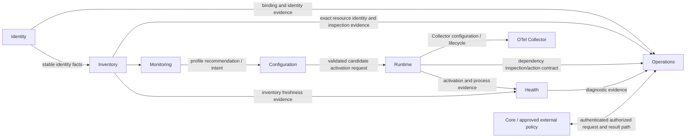

# PR-09.5 — Context Ownership Map

**Status:** approved ownership decisions; source structure and contracts remain for architecture review
**Baseline:** `b2599b8db31bfedfd75e360423d5aa98cfbcb5dc`
**Rule:** ownership follows business invariants and transaction boundaries, not current folder names.

## Seven business contexts

| Context | Existing source candidates | Owns in target | Public contracts / ports | Persistence and invariant boundary |
|---|---|---|---|---|
| **Identity** | `internal/identity`, `internal/enrollment`, `internal/coreapi`, `internal/coreconfig`, `internal/credentialstore`; enrollment/identity CLI adapters in `cmd/agentctl` | Stable installation identity, enrollment attempt semantics, Core binding, credential reference and protected-secret lifecycle, verified Core API outcomes. | Existing Identity/Enrollment service types and Core client DTOs; consumers ask for stable identity, enrollment state, or authenticated Core operations through explicit ports. OpAMP server translates identity claims against Core-owned binding; an OpAMP UID is not authorization. | Preserve stable installation ID, Node binding, persisted uncertain enrollment attempt and retry semantics, secret protection, no-secret output/logging. Transaction ownership for binding/attempt changes stays intact. |
| **Inventory** | `internal/discovery`, `internal/discovery/docker`, `internal/discovery/sqlite`; Inventory CLI adapters | Provider snapshots, source-native IDs, completeness/provenance, normalized resource identity, current/history/missing status and resource lookup. | Provider snapshot/observation contract; consumers query inventory or submit a complete snapshot. Failed/incomplete observations never mean “delete all.” | Preserve write revisions, snapshot atomicity, Docker resource vs workload identity, historical rows and incomplete-scan behavior. Inventory owns observed evidence; Configuration owns proposal lifecycle. |
| **Monitoring** | `internal/integration`, `internal/integration/redis`, `internal/monitoringprofile`; consumes the Runtime capability-query contract | Profile definitions, match rules, endpoint strategy, supported receiver capability resolution and recommendations/monitoring intent. | Profile registry/resolver returns supported intent and diagnostics; it queries Runtime for pinned-binary support and has no receiver lifecycle side effect. Provider discovery remains pluggable and generic. | Preserve profile schema, endpoint validation and single owner per target. Runtime owns the canonical capability catalog; Monitoring must not duplicate it. |
| **Configuration** | `internal/configuration`, `internal/configuration/sqlite`, `internal/reconciliation`, `internal/reconciliation/contracts`, configuration/template CLI workflow adapters | Accepted local/Core desired state, revision/CAS semantics, proposal creation/lifecycle/approval, Template ownership/materialization, and reconciliation decisions. | Snapshot/revision read, proposal/approval/materialization commands, and Runtime candidate-apply request/result contract; explicit errors for stale revision, invalid plan and apply failure. | Configuration atomically creates/approves a proposal with its desired-state update. Preserve materialization CAS over Inventory write revision, Template set revision and desired-set revision; restart reconciliation remains authoritative even when wakeups are missed. Preserve approved Core/local authority and revisions; track unresolved policy separately. |
| **Runtime** | `internal/bootstrap`, `internal/agentinstallation`, `internal/agentlifecycle`, `internal/dependency`, `internal/collectorruntime`, `internal/supervisor`, `internal/opampsupervisorconfig`, `internal/processowner`, platform service adapters | Verified artifacts, managed dependency definitions/provisioning/lifecycle, pinned Collector capability catalog, process/service lifecycle, configuration validation, activation journal, readiness, recovery, LKG and one Collector lifecycle owner. | Candidate apply/result, narrow capability query, dependency catalog/status/management, service lifecycle, Supervisor provisioning/status, and runtime evidence. Keep process errors and delivery evidence distinct. | Preserve candidate fingerprint/revision, one owner, activation terminal guard, LKG, protected ownership records, process-tree cleanup, and no concurrent Agent/Supervisor Collector control. Split `dependency` by real platform/capability seams, not file count alone. |
| **Health** | `internal/agenthealth`; Health evidence adapters and status CLI | Local snapshot aggregation, evidence freshness/assessment, diagnostics and truthful reporting ports. | Snapshot/assessment contract with independent dimensions (process, configuration, collection, Core/OpAMP connectivity, Gateway/delivery); missing/stale evidence is `UNKNOWN`. | Health reads owner-produced evidence and does not become authoritative owner for Runtime, Inventory or external Core reports. Preserve redaction and source timestamps. |
| **Operations** | `internal/operations`, `handlers`, `dockeradapter`, `sqlite`, `nats`; operations wiring in `cmd/agentctl` and `internal/app` | Typed command registry/execution, local execution idempotency, exact target validation, policy enforcement, audit and reliable result outbox. | Versioned Agent-local v1 request/result and broker-binding contracts; handler ports for Health, Inventory/Container, and managed dependencies. Core business authorization remains external. | Preserve execution key claim, audit/outbox transaction, no repeat of uncertain mutation, credential replacement/revocation, exact Docker identity, opt-in/default-off restart, and independence from monitoring. |

## Supporting boundaries — not additional business contexts

| Boundary | Baseline source | Target responsibility |
|---|---|---|
| CLI / delivery | `cmd/agentctl` | Parse arguments, validate presentation inputs, call context use cases, format output and exit codes. Keep compatibility facade while commands are migrated. |
| Application Host / composition | `internal/app`, composition portions of `cmd/agentctl` | Own startup, shutdown, cancellation and worker coordination. Business contexts own workflows and decisions. App starts the reconciliation worker; Configuration decides reconciliation and requests Runtime activation through an explicit contract. |
| SQLite technical support | `internal/platform/sqlite`, currently `internal/agentstate` as schema/state hub | One centralized technical migration coordinator owns ordered execution; contexts own table semantics and repositories. Composition registers ordered migration definitions. Platform SQLite code must not import business contexts. Preserve migration versions 1–14, order and all existing atomic transactions. |
| Advisory event dispatcher | `internal/platform/events` | Bounded post-commit notifications only. SQLite state and startup/periodic reconciliation remain authoritative. |
| Protocol/service adapters | `internal/opampserver`, Core clients in `internal/coreapi`, NATS adapter in Operations | Translate external protocols at boundaries; do not move protocol DTOs into domain models or infer one plane's health from another. |
| Test infrastructure | `internal/mockcore`, `internal/operations/testsupport/mockcore`, live test harnesses and `tests/` | Contract-compatible test fixtures and infrastructure orchestration; do not expose mocks as production behavior. |
| Telemetry data plane | pinned OTel Collector binary and its distribution | Receivers, processing, batching, retries and export. Agent owns configuration, supported policy, activation/recovery and local diagnostics. |

## Context collaboration (business/data flow)

These arrows describe observations, recommendations, requests, evidence, and results shared between contexts. They are **not Go package import directions**. Package imports are specified separately in [03 Target Architecture](03-target-architecture.md#code-dependency-go-imports).

The Application Host starts and coordinates workers but is omitted from this collaboration view because scheduling is not business data flow. SQLite persistence and code imports are also omitted. External protocol details remain in the release-level architecture.

## Contract and persistence invariants to preserve

1. **Identity:** stable installation identity and Core binding; enrollment uncertainty is persisted; credential material stays protected and out of logs/events/CLI.
2. **Inventory:** provider completeness and write revision are explicit; resource ID is provider/runtime scoped; logical workload ID is optional; failed observations do not delete inventory.
3. **Monitoring:** supported profiles resolve explicitly; endpoint missing/ambiguous/unreachable is diagnostic; one receiver owner per target; OTel owns receiver execution where delegated.
4. **Configuration:** expected revisions are checked in the same SQLite transaction as writes; approval/materialization cannot become two event-coordinated writes; no-op desired state does not cause needless activation.
5. **Runtime:** one Collector lifecycle owner; candidate config validation precedes activation; activation/recovery evidence and LKG remain durable; service and process tree cleanup preserve OS behavior.
6. **Health:** UNKNOWN is distinct from failure and success; evidence has source/time; process or Collector readiness is not collection or delivery proof.
7. **Operations:** Core owns business authorization; Agent owns execution safety and local audit; execution claim/audit/outbox atomicity remains; unknown mutations are never blindly retried; Operations connectivity does not gate telemetry.
8. **Events:** durable state commits before advisory event publication; consumers reread state; polls/startup recovery repair dropped wakeups.

## Source-to-owner disposition

| Source package | Target action proposal | Guard against a false move |
|---|---|---|
| `identity`, `enrollment`, `coreapi`, `coreconfig`, `credentialstore` | Keep as Identity capabilities or compatibility packages; split platform/HTTP storage adapters only when actual consumer port is defined. | Do not merge all names into one package or change enrollment responses, attempt persistence or credential ACLs. |
| `discovery` and children | Inventory owns provider observations; Configuration owns proposal lifecycle/approval and atomic desired-state transition. | Preserve atomic provider snapshot, CAS, source identity and migration-12 data during transfer. |
| `integration`, `integration/redis`, `monitoringprofile` | Keep Monitoring owner; query the Runtime-owned `collectorruntime` capability catalog through a narrow contract. | Do not fork generic discovery or OTel receiver lifecycle, or duplicate capability data. |
| `configuration`, `configuration/sqlite`, `reconciliation` | Keep desired-state and proposal owner; move concrete state/runtime imports behind use-case ports incrementally. | Preserve all cross-table transaction boundaries, approved Core/local revisions and deterministic reconciliation. |
| Runtime packages listed above | Keep Runtime owner with capability subpackages only where package cohesion needs them; Runtime owns managed dependency definition/provision/lifecycle. | Do not mechanically relocate `dependency`, rename legacy `supervisor` to OpAMP Supervisor or co-run lifecycle owners. |
| `agenthealth` | Keep Health context and owner-evidence ports. | No custom external Core/Gateway probes or new reporting schema. |
| `operations` tree | Preserve current context layout; clarify handler contracts and composition. | No new operations, authentication subsystem, or custom queue. |
| `agentstate` | Transitional persistence hub; extract repository/table ownership one family at a time under the centralized migration coordinator. | Preserve versions 1–14, their exact order and atomic writes; register context migration definitions at composition; platform imports no business contexts. |
| `cmd/agentctl`, `internal/app` | Keep as edges; App owns process/worker coordination and contexts own workflow decisions. | Preserve CLI output, flags, exit codes, service lifecycle and dependency graph; Configuration decides reconciliation and requests Runtime activation. |

## Approved ownership decisions and remaining review points

Approved: Configuration owns proposal lifecycle, approval, and atomic desired-state transition; Inventory owns observations; Monitoring owns profile matching and recommendations. Example: Docker observation identifies Redis; Monitoring recommends the Redis profile; Configuration creates and approves the proposal atomically with the desired-state update. Runtime owns the pinned Collector capability catalog and exposes a narrow query contract to Monitoring (including querying `redisreceiver` support before resolving a Redis profile). One technical migration coordinator executes context-registered ordered definitions while context repositories own table semantics; platform imports no business contexts. Runtime owns managed dependency definitions, provisioning, and lifecycle, with capability grouping based on source evidence. Application Host owns worker/process lifecycle while Configuration owns reconciliation decisions and requests Runtime activation. Existing approved Core/local configuration authority and revision semantics remain unchanged.

Remaining work is implementation contracts and sequencing: exact proposal adapter/types and a data-preserving transfer of migration-12 proposal rows; exact capability-query and migration-registration interfaces; and capability grouping within the oversized dependency package. The pinned shared coding policy at `c4cd59a9bcaaf0735c3107424f1be98fc498670a` was verified against the local supplement on 2026-11-15. Existing unresolved Core/security/control-plane policy questions remain separate and are not reopened by these structural decisions.

Ownership decisions above are closed. Remaining review items concern exact contracts, migration sequencing, source placement and shared-policy confirmation. Do not invent a Core/security policy or alter external contracts to answer them.
