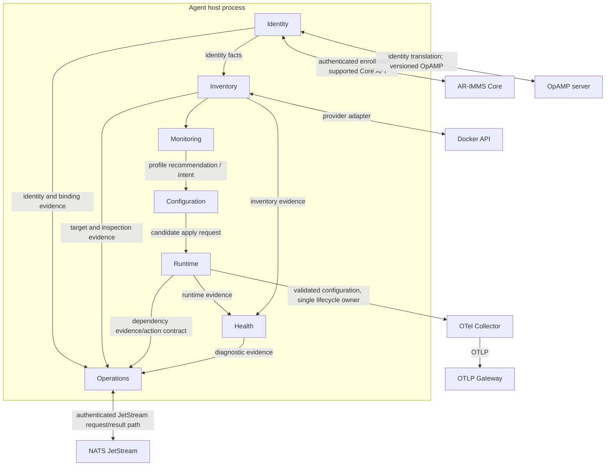

# PR-09.5 — Target Architecture

**Status:** proposed target for architecture approval; no implementation is authorized by this document.
**Source snapshot:** `b2599b8db31bfedfd75e360423d5aa98cfbcb5dc`.
**Release target:** `v0.1.4a-next`.

## Authority and relationship to existing architecture

The [release architecture overview](../architecture-overview.md) remains the canonical statement of product scope, OTel/OpAMP responsibilities, release capabilities, and acceptance behavior. This document proposes the PR-09.5 source ownership and dependency view derived from the merged source. The [context boundaries](../context-boundaries.md) state ownership rules; [04-source-structure](04-source-structure.md) shows a flexible physical layout; this document does not replace protocol contracts or release requirements.

The source-structure table that mechanically maps old packages into new roots is now a **historical migration hypothesis**, not an approved move list. The current package and symbol evidence is in [01-current-source-audit](01-current-source-audit.md); final movement decisions require review of the owner matrix and transaction map.

## Target system boundary

The Agent remains one cross-platform Go product with a separate OpenTelemetry Collector process. Business contexts are logical boundaries inside the Agent, not microservices. The OpAMP server/Mock Core and OTLP Gateway are distinct central or testbed service boundaries.

### Context collaboration (business/data flow)

The diagram above shows observations, recommendations, requests, and evidence exchanged between contexts. Its arrows do not specify Go package imports. Application Host worker scheduling and SQLite persistence are intentionally absent; see their responsibility below. The release architecture remains authoritative for protocol payloads.

## Context responsibilities and ports

| Context | Application boundary | Consumes | Produces |
|---|---|---|---|
| Identity | Enrollment/binding/credential use cases and Core request outcomes | OS identity source, protected credential store, Core API adapter | Stable installation/binding facts and authenticated Core session/results |
| Inventory | Provider snapshot evaluation, identity normalization, durable inventory queries | Provider adapter and provider-owned observation contract | Complete versioned snapshot, normalized resource observations, freshness/completeness evidence |
| Monitoring | Profile resolution, capability matching/recommendations and endpoint diagnostics | Inventory observations, profile registry, narrow Runtime capability query | Monitoring intent and explicit profile/endpoint resolution status; no duplicate capability catalog |
| Configuration | Desired-state revisions, proposal lifecycle/approval, materialization, reconciliation decision | Inventory observations and Monitoring recommendations; approved local/Core authority | Atomic proposal/approval plus desired-state transition; validated Runtime candidate/apply request and durable desired revision |
| Runtime | Pinned Collector capability catalog, artifact/dependency provisioning, candidate validation/activation, service lifecycle and recovery | Identity/configuration contracts and platform adapters | Narrow capability query, effective generation, process/dependency state, readiness and recovery evidence |
| Health | Snapshot/assessment and diagnostics projection | Evidence ports from Identity, Inventory, Runtime, Collector exporter diagnostics and delivery receipts where supported | Timestamped status dimensions and diagnostic reports with UNKNOWN for missing/stale evidence |
| Operations | Typed request validation, execution, journal and outbox | Authenticated Core-authorized request, target/evidence ports, narrow action adapters | Durable execution outcome, audit evidence and retriable result publication |

Every contract crossing a context boundary must name owner, consumers, input/output types, validation, errors, side effects, concurrency/transaction boundary, idempotency/retry behavior, and recovery outcome. Prefer consumer-defined narrow ports and owner-defined business types. Do not introduce a DTO layer unless an existing boundary requires it.

## Code dependency (Go imports)

This is a separate target import view. Arrows below mean **source packages may import the package at the arrow head**. It is a flexible target contract, not a statement that current source already conforms. Concrete adapter constructors and ordered migration registrations are assembled at the composition edge.

```mermaid
flowchart BT
  CLI[cmd/agentctl] --> APP[internal/app composition and host]
  APP --> IDAPP[Identity application entrypoints]
  APP --> INVAPP[Inventory application entrypoints]
  APP --> MONAPP[Monitoring application entrypoints]
  APP --> CFGAPP[Configuration application entrypoints]
  APP --> RUNAPP[Runtime application entrypoints]
  APP --> HEALTHAPP[Health application entrypoints]
  APP --> OPSAPP[Operations application entrypoints]
  APP --> MIG[SQLite migration coordinator]
  APP --> ADAPTERS[Concrete context adapters]
  IDAPP --> IDDOM[Identity domain and ports]
  INVAPP --> INVDOM[Inventory domain and ports]
  MONAPP --> MONDOM[Monitoring domain and ports]
  CFGAPP --> CFGDOM[Configuration domain and ports]
  RUNAPP --> RUNDOM[Runtime domain and ports]
  HEALTHAPP --> HEALTHDOM[Health domain and ports]
  OPSAPP --> OPSDOM[Operations domain and ports]
  MONAPP -->|Inventory observation contract| INVDOM
  MONAPP -->|Runtime capability query| RUNDOM
  CFGAPP -->|Inventory and Monitoring contracts| INVDOM
  CFGAPP --> MONDOM
  CFGAPP -->|Runtime candidate apply port| RUNDOM
  HEALTHAPP -->|Runtime evidence contract| RUNDOM
  OPSAPP -->|narrow target, evidence, action ports| INVDOM
  OPSAPP --> HEALTHDOM
  OPSAPP --> RUNDOM
  ADAPTERS --> IDDOM
  ADAPTERS --> INVDOM
  ADAPTERS --> MONDOM
  ADAPTERS --> CFGDOM
  ADAPTERS --> RUNDOM
  ADAPTERS --> HEALTHDOM
  ADAPTERS --> OPSDOM
  ADAPTERS --> PLATFORM[platform and external libraries]
  MIG --> PLATFORM
```

Domain packages do not import other contexts or adapters. Cross-context application dependencies use narrow published contracts; adapters implement ports inward. The composition root may import concrete adapters and context migration definitions to register them, but platform SQLite code does not import business contexts. Exact package names and layer count remain flexible.

## Dependency rules

1. Domain rules and value types do not import SQLite, HTTP/OpAMP/NATS, Docker, OS service APIs, process execution or Collector implementation details.
2. Application use cases depend on their context's domain and narrow ports. They do not reach into another context's SQL package or concrete internal persistence.
3. Adapters implement ports and translate external/protocol types at the boundary. Protocol DTOs do not become domain models.
4. Application Host and CLI may import context entrypoints for construction/use. Contexts do not import the CLI or composition root.
5. Cross-context direction follows explicit contracts; no cycles. Configuration may request Runtime application of a candidate; Runtime does not decide business monitoring policy.
6. One SQLite database is shared. Context repositories own table semantics; one centralized technical migration coordinator executes ordered context-defined migrations registered at composition. Platform packages do not import business contexts. Preserve migration versions 1–14, their order and all existing atomic transactions.
7. Events are advisory, published after commit, and carry IDs/revisions/fingerprints rather than secrets or mutable object graphs. Startup/poll recovery remains.
8. OTel owns receivers, processing, batching, retries and export. Agent owns policy, artifacts, configuration validation, activation/recovery and diagnostics. Receiver creation is single-owner per target.
9. Operations uses explicit supported actions. Core authorizes business actions; Agent enforces local execution safety/audit; UNKNOWN outcomes are never treated as success or blindly retried.

## Ownership invariants that are outside this consolidation's change scope

- Preserve identity/enrollment semantics and protected credential ACLs.
- Preserve Docker discovery completeness, resource/workload identity and history.
- Preserve Monitoring profile definitions, endpoint diagnostics and single receiver ownership.
- Preserve desired-state CAS/revisions, approval/materialization atomicity and deterministic no-op reconciliation.
- Preserve pinned Collector/Supervisor compatibility, exactly one lifecycle owner, activation/readiness/LKG/recovery and managed dependency ownership.
- Preserve honest Health evidence dimensions and freshness.
- Preserve Operations contract versions, exact-target mutation safety, opt-ins/default-off restart, SQLite journal/audit/outbox atomicity, replay behavior, credential invalidation and monitoring independence.
- Preserve CLI commands, flags, output, exit codes, installed layout and service lifecycle.
- Keep PR-09 production NestJS interoperability and audit/idempotency retention compatibility as independent release follow-ups; this architecture review cannot close them.

## Composition responsibilities

The installed Agent CLI/service is the composition edge. It creates the selected platform adapters, stable state/database handles, context application services and telemetry runtime, then starts and stops long-lived processes with bounded cancellation. It does not decide a business policy, directly manipulate a context's tables, parse remote policy into arbitrary Collector YAML, or route every domain operation through `main.go`.

The service host coordinates clocks, cancellation, startup ordering, worker start/stop and recovery triggers. Configuration owns reconciliation decisions; the host starts that worker and it requests Runtime activation through the explicit candidate-apply contract. Inventory and Monitoring similarly own their workflows. Validate these boundaries against current `RunRuntime` tests and service lifecycle behavior before moving any loop.

## Approved decisions and remaining review

**Approved target decisions:** seven named contexts; Configuration proposal lifecycle and atomic desired-state transition (Docker observes Redis → Monitoring recommends the Redis profile → Configuration creates/approves the proposal with the desired-state update in one transaction); Runtime-owned pinned Collector capability catalog queried by Monitoring (including `redisreceiver` support); centralized migration coordinator with context-owned migration definitions/repositories registered at composition; Runtime-managed dependency definition/provision/lifecycle organized by justified capability; Application Host lifecycle coordination separated from context-owned workflow decisions; preservation of approved Core/local authority and revision semantics. The user approved this target and all four companion planning documents on 2026-11-15 and authorized implementation through PR-09.5g; that authorization does not include PR-10 or new behavior/policy decisions.

**Still for review before implementation:** exact cross-context interfaces and error/transaction semantics; source-by-source movement sequence and characterization gates; dependency capability grouping from actual callers; shared-policy confirmation when the pinned submodule is available; independent Core/security/control-plane policy questions retained in their existing decision records.

No unresolved item is silently decided here. Implementation must wait until the complete target architecture, source structure, contracts, and migration sequence are reviewed and approved; remaining contract details must be settled before the slice that depends on them.
