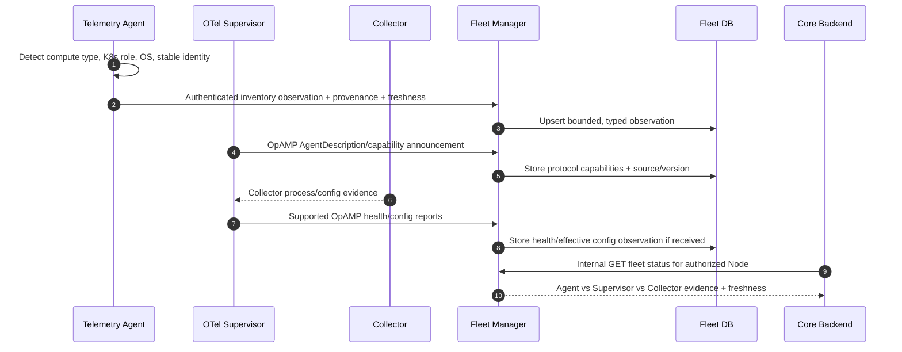
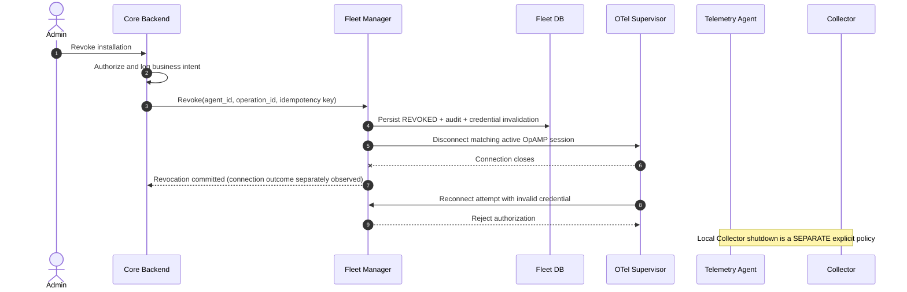

# Fleet Management — required control-plane flows

**Status:** Target sequences / implementation contract proposal; **not all implemented**.  
**Source baseline:** Agent PR #40 at `c9597df` and upstream pinned **OpenTelemetry OpAMP Supervisor** `cmd/opampsupervisor/v0.160.0`.  
**Read with:** `../../adr/0005-fleet-management-and-otel-native-ownership.md` and `../../adr/0006-agent-identity-and-environment-evidence.md`.

## Terminology, participants, and guarantees

- **Fleet Manager (`FM`)**: *our* Go Fleet Management Server using `opamp-go`, central VPS; fleet DB, enrollment/approval, desired config and publication state, OpAMP endpoint, execution audit.
- **Supervisor (`SUP`)**: official **OpenTelemetry OpAMP Supervisor**, runs beside the Collector; protocol client and sole managed Collector executor.
- **Agent (`AG`)**: *our* local installation/identity/dependency/operations application, not the OpAMP Supervisor.
- **Core (`CORE`)**: NestJS, public API/IAM/Assets/Node authorization/business audit. **Core is not an OpAMP protocol proxy.**
- **Collector (`COL`)**: OTel data-plane process; **Gateway (`GW`)**: OTLP sink.
- Only claims explicitly supported by pinned source/evidence are **verified**. Diagram behavior marked *target* is not a current code claim. Current `internal/opampserver` is a Core-backed adapter, not yet the full Fleet Manager.

### Required state vocabulary

| Dimension | Meaning | Examples |
|---|---|---|
| `desired_revision` | Fleet authority wants this policy | 15 |
| `publication_revision` + `config_hash` | Exact bytes/hash FM delivered or intended to deliver | 15 + SHA-256 |
| `reported_config_hash` | Supervisor reported remote-config hash and status | Old hash after rollback |
| `observed_applied_revision` | Fleet attribution resolved from previously published hash and credible runtime evidence | 14, or UNKNOWN |
| `effective_config` | Local+remote merged Supervisor result | Not identical to remote payload |
| `delivery_evidence` | Actual metrics/logs/traces at sink | Independent from process readiness and OpAMP status |

No success inferred from `202 Accepted`, WSS connected, `APPLIED` alone, or Collector `/health` alone. Unknown hash → `UNKNOWN`, never guess revision.

## Flow 1 — Enrollment, approval and authenticated connection

```mermaid
sequenceDiagram
  autonumber
  actor Admin as Admin
  participant CORE as Core Backend
  participant FM as Fleet Manager
  participant DB as Fleet DB
  participant AG as Telemetry Agent
  participant SUP as OTel Supervisor
  Admin->>CORE: Request register for Node
  CORE->>CORE: Authenticate + authorize Node eligibility
  CORE->>FM: Create invitation (Node, actor, idempotency key)
  FM->>DB: Persist PENDING invitation, audit
  FM-->>CORE: One-time bootstrap reference
  Admin->>AG: agentctl enroll --token (protected handling)
  AG->>AG: Read durable agent_id + environment evidence
  AG->>FM: Exchange one-time token; agent_id, host evidence
  FM->>DB: Validate expiration / uniqueness / binding
  alt Approval required
    FM->>DB: Store PENDING_APPROVAL without active credential
    Admin->>CORE: Approve installation
    CORE->>FM: Authorized approval decision
  else Preapproved invitation
    Note over FM: Existing authorized invitation policy
  end
  FM->>DB: Commit ACTIVE binding + credential record/audit
  FM-->>AG: Issue scoped enrollment credential securely
  AG->>AG: Protect credential and provision Supervisor token file
  SUP->>FM: OpAMP WSS + bearer; report instance_uid
  FM->>DB: Authenticate credential and bind UID to agent_id
  FM-->>SUP: Accept authenticated session
```

**Required:** One-time token expiry/use-once, duplicate/replay handling, stable `agent_id`, host ID collision detection, Core-authorized Node binding, non-secret logs, credential scope, durable lost-response recovery and idempotent retry. **Existing Core enrollment differs**; this is a migration target, not shipped behavior. Pending approval and its status transitions must be explicitly implemented, not inferred from the Supervisor.

## Flow 2 — Report health, capabilities and inventory



**Boundary:** OpAMP AgentDescription does **not** automatically represent product inventory. Host/VM/K8s topology comes from trusted Agent, OTel telemetry metadata, or infra-provider APIs; use a versioned authenticated API/pipeline for structured inventory. Supervisor v0.160.0 effective-config/health capabilities are supported in upstream but **AR-IMMS consumption not yet E2E verified**. Avoid making a single `healthy` boolean imply delivery.

## Flow 3 — Publish and apply configuration

```mermaid
sequenceDiagram
  autonumber
  actor User as Operator
  participant CORE as Core Backend
  participant FM as Fleet Manager
  participant DB as Fleet DB
  participant SUP as OTel Supervisor
  participant COL as Collector
  participant GW as OTLP Gateway
  User->>CORE: Update monitoring intent / Gateway config
  CORE->>CORE: Check IAM, target Node binding and business audit
  CORE->>FM: Update desired (actor, target, idempotency key, expected revision)
  FM->>FM: Validate policy + pinned Collector capabilities
  FM->>DB: CAS desired revision + audit + publication intent
  FM-->>CORE: 202 Accepted, operation_id, desired_revision
  FM->>SUP: OpAMP RemoteConfig + config_hash (active push or on message)
  SUP->>SUP: Merge local baseline + remote config
  SUP->>COL: Apply / restart Collector under Supervisor ownership
  SUP-->>FM: OpAMP RemoteConfigStatus + hash
  FM->>DB: Attribute observed hash to published revision
  COL->>GW: OTLP data (independently observed)
  CORE->>FM: Query operation outcome
  FM-->>CORE: Desired vs published vs observed; telemetry evidence separate
```

**P0 implementation question:** At current HEAD the Agent repo's native OpAMP adapter responds to Supervisor messages; **active push on a Core/Fleet policy change is not proven**. Fleet Manager must reliably wake connected sessions when desired revisions change or show a bounded reconciliation mechanism, and converge on reconnect. Record exact bytes/hash and mapping *before* sending. Validate merge precedence for duplicate YAML keys/receiver IDs with pinned Supervisor.

## Flow 4 — Disconnect during apply; reconnect/reconcile

```mermaid
sequenceDiagram
  autonumber
  participant FM as Fleet Manager
  participant DB as Fleet DB
  participant SUP as OTel Supervisor
  participant COL as Collector
  FM->>DB: Persist desired 12 + publication intent
  FM->>SUP: Send revision 12 / hash H12
  SUP->>COL: Begin apply
  Note over FM,SUP: WSS disconnects; send/ack outcome ambiguous
  COL-->>SUP: Local process outcome
  SUP->>SUP: Retain local Supervisor state
  FM->>DB: Keep observation UNKNOWN, not FAILED or APPLIED
  SUP-->>FM: Reconnect with credential + UID
  FM->>DB: Resolve latest desired and prior published hashes
  SUP->>FM: Report current hash/status if available
  FM->>DB: Correlate observations; ignore stale status for latest desired
  alt Observed current hash differs from latest desired
    FM->>SUP: Re-publish latest desired idempotently
  else Same hash and supported evidence
    FM->>DB: Record converged observation
  end
```

**P0:** Reconnect must not replay an obsolete revision over a newer desired policy. Network failure is **UNKNOWN** until evidence resolves it. FM process restart must preserve hash/revision mapping in durable storage (in-memory dedupe caches are non-authoritative). Collector can continue last-good locally during Core/FM outages according to configured fallback and Supervisor persistent state; verify exact artifact behavior.

## Flow 5 — Bad remote configuration and automatic rollback

```mermaid
sequenceDiagram
  autonumber
  participant CORE as Core Backend
  participant FM as Fleet Manager
  participant DB as Fleet DB
  participant SUP as OTel Supervisor
  participant COL as Collector
  FM->>DB: Persist desired revision 15, prior healthy 14
  FM->>SUP: Remote config H15
  SUP->>COL: Attempt apply H15
  COL-->>SUP: Startup/validation failure
  SUP->>SUP: Automatic rollback if conditions supported
  SUP->>COL: Restart with last-working config H14
  COL-->>SUP: Collector readiness (not OTLP proof)
  SUP-->>FM: Actual reported hash/status from protocol
  FM->>DB: Resolve hash via durable publication history
  FM->>DB: Keep desired 15; mark outcome failed/recovered as evidenced
  CORE->>FM: Request status
  FM-->>CORE: Desired 15 vs observed 14 or UNKNOWN
```

**No fabricated protocol events:** The pinned Supervisor may report `APPLIED` for the old remote config after rollback; the business projection must not translate that into revision 15 success. Automatic rollback covers documented Collector failure scenarios, not every delivery outage. Validate Agent legacy LKG/SQLite state and any transition flag path without running both Collector owners.

## Flow 6 — Revoke while connected



**Revocation semantics:** Invalid credentials block future sessions/updates; an online session must be invalidated or revalidated within a documented bounded interval. Existing adapter checks Core session approximately every 30 seconds; new FM target should invalidate directly and keep bounded fallback enforcement. Revoking connectivity does **not** imply stop Collector, uninstall, or delete local telemetry; define these as separate, authorized policies. Test race between revoke, config publication and reconnect.

## Minimum cross-component contracts

| Boundary | Minimum versioned contract | Owner |
|---|---|---|
| UI → Core → Fleet | Invitation/approve/revoke; update desired; query fleet and status; actor, target Node, request/operation ID, idempotency, expected revision | Core business API; Fleet internal API |
| Agent → Fleet | Enrollment/resume; identity/inventory observations; credential protection/rotation; error/retry taxonomy | Fleet API + Agent client |
| Supervisor ↔ Fleet | OpAMP transport, auth binding, `instance_uid`, remote config/hash, status, effective-config/health where supported | Native OpAMP protocol; Fleet adapter implementation |
| Fleet → MongoDB | Installation/binding, desired and publications, observation history, audit/outbox, indexes, retention and CAS | Fleet persistence |
| Collector → OTLP | Telemetry data plane, receivers and resource metadata | OTel / Gateway |
| Core ↔ Fleet audit | Business acceptance fact vs execution observation fact correlated by `operation_id` | Each service owns its own audit |

**Do not publish a speculative OpenAPI schema as approved.** First align Core and Fleet owners, then publish shared contracts under `docs/shared/` through the shared-docs repository. OpAMP protobuf is an upstream standard, not an AR-IMMS invented schema.

## Minimum verification / honest status

| Gate | Test | Current claim |
|---|---|---|
| F1 | Token replay, expiry, approval, binding, duplicate host and concurrent enrollment | **TARGET; NOT VERIFIED** |
| F2 | Host/VM/K8s identity provenance, identity collision, health/effective config without secrets | **TARGET; NOT VERIFIED end-to-end** |
| F3 | Policy revision update while WSS connected → config applied → actual OTLP sink receives metrics | Mock Core Gateway E2E historical; **new FM target NOT VERIFIED** |
| F4 | Disconnect during apply + reconnect after FM restart; no revision regression or duplicate scrape | **TARGET; NOT VERIFIED** |
| F5 | Bad config → Supervisor rollback → actual observed hash/revision remains correct | Supervisor rollback historically tested in part; **new FM target NOT VERIFIED** |
| F6 | Revoke established WSS; block reconnect; preserve independently defined local Collector behavior | Existing Core-backed adapter historically tested; **new FM authority NOT VERIFIED** |
| Safety | Windows Exporter/LHM/Node Exporter lifecycle, CLI compatibility, protected secrets, one Collector process owner, upgrade/uninstall | Existing regression evidence; must recheck changed source |

## Implementation ordering (limited-time focus)

1. Freeze terminology/authority ADR 0005 and identity ADR 0006; map old Core enrollment to proposed Fleet identity without breaking existing installations.
2. Complete required `agentctl` and managed exporter/LHM/Node dependency commands; freeze unrelated source refactors.
3. Deliver one **authenticated** Fleet→Supervisor config cycle, actual OTLP metric at sink, and bad-config rollback/hash attribution.
4. Exercise reconnect and live revocation, then record `PASS`, `NOT RUN`, `UNKNOWN` precisely.
5. Defer custom OpAMP execution, package updates, automatic topology inference and destructive legacy-code removal. Feature flags isolate rollout only; they do not replace verification.

**References:** Current repo `docs/local/architecture/v0.1.4a-next/opamp-integration.md`, `cli-contract.md`, `docs/local/requirements/v0.1.4a-next/cross-repository-contracts-open-decisions.md`, PR #40 verification report; upstream [OpAMP specification](https://opentelemetry.io/docs/specs/opamp/) and [pinned Supervisor README](https://github.com/open-telemetry/opentelemetry-collector-contrib/blob/cmd/opampsupervisor/v0.160.0/cmd/opampsupervisor/README.md).
