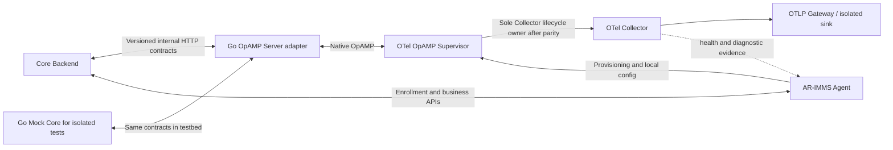

# OpAMP and Supervisor integration — v0.1.4a-next

**Status:** Windows and Ubuntu WSL Supervisor capability tests pass, including
hostmetrics OTLP delivery. PR-07b Mock Core integration passes on both OSes.
PR-07c now adds pinned artifact installation, a protected token-file helper, and
durable Mock Core publication/status fixtures with rollback attribution after
adapter restart. Native Linux Docker profile parity, Agent-owned process-tree
recovery, packaged/runtime integration, and production Core interoperability
remain open.

## Target topology

The Go Mock Core is a replaceable test implementation. It must use the same
documented HTTP contracts as the adapter's Core client; the OpAMP server must
not call mock-only functions or depend on mock state internals. Mock-backed
interoperability and production NestJS Core interoperability are separate gates.

## Ownership and migration invariant

- **AR-IMMS Agent:** enrollment and installation identity, inventory, monitoring
  profiles, local infrastructure policy/configuration, dependency provisioning,
  diagnostics, and product CLI/business APIs.
- **OTel OpAMP Supervisor:** OpAMP client protocol, accepted remote config,
  configuration composition/application, and Collector process lifecycle only
  after pinned-version capability and parity verification.
- **OTel Collector:** telemetry collection, processing/export, and OTel-native
  Observer/Receiver Creator dynamic receiver lifecycle.
- **Core Backend:** authenticated installation binding, authorization, desired
  policy, revision history, and observed business status.
- **Go OpAMP Server:** native protocol adapter and translation to/from explicit
  Core HTTP contracts; no second business database or policy authority.

Process ownership after migration is exactly:

`OS service manager → AR-IMMS Agent → OTel OpAMP Supervisor → OTel Collector`.

The current Agent `internal/supervisor` and `internal/agentlifecycle` are not the
OTel OpAMP Supervisor. Keep existing Agent Runtime behavior until parity is
demonstrated. The Linux hard-kill test showed that restarting Supervisor alone
can leave its Collector child alive and holding listeners. The Agent/service
manager must terminate the old process tree before a replacement Supervisor
starts, and tests must confirm only one Collector emits. Transfer ownership as
one controlled transition; never run two Collector lifecycle owners for the
same Collector. PR-07a and PR-07b must not silently transfer ownership. Rollback
must restore the prior single-owner mode.

## Version and capability evidence

The proposal requests Collector Contrib v0.160.0 and a matching Supervisor
version on Windows/Linux amd64. This is a verification target, not proof that
such compatible artifacts exist or are supported. Record exact artifact URLs,
version, platform, SHA-256, build provenance, and compatibility evidence before
adopting either binary.

Current official Collector Contrib Supervisor documentation describes a
mandatory server endpoint with `ws`, `wss`, `http`, and `https` schemes;
remote configuration is opt-in, can be merged with an optional local config,
is written to the Collector config, and restarts the Collector. Automatic
configuration rollback is opt-in and documented for a Collector that fails to
start correctly. These semantics must be checked against the exact pinned
artifact and real local configuration before relying on them. The existing
Agent LKG contract may cover failures beyond startup and must not be weakened.

Reference: [OpAMP Supervisor v0.160.0 specification](https://github.com/open-telemetry/opentelemetry-collector-contrib/blob/v0.160.0/cmd/opampsupervisor/specification/README.md).

## Configuration authority and status

**Immediate proposed policy scope:** one Core-owned setting, the OTLP Gateway
endpoint, carried in a typed versioned snapshot targeted to an installation.
This is not yet an approved cross-repository schema. Agent-local monitoring
profiles, receiver rules, infrastructure identity, and protected Supervisor
communication settings remain Agent-owned.

The local PR-07 contract defines schema/version, installation target, desired
revision, deterministic rendering/hash inputs, endpoint validation, binding
conflicts, publication history, and protocol-observed status in
[agent-control-v1.openapi.yaml](contracts/agent-control-v1.openapi.yaml).
It is intentionally a mock-backed Agent contract, not a production Core API
approval or publication to `docs/shared/`. It contains no arbitrary Collector
YAML or remote commands. Protected local configuration remains outside the
remote policy.

For each policy response, the adapter records the exact rendered hash and
revision in Core before returning OpAMP remote configuration. Status reports
carry current `desired_revision` separately from `publication_revision` and
`applied_revision`. Rollback to an older published hash is accepted as older
application evidence; it cannot satisfy a newer desired revision. Unknown
hashes remain unattributed. The Go Mock Core can persist its fixture to an
atomic local JSON state file for restart tests; this is test infrastructure,
not a production Core storage design. The adapter's bounded in-memory map is
only a duplicate-delivery optimization; hash attribution resolves through the
Core contract.

Keep desired revision separate from applied revision. Distinguish received,
validated, applying, applied, failed, recovered, and unknown only where the
actual Supervisor/runtime evidence supports that distinction. A Supervisor
remote-config status or Collector readiness alone does not prove scrape success
or OTLP delivery. A prior configuration reported applied after rollback must
not count as success for the newest desired revision.

## Identity, authentication, and internal API

Preserve enrollment's installation ID, binding, Node ID, and opaque credential
semantics. The local mock-backed slice reuses the existing enrollment bearer
for Supervisor authentication, resolves installation/Node identity from that
credential, and compare-and-set binds the Supervisor `instance_uid`. The UID
is never authentication. The pinned Supervisor's Bearer Token Authenticator
uses a token file and the `opampsupervisor.Extensions` feature gate; Windows
live evidence exercises that path. Agent installation/provisioning of this
file, production credential rotation/revocation, session invalidation, and
offline revocation remain open for PR-07c/Core contract review. The Core client
uses HTTPS, rejects redirects, and rejects insecure base URLs. The Go adapter
allows cleartext OpAMP only on loopback; non-loopback requires TLS.

The proposed OpAMP adapter needs only explicit internal Core operations for
installation authentication, instance binding, desired policy retrieval,
configuration status, and Collector health. Notifications are optional; the
adapter must reconcile after disconnects or missed notifications. HTTP schemas,
auth, errors, idempotency, retry, cache, and request IDs must follow the actual
Core API baseline. Native OpAMP messages remain standard protocol messages.

The authoritative enrollment OpenAPI and Core API Baseline were reviewed before
this local contract was written (blob IDs are recorded in the [PR-07 plan](../../plans/v0.1.4a-next/pr-07-opamp.md)).
They establish enrollment semantics and response conventions but do not define
the Agent control routes above. Production NestJS Core interoperability stays
blocked until those routes and their security policy are explicitly approved
and implemented in Core.

## Migration slices

1. **PR-07a — capability spike:** exact artifact/platform checks; pinned
   Supervisor/Collector interoperability; extension and profile support;
   local config composition/update, fallback, restart/crash, rollback, and
   real OTLP delivery. Deliver evidence and migration/rollback proposal. No
   lifecycle ownership transfer.
2. **PR-07b — contracts and control plane:** approve versioned cross-context
   contracts, implement Go OpAMP server and contract-compatible Go Mock Core,
   and verify authentication, identity binding, policy, and truthful status.
   Core production changes and shared-contract publication require separate
   approval.
3. **PR-07c — runtime adoption and E2E:** transfer lifecycle ownership only
   after PR-07a parity and PR-07b contracts; manage the Supervisor dependency;
   verify installation, config updates, service lifecycle, offline recovery,
   and PR-05/06 monitoring parity on native Windows and Linux.

These are review checkpoints, not a requirement for exactly three GitHub PRs.
Keep each change scoped and independently reversible. Follow the [PR-07 plan](../../plans/v0.1.4a-next/pr-07-opamp.md) and [verification report](../../verification/v0.1.4a-next/pr-verification/pr-07-report.md).

## Exclusions and gates

Remote package updates, arbitrary commands, remote container operations,
unrestricted Collector YAML, a second business backend, and production Core
repository changes are out of this Agent checkpoint unless separately approved.
Do not mark mock-backed tests as production Core E2E. Keep PR-07 in progress
until required platform, ownership, rollback, delivery, and compatibility gates
are evidenced; preserve all untested cases as `NOT RUN` or `BLOCKED`.
