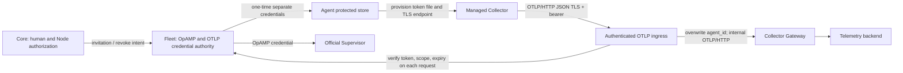

# Secure Agent Telemetry Ingestion — implementation plan

Status: implementation in progress, 2026-11-25. Agent, Fleet, and Core slices are implemented locally. The selected Gateway authentication path has passed a real pinned Collector → Gateway check. Cross-service contract owner review, integrated official Supervisor UAT, and exact-head hosted CI remain.

## Observed baseline

- Agent `configs/base/otel.yaml` exports OTLP/gRPC with `tls.insecure: true` and no authorization header.
- `infra/observability/otel-gateway/gateway-config.yaml` listens on all interfaces for gRPC and HTTP without authentication; Compose publishes gRPC publicly.
- Fleet enrollment currently returns one random credential for OpAMP. Fleet persists its hash, binds it to an `agent_id`, and revokes the installation's active credentials. Agent's protected credential store already supports encrypted/permission-restricted values and a materialized Supervisor token file.
- The pinned Agent Collector and official Supervisor are v0.160.0. Core handles Node authorization and Fleet invitation/gate requests. Shared Fleet C01–C04 wire details remain proposed/open.

## Decision and alternatives

Use the pinned Collector's OTLP/HTTP exporter with JSON encoding and a small Go HTTP ingress service in front of the existing Gateway. It is the only public OTLP listener. It terminates TLS, verifies a bearer on every request against a Fleet-owned introspection endpoint over authenticated service-to-service TLS, requires `otlp.write`, and overwrites every incoming resource's `agent_id` with the verified principal before forwarding OTLP/HTTP JSON to the internal Gateway. Reject protobuf, compression, and unknown signal paths in this PoC. No positive authorization cache: the revocation propagation bound is the maximum in-flight request duration plus Fleet commit visibility. Fleet unavailability rejects new ingestion; the Agent Collector retries within its configured bounded queue. Gateway unavailability returns a retryable error after authentication. The ingress must not log headers, token hashes, or payloads.

The stock Collector OIDC receiver authenticator targets JWT validation and does not fit the requested random opaque bearer. A static bearer-token authenticator cannot resolve per-Agent identity or prompt revocation. A custom Collector auth extension would require a custom distribution and broader release ownership. OTLP/HTTP JSON permits bounded identity rewriting using the Go standard library. The pinned v0.160.0 binary validates `otlphttp` with `encoding: json`. Per-request Fleet lookup is acceptable for the three-node PoC; if measured load later demands caching, a new revocation bound and test are required.

Fleet remains credential authority. The introspection endpoint returns `agent_id`, credential ID, active status, scope, and expiry only to the Gateway ingress; it never returns the raw bearer. This is request-time verification rather than credential copying, so there is no separately synchronized Gateway credential database. The wire contract and service authentication need owner review before implementation.



```mermaid
sequenceDiagram
  participant C as Collector
  participant I as OTLP ingress
  participant F as Fleet
  participant G as Gateway
  C->>I: TLS OTLP/HTTP JSON + Authorization bearer
  I->>F: Introspect bearer (authenticated service call)
  F-->>I: active, agent_id, otlp.write, expiry
  I->>I: discard client agent_id; set verified agent_id
  I->>G: internal Compose network OTLP/HTTP JSON
  G-->>I: result
  I-->>C: result
  Note over F,I: Revocation changes Fleet authority; next request is denied
```

## Reviewable implementation steps

1. **Contract and Fleet:** Approve an additive enrollment response that retains the existing OpAMP credential fields and adds an `otlp_credential` object (ID, one-time secret, scope, expiry), a private Gateway introspection request/response, TLS service authentication, error semantics, and revoke behavior. Generate independent 256-bit random tokens; persist only hashes outside encrypted recovery results. Preserve exact attempt replay and recovery behavior. Revoke both credentials atomically with installation status. Test missing/wrong scope, expired, mismatched agent, revoked, duplicate exchange, and recovery. During migration, an old response without `otlp_credential` may complete OpAMP enrollment but cannot enable OTLP export.
2. **Agent:** Extend Fleet enrollment response parsing and durable non-secret references. Store OTLP secret using `internal/identity/credentials`; provision a restricted token file for the Collector at service startup and remove it on re-enrollment/uninstall. Keep secrets out of SQLite, logs, diagnostic output, and generated YAML. Configure `otlp/gateway` with TLS verification and a file-backed bearer authenticator, validating v0.160.0 behavior with the actual binary. Keep bootstrap and existing Core enrollment behavior explicit: no OTLP export before Fleet credentials are available. Test restart, missing/unsafe file, revocation, and Fleet downtime.
3. **Ingress and Gateway:** Add the small OTLP/HTTP JSON ingress with bounded request size/deadline, TLS, Fleet introspection, strict `otlp.write`, no auth cache, resource `agent_id` overwrite for metrics/logs/traces, and internal-only forwarding. Disable direct public access to the Gateway receiver, including gRPC. Avoid exporting a client supplied identity through any other route. Test unauthenticated, invalid, expired, revoked, wrong scope, spoofed resource ID, Fleet outage, Gateway outage, malformed JSON, and live Collector export.
4. **Deployment and CI:** Add local and CI TLS fixtures without committing private keys; validate pinned Collector config; run Go unit/integration tests across Agent, Fleet, and ingress, plus Windows/Linux Agent checks. Add a real Agent → ingress → Gateway metrics test and verify OpAMP behavior still passes. Record environment-specific skips.
5. **UAT:** In a disposable environment, exercise Core invitation and Node binding, Fleet enrollment and both credential records, Agent protected storage, official Supervisor connection, TLS Collector export, Gateway attribution, and revocation of both paths. Capture sanitized request IDs, result codes, telemetry labels, timestamps, and the observed revocation interval. Delete test Nodes, credentials, telemetry fixtures, certificates, and containers; record cleanup and remaining limitations.

## Acceptance evidence and limits

Do not call the goal complete until all five steps are implemented and verified. The service-to-service introspection authentication mechanism and contract fields require explicit cross-service review. A compromised Agent host can read its own provisioned bearer while its Collector is running; OS ACLs/permissions limit access, but cannot eliminate that exposure. The current shared contracts are draft. Fleet implementation exists on a local branch, while Core and end-to-end integration remain open.

## UAT evidence

### Fleet credential lifecycle — 2026-11-25

- Passed against a disposable Fleet process and isolated MongoDB replica set, using temporary loopback TLS and mTLS identities.
- A Core client certificate created an enrollment invitation; an Agent exchange returned a distinct `otlp.write` credential; the Gateway ingress client certificate introspected it as active and associated it with the enrolled `agent_id`.
- The Core client certificate revoked the Agent. A subsequent introspection of the same token returned inactive. Raw invitation and credential values were kept in process memory and were not recorded.
- The Fleet process, isolated database, temporary certificates, client script, logs, and test binary were removed after the run.

This Fleet lifecycle slice did not connect the Core application, managed Agent/Supervisor, or the TLS ingress/Gateway stack. It remains separate from the integrated UAT below.

### Core → Fleet → Agent → Collector → Gateway — 2026-11-25

- Passed in an isolated Core database and dedicated Fleet, ingress, and Gateway resources. A human administrator created and placed a Node in Core, requested a Fleet invitation, and synchronized the enrolled Agent back into Core as `BOUND`.
- The real Agent Fleet enrollment path stored the separate `otlp.write` secret in the protected credential store. The pinned Collector v0.160.0 loaded only the restricted token file and sent OTLP/HTTP JSON over TLS to the ingress. The Gateway metrics exporter showed the Fleet-authenticated `agent_id`; a client supplied spoofed `agent_id` was absent. An unauthenticated OTLP request returned HTTP 401.
- Core human revocation used the returned opaque `fleet:<invitation-id>` binding ID and delegated to Fleet. A subsequent request using the same protected Agent token returned HTTP 401. Ingress performs Fleet introspection for every request with no positive cache. Its total request deadline is 10 seconds and Fleet HTTP timeout is 4 seconds; the observed post-commit probe was denied immediately. The residual bound is Fleet commit visibility plus at most one already-authorized in-flight request (bounded by the ingress's 10-second request deadline).
- Core focused tests passed (3 suites, 10 tests), Core TypeScript checking passed with incremental output disabled, and ESLint passed on all changed Core source and test files. Core's combined check script could not write its pre-existing `dist/tsconfig.spec.tsbuildinfo` file (`EPERM`); no generated output was changed.
- Sanitized result: Core Node/invitation/binding synchronization passed; Fleet enrollment and separate scope passed; anonymous request `401`; authenticated Collector export and identity replacement passed; post-revocation request `401`. Raw invitations, credentials, and certificate private keys were not included in the evidence.

The integrated run used the real Agent enrollment code and pinned Collector but did not start the official Supervisor process. Fleet OpAMP revocation was covered in the separate Fleet lifecycle checks; a single end-to-end run observing both the official Supervisor and Collector after Core revocation remains outstanding. Cross-service contract owner approval remains open. The existing Agent CI workflow already gates the ingress Collector integration, Agent credential provisioning, managed Supervisor lifecycle, Mock Fleet/Supervisor revocation, `go test ./...`, `go vet ./...`, and `go build ./...`; an exact-head hosted CI run remains outstanding. The isolated Core/Fleet databases, UAT containers/network/volumes, temporary certificates, private keys, test Agent state, temporary test source, and imported test root certificate were removed after evidence capture. Pre-existing `.local-verification` artifacts outside the task-specific UAT directory were preserved.
