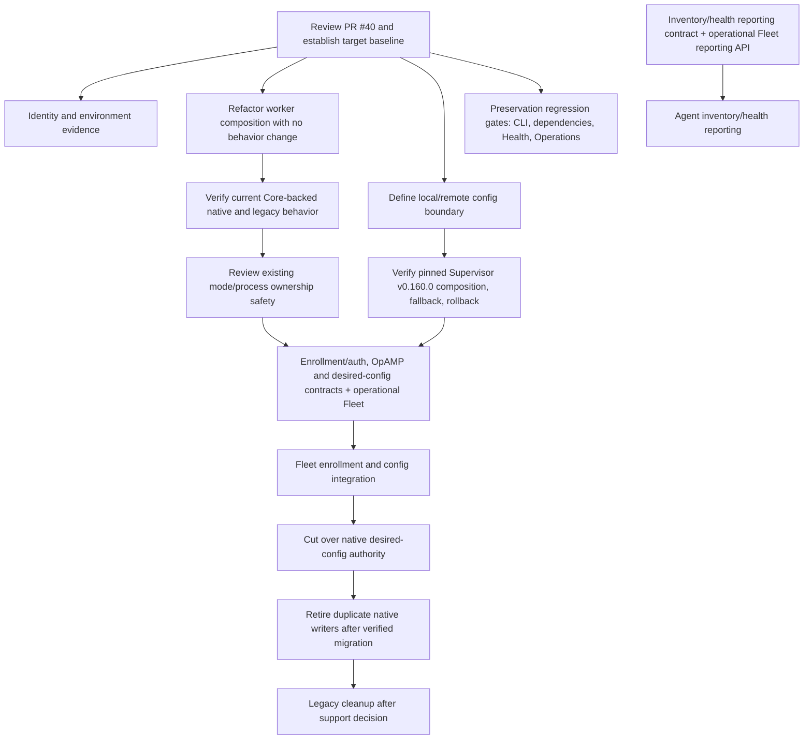

# OTel-Native Telemetry Agent — Implementation Plan

**Status:** Under user review. It covers Agent-side implementation only; Fleet Management Server and Core Backend remain external, and cross-system production work remains contract-owner dependent.

**Scope:** Telemetry Agent repository only. Do not implement Fleet Management Server or Core Backend here.

**Companion goals:** [OTel-native Agent goals](../../requirements/v0.1.4a-next/otel-native-agent-goals.md).

**Architecture direction:** Frozen by final review. Reopen only with concrete source evidence of incompatibility.

## 1. Current source baseline and PR #40 overlap

The writable checkout used to author this plan is `feat/pr-09.5h-architecture-cli-review` at `c9597df6bb8d498e6661df151b99c35b8c1ea1f1`. It is PR #40’s head, not the integration branch. The separately checked integration checkout is `chore/v0.1.4a-next` at `22b00757c466e0ddb524520e4d0c804ed483187e`. PR #40 is open/draft and must not be treated as merged.

The authoring worktree also contained unrelated uncommitted Go changes and an untracked verification report. Those are not part of this plan’s intended change set. Before implementation, inspect the actual target branch and reconcile whether PR #40 has been reviewed/merged. Do not overwrite its work or use its files as integration baseline before that happens.

PR #40 changes 522 files, including significant work under `cmd/agentctl`, `internal/app`, `internal/cli`, `internal/configuration`, `internal/identity`, `internal/inventory`, `internal/monitoring`, `internal/runtime`, and docs. Review the actual diff and behavior by slice; file count is not approval. Its description cites CI at earlier SHAs. Obtain check associations for the current head and distinguish executed tests from skipped live Docker/native service tests before relying on the evidence.

Relevant current source areas:

- Identity/evidence: `internal/identity/installation`, `internal/identity/host`, `internal/identity/enrollment`, `internal/identity/credentials`, `internal/identity/sqlite`.
- Runtime/app worker composition: `internal/app/runtime.go`, `cmd/agentctl/*runtime.go`, `internal/runtime/collector/activation/runtime.go`.
- Config and policy: `internal/configuration/{desiredstate,materialization,proposals,reconciliation,remoteconfig,templates}`, `internal/monitoring`, `internal/integration`.
- Supervisor and installation: `internal/runtime/opamp/config.go`, `internal/runtime/service`, `internal/runtime/collector`, `internal/runtime/lifecyclelock`.
- Preserved dependencies and features: `internal/runtime/dependencies/{windows_exporter,libre_hardware_monitor,node_exporter}`, `internal/health`, `internal/operations`, `cmd/agentctl`, `internal/cli`.
- Existing verification sources include tests beside these packages plus `cmd/agentctl/pr07a_*`, `cmd/agentctl/pr07b_*`, and `internal/runtime/service/pr07_native_service_e2e_test.go`.

Source-grounded constraint: current `internal/app/runtime.go` starts the desired-state dispatcher/reconciler and inventory/proposal/template loops together; `internal/runtime/collector/activation/runtime.go` starts the reconciliation callback before selecting Agent legacy runtime or managed Supervisor. First refactor composition without changing behavior. Later Fleet cutover must disable only duplicate native policy/config writers, not local inventory, health, Operations or required OS dependency work.

## 2. Goal-to-slice traceability

| Goal | Implementation slices |
|---|---|
| GOAL-01 stable `agent_id` | A, F |
| GOAL-02 evidence-derived host/environment identity | A |
| GOAL-03 exclusive Collector lifecycle | B, C, E |
| GOAL-04 behavior-preserving worker separation | B, F |
| GOAL-05 official Supervisor provisioning | D, E |
| GOAL-06 safe configuration authority cutover | C, F |
| GOAL-07 Fleet enrollment and credentials | F |
| GOAL-08 inventory and health reporting | A, G |
| GOAL-09 managed Windows Exporter/LHM/Node Exporter | E (regression gates) |
| GOAL-10 Core-authorized Operations | E (regression gates) |
| GOAL-11 CLI, SQLite and security compatibility | A–F (focused gates) |
| GOAL-12 Windows/Linux verification | A–G (affected behavior only) |

## 3. Dependency graph



Identity work, worker composition, pinned Supervisor verification and focused preservation tests do not require Fleet to be operational. Enrollment/auth, OpAMP and desired-config integration block configuration cutover. Full Inventory/Health reporting has its own contract and implementation slice and does not block configuration cutover; only endpoint observations essential to the effective Collector configuration must be available and validated.

## 4. Implementation slices

### Slice A — Identity and environment evidence (P0, independent)

- **Objective:** Add host/environment evidence while preserving installation identity.
- **Related goals:** GOAL-01, GOAL-02, GOAL-08, GOAL-11, GOAL-12.
- **Scope/source paths:** `internal/identity/installation`, `internal/identity/host`, `internal/platform`, `internal/identity/sqlite`, local health/inventory evidence consumers.
- **Expected behavior changes:** Reuse the persisted installation UUID as `agent_id`; derive `host_id` from approved OS evidence without using it as a credential; report hostname, OS, architecture, versions, capture time and evidence provenance; distinguish `compute_type`, `orchestrator`, `deployment_scope` and derived `host_type`; preserve UNKNOWN/conflicts. Explicitly test cloned VM and container-host ambiguity.
- **Explicit non-changes:** No Fleet client/API; no Core topology claim; no credential derived from fingerprint; no replacement of installation ID or destructive SQLite reset; no generic detector/plugin framework.
- **Dependencies:** None on Fleet. Review existing `internal/identity/host` readers and PR #40 changes first; prefer existing platform APIs/libraries.
- **Acceptance criteria:** Existing UUID remains stable; incomplete or conflicting signals remain UNKNOWN; raw sensitive identifiers are not indiscriminately persisted/logged; evidence has provenance/time; Windows and Linux semantics are explicit. The existing local `/v1/status` snapshot may expose this evidence as optional, non-authoritative metadata; this is not Fleet Inventory & Health reporting. Populate managed Collector/Supervisor versions only from actual runtime evidence, not pinned-version assumptions.
- **Verification:** `go test ./internal/identity/... -count=1`; applicable `go test ./internal/platform/... -count=1`; SQLite reopen/fixture tests; native Windows/Linux tests for platform evidence; `go vet ./...` and `go build ./...` at the normal PR gate.
- **Rollback/failure:** Additive fields/read compatibility only; on detector error, retain identity and report unknown evidence; never rewrite credential or installation ID.

### Slice B — Behavior-preserving worker composition (P0, independent)

- **Objective:** Make Agent worker ownership/composition explicit without changing today’s behavior.
- **Related goals:** GOAL-03, GOAL-04, GOAL-08, GOAL-11.
- **Scope/source paths:** `internal/app/runtime.go`, `internal/app/runtime_test.go`, `cmd/agentctl/reconciliation_runtime.go`, `cmd/agentctl/discovery_runtime.go`, `cmd/agentctl/template_materialization_runtime.go`, `cmd/agentctl/proposal_approval_runtime.go`, `internal/runtime/collector/activation/runtime.go`.
- **Expected behavior changes:** Structural composition only: represent existing reconciliation, inventory, proposal/template and Operations workers explicitly; preserve their current startup, ordering, errors, shutdown and effects for both Core-backed native and legacy installations.
- **Explicit non-changes:** Do not disable or reroute workers; do not change configuration authority; do not infer Fleet mode from `Supervisor.Enabled`; do not alter Collector execution or SQLite schema.
- **Dependencies:** PR #40 critical review and a verified baseline of current calls/side effects.
- **Acceptance criteria:** Tests prove worker start/stop and relevant behavior unchanged for existing states; cancellation and worker failure semantics remain stable; no new general lifecycle framework.
- **Verification:** `go test ./internal/app/... ./internal/runtime/collector/activation/... -count=1`; focused `cmd/agentctl` composition tests; `go test ./...` and architecture guards in CI.
- **Rollback/failure:** Revert only composition refactor; no persisted state or runtime selector changes.

### Slice C — Existing mode/process safety review and focused gaps (P0, independent)

- **Objective:** Ensure mode changes preserve one Collector owner with the smallest necessary safety fixes.
- **Related goals:** GOAL-03, GOAL-06, GOAL-11, GOAL-12.
- **Scope/source paths:** `internal/runtime/service/installer.go`, `internal/runtime/service/application/ownership.go`, `internal/runtime/collector/activation`, `internal/runtime/lifecyclelock`, platform process containment and `internal/agentstate`.
- **Expected behavior changes:** First document existing stop/start/process-tree guarantees. Add only missing checks for stop-and-verify, persisted selector update timing, target prerequisites and unsafe rollback refusal. Keep lifecycle selector separate from configuration authority.
- **Explicit non-changes:** No generalized lifecycle transaction framework; no new feature-flag platform; no mode flip as a substitute for DB migration rollback; no behavior change to the three authority states.
- **Dependencies:** Slice B and source review of existing ownership/process code.
- **Acceptance criteria:** No two Collector lifecycle owners; failure before target readiness preserves prior state; unsafe transition stops visibly; state/credential/config survive service interruption.
- **Verification:** Focused service, activation, lifecycle-lock and process-tree tests; native Windows SCM/Job Object and Linux service/process tests where modified; SQLite transition fault tests only if persistence writes change.
- **Rollback/failure:** Keep existing persisted owner and usable config/credentials; abort before selector commit when preconditions fail; do not kill an unverified process tree.

### Slice D — Agent-side Supervisor/config composition verification (P0, independent tests)

- **Objective:** Verify local Agent and official Supervisor v0.160.0 behavior before any authority cutover.
- **Related goals:** GOAL-05, GOAL-06, GOAL-09, GOAL-12.
- **Scope/source paths:** `internal/runtime/opamp/config.go`, `internal/runtime/opamp/config_test.go`, `internal/runtime/service`, Collector bootstrap/config validation, existing pinned artifact and managed-runtime E2E harnesses.
- **Expected behavior changes:** Add focused evidence/tests for actual v0.160.0 local+remote merge behavior, fallback, collision handling, remote apply/rollback, dependency endpoint readiness, protected token/config rendering and process ownership. Fix only verified Agent defects.
- **Explicit non-changes:** No unilateral Fleet schema/policy decisions; no speculative component-ID allocator; no change to current Core-backed native authority; no disabling current writers.
- **Dependencies:** Exact pinned Windows/Linux Supervisor and Collector binaries and reproducible harness. Fleet service is not required for these Agent-side checks if test server fixtures can exercise standard OpAMP behavior without defining production Fleet contracts.
- **Acceptance criteria:** Actual binary behavior is captured; local bootstrap/fallback remains valid offline; invalid remote config follows SUP behavior; duplicate component IDs fail or resolve as documented; dependency absence is visible; secrets remain protected.
- **Verification:** Focused `go test ./internal/runtime/opamp/... ./internal/runtime/service/...`; actual pinned binary tests on native Windows/Linux; remote apply, invalid config and rollback with logs; OTLP sink assertion if pipeline execution changes.
- **Rollback/failure:** Keep existing working local config and Supervisor settings; don’t make a new composition default until parity succeeds.

### Slice E — Preservation gates (P0, verification, not a bundled feature PR)

- **Objective:** Demonstrate preserved Agent capabilities while slices B–D change nearby composition.
- **Related goals:** GOAL-03, GOAL-05, GOAL-09, GOAL-10, GOAL-11, GOAL-12.
- **Scope/source paths:** `internal/runtime/dependencies/{windows_exporter,libre_hardware_monitor,node_exporter}`, `internal/health`, `internal/operations`, `internal/operations/nats`, `cmd/agentctl`, `internal/cli`, SQLite tests.
- **Expected behavior changes:** Only focused regression fixes required by the owning PR; keep these suites as separate verification reports/gates rather than combining unrelated changes.
- **Explicit non-changes:** Do not move Operations authorization to Fleet; do not alter CLI output/flags/exit codes; do not remove exporters; do not combine unrelated cleanup into one PR.
- **Dependencies:** Runs alongside A–D; compare behavior to current checked baseline.
- **Acceptance criteria:** Existing commands and noninteractive workflows work; exporter install/config/status/teardown retained; Health remains local and honest; Operations remains Core-authorized through existing NATS with local audit/idempotency/outbox intact; SQLite records reopen.
- **Verification:** `go test ./internal/runtime/dependencies/... ./internal/health/... ./internal/operations/... ./cmd/agentctl/... -count=1`; native OS dependency/service tests as applicable; credential ACL and SQLite fixture/migration checks.
- **Rollback/failure:** Revert only the specific affected change; never reset state, credential store, or dependency installation to make a test pass.

### Slice F — Fleet enrollment/config integration and controlled authority cutover (P1, externally dependent)

- **Objective:** Move target native installations from current Core-backed desired-config authority to Fleet only after the cross-system path is ready.
- **Related goals:** GOAL-04, GOAL-06, GOAL-07, GOAL-12.
- **Scope/source paths:** Agent enrollment/credential client, `internal/identity`, `internal/configuration/remoteconfig`, `internal/runtime/opamp`, `internal/runtime/service` and app worker composition. Exact files depend on approved contracts. Include only local observations of dependency endpoints required by the effective Collector config.
- **Expected behavior changes:** Implement Agent-side contract clients only for approved Enrollment & Identity, Configuration Management and OpAMP Integration Profile contracts. Keep existing Core-backed behavior until Fleet path is operational. At cutover, Fleet becomes sole native desired-config authority and the Agent disconnects only duplicate native policy writers.
- **Explicit non-changes:** No Fleet/Core/Mongo implementation; no invented endpoints or payloads; no premature writer shutdown; no credential replacement without explicit migration/recovery semantics.
- **Dependencies:** Owner-approved Enrollment & Identity, Configuration Management and OpAMP Integration Profile contracts; operational Fleet enrollment/config service; Core-to-Fleet authorization/binding integration; config composition decision; essential dependency endpoint evidence; migration plan and test environment. Full Inventory/Health reporting API is not a dependency of this slice.
- **Acceptance criteria:** Existing identity/credentials preserved or migrated explicitly; retries and revocation are safe; dependency endpoints required by the effective config are available and validated; revision/hash status is truthful; no concurrent config authorities; current Core-backed and legacy paths remain available according to the approved transition policy.
- **Verification:** Contract-compatible Mock Fleet/Core tests separated from production NestJS interoperability; native Windows/Linux enrollment/revocation/config E2E; reconnect and invalid-config rollback; actual telemetry at OTLP sink; credential ACL and SQLite compatibility.
- **Rollback/failure:** Before cutover, keep current Core-backed mode. During cutover, stop only after destination config, endpoint, credential and dependencies validate; preserve old state until new owner is verified; if unsafe to rollback, fail closed and retain evidence/state.

### Slice G — Fleet inventory and health reporting (P1, independently contract-dependent)

- **Objective:** Report Agent inventory and health evidence through approved Fleet contracts without coupling delivery to configuration authority cutover.
- **Related goals:** GOAL-08, GOAL-12.
- **Scope/source paths:** Agent identity/evidence, `internal/inventory`, `internal/health`, and app composition. Exact transport/client paths depend on approved contracts.
- **Expected behavior changes:** Add authenticated, freshness-aware reporting only after the Inventory & Health Reporting contract exists. Retain local evidence and report delivery state independently from Collector config state.
- **Explicit non-changes:** This slice does not own desired Collector config, alter Core business topology, or gate Slice F configuration cutover. Essential dependency endpoint observations used by config are handled in Slice F under its approved contract.
- **Dependencies:** Owner-approved Inventory & Health Reporting contract and operational Fleet reporting endpoint. It can proceed before or after Slice F and is not a prerequisite for config cutover.
- **Acceptance criteria:** Local evidence remains available; reporting retries/failures do not erase inventory; stale/unknown evidence stays explicit; Core remains topology authority; reporting state does not alter config authority.
- **Verification:** Contract-compatible Mock Fleet tests; outage/retry and duplicate reporting tests; native Windows/Linux tests for affected collectors; separate production Core interoperability status.
- **Rollback/failure:** Disable only the reporting integration and preserve local evidence; no impact to current Core-backed configuration or Fleet config cutover.

### Slice H — Deferred legacy cleanup (P2)

- **Objective:** Remove only obsolete code after Fleet migration and compatibility obligations are proven complete.
- **Related goals:** GOAL-04, GOAL-06, GOAL-11.
- **Scope/source paths:** Only proven-unused native policy writers/adapters in Configuration/Monitoring and explicitly transitional integration code.
- **Expected behavior changes:** Delete/retire code only when no supported mode, command, persisted state or rollback path uses it.
- **Explicit non-changes:** No cleanup solely to make the tree look target-shaped; no removal during initial Fleet adoption.
- **Dependencies:** Slice F passes; explicit legacy support-window decision; data and CLI migration evidence.
- **Acceptance criteria:** Call/import and runtime-use audit; state migration and CLI compatibility; all supported modes verified; explicit removal criteria documented.
- **Verification:** Focused old/new mode tests, migration fixtures, CLI tests, import architecture guard, native platform E2E for affected behavior.
- **Rollback/failure:** Keep prior release/artifacts and state migration path through the defined rollback window; if removal breaks supported legacy use, restore the code rather than silently changing compatibility.

## 5. Context ownership and current compatibility

| Context | Legacy Agent-managed | Current Core-backed Supervisor-managed | Target Fleet-backed Supervisor-managed |
|---|---|---|---|
| Identity | Agent installation UUID, enrollment and protected credentials | Same identity and current Core-backed enrollment | Same installation identity; Fleet credential authority through approved contract |
| Inventory | Agent discovers and maintains local inventory | Agent keeps local inventory/evidence | Agent produces evidence; Fleet stores fleet view; Core owns business topology |
| Monitoring | Existing Agent profiles/matching/policy path | Preserve current Core-backed behavior during transition | Fleet owns policy; Agent provides contracted local evidence/capabilities |
| Configuration | Existing Agent config/reconciliation/activation path | Existing Core-backed config path remains operational | Fleet desired Collector config; Agent local bootstrap/dependency inputs; SUP composes/applies/rolls back |
| Runtime | Agent exclusively manages Collector | SUP manages Collector lifecycle; `Supervisor.Enabled` selects lifecycle only | SUP manages Collector lifecycle and config application |
| Health | Agent-local diagnostics | Agent-local diagnostics plus current SUP/Collector evidence | Agent-local diagnostics; Fleet receives only approved reports |
| Operations | Core-authorized NATS; Agent execution safety/audit | Same | Same; Fleet is not authorization owner |
| CLI/app | Preserve existing behavior | Preserve existing behavior | Preserve commands; invoke same use cases with mode-aware composition |

Current Core-backed native behavior remains operational until Fleet cutover is verified. A lifecycle selector is not a config-authority selector.

## 6. Configuration composition and contract dependencies

### Agent-side verification that can proceed independently

- Actual Supervisor v0.160.0 local/remote config merge behavior, including field/list behavior and component ID collisions.
- Local bootstrap and startup fallback behavior while disconnected.
- Remote config apply, invalid config response and automatic rollback evidence.
- Managed dependency endpoint readiness and visible failure when the dependency is absent/unhealthy.
- Protected credential/token file provisioning, ACLs, rendering, redaction and restart behavior.
- Current Core-backed Supervisor mode continues working during these tests.

### Cross-system decisions requiring contract-owner approval

- Fleet-owned Collector policy shape and configuration publication/reconciliation semantics.
- Receiver/component/pipeline ID ownership and collision policy across local and Fleet-generated config.
- Exporter endpoint reporting and authority, including gateway routing changes.
- Managed dependency endpoint representation/readiness contract.
- Secure credential references and rotation/revocation behavior.
- Revision/hash attribution and observed status semantics.
- Fleet ↔ Core Node authorization/binding and audit mapping.

No wire schema or endpoint is created by this plan. Check `docs/shared/contracts/fleet-management/` when available; it was absent in the authored source snapshot. Do not edit the shared submodule without explicit authorization.

## 7. Cutover prerequisites

All conditions are required before disconnecting Agent native config/reconciliation writers:

1. Fleet Enrollment & Identity, Configuration Management and OpAMP Integration Profile contracts are approved and implemented by their owners. Inventory & Health Reporting is excluded from this gate.
2. Core-to-Fleet authorization/binding behavior is defined; production NestJS interoperability is separately verified or explicitly marked as an external release limitation.
3. Local/remote composition decisions cover endpoint/routing ownership, component IDs, dependency references, credential references, merge collisions and revision/hash attribution.
4. Pinned Supervisor v0.160.0 tests prove merge, offline fallback, invalid config, rollback, reconnect and process-tree behavior.
5. Agent can provision credentials and dependencies needed by the effective config before SUP applies it; required dependency endpoint observations are available and validated. Missing prerequisites fail visibly. This does not require the full Inventory/Health reporting API.
6. Migration preserves installation UUID, protected credentials, SQLite state/migrations, CLI behavior and old usable config.
7. The prior lifecycle owner is stopped and its process tree verified before target owner starts; one Collector owner is demonstrated.
8. Current Core-backed native and legacy compatibility tests pass; target Fleet config path reports configuration evidence truthfully.
9. Native Windows and Linux E2E verifies applied config/revision as supported, rollback and actual OTLP sink delivery.
10. Failure handling preserves old state and refuses unsafe rollback; the cutover state is recoverable without a general feature-flag system.

## 8. PR sequence and gates

| PR | Goal/scope | Dependencies | Acceptance criteria | Verification | Rollback |
|---|---|---|---|---|---|
| **A — Identity and environment evidence** | Slice A only; identity/evidence and compatibility | Review integrated baseline and PR #40 identity changes | Stable ID; provenance/time; independent environment dimensions; unknown/conflict safe; no auth/topology inference | Identity/platform unit tests, SQLite reopen/fixtures, native Windows/Linux evidence tests | Additive fields; unknown on error; no identity or credential rewrite |
| **B — Behavior-preserving worker composition** | Slice B only; refactor app wiring | PR #40 review; baseline worker behavior captured | Same workers/effects in current Core-backed native and legacy states | App/runtime focused tests, full Go tests and architecture guard | Revert composition only; no persisted state changes |
| **C — Supervisor composition and mode safety evidence** | Slices C/D; only verified gaps fixed | B; exact pinned binaries | Actual merge/fallback/rollback/collision behavior recorded; no lifecycle owner overlap | Pinned SUP tests; service/process containment tests on applicable native OS; OTLP sink test when collection changes | Keep current configuration/selector; revert new behavior if parity fails |
| **D — Fleet enrollment and credential integration** | Enrollment/authentication portion of Slice F | Approved Enrollment & Identity and Core-to-Fleet binding contracts; Fleet enrollment service | Existing identity/credentials preserved or migrated explicitly; retry/revocation safe; no secrets exposed | Mock-backed contract E2E; Windows/Linux protected credential and outage tests; production Core separately tracked | Preserve current Core-backed enrollment and credentials until explicit migration succeeds |
| **E — Fleet desired-config integration and cutover** | Configuration portion of Slice F | D; approved Configuration Management and OpAMP contracts; config-composition decisions; required dependency endpoint observations; all cutover preconditions | Fleet is sole native desired-config authority; SUP is sole native executor; no premature writer shutdown. Full Inventory/Health reporting is not required. | Native Windows/Linux SUP/Fleet/Collector E2E; invalid config/reconnect; actual OTLP sink; endpoint readiness | Keep prior authority/state until target verified; controlled rollback only with compatible config/credentials |
| **F — Fleet inventory/health reporting** | Slice G | Approved Inventory & Health Reporting contract and Fleet reporting endpoint; independent of E | Authenticated, freshness-aware reporting; local evidence and config cutover stay independent | Mock-backed report contract E2E; outage/retry/stale evidence tests; Windows/Linux as applicable | Disable reporting integration while retaining local evidence; no config-authority rollback needed |
| **G — Legacy retirement (deferred)** | Slice H only | E passes and legacy support/removal criteria approved | No supported caller/state/rollback depends on removed path | Consumer audit, migrations, CLI, native platform tests | Restore compatibility path or previous artifact within declared rollback window |

CLI, Windows Exporter, LHM, Node Exporter, Health and Operations are focused regression gates attached to affected PRs. They are not combined into a miscellaneous feature PR.

## 9. Verification commands and quality gates

Run the narrowest relevant test first, then required repository checks for each implementation PR:

```powershell
go test ./internal/identity/... -count=1
go test ./internal/app/... ./internal/runtime/collector/activation/... -count=1
go test ./internal/runtime/opamp/... ./internal/runtime/service/... -count=1
go test ./internal/runtime/dependencies/... ./internal/health/... ./internal/operations/... ./cmd/agentctl/... -count=1
go test ./... -count=1
go vet ./...
go build ./...
git diff --check
```

Run platform-specific tests on native Windows/Linux for identity APIs, protected credentials/ACLs, service/process containment, managed dependencies and live infrastructure. Cross-builds are compile evidence only. Test SQLite old fixtures/migrations/reopen/CAS when state is touched. Verify real pinned Collector/Supervisor config and actual OTLP sink delivery when effective pipeline behavior changes. Retain sanitized logs, exact SHA, artifact digests and executed/skipped test lists. Do not claim production Core interoperability from Mock Fleet/Core evidence.

Keep the existing coding policy unchanged, including GoDoc/package docs, file-size guidance, architecture boundaries, security, testability, Windows/Linux requirements and mandatory checks.

## 10. External blockers and owners

| Contract dependency | Owner | Blocks | Does not block |
|---|---|---|---|
| Enrollment & Identity: Node authorization/binding, Fleet enrollment/approval, credential issue/revoke and migration | Core + Fleet owners | Slice F enrollment/credential integration | Slice A identity detection; behavior-preserving worker composition; local credential security tests |
| Configuration Management: desired policy, revision/CAS, publish/reconcile, status/hash and failure semantics | Fleet owner, with Core authority mapping | Fleet config integration and cutover | Pinned SUP merge/fallback/rollback testing; current Core-backed behavior |
| Inventory & Health Reporting: authenticated payload, provenance/freshness, retry and storage semantics | Fleet owner, Core topology owner | Remote reporting | Local Agent inventory/health evidence and tests |
| OpAMP Integration Profile: supported auth, identity binding, config/status capabilities and reconnect expectations | Fleet owner | Fleet/Supervisor connection integration | Standard OpAMP and pinned SUP local behavior tests |
| Production NestJS interoperability | Core owner | Production end-to-end release claim | Agent/Mock contract test preparation once contract is approved |

## 11. Deferred cleanup and removal criteria

Do not remove Agent Configuration, Monitoring, `internal/opampserver`, or legacy runtime merely because Fleet/Supervisor offers a similar capability. Remove a native writer only during verified Fleet cutover, when the replacement is operational and its state/rollback path is clear. Remove legacy-only code only after an explicit support-window decision, consumer and persisted-state audit, migration proof, CLI compatibility tests and rollback artifact availability. Preserve historical verification reports and ADRs.

## 12. Commit strategy

- Use one commit for one cohesive change with independent engineering value.
- Keep implementation and directly related tests together when they form one reviewable change.
- Group small documentation edits that explain the same change; avoid trivial documentation-only micro-commits.
- Split unrelated responsibilities and independently reversible migrations into separate commits.
- Make commit boundaries useful for review, `git bisect`, revert and debugging; do not maximize commit count or combine unrelated changes.
- Do not amend unrelated commits or rewrite Git history. Do not change the existing Coding Policy.

## 13. Sources

- [Goals and scope](../../requirements/v0.1.4a-next/otel-native-agent-goals.md).
- [Release scope](../../requirements/v0.1.4a-next/release-scope.md), [CLI contract](../../architecture/v0.1.4a-next/cli-contract.md), [OpAMP integration](../../architecture/v0.1.4a-next/opamp-integration.md), [architecture overview](../../architecture/v0.1.4a-next/architecture-overview.md), and [PR-09.5 report](../../verification/v0.1.4a-next/pr-verification/pr-09.5-report.md).
- [Agent coding policy](../../development/coding-policy.md) is unchanged. The shared policy path is `docs/shared/engineering/AI_CODING_POLICY.md`; the shared submodule is unavailable in this checkout, so its content was not copied or modified.
- Accepted architecture review inputs: ADR 0005, ADR 0006 and Fleet flow definitions supplied by the user. These were not tracked in this PR #40 source snapshot; no links are fabricated.
