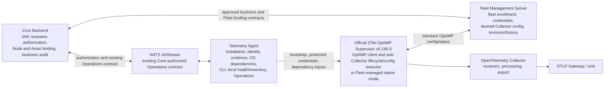

# OTel-Native Telemetry Agent — Goals and Scope

**Status:** Proposed for user review. The architecture direction is accepted; this goals document is not yet accepted. Implementation is not authorized until the user accepts the documents.

**Owner:** AR-IMMS Telemetry Agent maintainers.

**Scope:** Agent repository only. Fleet Management Server and Core Backend are external systems.

**Source snapshot reviewed:** `feat/pr-09.5h-architecture-cli-review` at `c9597df6bb8d498e6661df151b99c35b8c1ea1f1` on 2026-11-18. This branch is PR #40 and is not merged into the integration branch. The separately checked integration baseline is `chore/v0.1.4a-next` at `22b00757c466e0ddb524520e4d0c804ed483187e`.

**Authority:** Final architecture review decisions supplied 2026-11-18; see also current Agent architecture and verification documents listed under [Sources](#sources-and-evidence).

## Problem and motivation

The Agent currently supports both its legacy Collector runtime and an official OpAMP Supervisor-managed runtime. It also has Agent-side Configuration, Monitoring and reconciliation code, Core-backed enrollment/configuration integration, local inventory and health, managed OS dependencies, and infrastructure Operations. These capabilities evolved at different checkpoints. A Supervisor lifecycle selector alone does not transfer configuration authority, and the Agent must not stop working Core-backed native behavior before Fleet Management can replace it.

The release work must make those ownership boundaries explicit, preserve existing installations and compatibility, add evidence-based host/environment identity, and enable a controlled future Fleet cutover without building Fleet or Core inside the Agent.

## Target component architecture

The Fleet Management Server and the official OpAMP Supervisor are distinct products. The Agent repository does not implement Fleet, Core, or their persistence. The diagram describes the accepted target; it is not proof of production interoperability.

## Accepted principles

1. Core is business authority for IAM, Node/Asset binding, business authorization, business audit, and the existing Core-authorized NATS Operations contract.
2. The separate Fleet Management Server owns fleet enrollment, credential authority, desired Collector configuration, revisions/publication and fleet execution history.
3. Official OpAMP Supervisor v0.160.0 is the sole Collector lifecycle and configuration executor in Fleet-managed native mode. The Collector executes telemetry collection, processing and delivery.
4. The Agent owns local installation, stable installation identity, environment evidence, OS-managed exporters, Supervisor provisioning, CLI, local health/inventory and infrastructure Operations.
5. `Supervisor.Enabled` selects Collector lifecycle ownership only. It does not identify configuration authority.
6. Preserve three distinguishable states: legacy Agent-managed Collector; current Core-backed Supervisor-managed Collector; target Fleet-backed Supervisor-managed Collector. Do not introduce a general feature-flag framework.
7. Preserve existing CLI commands/flags/output/exit codes, SQLite data/migrations, protected credentials, enrollment retry/recovery, process containment and explicit legacy compatibility.
8. Preserve Windows Exporter, Libre Hardware Monitor (LHM) and Node Exporter lifecycle management. Use OTel-native Collector capabilities instead of duplicating collection, scraping, protocol or lifecycle engines.
9. Treat `agent_id` as the existing persisted installation UUID. Keep `host_id` and environment classification evidence-derived, non-authenticating and distinct from confirmed business topology.
10. Keep unknown, stale and conflicting evidence explicit. Readiness, OpAMP status and Collector health do not independently prove telemetry delivery.
11. Do not modify `docs/shared` or invent Fleet/Core wire contracts in this repository.

## Agent responsibility boundaries

| Agent context | Owns | Does not own |
|---|---|---|
| Identity | Stable installation ID, evidence collection/provenance, protected local credential handling and enrollment recovery | Fleet approval, Core business authorization, trusted asset topology |
| Inventory | Local provider observations, inventory evidence and compatible local CLI views | Core Asset/Topology authority or Fleet persistence |
| Monitoring | Current compatibility behavior while Core-backed or legacy paths remain active; local capability/evidence inputs as contracted | Fleet policy or a second desired-config authority in Fleet-managed native mode |
| Configuration | Current Core-backed and legacy behavior until cutover; Agent bootstrap, local credentials, dependency inputs and local diagnostics | Fleet desired Collector configuration/revisions in Fleet-managed mode; Supervisor application/rollback |
| Runtime | Agent OS service, managed OS dependencies, Supervisor process provisioning, ownership selection and containment | Collector lifecycle in Fleet-managed native mode |
| Health | Local Agent/runtime/evidence snapshots and accurate unknown/stale reporting | Fleet-side history or claims of delivery without sink evidence |
| Operations | Local operation safety, audit/idempotency/outbox and NATS transport integration | Business authorization or Fleet-managed Collector restart authority |
| CLI/application | Stable user/automation interface and composition of the same application use cases | Duplicate business logic or silent behavior changes |

## Scope

### In scope

- Preserve the installation UUID as `agent_id`; implement evidence-derived `host_id` and environment reporting with provenance and timestamps.
- Detect BARE_METAL, VM and Kubernetes context while keeping `compute_type`, `orchestrator` and `deployment_scope` independent. Handle UNKNOWN, conflicting evidence, cloned VMs and container-host ambiguity without claiming Core topology.
- Make lifecycle ownership and worker composition explicit while first preserving current behavior in both Core-backed native and legacy modes.
- Provision the official pinned Supervisor and test its real local/remote composition, fallback, rollback, process containment and dependency readiness.
- Define an Agent-side local/remote configuration boundary; defer cross-system policy decisions to contract owners.
- Integrate Agent enrollment, credentials, inventory/health reporting and Fleet config only against approved external contracts.
- Preserve managed Windows Exporter, LHM and Node Exporter, existing Core-authorized NATS Operations, CLI behavior, SQLite compatibility, and Windows/Linux support.
- Perform a controlled Fleet authority cutover only after the cutover preconditions in the [implementation plan](../../plans/v0.1.4a-next/otel-native-agent-implementation-plan.md) pass.

### Out of scope

- Implementing Fleet Management Server, Core Backend, MongoDB persistence, Fleet IAM, business authorization or business audit.
- Editing or publishing shared contracts without separate authorization.
- Replacing NATS Operations authorization with Fleet authority.
- Arbitrary remote command execution, proprietary telemetry receivers/scrapers, a custom OpAMP protocol, or a parallel Collector lifecycle engine.
- Inferring physical/organizational topology from a machine fingerprint or environment detector.
- Cutting over from current Core-backed native behavior before Fleet is operational and verified.
- Broad repository reorganization or removing legacy code before its usage, state and rollback requirements are resolved.

## Functional goals

| ID | Goal | Testable outcome | Implementation slices |
|---|---|---|---|
| GOAL-01 | Stable Agent identity | Existing installations retain their persisted UUID as `agent_id`; no second authoritative ID is silently generated | A, F |
| GOAL-02 | Evidence-based environment identity | Host/environment fields include provenance and time; unknown/conflicting evidence stays explicit; host identity is not authentication or Core topology | A |
| GOAL-03 | Exclusive Collector lifecycle | Each installation runs exactly one Collector lifecycle owner: Agent in legacy mode or Supervisor in either Supervisor-managed mode | B, C, E |
| GOAL-04 | Behavior-preserving worker separation | Worker composition is refactored without behavior change first; future Fleet cutover disables only duplicate native policy writers after Fleet readiness | B, F |
| GOAL-05 | Official Supervisor provisioning | Pinned Supervisor is provisioned with protected credentials and local bootstrap/fallback inputs; tested merge and rollback behavior matches v0.160.0 | D, E |
| GOAL-06 | Safe configuration authority cutover | Fleet owns target desired config/revisions; Supervisor applies/rolls back; cutover is withheld until contract, composition, migration and E2E gates pass | C, F |
| GOAL-07 | Fleet enrollment and credentials | Agent uses approved Fleet enrollment/credential contracts, preserves retry and credential protections, and handles replacement/revocation safely | F |
| GOAL-08 | Inventory and health evidence | Agent produces local evidence with freshness/unknown semantics and reports only through approved contracts; full reporting is independently deliverable from configuration cutover | A, G |
| GOAL-09 | Managed OS exporters remain available | Windows Exporter, LHM and Node Exporter install/configure/enable/disable/status/uninstall behavior remains supported | E |
| GOAL-10 | Core-authorized Operations remain intact | Existing NATS Operations authorization, local safety, idempotency, audit and outbox behavior remain independent from Fleet config authority | E |
| GOAL-11 | CLI and persistence compatibility | Existing commands, flags, outputs, exit codes, SQLite migrations and persisted data remain compatible | E, F |
| GOAL-12 | Cross-platform verifiability | Behavior-affecting changes receive applicable native Windows and Linux verification; live telemetry claims include sink evidence | A–G |

## Non-functional requirements

- **Security:** least privilege; no secrets in logs or ordinary configuration/state; protected credential storage; authenticated external calls; explicit authorization boundary; secure defaults.
- **Durability:** preserve SQLite schema/data and credential references; use existing transaction/recovery semantics; no destructive identity reset.
- **Concurrency:** bounded workers and subprocesses; explicit shutdown; process-tree containment; no overlapping Collector owners or native config authorities.
- **Compatibility:** stable CLI automation and installed-service behavior; compatibility aliases use the same application use cases.
- **Evidence quality:** distinguish Agent process, Supervisor process/session, Collector config/application, collection, connectivity and actual delivery. Report unknown when evidence is absent or stale.
- **Portability:** Windows and native Linux runtime checks for affected OS behavior; builds alone are insufficient for service/process/ACL/E2E claims.
- **Maintainability:** small, consumer-grounded interfaces; existing coding policy and file-size/comment/testing requirements remain unchanged.

## Runtime and authority states

| State | Collector lifecycle owner | Desired Collector configuration authority | Required compatibility rule |
|---|---|---|---|
| Legacy Agent-managed | Agent legacy runtime | Existing Agent Configuration/Monitoring path | Supervisor does not manage this Collector |
| Current Core-backed Supervisor-managed | Official Supervisor | Existing Core-backed path and current Agent integration, as verified in source | Keep behavior operational until cutover; `Supervisor.Enabled` does not imply Fleet authority |
| Target Fleet-backed Supervisor-managed | Official Supervisor | Fleet Management Server | Agent provisions local inputs and stops duplicate native config/reconciliation writers only after cutover gates pass |

## Required behavior preservation

- Existing `agent_id` source, enrollment attempts, lost-response recovery and protected credentials.
- The existing Core-authorized NATS Operations contract, local execution safeguards and audit/outbox state.
- Agent local health and inventory behavior.
- Windows Exporter, LHM and Node Exporter management and CLI.
- Existing CLI commands, flags, output shapes, exit codes and noninteractive/secure credential behavior.
- SQLite migrations, transaction boundaries, serialized records and reopen compatibility.
- Agent service install/upgrade/uninstall behavior and process-tree cleanup.
- Current Core-backed Supervisor behavior until controlled Fleet cutover.

## Migration and cutover invariants

1. Refactor worker composition before changing its behavior; retain current Core-backed native and legacy behavior in tests.
2. Do not interpret lifecycle mode as config-authority mode. Keep the three states distinguishable without a general flag framework.
3. Maintain one Collector lifecycle owner per installation.
4. Maintain one desired Collector config authority for each installation state; do not enable competing native writers after Fleet cutover.
5. Do not switch modes unless the destination config/bootstrap, endpoint, credential and dependency prerequisites are valid and the previous process tree is stopped and verified.
6. Preserve current usable state until the target owner is operational. If rollback is unsafe, fail visibly and preserve state rather than silently changing the selector.
7. Preserve credential protection, installation identity and SQLite contents across migration.
8. Require actual pinned-Supervisor composition/rollback and OTLP evidence before claiming native Fleet cutover.
9. Keep legacy source only while explicit legacy compatibility/rollback depends on it; later removal needs usage, state and CLI evidence.

## Definition of Done

- All GOAL IDs map to user-accepted implementation slices and each slice has reviewed acceptance criteria.
- Existing behavior is covered before worker ownership changes; current Core-backed native mode remains operational until cutover approval.
- Agent identity/environment evidence is additive, provenance-bearing, privacy-conscious and tested on Windows/Linux.
- Actual pinned Supervisor behavior, config merge, collision, fallback, rollback and process ownership are verified.
- Fleet-dependent behavior uses approved contracts and is separately tested from Mock Fleet/Core evidence and production Core interoperability.
- CLI, SQLite, credential, OS dependency, Health and Operations regressions pass focused gates.
- Fleet cutover preconditions pass, including actual sink delivery, before native Agent writers are disconnected.
- Required docs and checkpoint verification evidence are updated; no unverified case is described as PASS.

## External dependencies and explicit non-goals

Agent implementation depends on owner-approved contracts for **Enrollment & Identity**, **Configuration Management**, **Inventory & Health Reporting**, and the **OpAMP Integration Profile**. In the audited checkout, `docs/shared/contracts/fleet-management/` is not available; do not invent endpoint schemas, credential references, revision rules or reporting payloads. These contracts are required for their Fleet-dependent slices, not for independent identity detection, behavior-preserving worker composition, Supervisor binary tests, OS dependency preservation or local diagnostics.

Fleet Management and Core implementation, production database design, contract publication and business authorization changes are owned outside this repository. Production NestJS interoperability must be reported separately from Agent/Mock verification.

## Sources and evidence

- Current source snapshot and tests at PR #40 head `c9597df6bb8d498e6661df151b99c35b8c1ea1f1` (separate open draft PR; not merged to integration SHA `22b00757c466e0ddb524520e4d0c804ed483187e`).
- [Release scope](release-scope.md), [acceptance criteria](acceptance-criteria.md), [architecture overview](../../architecture/v0.1.4a-next/architecture-overview.md), [OpAMP integration history](../../architecture/v0.1.4a-next/opamp-integration.md), [CLI contract](../../architecture/v0.1.4a-next/cli-contract.md), and [PR-09.5 report](../../verification/v0.1.4a-next/pr-verification/pr-09.5-report.md). These describe current and historical implementation; this document governs the accepted Agent goal set where decisions changed.
- User-approved architecture inputs supplied in the 2026-11-18 review: ADR 0005, ADR 0006 and Fleet management flows. They were not tracked in the PR #40 source snapshot at the time this document was authored.
- [Agent coding policy](../../development/coding-policy.md) remains unchanged. The shared policy path is `docs/shared/engineering/AI_CODING_POLICY.md`; the shared submodule is unavailable in this checkout, so its content was not copied or modified.
