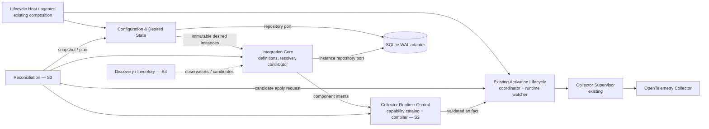
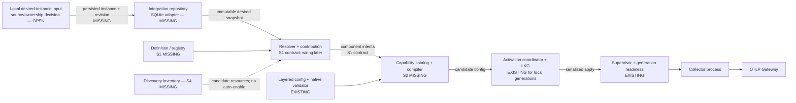
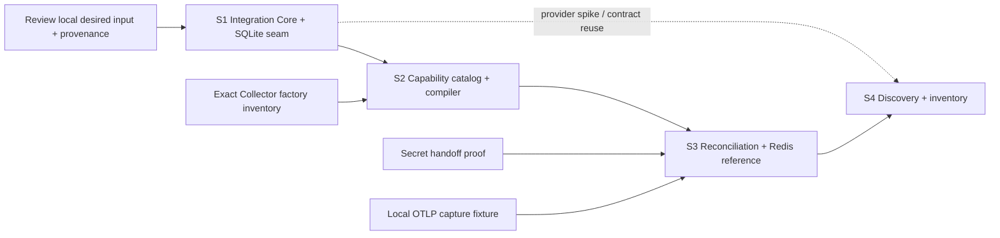

# Integration Core Delivery Slices — Telemetry Agent v0.1.4

**Status:** Proposed for developer review. Planning only; no implementation authorized by this document.

**Authority:** Approved [Target Architecture](../architecture/target-architecture-v0.1.4.md). The [Gap Analysis](../architecture/telemetry-agent-v0.1.4-gap-analysis.md) and [Core-Independent Roadmap](telemetry-agent-v0.1.4-core-independent-work.md) provide current-state evidence and delivery constraints. Labels: **Verified** = observed in current source/wiring; **Target** = approved architecture; **Proposed** = slice design; **Open** = decision requiring review.

## 1. Module Responsibility & Gap Matrix

| Module / context | Current state — verified | Target responsibility | Missing work | Owns / must not own | Dependencies |
|---|---|---|---|---|---|
| Integration Core | `internal/dependency.Catalog` describes a fixed set of managed host exporters; composition in `cmd/agentctl/composition.go` wires their installers, inspectors, receiver IDs, and teardown. No general definition/instance model. | Versioned definitions, configured instances, registry, matching, validation, capability requirements, contribution intent. | Minimal domain types, registry/resolver, validation, narrow contribution/matcher contracts; keep named dependency lifecycle intact during migration. | Own integration semantics and instance-to-definition/resource binding. Must not install processes, write Collector config, call Core, persist by reaching into SQLite, or restart Collector. | Configuration-owned desired input; Persistence repository interface; runtime-neutral capability identifiers. Later: discovery and reconciliation. |
| Configuration & Desired State | `internal/config` renders deterministic YAML layers and validates natively. `agentstate.State` tracks dependency desired/activated/applied generations. Gateway snapshot acceptance is a local repository seam; no authenticated ingress. | Own desired integration state, provenance/ownership, revisions, applied/LKG metadata and activation coordination. | Add a local desired-instance input contract and revisioned repository port; integrate instance revision into candidate input without settling Core precedence. | Own desired/applied state and activation. Must not discover resources, match definitions, know service-specific settings, or compile integration policy. | Integration instance value types; SQLite adapter; existing activation lifecycle. |
| Reconciliation | `configurationCoordinator` serializes activation of local dependency generations; `runtimeWatcher` starts Collector, observes generation readiness, and records applied generation. | Re-read durable desired/discovered/applied snapshots; resolve instances, produce immutable revision-bound plan, reject stale plan, bounded retry. | A later controller/plan path, idempotence/staleness rules and wiring to activation. | Own *what* needs applying. Must not own integration-specific rules, SQL, config generation, or process operations. | Stable desired/inventory/applied snapshots; Integration resolver; compiler; activation interface. Not S1. |
| Collector Runtime Control | `collectorConfigurationActivator` combines base `otlp`/`hostmetrics` and receiver IDs from dependency catalog, renders and invokes native validation/atomic activation. Collector pinned at `0.160.0`; `supervisor` handles process/readiness. | Capability catalog, deterministic full config compiler, native validation, lifecycle adapter. | Verify exact packaged factory inventory; add capability catalog/compiler consuming immutable intents, then bridge output into existing activation. | Own capability availability and OTel config shape. Must not own integration matching/policy, desired state, or Core semantics. | S1 intent contract; current config/bootstrap activation; pinned artifact proof. Compiler is S2, not S1. |
| Persistence / Infrastructure | `agentstate.Repository` is SQLite-backed operational store with WAL/migrations; reused for local state, identity, enrollment and Gateway revision state. | Context-owned repository contracts, short transactions, durable instance/revision state in same DB. | Schema/migration and adapter for Integration-owned repository, atomic update semantics and restart tests. | Persistence owns storage mechanics and migration. Must not own domain validation/precedence or expose shared tables for cross-context mutation. | Integration model and state invariants; SQLite WAL adapter. |
| Resource Discovery & Inventory | Platform identity and known dependency inspectors exist; no normalized inventory/provider registry. | Persist observations with stable identity, provenance, time/freshness; match candidates without auto-enabling. | Provider and inventory are later S4. S1 only leaves a resource-binding contract that supports explicit local resource references. | Own observations/candidates. Must not create desired instances or activate integrations. | Integration matching contract; Persistence inventory adapter; provider feasibility decision. |
| Lifecycle Host / composition | `agentctl` composition constructs dependency catalog and lifecycle adapters; existing CLI and service paths operate. | Neutral composition root constructs context adapters and invokes lifecycle interfaces. | Wire new modules when they exist; avoid integration-specific orchestration in `main`/composition. | Own construction, startup/shutdown and supervision only. | Interfaces from contexts; implementation stays in contexts. |

## 2. Cross-Module Contract Matrix

| Integration point | Proposed contract / producer → consumer responsibility | Current gap and constraint |
|---|---|---|
| Desired Integration Instance → Integration Resolver | Configuration repository returns immutable desired instances with revision/provenance. Resolver accepts definition ID/version plus instance config and optional resource reference; returns validated resolved instance or diagnostics. | No general desired instance or resolver. S1 defines value semantics and local repository seam; no Core ownership policy. |
| Integration Resolver → Configuration Contribution | Integration module resolves a known definition and invokes its contributor with immutable instance input; returns zero or more immutable component intents plus diagnostics. | No contribution seam. Integration cannot touch files, Collector process, persistence internals or activation. S1 defines this contract and test fake only. |
| Contributions → Collector Compiler | Compiler accepts baseline/config snapshot and component intents referencing capability IDs; returns deterministic complete candidate config or structured unsupported/invalid errors. | Current activator selects hard-coded receiver names from dependency catalog. Compiler and capability catalog are S2; do not put OTel YAML generation in Integration Core. |
| Reconciliation → Existing Activation Lifecycle | Reconciler supplies a revision-bound candidate/artifact (or activation request) to one serialized apply port; activation returns activated/applied generation and outcome. Reconciler commits plan progress only for matching input revisions. | Existing coordinator accepts `agentstate.State`, not arbitrary plan/artifact. S3 defines the narrow adapter/extension after S1/S2; reuse activation lock, readiness, LKG recovery. No direct process calls from reconciler. |
| Integration Instance → SQLite Persistence | Integration repository port stores/loads validated instance records and revision/provenance. SQLite adapter owns migration and transactional serialization; no cross-context table access. | Existing SQLite has no integration-instance repository/schema. S1 adds persistence seam and migration while preserving unrelated rows/state. |
| Future Discovery → Integration Matching | Discovery publishes normalized observations/candidates with stable ID, provider, evidence, observedAt and freshness; matcher consumes a snapshot and returns candidates only. Operator/configuration approval makes an instance desired. | No inventory/provider registry. Implement in S4 after S1 matcher/resource-reference contract. Discovery must not enable or activate. |

## 3. Module Dependency Diagram

Direction rule: Integration Core depends on domain values and narrow ports, not concrete Configuration, Persistence, Lifecycle, or Collector packages. Persistence adapters implement context-owned repository ports; composition wires them. Dashed discovery path is future work.

## 4. Cross-Module Data Flow

The present production path is local dependency state → `collectorConfigurationActivator` → `internal/config`/native validation → activation/recovery → supervisor. General desired instances, resolver/contributions, compiler, reconciliation, and discovery are absent. Collector readiness proves process/config readiness, not Gateway receipt.

## 5. Proposed Implementation Slices

### Slice 1 — Integration Core contracts and local persistence seam (S1)

| Field | Plan |
|---|---|
| **Scope** | Add definition/instance/component-intent value types, validation, registry/resolver and narrow matcher/contributor contracts; add Integration-owned repository port and SQLite adapter/migration. Define local desired-instance input/provenance only as far as needed to persist and exercise contracts. Excludes compiler/catalog, reconciliation loop, discovery provider, Redis, Core APIs/auth/remote ownership, CLI UX unless review explicitly selects a minimal local fixture/input. |
| **Goals** | Make integrations representable and testable independently; persist instances without disturbing existing operational state; permit a test contributor/resolver to run without edits to Lifecycle Host or Collector process control. |
| **Module Work** | Integration Core owns model, registry, resolver, diagnostics and contribution values. Persistence implements repository and migration. Configuration exposes/owns desired state and source/revision semantics; avoid dual ownership of the instance domain object. |
| **Cross-Module Work** | Agree instance ID/definition version/resource reference/config representation and repository transaction semantics. Resolver returns immutable component intents; no compiler invocation in S1. Composition may wire a test/local adapter but no production reconcile path. |
| **Dependencies** | Existing SQLite WAL/repository conventions; approved target rules. **Open gate:** choose the interim local operator source and its ownership/provenance semantics. This does not decide future Core/local precedence. |
| **Acceptance Criteria** | Unit tests cover valid/invalid definitions and instances, duplicate IDs, version/capability references, deterministic resolver outcomes and invalid contributions. SQLite tests prove create/update/restart and preserve dependency generations, identity, enrollment and Gateway state. Test contributor can be registered and invoked without changing lifecycle or Collector code. Existing dependency lifecycle/config tests remain behaviorally equivalent. |
| **Delivery** | Proposed `internal/integration` domain/resolver contracts; Configuration-owned desired-instance port/value source; `agentstate` SQLite adapter/schema migration; focused tests and a short ADR/decision record for local input/provenance. Exact package names to confirm at design review. Observable result: persisted, validated instance can be resolved into intents in-process; it is not activated. |

### Slice 2 — Collector capability catalog and configuration compiler (S2)

| Field | Plan |
|---|---|
| **Scope** | Verify packaged Collector 0.160.0 factories for Windows/Linux; catalog capabilities; deterministically compile baseline plus component intents; native validation and existing activation integration. Excludes reconciliation policy and Redis service behavior. |
| **Goals** | Unsupported capabilities fail before activation; equivalent inputs produce equivalent full Collector config; preserve current baseline and managed exporters. |
| **Module Work** | Collector Runtime Control owns capability catalog, naming/topology rules, compiler and validation adapter. Configuration provides baseline/config snapshot. Integration contributors remain OTel-agnostic except declared capability IDs. |
| **Cross-Module Work** | Consume S1 component-intent contract; bridge compiled candidate into existing activation and readiness/LKG lifecycle. Keep the existing dependency-catalog path until equivalence is proven. |
| **Dependencies** | S1 contract review; exact artifact/factory inventory and Windows/Linux native validation. Credential handoff must be separately proven before credentialed receivers are claimed. |
| **Acceptance Criteria** | Deterministic compile tests; unknown factory rejection; native validation against exact shipped binaries; golden equivalence for current baseline/host/managed dependency receivers; invalid config leaves active/LKG intact; unchanged effective config does not restart unnecessarily. |
| **Delivery** | Capability inventory, compiler and config tests; activation adapter; platform smoke evidence. Observable result: intent-based candidate config is validated and can use existing lifecycle safely. |

### Slice 3 — Revision-bound reconciliation and Redis reference slice (S3)

| Field | Plan |
|---|---|
| **Scope** | Add smallest controller that reads durable desired/applied snapshots, computes immutable revision-bound plans, detects stale plans and invokes shared activation. Prove using Redis only after compiler is ready. Excludes general discovery and Core sync. |
| **Goals** | No-op on unchanged inputs; no stale plan acknowledged as current; Redis uses the common resolver/compiler/apply path without Redis branches in orchestration. |
| **Module Work** | Reconciliation owns snapshot/plan/retry behavior. Integration supplies Redis definition/contributor as a separate implementation. Configuration owns revisions; activation remains lifecycle-owned. |
| **Cross-Module Work** | Wire repository snapshots → resolver → compiler → serialized apply; commit progress only if source revisions still match. Keep generation lock, readiness and LKG recovery. |
| **Dependencies** | S1/S2; approved local desired-instance editing path; secret-to-Collector handoff proof; local Redis and OTLP capture fixture. |
| **Acceptance Criteria** | Repeated reconcile no-op; stale plan rejected; concurrent updates do not lose accepted state; invalid Redis config preserves prior active config; Agent restart restores applied config; Redis metrics reach local OTLP sink; Redis failure does not unnecessarily stop host metrics where pipeline topology permits. No Core calls or automatic health rollback. |
| **Delivery** | Reconciler/controller, activation adapter and Redis definition/contributor plus local test fixture. Observable result: local Redis instance applies through the shared pipeline. |

### Slice 4 — Discovery inventory and matching (S4; parallel after S1 contract)

| Field | Plan |
|---|---|
| **Scope** | One feasible bounded provider, normalized persisted observations, freshness/expiry and candidate matching. Excludes automatic enablement and new service integrations. |
| **Goals** | Discovery informs matching while explicit operator approval remains required to create desired instances. |
| **Module Work** | Discovery owns provider execution, inventory and provenance. Integration owns matching rules/candidates. Persistence adapter stores inventory separately from desired instances. |
| **Cross-Module Work** | Provider observations → inventory snapshot → matcher candidates; approval produces an ordinary desired instance consumed by S3. No provider directly invokes compiler/activation. |
| **Dependencies** | S1 resource-reference/matcher contracts; provider feasibility spike for actionable Windows/Linux facts; S3 for activated end-to-end connection. |
| **Acceptance Criteria** | Idempotent observation persistence; transient provider error preserves valid observations until expiry; candidate alone never enables; approved instance uses same S3 flow; platform limitations explicitly covered. |
| **Delivery** | One provider adapter, inventory repository/schema, matching adapter and tests. Observable result: discovered candidate is shown/recorded and can be explicitly approved into desired state. |

## 6. Slice Delivery & Dependency Diagram

S1 ends at persisted, validated integration state and component-intent generation. S2 introduces Collector-specific compilation. S3 introduces desired/applied reconciliation and Redis. S4 introduces provider observations and candidate matching; it does not silently turn discoveries into desired instances.

## 7. Architecture Risks & Open Decisions

- **Local input and ownership (Open, S1 gate):** decide how a local operator creates/updates desired instances while Core sync is absent; record provenance. Do not infer future Core/local precedence.
- **Domain ownership (Proposed):** Integration owns definition/instance semantics; Configuration owns desired revision/source/activation metadata. Avoid copying the instance model into both contexts.
- **Repository seam (Proposed):** repository port should be owned by the Integration domain/application contract; SQLite adapter in infrastructure. No cross-context SQL/table access.
- **Collector capability reality (Open, S2 gate):** version pin does not prove receiver factories in the shipped artifact. Verify exact binaries and OS support before cataloging capabilities.
- **Credential handoff (Open, S3 gate):** current credential storage does not prove safe transfer to Collector without plaintext DB/config/log exposure.
- **Activation semantics (Open):** existing readiness is process/config readiness, not Gateway delivery. Keep last-known-good recovery; do not make health events unconditional rollback triggers.
- **Shared process blast radius (Risk):** integrations share Collector process/pipelines. Test failure isolation; do not promise per-integration process isolation.
- **Discovery feasibility (Open, S4 gate):** known dependency inspection is not general resource discovery. Select provider based on actionable facts and platform proof.
- **Interface sprawl (Risk):** do not require every definition to implement discoverer, matcher, preflight and health. Add seams only where a real variation/use exists.
- **Scope guard:** no Core routes/auth, remote ownership, dynamic Go plugins, Redis conditionals in shared orchestration, or implementation changes in this planning task.

## References

- [Target Architecture v0.1.4](../architecture/target-architecture-v0.1.4.md)
- [Architecture Gap Analysis](../architecture/telemetry-agent-v0.1.4-gap-analysis.md)
- [Core-Independent Roadmap](telemetry-agent-v0.1.4-core-independent-work.md)
