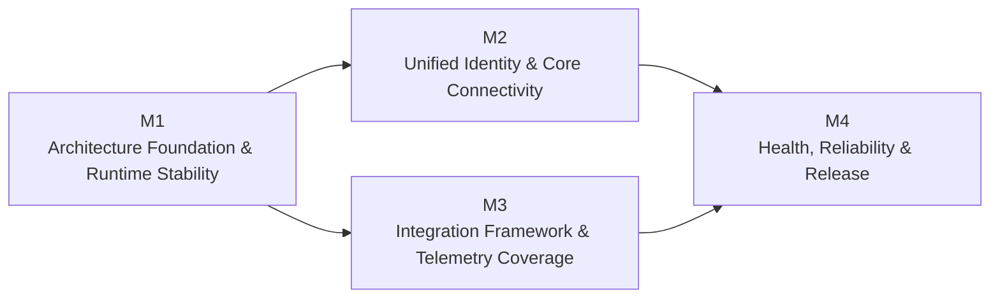

# Roadmap — Telemetry Agent v0.1.4

Architecture baseline: 26 October 2026

Because this is a solo-developed project and the goal is to ship Telemetry Agent v0.1.4 as soon as possible, this roadmap is divided into four major milestones. Each milestone delivers a capability that can run and be tested.

The work is not divided by module or bounded context, since that can lead to prolonged architectural refactoring without delivering new functionality.

## M1 — Architecture Foundation & Runtime Stability

**Target:** The Agent runs reliably on the new reconciliation-driven architecture.

- Establish bounded contexts, interfaces, and dependency direction.
- Implement the reconciliation loop, desired/applied state, and configuration activation.
- Add SQLite persistence, revision tracking, and restart recovery.
- Preserve the existing CLI, exporters, Collector supervision, and host telemetry.

**Done when:** The Agent can be installed, collect host metrics, apply configuration changes, and recover after restart without regressions.

## M2 — Unified Identity, Registration & Core Connectivity

**Target:** The Agent operates as an independent installation on a host or VM and connects to AR-IMMS Core.

- Implement installation identity and registration binding.
- Implement registration, credentials, and the authentication lifecycle.
- Add Core configuration synchronization and status reporting.
- Support local-first operation while Core is offline.

**Done when:** Agents on hosts and VMs register independently, receive desired configuration from Core, and continue collecting telemetry when Core is unavailable.

## M3 — Integration Framework & Telemetry Coverage

**Target:** Integrations can be added without changing the Agent's core orchestration.

- Add Integration Definition and Instance models, a registry, and minimal extension contracts.
- Implement basic resource discovery and integration configuration compilation.
- Add Redis, PostgreSQL, and MongoDB integrations.
- Collect application metrics and logs through suitable OpenTelemetry capabilities.

**Done when:** Integrations can be enabled, disabled, and reconfigured; data is collected from real services and sent to the Gateway. Adding an integration that uses an existing receiver does not require changes to the Reconciler.

## M4 — Health, Reliability & Release v0.1.4

**Target:** The Agent is reliable enough to support the AR-IMMS monitoring flow.

- Add the Health context, integration diagnostics, and `HealthChanged` events.
- Implement configuration failure handling, recovery, and last-known-good behavior.
- Test Core outages, Gateway outages, integration failures, and concurrent configuration updates.
- Package for Windows and Linux and run end-to-end regression tests.

**Done when:** The Agent runs reliably on Windows and Linux, on hosts and VMs; recovers from failures; and provides the telemetry and health status required for monitoring.

## Delivery principles

- **No big-bang rewrite:** Preserve working functionality and migrate incrementally to the target architecture.
- **Every milestone must run:** Do not merge a collection of abstractions without an integration test.
- **Do not build an SDK too early:** Use Redis as the reference implementation, then derive the extension contracts from it.
- **Do not defer testing until M4:** Each milestone must include its corresponding regression tests.
- **Prefer vertical slices:** Avoid implementing every context in isolation before connecting them.

## Priority and dependencies

M1 is the foundation for further work. Some parts of M2 and M3 can proceed independently once M1's foundational contracts are stable. M4 verifies and packages the capabilities required for v0.1.4.

## Scope guardrails

Automatic health-triggered rollback, dynamic plugin loading, full auto-discovery, and distributed reconciliation are not required to ship v0.1.4. Safe recovery and clear error reporting are required.

Keep M1 strictly scoped: refactor only as much as needed to support the configuration lifecycle and subsequent integrations. This milestone has the greatest risk of consuming too much time if architectural optimization takes priority over delivering functionality.

## Related architecture

Milestones follow the accepted [Target Architecture v0.1.4](../architecture/target-architecture-v0.1.4.md). They describe delivery order and acceptance outcomes; they do not change the architecture decisions or resolve the open implementation questions in that baseline.
