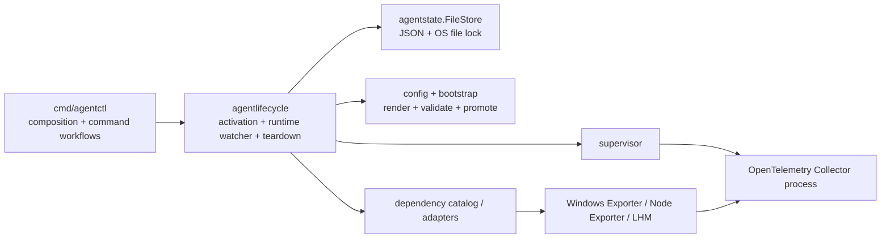
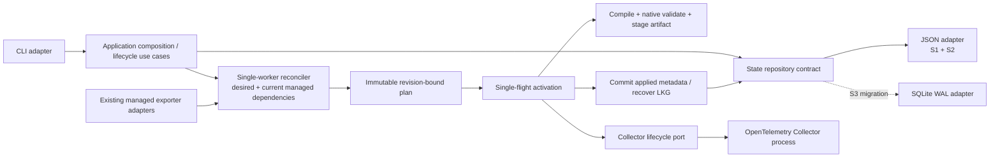
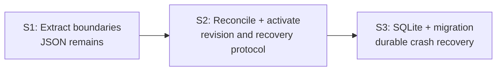

# M1 Architecture Refactor Plan

> **For agentic workers:** Use `superpowers:executing-plans` for inline execution or `superpowers:subagent-driven-development` for delegated execution. Implement one slice at a time and keep each slice reviewable.

**Goal:** Evolve the current Agent into M1’s bounded, reconciliation-driven configuration lifecycle while preserving current CLI, Collector, installation, host telemetry, and managed exporter behavior.

**Architecture:** S1 extracts only composition and lifecycle-related workflows from the CLI and puts persistence behind a small contract while continuing to use the JSON file adapter. S2 adds a single-worker deterministic reconciler for current persisted state, with revision-bound plans and serialized activation outside persistence locks. S3 adds SQLite, migration, activation journaling, last-known-good artifacts, and restart recovery. The Agent and Collector remain separate processes.

**Tech Stack:** Go; existing pinned OpenTelemetry Collector; current JSON state adapter for S1/S2; SQLite WAL adapter in S3 after driver validation; Windows and Linux.

**Spec:** `docs/architecture/target-architecture-v0.1.4.md`; M1 slices and review decisions in `.scratch/tickets/` and the accepted review supplied with this plan.

## Implementation Status — 2026-10-26

S1, S2, and S3 implementation is complete and ready for review. The implementation uses `modernc.org/sqlite` v1.59.0 as selected by the user; JSON state is imported into SQLite on first access and the source JSON file is preserved. Configuration activation uses in-process serialization and a cross-process OS lifecycle lock. Plans are bound to immutable state snapshots, stale revisions are rejected, activation intent is persisted before config promotion, and readiness commits the exact launch snapshot as last-known-good.

Verification completed on Windows: `go test ./... -count=1`, `go vet ./...`, and `go build ./...` passed. Linux amd64 and Windows amd64 cross-builds passed. Native Linux execution remains for the new CI matrix; Windows/Linux packaging and service recovery remain outside this implementation plan's local verification.

## Global Constraints

- Preserve current CLI commands and behavior, Collector supervision, exporters, host telemetry, Windows/Linux support, installation ownership, and safe teardown ordering.
- Do not implement SQLite before S3, a generalized integration framework, discovery, an event bus, or Core synchronization in M1.
- S1 does not add reconciliation or change runtime behavior.
- S2 initially reconciles current persisted desired state and managed dependency definitions only; discovery and integration instances are M3 inputs.
- Use one serialized activation worker. Keep repository transactions short and state-only; use the dedicated cross-process OS lifecycle lock across config promotion and managed-resource teardown where side-effect exclusion is required.
- Every non-test Go source file must remain at or below 450 lines.
- Keep package dependencies acyclic and add `doc.go` for any new Go package.
- Keep Collector receivers, processors, exporters, batching, retry, and telemetry processing in OpenTelemetry Collector.
- Do not run tests/builds during planning; implementation must establish regression baselines before refactoring and verify affected Windows/Linux behavior.

## Review Focus

- State changes during validation or Collector restart must not allow an older plan to overwrite or acknowledge a newer desired generation; pin with stale-plan/revision tests in S2.
- A crash after config promotion but before state commit must recover to a known committed revision; pin candidate/commit crash windows in S2/S3.
- A teardown that succeeds before its completion record persists may be retried; pin idempotent teardown/recovery behavior in S2/S3.
- Missing state-file parent directories must not leave a bootstrapped Collector without persisted Agent state; pin fresh bootstrap behavior in S1.
- SQLite migration interruption must preserve installation and managed-resource ownership; pin repeatable migration and recovery behavior in S3.

---

## 1. Current Structure

```text
cmd/agentctl
  main.go                         CLI entry, production wiring, catalog, workflows (1,237 LOC)
  dependency_command.go           dependency parser and handlers (688 LOC)
  dependency_lifecycle.go         managed dependency workflows
  agent_uninstall.go              ownership-aware uninstall workflow

internal/
  agentstate/                     State model + JSON FileStore and OS locks
  agentlifecycle/                 activation, runtime watching, health, deferred teardown
  bootstrap/                      pinned Collector install + config validation/promotion
  config/                         layered rendering, validation, atomic config writes
  supervisor/                     Collector process/readiness/shutdown
  agentinstallation/              Agent install layout, service adapters, ownership-aware removal
  dependency/                     managed exporter catalog and installation adapters
  agenthealth/                    local runtime health snapshot and HTTP endpoint
  identity/                       platform and host identity
```

Current lifecycle flow:



The current `State` already has desired, activated, and applied generations, plus dependency ownership and pending teardown. Preserve these invariants and evolve the lifecycle around them.

## 2. Expected Structure After M1

The layout below describes responsibility seams. New paths are proposed, not pre-existing APIs; final filenames should follow cohesive extraction and the 450-line limit.

```text
cmd/agentctl
  main.go                         process startup + command dispatch
  composition.go                  production adapter construction and wiring
  command files                   CLI parsing/output, each <=450 LOC

internal/agentstate
  state.go                        domain state and generation invariants
  repository.go                   small persistence contract
  file_store.go                   current JSON adapter for S1/S2

internal/agentlifecycle
  configuration.go                lifecycle use case via repository contract
  reconcile.go                     current-input deterministic planner (S2)
  activation.go                    single-flight candidate apply/verify/commit (S2)
  teardown.go                      safe, recoverable deferred teardown
  runtime.go                       Collector watch/restart interaction

internal/bootstrap + internal/config
  existing Collector install, render, native validation and promotion
  revision-bound candidate and last-known-good artifacts (S2/S3)

internal/agentstate (S3 adapter) / persistence seam
  SQLite WAL implementation, schema migration, JSON import, activation records
```

Expected M1 flow:



S3 may choose a concrete storage-package location after driver and migration validation. Do not create a generic persistence framework beyond the repository seam the current lifecycle needs.

## 3. Decisions and Scope

| Topic | Plan decision |
|---|---|
| Process topology | Keep Agent and Collector as two independently restartable processes. |
| S1/S2 persistence | Keep JSON during boundary extraction; introduce SQLite only in S3 behind the repository contract. |
| S2 reconcile inputs | Current persisted desired state plus existing managed dependency definitions; no discovery or integration-instance model. |
| Reconciliation execution | One worker; deterministic immutable plan; re-read state before commit and reject stale revision. |
| Activation | Single-flight; do not hold repository locks during render, validation, filesystem promotion, process restart, or readiness checks. |
| Verification | Collector readiness is the M1 runtime gate. Detailed integration health evidence is M4. |
| Recovery | Persist candidate/applied metadata and a last-known-good config artifact; exact crash-window protocol is implemented and tested across S2/S3. |
| Event bus | None in M1. Existing calls or a local wake-up signal can trigger reconcile; durable state remains authoritative. |
| CLI scope | Extract composition and M1 lifecycle/configuration workflows. Split command files as required by the 450-line rule; leave unrelated command behavior unchanged. |
| Package structure | Change packages only when a real responsibility seam requires it. |
| SQLite driver | Use `modernc.org/sqlite` v1.59.0, a pure-Go driver, to avoid CGO requirements on Windows/Linux. |

## 4. Slice Plan

### S1 — Extract Boundaries

**Outcome:** Thin CLI composition around current workflows and remove lifecycle’s compile-time dependency on concrete `FileStore`, with no behavior change.

**Candidate files:**

- Modify `cmd/agentctl/main.go`: retain process startup and dispatch; move production wiring/catalog and M1 lifecycle workflows into focused files.
- Modify/split `cmd/agentctl/dependency_command.go`: retain existing command parsing/output; split handlers enough to satisfy the line limit without changing unrelated behavior.
- Modify `cmd/agentctl/dependency_lifecycle.go` and `cmd/agentctl/agent_uninstall.go` only where composition/workflow extraction requires it; preserve safe ordering.
- Add a small state repository contract in `internal/agentstate`; keep `FileStore` as the only production adapter.
- Update `internal/agentlifecycle` constructors/fields to depend on the repository contract.
- Add missing package documentation only for packages touched or newly introduced; `doc.go` cleanup is not a blocker for M1.

**Implementation tasks:**

1. Establish the baseline by running existing focused tests and recording CLI help, status, install/bootstrap, dependency lifecycle, and rendered configuration behavior. Include a test for bootstrap when the state parent directory is missing.
2. Extract production composition and catalog construction from `main.go`; preserve the same concrete implementations and command behavior.
3. Extract configuration/install/uninstall lifecycle workflows from CLI dispatch while leaving unrelated commands behaviorally untouched.
4. Split oversized command source files by cohesive command responsibility until every non-test Go file is <=450 LOC.
5. Define the minimal repository contract required by current lifecycle code and make `FileStore` satisfy it; update lifecycle constructors without changing callback semantics in this slice.
6. Run focused tests, `go vet ./...`, `go test ./...`, `go build ./...`; review import graph and changed file line counts. Run affected OS-specific checks on Windows and Linux before claiming cross-platform acceptance.

**S1 acceptance:** Existing CLI behavior, install/start/stop, Collector, host metrics, exporters, and teardown ownership are preserved; lifecycle no longer names the concrete `FileStore`; no import cycle; all non-test Go source files are <=450 LOC.

### S2 — Reconcile & Activate

**Outcome:** Current configuration changes flow through a deterministic, revision-bound plan and recoverable activation sequence.

**Implementation tasks:**

1. Add plan input/output types limited to current desired state and managed dependencies. Include source revision and deterministic configuration digest; do not add generic discovery interfaces.
2. Add a single-worker reconcile loop/entry point. Repeated input with the same digest must be a no-op; an in-flight older revision must not be committed as a newer desired revision.
3. Separate state reads/commits from external activation work. Serialize activation in process and across Agent processes with a dedicated OS lock; never hold a repository transaction during compile, validation, promotion, restart, teardown, or readiness checks.
4. Reuse existing config renderer and native Collector validation. Stage candidate artifacts with revision/digest metadata; do not replace the committed artifact before validation succeeds.
5. Apply candidate through existing Collector lifecycle/supervision; use readiness as the runtime gate. Commit applied metadata only if the plan revision remains current.
6. Preserve deferred dependency teardown: execute only after Collector confirms the revision that removed its receiver; coordinate teardown and re-enable/install operations with the OS lifecycle lock and persist outcome so a retry is safe.
7. Add fault tests for unchanged digest, invalid config, stale desired revision, readiness failure, crash/save failure after promotion, and teardown replay.
8. Run focused tests, `go vet ./...`, `go test ./...`, `go build ./...`; validate Collector config and execute affected Windows/Linux lifecycle checks.

**S2 acceptance:** Unchanged config does not restart Collector; invalid config does not replace active config; stale plans do not advance newer desired state; failed activation leaves a recoverable known-good config; safe teardown ordering remains intact.

### S3 — SQLite & Recovery

**Outcome:** One SQLite `state.db` in WAL mode becomes operational state persistence with repeatable JSON migration and restart recovery.

**Implementation tasks:**

1. Validate SQLite driver options against Windows/Linux, Go version, packaging, CGO requirements, and deployment constraints. Record the selected driver and migration approach before adding the dependency.
2. Define schema/migrations for desired state, generation/revision metadata, integration/dependency ownership, pending teardown, installation records, and activation journal. Keep secrets out of SQLite.
3. Implement the SQLite repository adapter behind the S1 repository contract; keep transactions short and contain no external I/O.
4. Implement idempotent migration from current JSON state, preserving Collector context, Agent installation ownership, dependency ownership resources, and pending teardown state.
5. Implement activation recovery from journal + candidate + last-known-good artifacts for crashes around config promotion, Collector readiness, and state commit.
6. Add migration interruption/retry, legacy state import, database transaction concurrency, restart recovery, and failed activation tests.
7. Run focused tests, `go vet ./...`, `go test ./...`, `go build ./...`; run Windows/Linux service and restart recovery checks.

**S3 acceptance:** Agent restart restores the committed Collector configuration and host telemetry; migration can be retried safely; failed activation preserves the committed configuration and managed-resource ownership; no external side effect occurs inside a database transaction.

## 5. Dependency Order



Do not start S2 until S1’s repository seam and behavior-preserving workflow extraction are reviewed. Do not select or implement SQLite until S3 driver/platform validation is complete. M2 Core connectivity, M3 discovery/integration framework, and M4 expanded health/release work remain outside this M1 plan.

## 6. Main Risks and Mitigations

| Risk | Mitigation |
|---|---|
| CLI behavior changes during file extraction | Capture command and config baselines first; move functions with narrow diffs and keep output/flags stable. |
| Repository contract mirrors the current FileStore too literally | Keep only operations needed by real consumers; S2 replaces side-effect callbacks with explicit read/commit steps. |
| Config promoted but state commit fails | Persist activation intent and an immutable previous-config artifact before promotion; restore it on commit failure or startup recovery. |
| Old reconcile completes after desired state advances | Bind plan to source revision and compare current revision before commit. |
| Separate Agent processes activate or roll back concurrently | Hold a dedicated OS lifecycle lock across promotion/rollback side effects without holding a database transaction. |
| Teardown repeated after crash | Keep teardown idempotent and ownership-scoped; persist intent and completion around the applied-generation gate. |
| SQLite adds platform/packaging complexity | Validate driver and CGO/build implications before dependency addition. |
| S1 expands into architecture rewrite | Limit S1 to CLI composition, M1 workflow extraction, repository contract, <=450 LOC, and regression preservation. |

## 7. Not in M1

- Core registration, credentials, synchronization, and reporting (M2).
- Resource discovery, integration definitions/instances, and developer extension contracts (M3).
- Detailed integration health probes, `HealthChanged`, and release hardening beyond required M1 regression checks (M4).
- Arbitrary dynamic Go plugins, generalized event bus, multi-worker reconciliation, automatic health-triggered rollback, or multi-Collector sharding.

## 8. Plan Review Checklist

- [ ] S1 is limited to composition/workflow extraction and persistence decoupling; no reconciliation or SQLite.
- [ ] Reconciler input is limited to current persisted desired state and managed dependency definitions until M3.
- [ ] CLI, Collector, host telemetry, exporters, platform support, installation ownership, and teardown ordering are explicit acceptance requirements.
- [ ] Every production Go file is constrained to <=450 LOC.
- [ ] S2/S3 recovery tests cover stale revisions and cross-resource crash windows.
- [ ] SQLite driver/platform choice remains an S3 validation decision, not an assumed implementation detail.
