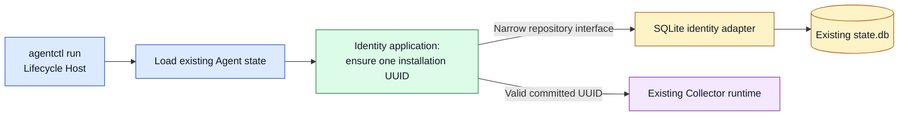

# M2 Local Installation Identity Implementation Plan

**Goal:** Give each Agent installation a durable UUID before Collector runtime starts, while preserving M1 state and behavior.

**Spec:** [M2 Local Installation Identity Design](../../architecture/m2-local-installation-identity-design.md) and [Target Architecture v0.1.4](../../architecture/target-architecture-v0.1.4.md). This plan covers the local identity slice only.

## 1. Implementation Approach

The Lifecycle Host loads the existing Agent state, asks the Identity module to ensure an installation ID, and then starts the existing Collector runtime. Identity policy and UUID validation stay in `internal/identity`; SQLite transactions and migration stay in `internal/agentstate`. A narrow repository interface connects them. No Collector, configuration, or host-fingerprint behavior changes.



**Approved clarification:** Version 2 in `schema_migrations` records the table structure only. Its migration creates the table, seeds one uninitialized singleton row, and records version 2 in the same transaction. The Identity module generates a candidate UUID; the SQLite repository atomically writes it only for an uninitialized row and always returns the committed UUID, including when another initializer won the race. A separate row state distinguishes uninitialized from initialized identity. If version 2 exists but its table/row is missing, or an initialized UUID is invalid, return an error. Do not recreate the row or rotate the ID.

Reuse the existing WAL database, immediate transaction mode, busy timeout, and JSON import path. Identity generates UUIDv4 candidates through an injected randomness source; the Lifecycle Host supplies `crypto/rand.Reader`. This keeps Identity independent of SQLite, CLI, and OS service code. Existing desired/activated/applied generations and ownership state remain untouched. Clones receive IDs only after the Agent is installed separately on each clone.

The current uninstall removes `state.db`; the approved retain-by-default uninstall policy remains a separate lifecycle change. This slice verifies identity persistence through restart and upgrade/repair with state reuse.

## 2. Draft Code Structure

```text
internal/identity/
  installation_id.go                 NEW     UUID value, generation, validation (Domain)
  installation_identity.go           NEW     ensure-once policy and narrow repository interface (Application)
  installation_identity_test.go       NEW     valid/invalid IDs, generation, and repository-returned identity
  doc.go                              MODIFY  document installation identity responsibility

internal/agentstate/
  sqlite_schema.go                    MODIFY  atomic schema-v2 migration; separate initialization state
  sqlite_identity.go                  NEW     SQLite adapter for identity repository (Infrastructure)
  sqlite_identity_test.go             NEW     migration, concurrency, corruption, and legacy-state cases
  repository.go                       MODIFY  share existing .json/.db path resolution with identity adapter
  doc.go                              MODIFY  document the identity table and ownership

cmd/agentctl/
  installation_identity.go           NEW     load and validate existing state, then initialize identity
  collector_command.go               MODIFY  run identity preparation before runtime launch
  composition.go                     MODIFY  wire production identity preparation through one testable seam
  run_lifecycle_test.go               MODIFY  assert ordering and startup failure behavior
```

`internal/identity/machine.go`, `internal/agentlifecycle`, `internal/agentinstallation`, Collector configuration, and uninstall/remover files remain unchanged. Keep `composition.go` and every other non-test Go file at or below **450 LOC**; it is currently about 410 lines, so wiring there must stay small.

## 3. Implementation Steps

1. **Identity contract:** Add the UUID value and an application operation that generates a candidate and accepts the repository's committed ID through a narrow `EnsureInstallationID(candidate)` interface. Test first creation, reuse, malformed repository results, and randomness failure. The host fingerprint remains independent.
2. **SQLite storage:** Add atomic schema v2 with a singleton uninitialized row, then implement transactional `EnsureInstallationID`. Test fresh and M1 databases, legacy JSON import, simultaneous startup attempts, missing/invalid initialized state, and unchanged configuration generations. Do not reseed a missing row after v2 is recorded.
3. **Startup wiring:** Compose state load and identity ensure before the status listener and Collector runtime. Add an injectable preparation seam for current CLI tests. Verify identity failure prevents Collector launch; repeat start and upgrade-compatible state reuse return the same ID. Keep installation and removal code untouched.
4. **Verification:** Run focused identity/SQLite/CLI tests, then `go vet ./...`, `go test ./...`, and `go build ./...`; check changed non-test Go file lengths. Require the existing native Linux and Windows CI jobs, plus a Collector startup smoke check, before claiming cross-platform runtime acceptance. Record any unavailable platform check as unverified.

## 4. Risks / Open Questions

- **Review the schema refinement:** `schema_migrations` tracks table structure; the identity row tracks initialization. The approved design currently uses one marker for both. This plan makes the distinction explicit to prevent silent regeneration after row loss.
