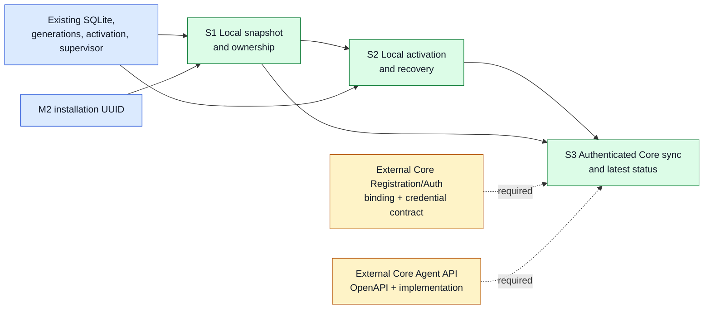
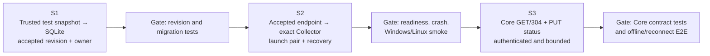

# M2 Core Gateway Endpoint Sync Implementation Plan

> **For agentic workers:** REQUIRED SUB-SKILL: Use superpowers:subagent-driven-development or superpowers:executing-plans after both documents are approved. Execute one slice at a time with focused tests and review before continuing.

Status: **Draft for developer review**, 28 October 2026. No code is authorized by this document alone.

**Goal:** Synchronize the first Core-owned setting, the OTLP Gateway endpoint, without losing Bootstrap operation, local dependency state, or a known-good Collector runtime.

**Architecture:** Accept revisioned snapshots through a Configuration use case and a narrow SQLite port. Reuse M1 generation/activation and Collector supervision for a config-plus-endpoint runtime pair. Add authenticated Core polling and one durable latest-status slot only when the Core Registration/Auth and API contracts exist.

**Tech stack:** Go, existing `modernc.org/sqlite` WAL state, pinned `otelcol-contrib` on Windows/Linux, REST/JSON over HTTPS.

**Spec:** [M2 Core Gateway Endpoint Sync architecture design](../../architecture/m2-core-gateway-endpoint-sync-design.md); Target Architecture v0.1.4. The design's proposed API is not an approved Core contract.

## Global constraints and review focus

- Preserve current CLI, M2 installation UUID, M1 SQLite state/legacy import, dependency ownership/teardown, Collector process split, and local last-known-good behavior.
- Core owns only the Gateway endpoint after the first authenticated, valid snapshot is committed. `core_api_url` remains local. Never use installation ID alone as authorization.
- Keep Domain/Application policy independent of SQLite, HTTP, CLI, and OS service code. Add only narrow ports at real boundaries; no generic sync, event-delivery, or configuration framework.
- Keep every non-test Go file **≤450 LOC**; `state.go` is currently 435, `composition.go` 412, `runtime.go` 401, and `supervisor.go` 402 lines. Extract focused helpers before these grow beyond the limit.
- Add GoDoc to new exported identifiers and comments only for policy, transaction, concurrency, and recovery invariants. Preserve meaningful structured errors; never log credentials.
- Review failure cases in the owning slice: concurrent Core/local updates, first-sync SQLite failure, same-revision/different-content conflict, stale health listener, crash between activation and applied commit, revoked binding, and lost status acknowledgment.

## Dependencies and delivery order





S1 and S2 are locally testable with an injected trusted snapshot. They do **not** establish production Core connectivity. S3 is blocked until Core authorizes a machine credential against the installation binding and serves the approved API.

## Draft code structure

`NEW`/`MODIFY` are proposals, not an instruction to create every file regardless of need. A test file sits beside each new behavior; test files are exempt from the LOC limit.

```text
internal/coreconfig/                    NEW     Snapshot/revision/ownership policy; narrow desired-state port (S1)
  doc.go, snapshot.go, acceptance.go    NEW     Pure rules and acceptance use case
  reconcile.go                         NEW     Immutable endpoint plan, no process operations (S2)
internal/agentstate/                    EXISTING SQLite adapter; one state.db
  sqlite_schema.go                     MODIFY  Additive Core snapshot/recovery/outbox schema (S1/S2/S3)
  sqlite_core_gateway.go               NEW     Atomic snapshot, owner, and generation update (S1)
  sqlite_gateway_activation.go         NEW     Core↔local revision mapping and good-pair journal (S2)
  sqlite_status_outbox.go              NEW     One coalesced latest-status slot and sequence ack (S3)
  repository.go                        MODIFY  Expose narrow repository constructors without cycles (S1)
internal/agentlifecycle/               EXISTING configuration activation and runtime control
  collector_configuration.go           MODIFY  Validate the resolved candidate endpoint (S2)
  gateway_runtime.go                   NEW     Generation-bound endpoint/config launch and recovery (S2)
  runtime.go, rollback.go              MODIFY  Delegate endpoint selection and paired rollback (S2)
  activation_recovery.go               MODIFY  Recover interrupted config/endpoint activation (S2)
internal/supervisor/                   EXISTING Collector process adapter
  generation_readiness.go              NEW     Bind readiness to the new child and reject stale listeners (S2)
  supervisor.go                        MODIFY  Use the focused readiness helper (S2)
internal/coresync/                     NEW     Bounded poll/report application loops and ports (S3)
  doc.go, poller.go, status.go          NEW     No HTTP or SQLite implementation dependency
internal/corehttp/                     NEW     HTTPS snapshot/status adapter for approved Core API (S3)
  doc.go, client.go                    NEW     Strict response, auth, and Problem Details handling
cmd/agentctl/                          EXISTING composition root
  core_sync_wiring.go                  NEW     Focused worker/adapter wiring; keep composition.go ≤450 (S3)
  composition.go, collector_command.go MODIFY  Start/stop bounded sync workers with runtime (S3)
Core backend (separate repository)     EXTERNAL  New Agent OpenAPI and owned module implementation (S3 blocker)
```

Keep `internal/agentstate/state.go` and the existing local dependency commands free of Core ownership fields where possible; a separate Core snapshot row and mapping avoid changing the M1 JSON shape. Add test files beside the listed source files only for behavior each slice introduces.

## S1 — Local configuration foundation

| Item | Delivery |
|---|---|
| Scope | Validate a one-field Core snapshot, compare revisions, store it with Core ownership in one SQLite transaction, and resolve the effective endpoint. No network client, registration, Collector restart, or status sender. |
| Goals | First valid accepted snapshot changes ownership atomically; Bootstrap remains the seed. A changed effective endpoint advances local desired generation; a higher Core revision with the same endpoint updates Core mapping without creating a local generation. |
| Acceptance criteria | Tests cover first sync, identical equal revision, stale lower revision, equal revision/different content, Core rollback at a new higher revision, invalid endpoint, SQLite commit failure, concurrent acceptance/local CLI update, Bootstrap rerun, legacy JSON import, restart, and preserved dependency ownership. No partially committed owner/snapshot/generation state. |
| Dependencies | Existing installation UUID, `agentstate.NewStore`/WAL and M1 generation model; the accepted design's ownership rules. Production ingress remains blocked on Auth/Core. |
| Delivery | `coreconfig` policy plus `agentstate` adapter/migration and focused tests. An internal test ingress can accept a trusted snapshot; the Agent still runs from Bootstrap or existing local state without Core. |

## S2 — Generation-bound activation and recovery

| Item | Delivery |
|---|---|
| Scope | Compute an immutable, stale-checked endpoint plan from S1 state; feed it into existing validation/activation, bind config bytes and endpoint to one local generation, restart only when runtime input changes, and recover the pair. No Core HTTP or Gateway delivery gate. |
| Goals | Record accepted/activated/applied Core revisions separately with local-generation associations. A higher same-endpoint revision reuses a matching, ready child; a changed endpoint launches a new child with the correct environment value. |
| Acceptance criteria | Fake-child tests reject prior/stale health listeners, verify old child exit before new readiness, and prevent an older launch from applying a newer revision. Failure before/after config promotion or before applied commit restores the prior good YAML/endpoint pair after restart; desired Core revision remains accepted. Same endpoint causes no restart. Existing dependency activation/teardown tests remain green. Run native Windows/Linux integration checks and a pinned Collector smoke test for HTTP-200 readiness with the selected generation. |
| Dependencies | S1; existing lifecycle lock, config validator/recovery artifact, runtime watcher, supervisor and `health_check` extension. Numeric retry policy may be finalized during implementation but must be bounded and persist failed revision to avoid a busy loop. |
| Delivery | Focused `agentlifecycle`/`supervisor` helpers plus SQLite activation mapping and tests. The local accepted-snapshot-to-Collector path works without Core; no end-to-end Core claim. |

## S3 — Authenticated Core sync and latest-status reporting

| Item | Delivery |
|---|---|
| Scope | Add HTTPS snapshot polling, conditional GET/304, Problem Details handling, bounded retry, and one durable coalesced status slot with idempotent PUT acknowledgment. Keep API URL local; no SSE/event replay, integration settings, or general outbox. |
| Goals | Only a credential authorized against the installation/registration binding can fetch/report. Revoked/mismatched bindings fail closed. Core outages leave S2's good pair running and reports queued; reconnect resumes from the last accepted revision. |
| Acceptance criteria | Core contract tests cover 200/304, invalid and stale payloads, same-revision conflict, 401/403/revocation, 404, 429/5xx/timeout, lost acknowledgment, report replacement during retry, and Core-initiated rollback at a higher revision. End-to-end Windows/Linux checks verify offline restart, reconnect, exact endpoint at Collector, and status acknowledgment using the approved Core service. |
| Dependencies | S1 and S2; approved Core Agent OpenAPI/implementation, registration binding, credential issuance/storage and revocation behavior, plus approved Gateway address/TLS policy. If these are absent, complete only testable local work and leave S3 blocked. |
| Delivery | `coresync` application loops, `corehttp` adapter, SQLite latest-status slot, focused composition wiring; corresponding Core OpenAPI/module work in its own repository and review. M2 Core-sync completion is claimed only after these external prerequisites and E2E tests pass. |

## Verification and blockers

For each slice: run focused tests first, then `gofmt` on changed Go files, `go vet ./...`, `go test ./...`, `go build ./...`, and check every changed non-test Go file is ≤450 LOC. S2/S3 also require native Windows/Linux checks and the pinned Collector smoke scenario. Do not treat a Linux cross-build or fake readiness server as native runtime proof. Review the diff against this plan and the accepted architecture after each slice.

**External blockers before S3 implementation:** Core Agent route/module ownership and OpenAPI approval; machine credential and registration binding including revocation; allowed Gateway addresses and TLS policy. The current Core `api/v1/` contains IAM, Asset & Topology, and Audit contracts, with no Agent sync/status contract. Current `configs/base/otel.yaml` sets `tls.insecure: true`; do not silently extend that security posture to an arbitrary Core-provided address. No production polling or reporting is complete while these decisions remain open.
